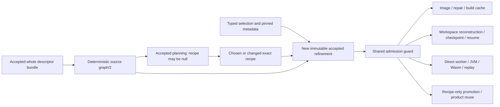
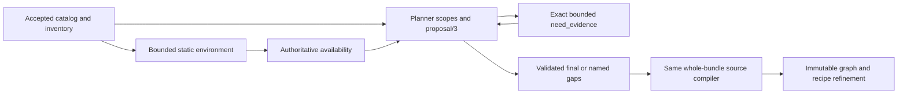

# Target build topology and bounded iterations

## Current graph/2 source contract

The current source introduces `appsec-review/build-topology/2`, compiled once from the complete
accepted bounded descriptor bundle. Physical path, raw SHA-256, declaring line/span, rule,
subject and stage remain attached to facts/bindings. Recipe choices and model-proposed edges
cannot change graph bytes. Conditional, candidate and unresolved relations do not become
unconditional scheduling edges; active required unknowns block execution before caches.

Selection intent is a typed policy, not an observation. Its OS, ISA, ABI, SDK, deployment,
device/simulator and hardware-generation axes are distinct and nullable. With no policy table,
legacy defaults request Windows x64 only for MSBuild/VCBuild and Linux x64 only for
Make/Autotools/CMake. Other native operations, including Go, require an explicit applicable
rule or override; missing policy is not a host fallback or mobile selection. The shipped TOML
separately supplies explicit .NET/Go/Rust/mobile rules. Explicit unit/root rules can select
another confirmed platform. Equal-specificity conflicts
block. Project declarations, including 32-bit ones, remain in the graph without granting
permission to select or build prohibited 32-bit code. Mobile hardware/device policy is not
fabricated.

`appsec-review/build-topology-refinement/1` binds the complete graph, source/bundle identity,
selection policy, exact chosen recipe, releases, selected operations and compiler metadata.
Accepted planning with a null recipe records `recipe_missing`, null recipe/operation bindings
and unknown enforcement. Choosing a deterministic recipe, repairing it or selecting a promotion
creates a new immutable accepted refinement; the original plan, graph and previous receipts
are not rewritten. Accepted entries live in `data/build/topology/accepted-refinements.json`
and resolve immutable artifacts beneath `artifacts/build/topology/`.



Native enforcement has four closed proof kinds: selected MSBuild mapping, explicit compiler
target, pinned compiler default and explicit Go target. A selected `.sln` member, its captured
descriptor and requested operation determine managed/native classification; the driver's
family does not. A Release solution can legitimately map to a Debug x64 project. Uncaptured
members stay unknown. Managed x86 and applicable AnyCPU executable Prefer32Bit remain managed
incompatibilities. Unresolved imports, options, wrappers or dynamic conditions taint proof.
Compiler basenames, image labels, host hints and `-m64` alone never prove Linux native targets.

Android declarations retain their declaring module/path. `apply false` is not plugin execution;
literal settings modules and project-directory mappings scope module facts. D8/R8 and ABI filters
are not native-compilation proof. Requested external-native stages require their own enforced
target, not an Android family exemption.

Retained products carry an exact role and seven-axis contract. Static archives, Windows import
libraries, runtime DLLs, executables, native objects and metadata cannot substitute for each
other. Byte-derived native roles and accepted producer/consumer axes are checked before reuse.
ELF, PE/COFF and thin Mach-O machine/class headers are checked against the accepted ISA.
Archive checks cover every bounded member, not only the first object or a `.lib` suffix.
Unknown, mixed or 32-bit members cannot inherit an x64 label. Import libraries require positive
import-member evidence; native symlink products resolve through their pinned generation.
Direct generic/JVM/Wasm workers admit exact retained interfaces before cache access, and their
cache keys include those interfaces. Selected replay verification reads immutable generation/CAS
custody without acquiring a nested production writer or restoring trial products into production.
Produced Go build settings and binary machine/class must agree with accepted target proof;
unparseable or mismatched metadata fails before typed successful publication.

Graph/1 remains readable and auditable; it grants neither graph/2 readiness nor authority to
reuse old build receipts. Generic unrelated job caches retain their previous lifecycle.
Content-keyed derivation memoization follows bounded raw-artifact integrity reads, never mutable
pointer/mtime trust.

**Verification limit:** V1 original `8ac764c0c4d8fa5582922adb0587512614158ef8` was independently
verified at 83 functions/173 passing cases. The V2 source additions below are authored, not yet
unit-tested, replayed or live accepted. Real compiler-profile acquisition is absent; optional metadata intake and explicitly
synthetic unit controls are not a probe or provisioning path. Unsupported compiler/wrapper
closure remains a named unknown. The 295-unit/120-second offline budget and 16 MiB graph bound
are requirements, not measured acceptance results. The source-history receipts below describe
the earlier implementation only.

### V2 static environment and bounded feedback source

The default-enabled environment producer precedes planning in both review composites, with
explicit disabled transparency and strict expected-current versus optional-prior availability.
Its source declarations are advisory. Missing/changed expected publications block; recognized
bounded analysis gaps do not become proof. See the [availability matrix](../operations/build-environment-analysis.md).

Proposal/3 partitions deterministic bounded scopes, accepts exact additive evidence requests and
requires one recipe or abstention per unit. It shares the same whole-bundle compiler and immutable
recipe-bound refinements; there is no model topology compiler. Complete-only caches bind source,
environment, profiles, rules, guidance/model identities and bounds. Unity settings/plugin metadata
and ancestor-scoped Dockerfile declarations retain raw scoped partial observations, including
unselectable 32-bit declarations, without inventing target selection or image-native proof.
The source rule identity is `source-scoped-topology/3`; older graph/2 rule receipts require
replanning rather than borrowing a prior compiler result. Graph/1's schema remains unchanged.



The manually selected actual-capture R8 driver is authored NOT RUN, with genuine original `acf973f8`
baseline custody and a separately pinned candidate. Its full intake, actual plan/publication/read/
selection/preflight, explicit external doubles and whole-produced-byte measurements are described
in [planning operations](../operations/target-analysis-planning.md#r8-authoring-not-a-measured-result).
Neither 173 V1 passes nor parser timing establishes that replay's outcome or budget.

Native image derivation also requires prebound compiler/recipe metadata before image cache
access; knowing only the base image does not authorize a newly derived image. Thin archives,
fat/universal native containers, unsupported archive members and absent compiler closure remain
explicit unsupported/unknown inputs. Go's build-facts intake remains ELF-only; Windows PE Go
build settings are not silently synthesized. CGO needs separately closed C compiler/linker proof.

## Status and evidence boundary

**SOURCE INTEGRATED; LIVE ACCEPTANCE UNESTABLISHED:** the initial source publication is
`8ea90ee18bd16798d91d4ce3aceaa8ddc93c157a`, tree
`f9f6b20ae09c17c6aaaed588b83de8c301d5c3a5`. Windows and canonical WSL `main` were separately
fast-forwarded to that publication on 2026-11-04, as recorded below. This is a fixed source-history
anchor, not a claim that later documentation descendants or current Git HEAD must retain that SHA.

The execution implementation was independently tested at commit
`be6ca91d0745128feddfddb438a14c62473e3824`, tree
`739c0b2ad534c60073a16f58cf92292bb0cdd8e6`. The coordinator released documentation work after
independent focused verification: 253 collected, 252 passed, one explicit authenticated-live
skip, 575.06 seconds pytest / 576.405 seconds wall. That evidence includes actual registered
in-process job/controller/replay paths with controlled external boundaries; it is not a new
Docker/compiler execution, deployment, live Dagster review, complete target topology, or accepted
SPDX endpoint. Source integration is complete; runtime deployment and live acceptance are not
established by that integration.

**HISTORICAL/OBSERVED** sections describe source
`1c7b38e1c927a1b5c46036df26e2da988e70557a`, tree
`80ad9506d23eea107a99f163e2c606557183c6ad`, and coordinator-verified run evidence.
**NOT YET ESTABLISHED** identifies coverage or acceptance that source implementation and unit
evidence do not prove. This documentation pass inspected source, not raw model responses or the
target checkout.

The operational descriptions remain in [project-build](../operations/project-build.md),
[language-build](../operations/language-build.md), and
[target analysis planning](../operations/target-analysis-planning.md).
This page records the implemented switch and the limits of the discovery attempt, not new worker
guidance or permission to launch a review.

## Three graphs, with different authorities

Keep three different graphs distinct:

| Graph | Meaning | Tested-source status |
| --- | --- | --- |
| Review-job DAG | Ordering application producers such as planning, project-build, language-build, and artifact indexing | Implemented in `orchestration/topology.py`; does not establish target build prerequisites |
| Target build graph | Build-unit ownership and actual producer-to-consumer prerequisites, including generated inputs and dependency products | Accepted `build_topology.executable_graph`, conservative descriptor-backed discovery, typed product readiness, and explicit unresolved relationships |
| Attempt/iteration graph | Separate bounded executions, failures, replay candidates, selected recipe revisions, and retries | Registered `job_build_iteration` requests, distinct Dagster invocation IDs, immutable receipts/products, recoverable ledger, and recipe-only replay promotion |

Container catalog image dependencies are a separate packaging concern. Building the right
toolchain image does not establish that a target library was built before its consumer.

## HISTORICAL/OBSERVED: baseline topology and source-visibility gaps

The original source established the following narrower behavior:

| Surface at `1c7b38e1` | Historical behavior | Gap motivating the switch |
| --- | --- | --- |
| `job_target_analysis_plan/planning.py:264-286` | Creates `build_actions` for catalog build units and `component_build_root` relationships | A directory/build-root inventory is not an executable producer/consumer topology |
| Same file, `validate_proposal` and `merge_proposal`, lines 296-425 | Validates component identities and proposal cycles; merges component-level `depends_on` edges and recipes | Does not establish which exact build unit produces a required header, archive, generated source, or package interface |
| `job_project_build/job.py:1157-1181` | Maps each component to its shortest-root candidate action | Ambiguous component ownership is projected onto one action rather than resolved with build-unit/artifact evidence |
| Same file, `probe_handler`, lines 1360-1381 | Iterates family image entries and probes them | Probe execution does not schedule those entries by `build_dependencies` |
| Same file, `_copy_source`, lines 91-118 | Copies the unit root and accepted dependency files; applies directory-name exclusions | Required sibling sources and checked-in inputs outside that copy can be absent even at the correct command directory |
| `job_language_build/job.py:1655-1740` | Already selects dependency-ready layers, detects cycles, and blocks failed same-family dependents | Runs after project probes, inside family lanes; is not a full cross-family target scheduler |
| Same file, lines 219-242, 887-921, and 1670-1677 | Generic builds make another per-unit/per-attempt source copy; the generic/native call does not receive the computed upstream map | Readiness alone neither materializes upstream products nor adds include, linker, pkg-config, or CMake search paths |

These are references beneath `src/appsec_review/jobs/` at the named source baseline;
the review-job graph is beneath `src/appsec_review/orchestration/`.
The ordering that already exists should be reused and improved, not described as absent.
Static dispatch can proceed from the accepted plan independently of compiled work.
Unity already performs one engine build and forwards its receipt, rather than doing the generic
probe/rebuild sequence.

## HISTORICAL/OBSERVED: discovery and build attempt

The historical application run is `2026-11-04-0003`, controller
`barracuda-spdx-1c7b38e1-cd42-20261104T1600Z`. It was **OPERATOR_STOPPED**.
Project-build invocation `1c9317e6-5b40-43f4-9806-b464ecd75685` was **CANCELED**.
Coordinator-verified stop records reported the controller/local workload gone, no leases, and no
monitor schedule, with the original target, configuration, images, and five services preserved.
This historical stop does not authorize a restart.

The accepted historical plan contained 295 build units, 271 roots, 194 nonnull recipes, and
101 null recipes. These are discovery/recipe counts, not a proven 295-node executable DAG or
295 successful builds. Representative execution evidence establishes:

| Unit or event | Observed result | Limit of the conclusion |
| --- | --- | --- |
| GoogleTest `4edbc733908bc8fd0daa`, root `fsh-server/Server/lib/libs/protobuf/protobuf-2.5.0/gtest/make` | `make` ran in the correct directory, exit 2 without timeout; `../samples/sample1.cc` was missing | The 2502-byte target source existed but was omitted from the partial workspace; moving the command to the repository root or installing packages is not the fix |
| GoogleTest `87501fd49ba97c80b2d8`, root `fsh-server/Server/lib/libs/protobuf/protobuf-2.5.0/gtest/scripts/test` | `make` ran in the correct directory, exit 2 without timeout; `../../samples/sample1.cc` was missing | The same relative-layout problem is demonstrated for this unit, not for every native failure |
| Native hiredis `75dc990fe57ef051d2b8` | `gcc` compiled objects, `ar rcs libhiredis.a` ran, and `make` exited 0 | This is actual native compilation, not a successful complete target build or downstream link |
| Two Lua commands | Exit 0, but printed target/platform choices only | An exit-zero help/selection command does not establish compilation |
| GoogleTest repair proposals | Three no-op proposals per representative unit were rejected as `repair proposal repeated the current repair set` | Those receipts are not three further compiler executions; the initial immutable C++ image was valid |
| Changed-image repairs | Separately blocked by the missing operator-approved bounded builder | Image-preparation capability and missing project source context are different failures |

The hiredis archive was 161332 bytes, SHA-256
`359af9134b94eb2ebe940f8738e808072cc0dac4a278e1ff4b827840c1603d69`.
No accepted overall project-build/SPDX endpoint was reached. The last uncompleted historical
model call has remote-provider completion **UNKNOWN**; stopped local workers do not establish
remote completion.

Preserved records are under
`runs/metadata/barracuda-spdx-1c7b38e1-cd42-20261104T1600Z/`.
Their sizes and SHA-256 identities were verified by the coordinator; this documentation pass did
not reread the large evidence payloads:

| Record | Bytes | SHA-256 |
| --- | --- | --- |
| `operator-stop-terminal-20261104T182647Z.json` | 42537 | `7bf37be5905d65b1e99a9ef934669c496ff4001643e7fd50cc4e1e38dc2713dc` |
| `operator-stop-native-probe-preservation-20261104T182915Z.json` | 60489 | `ca205f8b490e9d1558ca9d23e3edcf6ca912326ef1f39e4f9f6921cc86c0f97d` |
| `operator-stop-native-original-captures-20261104T183059Z.json` | 142738 | `fddeffb7309576f6a74f9ca32ab667ab5c9ea79a5b8a3ff04291782196f11164` |

This attempt found build roots, recipes, real compiler/artifact evidence, source-context failures,
and repair-capability limits. It did not resolve every owner or producer/consumer edge.
Historical target paths and unit identities are examples, never generic runtime constants.

## IMPLEMENTED: conservative ownership and producer readiness

`jobs/build_topology.py` compiles `appsec-review/build-topology/1` from accepted catalog
declarations. Every catalog unit is accounted for once as `independent`, `contained`,
`unsupported`, or `unresolved`. Literal CMake declarations can resolve ownership through
`add_subdirectory`, target declarations, and linking; recursive Make `$(MAKE) -C` declarations
can establish contained ownership, with accepted default-goal build-driver evidence. An
Autotools unit needs its own configure authority. Merely finding a nested file or a package
marker does not prove a separate build or every dependency edge.

Cross-owner edges are `requires_product` or `order_only`, not shortest-root component
projection. CMake target interfaces use `cmake-target:<name>` and product IDs `cmake:<name>`.
Cycles, ambiguous ownership, unresolved/external requirements, and dynamic or unsupported
declarations remain named gaps. The compatible component-proposal helper may retain only
relationships already derived by that compiler; foreign, non-derivable or cyclic dependencies
are rejected. These advisory component annotations never create scheduling edges or native proof.
The actual model worker has empty component/scanner request allowlists, independent of the
bounded helper/API contract.
Every nonempty graph also records `incomplete_dependency_discovery`: no discovered edge is
not proof that two units are independent. The accepted graph must equal recompilation from
the accepted declarations; graphless old plans require replanning.

Readiness evaluates the global graph before family publication. A successful producer must
supply the exact interface, graph/recipe identity, compatible variant, and independently
verified retained product bytes. Supported product kinds are `library`, `executable`, `headers`,
`package_metadata`, and `generated_source`; products resolve under `target/` or `install/`.
Ordering alone never materializes a library.

Variants have six fields: `configuration`, `target_arch`, `execution_role`, `linkage`,
`toolchain`, and `abi`. Explicit central `settings.variants` entries may be keyed by unit ID or
family; contradictions with descriptor facts are rejected. Unknown facts are not guessed.
Unknown required compatibility blocks product-dependent readiness, and any unknown variant
field forbids successful-node checkpoint reuse. A basename match cannot substitute an ABI,
architecture, toolchain, host/target role, or configuration.

## IMPLEMENTED: one shared run-owned production tree

`jobs/build_workspace.py` materializes the complete target, excluding Git control metadata,
into `runs/<run-id>/workspace/build/target`; its shared install prefix is
`runs/<run-id>/workspace/build/install`. All compatible production nodes use those same trees,
mounted as `/workspace` and `/install` in successive disposable containers. Source inputs
named `build`, `bin`, `obj`, or `target` are not filtered out by directory name. Materialization
verifies stable source bytes, keeps supported in-tree relative links, and rejects absolute,
escaping, broken, or cyclic links and overlapping original/run roots.

The original target is not a writable build mount. Other runs, application/host credentials,
container resource policy, and cancellation boundaries do not become shared. Descriptor/model
input bounds constrain inference, not compiler visibility.

Verified product interfaces populate include/library/tool/pkg-config paths and the CMake prefix
environment (`CPATH`, `LIBRARY_PATH`, `PATH`, `PKG_CONFIG_PATH`, `CMAKE_PREFIX_PATH`).
Generated files and install-prefix products survive container disposal. This does not invent an
export/install command: accepted configure/build argv and declared product paths remain the
execution authority, and installation alone is not compilation.

`source_dir` stays equal to the accepted unit root. Optional
`execution_cwd = {"configure": "...", "build": "..."}` changes phase directories without
changing that source origin; omitted phases default to `source_dir`. The common
`jobs/build_recipe_commands.py` guard is used in production and replay before every launch.
It validates recognized Make/CMake source/driver/output operands, accepted descriptor hashes,
actual directories and symlink custody, including changes made by configure. Arbitrary target
names are not rebased as paths; wrong-source CMake `-S` and mismatched build/cache origins fail
before launch. Changed-cwd support is limited to recognized native Make/CMake forms; other
drivers cannot silently change cwd. This is not permission for free-form scripts, arbitrary
source roots, or an unvalidated separate export phase.

### Committed progress and restoration after failed writes

Successful nodes publish content-addressed products and committed generations before acceptance.
The durable input identity is `artifacts/build/workspace/input.json`; workspace state and owner
metadata live under `data/build/workspace/`. A writer claim protects the shared tree.
Unfinished writes are tainted, not reusable success. Failure/crash recovery restores overwritten
and deleted target/install bytes and relevant modes/mtime from the committed state, removes
failed-only writes, and verifies prerequisites before another attempt. The executor's temporary
permission windows must not change accepted upstream bytes or metadata.

Requests bind source, graph/configuration, recipe, image/toolchain/releases, exact upstream
products, execution/capture and output-policy identities. The ledger is an index, not proof:
retained products, generations, receipts, and references are verified on reuse.
Changing B invalidates B and its graph descendants, not unchanged A. A durable
`pending-invalidation.json` points to an immutable intent before recomposition; recovery checks
the expected generation and ledger and preserves surviving checkpoints' original provenance.
An interrupted worker uses `pending.json`, prepared records and exact-name container leases to
reconcile cleanup and restore or finish a committed result, rather than deleting arbitrary
containers or accepting an uncertain success.

## IMPLEMENTED: separate bounded build invocations

The registered generic job is `job_build_iteration` (Dagster name `build_iteration`, step/task
`execute.node`). `job_language_build` starts `iterations.dispatch` before family load/publication.
Its controller evaluates dependency-ready nodes serially, each through a distinct actual
in-process Dagster invocation and UUID with one immutable request/node transaction.
There are no unlimited generated job definitions and no concurrent production writers.

The operational sequence is:

```text
A production request : succeeds; commit A and verified products
B/r1 request         : fails; restore committed state; block B's consumers
B/r2 detached trial  : verify candidate without advancing production
B/r2 new request     : consume selected revision; rerun B in production
C production request : use verified A/B products
family publication   : normalize receipts, without rebuilding the graph
```

Display labels are `build_cpp`, `build_cpp1`, etc. for native, and equivalent family labels.
Their suffix counts same-family nodes encountered in a controller traversal, not a durable global
retry counter. Requests, attempt IDs and Dagster UUIDs distinguish retries; do not assume B's
next attempt must be named `build_cpp2`.

Iteration/request schemas are `appsec-review/build-iterations/1` and
`appsec-review/build-iteration-request/1`. Immutable documents live under
`artifacts/build/iterations/`; recoverable indices, pending/prepared/failure records, selections
and leases live under `data/build/iterations/`. The narrow CLI
`run job_build_iteration --run-id <id> --iteration-request <reference-json>` requires an existing
controller-claimed immutable request. It is not a general arbitrary-node launch command.

`job_project_build` now prepares images and publishes an immutable execution graph/dispatch.
Its non-Unity `probe` tasks are compatibility no-ops, not a first whole-graph compilation.
Unity retains its existing single engine execution. Language-build consumes the authoritative
production receipts rather than rebuilding once per family. JVM still uses its instrumentation
trace; WebAssembly without native components still uses its plain executor. Shared workspace
wiring does not claim their migration to standardized syscall/envp capture.

A failed node is recorded, restored and exposed through failure context; dependent nodes block,
while unrelated ready work may continue. Aggregate outcomes include `COMPLETED_WITH_GAPS`.
There is no persisted `AWAITING_RECIPE` state or universal whole-review pause in this increment.
An intermediate success or completed Dagster invocation is not an overall build/SPDX acceptance.
Legacy probe/rebuild dispatches require replanning; `force_buildability_probe = true` and
`force_probes` are rejected, not a way to select the old production path.

## IMPLEMENTED: detached Docker recipe recovery

The operator-facing sequence is:

```text
appsec-review build-failure-context --run-id <id> --node-id <B> --products <products.json>
appsec-review replay-build-recipe --run-id <id> --context <reference-json> --candidate <candidate.json>
appsec-review promote-build-recipe --run-id <id> --context <reference-json> --trial <reference-json>
```

Reference arguments are JSON reference objects, not arbitrary filesystem paths. Product/candidate
files supply typed evidence-backed declarations. CLI configuration must match the frozen run.
Failure context binds the original failed request and generation, plus a selected current committed
generation only if it preserves every original accepted product and compatible source, graph and
configuration. Unrelated compatible successes may therefore survive B's failure without forcing
A to recompile. Both original and selected generation provenance are retained.

`jobs/build_recipe_replay.py` reconstructs a separate full-context replay under
`workspace/build-replays/`, with the same `/workspace` and `/install` paths and verified upstream
interfaces. This is recovery isolation, not a private source-only workspace for each production
node. Durable contexts/candidates/intents/trials/promotions and captures live under
`artifacts/build/recipe-replay/`, outside disposable replay subtrees.

Candidates cannot change the accepted source root, product IDs, kinds, interface/variant contract,
or arbitrary environment. Supported command/build-directory/output-path/cwd revisions need
accepted context/failure/upstream evidence; a foreign durable artifact is not authority.
Normalized no-ops and duplicates stop without another Docker launch. The shared source/driver
guard runs before every actual replay command, not just before configure.

Typed `FailureKind`/`FailureDiagnosis` separate capability, prerequisite, source-context, capture,
image/environment, command-recipe, compiler/linker and unknown failures. Only resolved image
evidence opens image repair; a missing relative project header/library is not an apt diagnosis.
The image-repair `/3` contract has explicit `NOT_IMAGE_REPAIRABLE`, and `RepairStopped`
terminates normalized no-op/non-image proposals. Retained legacy model-repair helpers are not
an automatic production retry loop in the new preparation/iteration path.

A winning trial requires exact successful argv/cwd/image, complete verified captures and streams,
expected outputs, new/changed retained product bytes, declared interfaces/variants, and explicit
cleanup proof. Exit zero alone is insufficient. Promotion revalidates the trial, publishes only
recipe/products/image-profile revision evidence, and requires B to run again in production.
Replay output bytes are never transplanted as production success. Selected revisions remain
outside frozen configuration; consumption revalidates source/node/graph/configuration,
implementation/validation releases, toolchain, upstream products and generation custody.
Promotion itself does not advance the review. The next explicitly authorized production
controller entry consumes the selection and creates a fresh request for B.

Unchanged-image replay reuses the failed dispatch's exact profile. A changed image requires
operator-approved bounded preparation evidence and the full `BuildProfile`
(`name`, `tag`, `image_id`, `user`, `derived_from_image_id`), preserved through promotion and retry.
CLI `--prepared-image <reference-json>` consumes that evidence; it does not build an image.
Absent approved preparation yields `derived_image_preparation_unavailable`, never an unmanaged
builder fallback.

"Offline" recovery ordinarily means detached from review advancement. Explicit replay `--offline`
selects network `none`, prohibits image pulling/hidden preparation and refuses declared fetching;
prepared dependencies must already be available. Neither mode widens credentials or resource policy.

## IMPLEMENTED: tunable workspace retention

Central TOML now has:

```toml
[build_workspaces]
build_workspace_retention_runs = 3
```

The integer range is 0-10000; Boolean values are invalid, and **0 disables automatic deletion**.
This operational policy is excluded from semantic resolved configuration identity, so adjusting
retention does not revise a frozen recipe or invalidate semantic build inputs.

Graph completion marks eligible workspace owners terminal and sweeps, retaining the newest N
terminal run owners first. Older owners are also retained if held/preserved/resumable, locked,
unfinished or tainted, or if a registered replay is active/held. Holds are checked after choosing
the newest N: this is not "three eligible directories after exclusions" or a hard disk-usage cap.
Resume reestablishes holds and verifies/reconstructs state.

Only exact owned disposable production/replay trees are swept, after durable inventory and
purged-state marking. Run data, CAS products, captures, logs and receipts survive; failures surface
in the retention report, including `data/build/iterations/retention.json`.
No purge execution against the historical review is established by these implementation details.

## Remaining evidence and integration record

The initial source publication integrated execution code and its reconciled documentation at
`8ea90ee18bd16798d91d4ce3aceaa8ddc93c157a`, tree
`f9f6b20ae09c17c6aaaed588b83de8c301d5c3a5`, into both Windows and canonical WSL `main`.
The coordinator's immutable initial-publication receipt was complete by
`2026-11-04T18:12:47.137-05:00`. It pins the independently checked landing reports; this
documentation followup records that publication, not its own commit identity.

Both source-only fast-forwards verified 15 linear commits, zero merge commits and 58 changed
paths with LF and exact HEAD/index/worktree bytes plus range whitespace checks. All 2,913 tracked
mode/blob entries outside these six documentation paths match execution commit `be6ca91d`. Windows was clean;
canonical WSL retained only its pre-existing untracked `data/feeds/` directory, with custody
metadata unchanged and contents never read. No runtime release follows from moving these source refs.

| Publication evidence | Identity |
| --- | --- |
| Coordinator's `barracuda-initial-source-publication-8ea90ee1.json` | 4650 bytes; SHA-256 `439d239ac804be0c538c7d24c3088a9389bf1d9b9fb3abe751816b3de590c255` |
| Windows main owner's `verification-receipt-8ea90ee1.json` | SHA-256 `9bfdecc420bbe81c08cd66d030b8e90369a4b4406faa12b62ce2226c49595808` |
| Canonical WSL `runs/metadata/barracuda-source-landing-8ea90ee1-cd42/source-landing-receipt.json` | 209059 bytes; SHA-256 `7b0c7398eb349768866c982b63037881e996584a9fb7196eb298523e17a5d765` |

The documentation owner verified the coordinator receipt's bytes/hash; the coordinator directly
checked both underlying report hashes. Neither main checkout was inspected by this documentation
pass. The main owner also independently ran 253 focused cases in its own clean Linux clone/venv:
252 passed, one forced authenticated-live skip, 585.75 seconds pytest / 589.14 seconds wall,
with no dependency installation and imports bound to that clone. These are unit/source receipts,
not new external Docker/compiler or live-review evidence.

The historical discovery counts and GoogleTest/hiredis/Lua evidence remain unchanged. The new
source has not established a complete Barracuda topology, successful repaired target build,
accepted SPDX output, deployment, or live review restart.

Independent focused units cover the shared-workspace destructive-B/revision retry, A-count-one,
actual registered production-to-replay-to-selection-to-retry boundaries, provenance, cleanup,
families, GraphRunner, definitions and downstream readers. Controlled Docker boundaries and
definitions-load checks do not prove real toolchain or live service acceptance.

The historical selector
`tests/test_target_analysis_plan.py::test_plan_is_resumable_indexed_and_has_exact_dag_position`
was rerun separately once at execution commit `be6ca91d` and still fails with
`missing_release_identity`:
`RUN / INVALIDATE / INVALIDATE` for intake/catalog/planning, identical to the original baseline.
It is **NOT GREEN**, not part of the 252 passing cases. The initial publication's final
documentation-link selector was actually run once by the integration owner: one failure,
0.72 seconds pytest / 1.144 seconds wall, with exactly two unchanged missing target-owned
references in the capture architecture page and no additional regressions:
`../../targets/appsec-multi-vuln/support/project-matrix.json` and
`../../targets/appsec-multi-vuln/README.md`. These are named gaps, not permission to provision a target
or remove links. Changed-document verification for this followup remains with the integration
owner; the documentation owner did not duplicate it or rerun code/historical selectors.
