# Finding-seeded CBMC bounded analysis

## Decision and placement

Use the [CBMC tooling image](../../containers/tools/cbmc/README.md) as a deterministic,
source-level producer, `job_cbmc_analysis`, after accepted C/C++ compilation and scanner
evidence, before review indexing and package assembly. The owner selected automatic execution
on eligible C/C++ targets, within strict budgets. Enabling this job does not authorize an agent
to launch a review, run live validation or execute a target binary.

The useful question is: **can CBMC exhibit a violation of a selected safety property in the
original accepted translation unit, starting from the function containing a scanner lead,
under recorded function-entry assumptions and bounds†** This is not arbitrary binary analysis,
an unbounded proof, a caller-reachability proof, or a replacement for review adjudication.
The [Lean-lane decision](../formal-verification/design-review-2026-11-07.md) is unchanged.
The separate binary/symbol-guided design is not implemented by this source-level job.

```mermaid
flowchart LR
    CPP["Accepted C/C++ source snapshots<br/>compile commands and source hashes"]
    SAST["Accepted source-SAST, CodeQL<br/>and Clang scanner leads"]
    PLAN["job_cbmc_analysis<br/>bounded deterministic selection"]
    GOTO["goto-cc<br/>original translation unit"]
    FUN["goto-instrument<br/>source-located GOTO functions"]
    BMC["CBMC function-entry analysis<br/>recorded safety checks and unwind bounds"]
    RAW["Verified raw closure: staged source, GOTO,<br/>function tables, stdout/stderr and receipts"]
    ACCEPT["Accepted publication / reuse<br/>reverify nested raw artifact identities"]
    INDEX["Normalized CBMC judgments<br/>seed links, assumptions and coverage"]
    DATA["Review-data indexing<br/>accepted dataset inventory"]
    PACKAGE["Review packages<br/>exact originating-lead context"]
    REVIEW["Red / blue / verifier / judge<br/>existing evidence and claim-state rules"]
    REPORT["Finding dossiers and final reports<br/>cited evidence and explicit limitations"]
    CPP --> PLAN
    SAST --> PLAN
    PLAN --> GOTO --> FUN --> BMC
    BMC --> RAW
    BMC --> INDEX --> ACCEPT --> DATA --> PACKAGE --> REVIEW --> REPORT
    RAW -. hash-bound provenance .-> INDEX
    RAW --> ACCEPT
```

## Inputs and selection

The job has accepted-evidence access, not target-checkout access. It consumes only admitted,
hash-verified handoffs and their declared datasets. The C/C++ producer supplies the immutable
case source copy, per-file source mapping and compilation database. Scanner observations
supply seed identities, paths, lines and reported severity. Scanner severity orders work;
it never becomes adjudicated severity.

Selection is deterministic: severity, source location and observation identity break ties.
It deduplicates translation units and function entries while retaining the originating
observation identities within the shared seed extractor's bounded origin list. Unlinked
observations retain a missing-context gap rather than inheriting a nearby result.
A source location outside the accepted build, an unsupported compile
argument, an unresolved function, or a budget omission is accounted for rather than dropped.
There is no whole-program fallback when seeds are absent.

Compile the original accepted translation unit with `goto-cc`. Retain only explicitly supported
semantic compiler arguments; reject unknown semantic flags, response files, compiler plugins,
external include roots and incompatible target modes rather than silently ignoring them.
Build-output flags are replaced by the job-owned GOTO output path. Do not execute a target
build script, copy a model's replacement implementation, or synthesize stubs to make compilation
succeed. C standards and explicit legacy `-std=c++98`/`-std=c++03` flags are admitted; C++11+ and
unflagged modern-C++ translation units are rejected before unit-budget selection and recorded
as explicit `CompileRejected` coverage gaps so supported C units are not starved.

Read compact `goto-instrument --show-goto-functions` output to map seeds to actual GOTO function
identifiers without verbose per-instruction JSON truncation, and run function-entry CBMC checks
with `--drop-unused-functions` and `--object-bits 16`. The selected function must have an available body and an accepted, source-hash-bound
location. Ambiguous source mappings are not resolved by guessing a similarly named function.
This avoids treating a compiler-specific C++ mangled name as a CBMC function identifier.

## Execution and budgets

The signed, host-pinned image supplies tools only. The existing `ContainerExecutor` owns
execution and receipts: no network, non-root, read-only root and accepted source mount, no
capabilities, one writable attempt-owned scratch area, bounded memory/CPU/PIDs/output.
The job does not add a shell runner, network access, native execution or model-held tools.
Execution uses immutable image identity; signature enforcement retains the operator's policy.

Central typed TOML settings bound seeds, translation units, functions, instruction/property
counts, output/file bytes, each command and the total analysis budget. Compilation is reused
within an attempt for entries of the same translation unit.
The verified GOTO artifact is mounted read-only for subsequent commands, not copied per function.
Increasing unwind limits are
tried only for a remaining unwinding obligation, within the same total budget.
Always retain unwinding assertions. No exhausted bound is reported as a successful proof.

Every unwind round records `validated`, `failed` or `not_attempted`, plus its gaps. Attempted
bounds include failed rounds that actually produced an execution receipt; a deadline refusal
before launch is not an attempted bound. If a later round fails, the final judgment is
`inconclusive` with no candidate count. Any retained parsed `native_output` stays paired with
the `native_execution` receipt from the last validated round, not the last failed invocation.
The failed round still retains its own raw output/receipt pair and the prior unwinding gap.

Each result records the function-entry model: parameters are symbolic, caller preconditions
are not established, translation-unit globals have the engine's initialization semantics,
and only the modeled compilation context and selected safety properties are covered.
External/missing bodies, engine warnings and unsupported constructs qualify coverage.

## Artifacts and judgments

| Output | Contents | Authority and consumer |
| --- | --- | --- |
| `cbmc_plan` | Exact seed/TU selection and explicit budget omissions | Auditable selection, not findings |
| `cbmc_results` | Indexed, source-bound per-entry judgments; exact seed observation IDs; property counts; selected function; assumptions and bounds; bounded trace previews and raw-output/receipt identities | Conditional `review_signal` evidence, exposed through existing scoped find/search and explicitly embedded as bounded-analysis review context |
| `cbmc_coverage` | Indexed selection/execution coverage, omissions and named gaps | Coverage only; indexing, review packages and reporting |
| `cbmc_summary` | Versioned accepted summary, settings identity, input/image identities, counts and artifact references | Auditable job summary; no claim-state transition |
| `cbmc_raw` | Staged accepted source, GOTO programs, function tables, bounded stdout/stderr and engine JSON/traces, argv and execution receipts | Protected run-owned material; sanitized identity/status only in the dataset inventory |

Load, analysis and acceptance outputs expose their verified nested artifact closure. Acceptance
reopens the bound plan and analysis and verifies the raw references, including compilation and
function-discovery outputs even when no solver result was produced. Missing or mutated raw
bytes refuse acceptance or accepted reuse; intact summary JSON alone is insufficient. Shared
planning/execution gaps are canonical job-level producer gaps (`unit_id = null`), so all three
unit outcomes retain the same gaps without assigning them to the wrong unit.
Whenever a parsed native output exists, publication must invoke the shared native-retention
boundary. Missing or foreign active publication ownership refuses; the job cannot silently
omit native provenance and still publish a result.

Judgments are payload values, never additions to `ProducerStatus`:

- **`counterexample_candidate`**: a selected safety property failed and a bounded trace was
  retained. It is a witness in the recorded function-entry model, not proof of exploitability,
  attacker control, caller reachability or the original scanner's complete claim.
- **`bounded_pass`**: nonempty properties all succeeded, including unwinding obligations,
  with consistent exit/terminal statuses and no incomplete execution or model warning.
  It does not dismiss a finding or establish program-wide absence.
- **`inconclusive`**: timeout, OOM, output limits, parser/engine failure, unknown properties,
  unresolved unwinding, empty results or incomplete modeling. Preserve the reason and artifacts.
- **`not_attempted`**: explicit selection or resource-budget omission.
- **`not_applicable`**: no eligible C/C++ seeded scope. This is different from an applicable
  scope lacking accepted build context.

Mixed outcomes retain both failed-property candidates and coverage limitations. A generic
exit code 10 is not a vulnerability: unwinding and missing-body failures must be distinguished
from safety-property failures. An exit 0 without valid terminal/property results is not a pass.
Paths in native output must resolve into the accepted source mapping; raw paths and guessed
suffix matches cannot create resolving evidence.

## Consumption and judgment boundary

Review-data indexing accepts the new datasets and preserves their coverage. Package assembly
joins results to the **exact originating observation identities and file hashes**, not just a
nearby line. It includes bounded-analysis context for finding-lead and relevant hunt packages,
with the existing context budgets and explicit omission counts. Reviewers retrieve the same
accepted records through existing scoped tools; no new model-held execution tool is added.

CBMC context is deliberately not another scanner lead that would duplicate the original issue.
Its `review_signal` entity kind is indirect under the existing R3 policy for every predicate.
A conditional trace is not a
commissioned source-to-sink proof, and a bounded pass cannot support automatic refutation,
severity reduction, OpenVEX `not_affected`, claim confirmation or publication. Existing
adjudication and publication gates still decide those outcomes from resolving evidence.
Dossiers/reports carry the cited context and limitations through the existing review products,
not a second competing verdict.

## Implemented scope and verification boundary

The registered source implements the following path, including the raw-closure and failed-round
repairs. This is a source reconciliation, not a real-engine acceptance record.

1. Add closed typed settings and immutable dataset/input contracts; register one job and its
   three steps: accepted input/selection, bounded analysis, accepted publication.
2. Implement compiler-argument admission, bounded GOTO function selection and strict native
   JSON classification. Treat expected counterexample exits separately from engine failures.
3. Execute through the existing pinned container executor; retain source/input/output hashes,
   receipts, budgets, producer gaps and deterministic indexed result identities.
4. Wire indexing and review-package context, explicitly preserving indirect/conditional evidence
   semantics and disabled/partial/missing producer behavior.
5. Add focused offline units for input tampering, flag rejection, ambiguous function selection,
   terminal/property contradictions, unwinding-only failure, missing traces, budget omissions,
   image identity, exact dataset ownership and consumer visibility.
6. Update architecture/operations navigation, diagrams, test map, bucket mappings and generated
   inventories. Real C/C++ engine-to-publication trials remain separately authorized manual
   validation; passing units do not establish end-to-end review quality.
