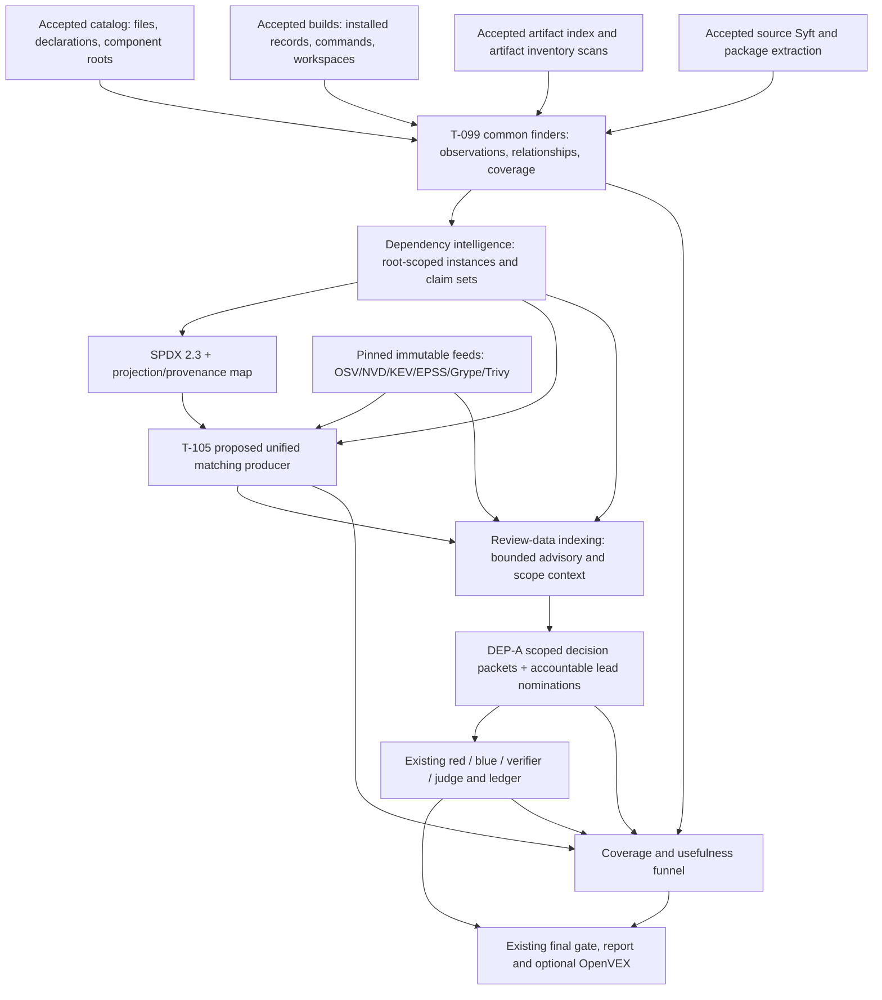

# Dependency intelligence enhancement design

**PROPOSED — NOT IMPLEMENTED OR APPROVED.** Written 2026-11-13 against code commit
**5926171238607e27a948bc7d40ce190a853b3d0c**. Frontmatter `status: current` means this
is a current design document, not that its behavior exists. The
[source-backed review](../reviews/2026-11-13-dependency-intelligence-review.md) records
the current behavior, dirty-documentation limitations and findings D1–D12.

T-146 landed before registry integration at main
`2612ee80f305970707520ad92774d1e1c1336c1c`; use its
[delivered interfaces](../tasks/2026-11-13-behavior-oriented-review.md#implementation-and-verification-record)
when implementing this proposal. Its operation/map/actionability work is not rescheduled here.

The canonical implementation schedule remains [docs/TODO.md](../TODO.md), particularly
T-009–T-013 and T-098–T-106. Their build/topology-first prerequisite is unchanged.
**DEP-A** names the consumer-focused design slice scheduled as
[T-149](../TODO.md#t-149-route-scoped-dependency-decision-packets-into-review-and-account-for-their-use).
T-129 owns bucket mapping as a **nonblocking
registration/reconciliation dependency**, not a runtime implementation prerequisite. Concrete
dataset contracts, artifact-only publications and retrieval routes can proceed while conceptual
bucket labels remain provisional; coordinate their eventual registration with the T-129 owner.
This document neither creates a second backlog nor allocates a competing taxonomy.

## Outcomes and non-goals

The product should let a reviewer answer, with resolving evidence:

1. What dependency **instances**, including separate vendored/installed copies, are present
   in this source/build/deliverable, and what was not inspected?
2. Which package identity and release claims are observed, inferred, resolved, conflicted or
   unknown? Which exact observation supports each claim?
3. Which advisories match which claimed identity, under which matcher and pinned database?
4. What is known about patch state, selected build conditions, artifact inclusion and local
   vulnerable constructs—and what still requires verification?
5. Did that intelligence actually reach a relevant review package, get read, receive a
   disposition and improve a finding or reduce a known miss within an explicit budget?

Success is not “more packages/CVEs,” “SPDX validates,” “scanner exited zero,” or “a model cited
the inventory.” Those are separate intermediate measures.

Non-goals: no runtime implementation in this task; no automatic production activation, feed
restart, image rebuild, target execution, arbitrary repository fetch, signing-policy change,
general license-compliance engine, replacement review protocol or new model-held tools.
No inference of shipment, vulnerable code, exploitable reachability or upstream equivalence
from a package name/version, CVSS, KEV, EPSS, Scorecard or absent call-graph edge. No attempt to
replace T-146's behavior-oriented review interfaces: dependency context should attach to its
accepted operation/component/build identities when available, with a named unknown otherwise.

## Recommended architecture

Keep the existing source and artifact **observation acquisition** paths. Introduce the common
finder boundary under T-099; make dependency intelligence the one normalized inventory/SPDX
owner; put all vulnerability matching after that inventory under T-105. Add deterministic
review packets in existing review-data/package assembly surfaces rather than another model
research phase.



### Why a separate matching producer

Adding merged-inventory matching to the current source-evidence job would create an ordering
cycle: dependency intelligence already consumes that job's Syft output. Adding it to an
artifact job whose inventory is then merged has the same risk. Recommended T-105 boundary:
one target-independent matching job, with internal units for accepted input loading, bounded
matcher partitions, normalization and immutable publication. It consumes no mutable checkout.
The name and schemas below are **design candidates**, not registered runtime identifiers:

```text
PROPOSED T-105 surface:
  src/appsec_review/jobs/job_dependency_matching/
  job_dependency_matching
  load.accepted_inventory
  match.osv / match.grype / match.trivy / match.cpe / match.binary
  normalize.matches
  acceptance.publish_handoff
  appsec-review/dependency-matching-handoff/1
```

Binary component extraction belongs before inventory merge (T-102); its vulnerability results,
if the scanner cannot separate extraction and matching, are imported as matcher observations
with the same inventory-instance reconciliation, not a second unmatched universe.
Until the migration is complete, existing scanner publications remain readable and are
deduplicated by provenance; do not silently disable a working scanner before equivalent
coverage is demonstrated. Do not retain duplicate long-term matcher pipelines.

## Typed information model

These are **proposed closed contracts**, not declarations of currently accepted schemas.
Implement them using the repository's typed configuration, publication validators and dataset
contracts. Unknown additional fields fail validation. Bounded collections retain total and
omitted counts with explicit reasons. Descriptive text is data, never executable policy.

```text
PROPOSED shared observation contract (T-099):
dependency-observation/1
  observation_id: content-derived identity
  source_fingerprint: sha256
  producer: {job_id, attempt_id, handoff_sha256, output_kind}
  finder: {id, version, tool_id?, image_id?, parser_identity}
  domain: target | workspace | artifact
  root_id, component_root, component_id?, build_unit_id?
  artifact_identity?, artifact_sha256?, installer_record_identity?
  name_claim, ecosystem_claim, namespace_claim, purl_claim, repository_claim
  version_claim:
    {raw_value?, normalized_value?, scheme?, kind, state, evidence_ids, alternatives}
    kind: declared_constraint | lock_resolved | installed | metadata_release |
          source_literal | binary_signature | filename_hint | abi_hint | unknown
    state: unknown | inferred | corroborated | conflicted
  source_revision_claim?, supplier_claim?, cpe_candidates[]
  origin: declared | resolved | installed | vendored | header_only | binary | unknown
  scope_observations[]: {build_unit_id?, configuration?, role?, basis, evidence_ids}
  evidence[]:
    {accepted_artifact: {path, sha256, size_bytes}, selector,
     source_path?, source_sha256?, byte_span?, line_span?,
     authority, sensitivity, redaction_projection_identity?}
  gap_ids[]

PROPOSED normalized contracts (T-099):
dependency-instance/1
  instance_id, coordinate_id?, observation_ids[], claims, conflicts[]
  source_fingerprint, domain, root_id, component_root, build_unit_id?
  artifact_identity?, content_identity?, installation_identity?
  source_equivalence: verified | different | unknown
  scope: {declared_roles[], build_configurations[], delivery_state, evidence_ids[]}
  priority_exposure: {value, inference_basis, evidence_ids[]}
  spdx_ids[], projection_dispositions[], coverage_ids[]

dependency-relationship/1
  edge_id, source_instance_or_component, target_instance_or_artifact
  kind: declares | resolves_to | depends_on | contains | links_into | derived_from
  state: observed | inferred | conflicted
  build_unit_id?, configuration?, selected_condition?, evidence_ids[], gap_ids[]

PROPOSED matcher contract (T-105):
dependency-match/1
  match_id, instance_id, coordinate_id?, inventory_sha256
  advisory_id, aliases[], advisory_record_sha256, advisory_selector
  matcher: {id, version, image_id?, configuration_sha256}
  feed: {snapshot_id, manifest_sha256, index_sha256?, published_at, observed_at,
         stale, provenance_ref}
  identity_basis, version_kind, version_state
  match_state: scanner_reported | affected_range | not_affected_range |
               candidate | withdrawn | undetermined
  matched_range?, matched_cpe_clause?, comparator_identity?, evidence_ids[], gap_ids[]
  local_applicability: not_assessed | unresolved

PROPOSED consumer contract (DEP-A):
dependency-decision-packet/1
  packet_id, instance_ids[], match_ids[], component_ids[], build_unit_ids[]
  operation_ids[], operation_binding_state
  accepted_manifest_sha256, inventory_sha256, matcher_publication_sha256
  identity_state, version_state, match_state
  delivery_state: included | excluded | conditional | unknown
  patch_state: not_assessed | conflicting | candidate_fix | evidence_resolved
  local_applicability: unassessed | unresolved | supported | contradicted
  reachability_state: unknown | candidate_path | supported_path
  resolving_target_evidence_ids[], indirect_reference_ids[]
  counterevidence_ids[], remaining_questions[], coverage_ids[], gap_ids[]
  nomination: {state, basis, policy_identity, existing_lead_ids[]}
  budget: {eligible, selected, omitted, reason}
```

### Identity, deduplication and epistemic rules

- **Three identities:** immutable observation identity, physical instance identity and package
  coordinate identity. Share reference lookups by coordinates; never share patch/delivery
  decisions merely because two instances have one PURL or repository.
- Instance identity includes accepted snapshot/domain/root and installation/build/artifact
  scope. Preserve separate copies even if package bytes happen to match; use content
  equivalence links to reuse safe computation, not to erase instance membership.
- A constraint such as `^2` never becomes an installed version. Keep raw values and comparator
  scheme; do not lowercase whole PURLs or package namespaces indiscriminately. Canonicalization
  is ecosystem-specific and versioned.
- Preserve competing name/version/repository claims and their sources. Resolve only by
  explicit evidence rules; first observation, majority vote and model confidence are not
  conflict resolvers. Forge-specific repository parsing must preserve GitLab subgroups.
- A source literal can establish the claimed local release without establishing upstream-byte
  equivalence or patch state. A binary signature stays a candidate unless the detector's
  validated evidence supports a stronger identity claim. ABI versions never become releases.
- `priority_exposure` preserves the current conservative maximum and its basis for compatibility.
  Delivery is a separate per-build fact: `PROD` with conservative default must display as
  **delivery unknown; prioritized conservatively**, never “deployed in production.”
- Relationship kinds already exist for `DEPENDS_ON`, `CONTAINS`, `LINKS_INTO` and `DERIVED_FROM`.
  Reuse them with typed provenance/state payloads; do not invent exact edges from shared names,
  co-location or absent metadata. Baseline SPDX relationships remain evidence of their
  producer's assertion, not automatically verified local linkage.
- Make normalized inventory the truth from which SPDX and retrieval are projected. A
  projection map accounts for every instance: emitted, represented-with-uncertainty, omitted
  with reason, or unsupported. Unknown releases must remain legal inventory records even when
  the SPDX representation omits `versionInfo`.

### Matching and patched forks

T-105 consumes only the accepted inventory and feed pins. Each enabled matcher publishes
per-instance outcomes, including unmatched, undetermined, unsupported and truncated cases.
Use advisory alias groups for display while preserving every original advisory/matcher record.
Different matchers disagreeing is an investigation signal, not a majority decision.

OSV evaluates only supported ordering/range semantics. CPE matching must retain vendor,
product, version boundaries and logical/environmental applicability clauses, not perform a
name-to-CVE string join and call it exact. Ecosystem-qualified package lookup is preferred;
name-only cross-ecosystem lookup is a separately capped nomination route. Match count is not
inventory recall. Withdrawn or outside-range outcomes retain their evaluation record and
coverage context instead of disappearing from the audit trail.

For native/vendored discoveries, respect the T-105 decision allowing advisory matching as
**leads**. Do not fabricate PURLs or upgrade inferred versions in the authoritative SPDX just
to satisfy a scanner. Feed corroborated representable identities through SPDX where supported;
use typed candidate matching for uncertain observations. A matcher unable to represent that
uncertainty records an unsupported-input gap rather than an invented package.

DEP-A assembles an investigation packet containing local version evidence, advisory affected
construct/configuration details, accepted component/build membership, and available local
patch/source evidence. Registered review roles may use existing bounded source/graph
retrieval to examine it:

- Red proposes a concrete affected construct/use hypothesis and identifies missing predicates.
- Blue checks local modifications/backports, incompatible build conditions and other
  counterevidence against accepted target bytes.
- Application evidence validation re-resolves citations supplied by the verifier and other
  roles. Judge output is advisory: **deterministic application adjudication remains the final
  claim-state authority; judge advice cannot decide R5**. A matcher result or a packet's state
  cannot satisfy an obligation by itself.
- `candidate_fix` means a possible fix was found, not that the component is unaffected.
  A “not affected” conclusion needs sufficient local evidence and a disposition under the
  existing review policy. No call edge, no matching CVE, or no runtime profile sample proves
  neither absence nor nonreachability.

Do not fetch arbitrary upstream source or patches from model-provided URLs. If a future
accepted upstream-patch producer is desired, it needs separate authority, provenance and
policy approval; this design works with already admitted local/source-history evidence.

## Intelligence products and routes

**All conceptual bucket labels in this table are provisional T-129 candidates.** Actual
dataset/output-kind and retrieval identifiers are separate. Where a product or route is new,
the cell explicitly says proposed. The existing eight documentation subsystems are not buckets.

Lifecycle codes: **I** = invalidate on accepted input/finder/schema/configuration or release
identity change; **M** = additionally invalidate on exact matcher/database/advisory identity;
**R** = additionally invalidate on admitted review manifest, scope/selection/guidance/policy;
**U** = append immutable use/disposition events bound to the packet and ledger head.
Historical accepted bytes and original freshness observations never change.

| Product and bucket candidate | Dataset/index route: current → proposed | Producer | Provenance, confidence and uncertainty | Consumer/decision enabled | Evidence ceiling | Freshness, redaction and coverage |
| --- | --- | --- | --- | --- | --- | --- |
| Common observations; `dependencies_and_advisories` | Current `native_discovery`, `static_tool_observations`, `artifact_security_results`, build receipts → proposed common observation publication plus normalized `dependency_context` in `inventory` | Existing acquisition jobs and T-099 finders, merged by dependency intelligence | Exact raw selector, source/record/artifact hash, finder/tool identity; independent field states | Resolver and inventory reviewers: identify what was seen and what is unresolved | Observation supports only the literal/record fact it resolves; not package vulnerability | I; protected originals and sanitized projection; eligible/read/failed/unsupported/omitted counts per finder and root |
| Instance identity and projection map; `dependencies_and_advisories` | Current `dependency_context` and `native_spdx` → enriched same routes with instance/coordinate separation and SPDX coverage map | Dependency intelligence, T-099 | All contributing observations and conflicts; package equivalence separate from local copy identity | Matchers, remediation planning, reviewers: target the right copy and version | Identity/release assertion, not upstream equivalence or reachability | I; stable IDs/redaction mapping; every observation/instance accounted, unresolved versions explicit |
| Dependency/use relationships; `dependencies_and_advisories`, `build_and_deployment`, `binary` | Existing `artifact_relationships`/SPDX edges → proposed instance relationship projection in `inventory`/`links`, `trace`, `query_artifacts` and scoped `query_precomputed` | T-099 finders with T-098/T-100/T-011/T-102 evidence | Accepted installer paths, build actions, artifact/link receipts; edge state and condition retained | Build/delivery reviewers and T-146 operation context: distinguish declared, selected, installed, linked and delivered | Observed relation only; absence is unknown unless bounded exhaustive evidence says otherwise | I; no raw argv/environment; per-configuration relation coverage and omitted edges |
| Matcher outcomes; `dependencies_and_advisories` | Current scanner observations plus `dependency_advisories` → proposed T-105 match publication and enriched same query set, scanner observations retained as evidence | T-105 matching producer; T-009/T-103/T-104/T-013/T-102 adapters | Inventory hash, instance, original advisory aliases, exact feed/tool/comparator and native selector; separate match/local applicability | Lead triage and reviewer: decide whether and how to investigate | Affected range or scanner report is not local exploitability; uncertain identity stays a candidate | M; no target data sent to feeds; per-instance/matcher outcome, fresh/stale/unsupported/bounded status |
| Repository practices; `dependencies_and_advisories` | Existing `scorecard_responses` and `dependency_context` review signals → scoped presentation, no new scanner/index | Existing Scorecard stage | Exact response hash/date and inferred/metadata repository basis; local origin remains unproven | Supply-chain reviewer: investigate actionable process questions without flooding unrelated units | Indirect repository-practices context only; cannot raise finding severity alone | I plus observed response/cache identity; TTL applies to new work, not mutation of old evidence; missing/unsupported repository counted |
| Decision packets and nominations; `review_claims` with dependency/build references | Proposed immutable packet artifact and bounded projection through existing `dependency_advisories`, review package `inference_context` and lead menus | Review-data indexing plus package assembly, DEP-A | Instance/match/relationship IDs, selection reasons, target evidence separate from feed facts; explicit unresolved dimensions | Red/blue/verifier/judge: inspect relevant instances and local patch/configuration evidence; admit inventory-only nominations | Packet is indirect context; only re-resolved underlying evidence may satisfy mapped predicates | R; sanitized content, bytes/results/instance caps; nominated/held/duplicate/selected/omitted with reasons; no silent drop |
| Dependency disposition and report section; `review_claims` | Existing review ledger → proposed typed dependency projection bound into existing final gate/report; no independent direct-to-report path | Existing review/gate/report producers, DEP-A | Packet/claim/ledger and underlying citation bindings; reviewer decision separated from matcher status | Maintainers: decide investigate/update/backport/retain and understand remaining coverage | Report claims only accepted adjudication; no automatically generated package-level VEX exclusions | R+U; public projection excludes protected evidence content; each admitted nomination has a disposition or unresolved accounting |
| Usefulness and cost funnel; `metrics` | Existing `native_sbom_metrics`, `native_inference_metrics`, telemetry → proposed dependency-use counters/receipts and gate-bound coverage summary | Existing observability, package audit and review ledger adapters, DEP-A | Counts linked to accepted publications and actual read/citation/disposition events; missing use data is unknown | Operators and evaluation owners: prioritize work that improves verified outcomes per cost | Operational/evaluation evidence, never target safety | I/M/R/U according to stage; aggregate names/paths redacted; accepted inventory versus cumulative work/reuse reported separately |

This table intentionally does not create an `observations_sast` dependency dataset. A vendored
library's source-SAST observations remain in their current observation route and may be linked
to the instance with accepted source identity. The bucket mapping belongs to T-129.

## Exact producer and consumer changes

### T-099 and its finder extensions

1. Define the common observation/relationship contract and a deterministic finder registry
   inside dependency intelligence. Adapt existing catalog, source Syft and native outputs
   without executing target build descriptors in a finder.
2. Import installed npm/Go/Composer summaries from accepted receipt/artifact records under
   T-011; preserve pre-build versus recipe-written origin, installer custody and unresolved
   packages. Extend remaining ecosystems one at a time rather than resummarizing already
   implemented ecosystems.
3. Add accepted artifact-security **inventory** output to the dependency job's typed inputs
   and scheduling. Its result artifact/native output is authoritative; inventory summaries
   with package bodies removed are not the complete inventory. Add explicit required,
   optional/conditional and missing policies; absent optional binary inventory is a scoped
   gap, not a license to read mutable build output.
4. T-098 supplies vendored component ownership without removing those sources from review;
   T-100 supplies bounded native build declarations and constraints; T-101 uses appropriate
   extraction tools for recognized manifests/lockfiles; T-102 supplies binary candidates.
   Unity metadata must enter the common observations, not only the SPDX postprocessor.
5. Refactor normalization and SPDX projection together: preserve conflicts/roots/relationships,
   publisher membership, source references and finder gaps; account for representation
   differences explicitly. Retain all original source-Syft bytes and native inference records.

### T-105 and existing matcher tasks

1. Register the proposed matching producer once in the semantic registry; declare typed
   configuration, direct/Dagster topology parity, target access NONE and explicit accepted
   inventory plus external feed inputs. The upstream acquisition jobs do not consume it.
2. Preserve package name, ecosystem, namespace, version, PURL, artifact/instance association,
   advisory ID and resolving selector through source and artifact parser/envelope/index paths.
   Repair artifact OSV pair adaptation as part of this migration.
3. Keep acquisition, extraction and matching releases separate. Bump parser/normalizer and
   product identities when payload semantics change. Preserve old accepted scanner evidence;
   do not reinterpret a historical missing coordinate as resolved.
4. Retain per-matcher outcomes and disagreement. Fix Grype SBOM reuse/dedup under T-010;
   T-103 adds offline Trivy SBOM matching/sync; T-104 owns CPE specificity; T-013 owns indexed
   OSV extraction/matching and ordering extensions. T-009's implemented validated snapshot
   branch remains the Grype feed source; activation is not part of this design.
5. Remove ambiguous reliance on `applicability_verified` in new output. Historical facts keep
   their original field with legacy semantics; a new consumer interprets it as historical
   matcher information, never as local applicability proof.

### DEP-A: close the useful-review loop

1. Index decision packets using existing accepted index/retrieval grants. Select by exact
   component/root/build/artifact edges, then bounded operation associations when T-146 supplies
   them. Do not globally attach every package/Scorecard. An unbound instance receives a
   bounded unlocated investigation unit, not an arbitrary component.
2. Teach lead collection to recognize **T-105 nominations**, not all inventory rows or all
   arbitrary precomputed facts. Preserve stable nomination identity, original matcher/advisory
   observations and duplicate relationships. One inventory-only nomination must be visibly
   selected, held by policy/budget, deduplicated to an existing lead, or marked unavailable.
   “Queryable” is not an allowed substitute for that accounting.
3. Carry match/identity/version/delivery/patch uncertainty through `review.advisories`,
   lead and hunt package schemas/views. Keep fixed-version recommendations conditional on
   ecosystem, branch and matched range. Avoid taking the highest advisory score as proof of
   the local instance's severity.
4. Extend registered task/role guidance to ask the bounded dependency questions above.
   Update registry/output contracts and hash-pinned guidance assembly; budgets and selection
   policy stay in typed TOML. Reuse governing rules once, existing role authority and existing
   source/graph/artifact tools. Do not load development guidance into workers.
5. Record independent states: available, supplied to package, retrieved/read, cited with a
   resolved selector, used in a disposition, published. An accepted handoff read is not proof
   a model read every package record, and a model citation is not proof of correct use.
6. Bind the dependency coverage/disposition projection into the existing accepted final gate
   before rendering. Keep unresolved dependency investigations separate from publishable
   findings. Do not turn this into automatic package-level `not_affected` OpenVEX output.

### Implementation surface map

Paths name future edit locations, not changes made by this documentation task.

| Surface | Required edits and ownership |
| --- | --- |
| Observation contracts/merge | T-099: `src/appsec_review/jobs/job_dependency_intelligence/{datasets,job,resolution,discovery,integration,native_sbom_contracts,sbom,unity}.py`; add common finder/claim validators; `engineering_contracts.py` and focused schema registrations as required. |
| Acquisition/normalization | T-099/T-101/T-105: `job_target_catalog/job.py`, `job_evidence_collection/{adapters,evidence,job,datasets}.py`, `job_artifact_security_analysis/{findings,scanners,job,datasets}.py`; bump changed projection identities. |
| Installed/build/binary scope | T-011/T-098/T-100/T-102: `job_language_build/{node,go,php}.py`, installer parsers, artifact-index datasets, `jobs/build_points.py`, `jobs/delivery_scope.py`; new binary adapter through existing tool policy. |
| Matching/feed tools | T-009/T-013/T-103/T-104/T-105/T-106: `osv_matching.py`, third-party sync branches/publication, proposed matching package, `containers/catalog.toml`/tool manifests only where tools genuinely change. Image builds and host pins remain separately authorized. |
| Registration/config/topology | T-099/T-105: `runtime/registry.py`, `orchestration/topology.py`, each job's typed `CONTRACT`, `config/loader.py` and dedicated settings types, `appsec-review.toml`; test disabled producers/optional inputs. No parallel hard-coded CLI graph. |
| Index/retrieval/data audit | T-099/T-105/DEP-A: `indexing/{input_matrix,links,products,inventory}.py`, `job_review_data_indexing/{job,datasets}.py`, `retrieval/{model,precomputed,core}.py` only if typed payload/query changes require it; reuse current grants and protected-data filtering. |
| Lead/packages/review | DEP-A: `review/{lead_families,advisories,units,packages,scope,evidence}.py`, package/review schemas under `docs/schemas/`, `job_review_package_assembly` and `job_inference_security_review` contracts/validators. No widening of evidence predicates by implication. |
| Guidance | DEP-A and finder owners: `pipeline/guidance/registry.json`, registered dependency-intelligence and review task/role fragments; versioned output contracts, bundle hashes and offline guidance evaluation. No new free-form runtime authority. |
| Reporting/measurement | DEP-A: `observability/{telemetry,native_inference}.py`, `observability/findings/` adapters, existing review/gate/report schemas and jobs; register a gate-bound dependency summary instead of making the final renderer scan arbitrary run files. |
| Documentation and bucket map | Parent/documentation owner: relevant architecture/operations pages, T-129 canonical mapping, inventory generation and ledger. No hand-edited generated documentation. |

## Trust, freshness, reuse and compatibility

- Inputs remain immutable admitted publications. Every producer input names output kind,
  schema, authority, availability/missing policy and channel in `Job.contract`; consumers use
  accepted loaders under the claim's exact upstream pins and retain actual read receipts.
  Scheduling edges, input-matrix entries and dataset declarations are not evidence of use.
- All new control gaps use `producer-gap/1` and existing producer status vocabulary. The new
  matching producer uses strict gap validation. New semantic gap causes distinguish
  unsupported ecosystem, unresolved/conflicted release, ambiguous package/instance, missing
  artifact inventory, matcher disabled, stale/missing feed, truncated candidate set, unbound
  build scope and held review nomination. They are coverage states, not “safe” outcomes.
- Bound finders by eligible inputs, roots/files/bytes, candidates, observations and relationships;
  bound matching by instances, per-instance candidates/ranges and total facts; bound packet
  assembly by per-unit instances/bytes and total nominations. Stable ordering and recorded
  omitted counts prevent memory pressure from silently dropping difficult packages.
- Protected compiler commands, raw scanner streams, private URLs/tokens and detached workspace
  content remain protected. Publish only bounded approved fields plus opaque resolving
  references in indices. Scan/sanitize display text and metadata; an allowed repository host
  does not make all target-provided URL text public. Do not expose a generic raw-file endpoint.
- Preserve exact feed snapshot manifests, advisory selectors, upstream publication provenance
  and freshness observations per run. T-106 owns readiness policy/restart. A new review can
  choose refreshed feeds; resuming an admitted attempt must not silently switch snapshots.
  Legacy feed provenance stays unknown when not recorded.
- Reuse identity includes accepted source/build/artifact inventory, finder/parser/normalizer,
  schema/contract and release, relevant config, matcher tool/image/database/comparator, and
  review scope/selection/guidance/policy as applicable. A feed-only change rematches and
  reselects downstream packets; it need not rediscover unchanged target dependencies.
  A failed sibling matcher cannot erase completed partitions or produce a clean aggregate.
- Share computation only by relevant exact identities. T-010's content-hash scanner cache
  still retains separate artifact/build/instance memberships and observed coverage.
- Historical handoffs remain readable under their original contract; new consumers label
  absent fields unknown. Preserve optional native publication compatibility and exact old
  guidance bytes. Add new/versioned schemas when required, not rewritten accepted artifacts
  or a false backfilled “read” history.
- Existing signed source/image launch policy is unchanged. Deployment/reload, image rebuilding
  for actual dependencies, feed activation and runtime evaluation need their normal explicit
  authorization.

## Tradeoffs and policy choices

| Choice | Alternative and cost | Recommendation, not a new authorization |
| --- | --- | --- |
| Unified observations and matcher | More scanners in the existing fragmented pipelines are quicker but do not fix inventory/consumer mismatches. | Finish T-099/T-105; add acquisition tools behind that contract. |
| New matcher producer versus units inside dependency intelligence | Keeping matching inside dependency intelligence avoids a job but couples inventory/Scorecard/model failures and database-only reruns. | T-105 separate target-independent producer; registry/topology cost buys explicit reuse and independent coverage. |
| Preserve physical instances versus package-level collapse | Instances cost rows and joins; collapse is cheaper but loses patched copies/build decisions. | Preserve instances, cache coordinate/reference computations, use bounded instance groups in display. |
| Unknown-version/name-only nominations | Aggressive admission can find misses but inflate review volume; suppression hides coverage. | Separate capped exploratory nominations and visible holds; do not automatically apply KEV admission to ambiguous identities. User chooses its budget and policy. |
| Scorecard breadth | Fetching every resolvable repository can dominate network/time without relevant review use. | Keep current behavior until measured; propose priority for scope-bound repositories and explicit unselected coverage, never silently cap away packages. User chooses freshness/budget. |
| Patched-fork resolution | Automatic remote patch fetch could improve comparison but changes data/egress authority; version-only suppression is unsafe. | Use admitted local evidence first; leave unresolved when inadequate. External patch acquisition requires a separate approved producer. |
| Feed freshness | Fail-closed readiness prevents stale matching but can block an offline investigation. | T-106 exposes explicit policy with a named gap/approved exception; do not invent a default here. |
| Report/OpenVEX projection | A full component-VEX exporter needs per-product identity and positive unaffected evidence not supplied by current gate projection. | Add dependency summary through the gate; retain current OpenVEX semantics. Any broader component-VEX policy is a separate user decision. |

## Dependency-aware implementation sequence

This is the execution order for canonical tasks, not an alternate task registry.

1. **Build/topology prerequisite and T-106.** Respect the previously agreed walk gate; repair
   and authorize feed readiness/activation separately. Reconcile T-009's implemented state,
   T-011's Go/Composer progress and T-013's existing code before estimating work.
2. **T-099 foundation.** Close D1/D2/D8/D9/D10 with common observations, instances,
   projection accounting and finder coverage, retaining current behavior on existing fixtures.
3. **T-098/T-100 and T-011/T-101/T-102 adapters.** Native/vendored work follows the agreed
   priority; managed and binary adapters can proceed independently once their accepted input
   contracts are stable. Do not postpone all consumer tests until every ecosystem is supported.
4. **T-009/T-103/T-104/T-013 plus T-105.** Preserve validated feed publication; establish
   the common matcher contract, then add each enabled matcher with equivalent coverage,
   coordinate preservation and explicit uncertainty. Grype activation follows explicit
   validation, not a documentation edit.
5. **DEP-A**, depending on **T-099 and T-105**. First run the smallest offline vertical
   slice: one managed instance, one native/vendored instance and a conflict; follow each to
   a scoped packet, nominated/held outcome, resolving citation and report accounting.
   Coordinate dataset/output-kind and route registration with **T-129** in parallel; its
   canonical bucket mapping is a nonblocking reconciliation dependency, not an implementation
   gate. Keep conceptual labels provisional until that owner publishes the mapping.
   T-146 operation mapping is optional enrichment initially, not a blocker that hides
   component/build-level routing.
6. **Separately authorized evaluation.** Exercise real tool publication and then a bounded
   review comparison on held-out targets. Update canonical tasks with observed results;
   failed/skipped/live-unrun checks are not replaced with “tests pass.”

## Acceptance and evaluation design

### Independent labels and leakage control

The evaluation owner labels a fixed corpus independently of producer/model output. Identity
labels name physical roots, actual package/release provenance and deliberately unresolved
cases; advisory labels identify ecosystem/range/patch/configuration status; outcome labels
identify expected local constructs and acceptable unresolved dispositions. Ambiguous labels
stay ambiguous. Hold out renamed libraries, subgroup repositories, patched forks, unsupported
version schemes and repeated copies from tuning.

Production jobs and model prompts never read these labels or private answer keys. Evaluation
consumes the completed immutable publication/ledger afterward. Labeler disagreement is
reported separately from system error. Use identical input snapshots, feeds, model configuration
and budgets for paired baseline/new comparisons; repeat only separately authorized stochastic
review trials, and report variability rather than attributing one run's difference to the design.

### Measures and initial acceptance proposals

Numerical release thresholds below are **proposed fixture/evaluation gates**, not current
measurements or permission to enlarge budgets.

| Measure | Definition and proposed acceptance |
| --- | --- |
| Inventory recall | Correct observed physical instances / independently labeled eligible instances, stratified by managed/native/vendored/header-only/binary and source/installed/build artifact. Every deterministic fixture instance must be recovered or have the exact expected named gap; no silent omission. Report excluded/unsupported inputs separately; an unknown corpus denominator is unknown, not 100%. |
| Identity accuracy | Correct ecosystem/namespace/coordinate, version kind and physical-copy binding / asserted identities. Zero asserted wrong identity/version or merged distinct copies in adversarial unit fixtures. Report wrong, conflicted, inferred and unresolved separately; do not improve accuracy by hiding unresolved instances. |
| Advisory precision | Correct instance-specific nominations / evaluated nominations, stratified by affected-range, scanner-reported, CPE/name-only and local patch status. Zero false “verified local applicability” from names/ranges in units; held-out precision must not regress at the same recall/budget. Declare indeterminate denominator separately. |
| Unresolved versions | Unknown/inferred/conflicted version counts and rate by finder and reason, before/after investigation. Every conflict survives; unsupported comparator never produces unaffected. Evaluation must reduce eligible resolvable unknowns without increasing false assertions. |
| Reviewer use | Distinct relevant instances with available → supplied → read → cited → dispositioned states, deduplicated by instance/packet, plus byte/token cost. Units require every nominated instance to have selected/held/duplicate/unavailable accounting. A recorded read is not a quality label; independent review scores whether citation/disposition was relevant and correct. |
| Known-miss reduction | Independently labeled local dependency cases missed in baseline but correctly investigated/confirmed or correctly left unresolved in new output, at fixed budget. Count false confirmations and lost baseline cases too; require no lost baseline detection in deterministic fixtures. No live improvement is claimed until paired reviews are authorized and measured. |
| Cost and reuse | Finder bytes/CPU, scan launches, peak RSS, feed/cache work, model calls/tokens, package bytes and review time per correctly dispositioned case. Feed-only changes must not repeat unchanged discovery; identical rerun must preserve coverage while reusing valid computation. T-013 compares actual memory to its documented scanner baseline, not just SQL operation counts. |
| Coverage integrity | Every eligible input/instance/matcher/nomination partitions into a named outcome; omitted facts/provenance references report counts and resolving continuation. No bound exhaustion, failed matcher or stale feed becomes a clean zero. |

### Fast unit regressions

Extend the smallest relevant existing tests, fake only external boundaries, and keep each unit
under ten seconds, independently runnable and shuffled in bounded parallel workers:

- T-099: permutation invariance, same coordinate/different root, conflicting same PURL,
  GitLab subgroup, manifest constraint versus installed release, inherited parser gaps,
  installed npm/Go/Composer records, source/artifact/Unity projection parity and exact hashes.
- T-105: real parser→envelope→pair→fact normalization for source OSV/Grype and artifact OSV;
  no direct test-only construction that bypasses the broken boundary. Cross-ecosystem same
  name, unsupported comparator, withdrawn advisory, alias disagreements, CPE conditions,
  declared version and patched-copy uncertainty remain distinct.
- DEP-A: inventory-only candidate reaches an accountable nomination; relevant instance
  context wins over unrelated global inventory; held/duplicate candidates remain visible;
  missing relation/operation/patch evidence cannot be inferred. Range/identity uncertainty
  survives schemas and model-facing projection.
- Trust/reuse: undeclared producer read, unsupplied pin, hash/selector mismatch, foreign
  snapshot, protected-field projection, stale feed, changed policy/guidance, unchanged rerun,
  independent matcher failure and historical handoff without new fields.
- Reporting: gate-bound dependency coverage, unresolved versus publishable disposition,
  no raw evidence disclosure, no automatic package-level unaffected VEX.

Expected existing test surfaces include `tests/test_dependency_intelligence.py`,
`tests/test_native_sbom_job.py`, `tests/test_native_inference_wiring.py`,
`tests/test_native_inference_runtime.py`, `tests/test_artifact_security_analysis.py`,
`tests/test_osv_matching.py`, `tests/test_review_data_indexing.py`,
`tests/review/test_advisory_enrichment.py`, language-build installed-package unit files,
feed unit files and focused registry/contract/retrieval/report tests. New fixture cases belong
with their owning behavior, not a giant end-to-end unit test.

### Separately authorized integration and live validation

Integration: pinned real scanners/conversion on small independently labeled artifacts;
accepted publication → common inventory → matching → index → package routes, with explicit
time budgets and positive/negative custody tests. Include a static binary, a header-only
library, a repeated patched copy, artifact OSV and offline feed fixtures. Container/image/
feed prerequisites missing means a named coverage gap, not success.

Live review evaluation: only on explicit user request, held-out targets and agreed budgets.
Measure actual reviewer usefulness and paired known misses, adjudicate contested conclusions
against target evidence, and retain independent labels outside worker access. Readiness,
nightly activation, database refresh, model calls, target builds and current-host performance
measurements are **not executed or authorized by this design**.
