# Target document analysis and finding handoff

## Purpose and current boundary

Target-owned design docs, STRIDE models, DFDs, OpenAPI, Postman collections, and unit tests help
reviewers discover routes, trust boundaries, and intended controls. They are untrusted target data.
The system must preserve their exact source identity and distinguish a declaration or test from
observed enforcement. The accepted collection, bounded context facts, document hunts, and first
source-mapping candidate ledger are implemented. The broader inference and final finding jobs
described below remain future work.

## Current data flow

```mermaid
flowchart LR
  T[Target checkout] --> C[job_target_catalog: hash-pinned inventory]
  C --> D[documents shard: records, source lines, route and boundary links]
  D --> A[job_review_data_indexing: document_context]
  A --> I[accepted precomputed shard and query_precomputed]
  I --> P[job_review_package_assembly: scanner leads and document hunts]
  P --> M[job_document_issue_analysis: private candidate ledger]
  M -. planned .-> R[job_inference_security_review]
  R -. planned .-> J[adjudicated finding packages]
  J -. planned .-> E[enrichment and final publication]
```

`job_target_catalog.retrieval_indexes.build_target_documents` starts after
`repository_discovery.partition_repository` in both `appsec-review start --target <checkout>` and
Dagster `wave1_review`. It accepts only inventory paths and hashes, verifies target bytes, and
publishes the `documents` shard. Parser limitations, absent kinds, and bounded truncation are
named gaps. A changed accepted file hash or escaped path is an integrity failure.

`job_review_data_indexing.precompute.document_context` reads only the accepted `documents` shard.
It groups OpenAPI operations, Postman requests, and unit-test requests by exact method and route;
DFD boundaries and STRIDE threats are grouped by exact boundary ID. It publishes one
`precomputed_fact` per bounded route or boundary subject, with the accepted source identities,
line location, relation links, authority and gap status. It does not execute tests or infer that a
declared control is present. A request without an accepted OpenAPI operation is partial coverage,
not a vulnerability. These facts are available through `query_precomputed(query_set="document_context")`
and remain discoverable through `search`, `find`, `trace`, and `read_excerpt`.

The dataset inventory audits both the original `target_documents` shard and the derived
`precomputed_products` shard. Product fingerprints bind rule version, bounds, accepted shard
hashes, and target snapshot. A later accepted input creates a new product identity.

`job_review_package_assembly` publishes one `document_hunt` package per accepted route or
boundary context fact. It grants the fact and at most 64 exact source-record identities through
the scoped retrieval capability, with an explicit truncation gap for any omitted context. The
package has no scanner lead, uses a synthetic document-corpus scope, and carries a gap until an
implementation component is resolved. Its `nominates` evidence is a computed review question,
not a finding. Package membership is audited against every accepted document-context fact and
hash-verified on read. Document hunts can be assembled when scanner correlation is unavailable;
that absence is recorded as a separate gap. The package format is
`appsec-review/review-package/3`.

`job_document_issue_analysis` consumes the accepted package handoff and re-verifies package
membership and bytes against the accepted index set. It searches accepted source-file identities,
verifies target bytes against catalog hashes, and recognizes literal route registrations such as
`router.get('/route/:id', ...)`. A unique registration yields a candidate with an exact source
line; no match and multiple matches remain explicit mapping gaps. Dynamic registrations,
cross-file mount prefixes, and semantic trust-boundary mappings are outside this first rule and
must not be inferred as absent behavior. Size, decode, and inventory bounds are coverage gaps.
The private exact-byte-addressed `data/shared/objects/<sha256>` ledger contains one candidate
per document hunt, with document and implementation evidence separated. Attempt-local shared
receipts pin the computation and original producer or reuse; legacy
`data/document-issues/<hash>/ledger.json` files remain readable without rewriting their history.
All automated candidates
remain `insufficient_evidence`; the accepted ledger has no findings or scoring inputs without
independent claim review. The adjudication gate requires distinct source proof lines plus red,
blue, and independent verifier decisions that resolve to the accepted source snapshot. The job
does not synthesize those decisions from document text, OpenAPI, tests, or scanner output.

## Inference and findings design

The next inference job should consume the accepted index manifest and verified review packages.
Its bounded discovery tasks may nominate a security hypothesis from a document-context fact, but
the hypothesis must identify an affected source construct or accepted tool observation and state
which behavior needs verification. Document text is evidence of *intent*; OpenAPI is evidence of
a *declared* interface. Neither is direct proof of implementation behavior. A Postman assertion
shows a test author's expectation, not a complete control check. Missing or failed parsing stays
in the claim's coverage record.

Claims then follow the existing [inference security review](inference-security-review.md)
contract: independent evidence resolution, red/blue review, independent verification when policy
requires it, and deterministic adjudication. Only an adjudicated claim with resolving source lines
or run-owned tool artifacts may become a finding package. Proposed, duplicate, unsupported, and
insufficient-evidence claims remain in the private claim ledger and cannot be published as findings.
The finding package must retain the document and code evidence identities separately, exact
manifest and snapshot hashes, affected route/boundary, proof obligations, contradictions, coverage
gaps, and final disposition. Enrichment joins accepted findings to CWE/OWASP, build and deployment
context, severity policy, and remediation work without reinterpreting the adjudicated state.

## Remaining implementation work

1. Extend literal route registration mapping to framework mounts, dynamic routes, handler bodies,
   guards, and source/AST facts. A registration match alone is only a candidate link.
2. Link document hunts to exact source components and attach relevant document-context identities
   to scanner-lead packages when an implementation route mapping resolves. Keep ambiguous or
   missing mappings as gaps and retrieval grants scoped to those identities.
3. Implement `job_inference_security_review`, independent review cells, accepted review decisions,
   finding and score indexes, and final publication. The document issue ledger is private
   pre-adjudication material; no current job promotes it to confirmed findings.
4. Add Northwind v1/v2 comparison tests: verify that the same document intent yields different
   decisions only when implementation evidence differs, with explicit false-positive and
   missing-coverage accounting.
