# Target document analysis and finding handoff

## Purpose and current boundary

Target-owned design docs, STRIDE models, DFDs, OpenAPI, Postman collections, and unit tests help
reviewers discover routes, trust boundaries, and intended controls. They are untrusted target data.
The system must preserve their exact source identity and distinguish a declaration or test from
observed enforcement. This design extends the accepted document collection path with a bounded
analysis product that inference can query. It also defines the later finding handoff; the inference
and final finding jobs described below are not implemented by this slice.

## Current data flow

```mermaid
flowchart LR
  T[Target checkout] --> C[job_target_catalog: hash-pinned inventory]
  C --> D[documents shard: records, source lines, route and boundary links]
  D --> A[job_review_data_indexing: document_context]
  A --> I[accepted precomputed shard and query_precomputed]
  I -. planned package context .-> P[job_review_package_assembly: scanner leads]
  I -. planned .-> R[job_inference_security_review]
  P -. planned .-> R
  R -. planned .-> J[adjudicated finding packages]
  J -. planned .-> E[enrichment and final publication]
```

`job_target_catalog.retrieval_indexes.build_target_documents` starts after
`repository_discovery.partition_repository` in both `appsec-review start --target <checkout>` and
Dagster `wave1_review`. It accepts only inventory paths and hashes, verifies target bytes, and
publishes the `documents` shard. Parser limitations, absent kinds, and bounded truncation are
named gaps. A changed accepted file hash or escaped path is an integrity failure.

`job_review_data_indexing.precompute.document_context` reads only the accepted `documents` shard.
It groups OpenAPI operations, Postman requests, and unit-test requests by exact method and route;
DFD boundaries and STRIDE threats are grouped by exact boundary ID. It publishes one
`precomputed_fact` per bounded route or boundary subject, with the accepted source identities,
line location, relation links, authority and gap status. It does not execute tests or infer that a
declared control is present. A request without an accepted OpenAPI operation is partial coverage,
not a vulnerability. These facts are available through `query_precomputed(query_set="document_context")`
and remain discoverable through `search`, `find`, `trace`, and `read_excerpt`.

The dataset inventory audits both the original `target_documents` shard and the derived
`precomputed_products` shard. Product fingerprints bind rule version, bounds, accepted shard
hashes, and target snapshot. A later accepted input creates a new product identity.

## Inference and findings design

The next inference job should consume the accepted index manifest and verified review packages.
Its bounded discovery tasks may nominate a security hypothesis from a document-context fact, but
the hypothesis must identify an affected source construct or accepted tool observation and state
which behavior needs verification. Document text is evidence of *intent*; OpenAPI is evidence of
a *declared* interface. Neither is direct proof of implementation behavior. A Postman assertion
shows a test author's expectation, not a complete control check. Missing or failed parsing stays
in the claim's coverage record.

Claims then follow the existing [inference security review](inference-security-review.md)
contract: independent evidence resolution, red/blue review, independent verification when policy
requires it, and deterministic adjudication. Only an adjudicated claim with resolving source lines
or run-owned tool artifacts may become a finding package. Proposed, duplicate, unsupported, and
insufficient-evidence claims remain in the private claim ledger and cannot be published as findings.
The finding package must retain the document and code evidence identities separately, exact
manifest and snapshot hashes, affected route/boundary, proof obligations, contradictions, coverage
gaps, and final disposition. Enrichment joins accepted findings to CWE/OWASP, build and deployment
context, severity policy, and remediation work without reinterpreting the adjudicated state.

## Remaining implementation work

1. Link declared operations to actual route handlers and guards using accepted source/AST facts.
   An exact name match alone is only a candidate link; absent or ambiguous source mapping is a gap.
2. Extend review-package nomination to include bounded document-context identities relevant to
   each source or scanner lead, and a separate hunt package for document-only questions. Keep
   package retrieval grants scoped to those identities.
3. Implement `job_inference_security_review`, its claim ledger, deterministic adjudication, and
   final finding/enrichment publication as specified in the inference design. No current job
   promotes document-context facts to confirmed findings.
4. Add Northwind v1/v2 comparison tests: verify that the same document intent yields different
   decisions only when implementation evidence differs, with explicit false-positive and
   missing-coverage accounting.
