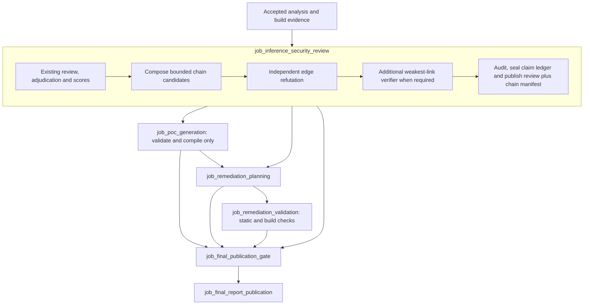

# Evidence completion and remediation

Status: implementation contract, partially delivered; no change to execution authorization.
Original inspected baseline: `d2b64774`. Source reconciliation through `dd9c9ad`
(including `b702eb7`, `7641fa5`, `18eae9f`, `e769645f`, `dd1f8018`, `c44eddc1`),
2026-10-28.

The [dossier data inventory](dossier-data-inventory.md) records the source-verified available
inputs, bounded queries/indexes, producer ownership, visibility and evidence gaps at contract
commit `5f5548d` and the delivered integration. [Dossier operations](../operations/dossier-publication.md)
and [remediation operations](../operations/remediation.md) describe the implemented producers and
their limits; the [documentation implementation record](../reviews/evidence-completion-documentation-inventory.md)
tracks reconciliation and acceptance gaps.

The chain, remediation and dossier producers, central configuration/registration/pre-gate graph
and completion metrics now exist. The shared reader accepts review `/3`; chain/base completeness
isolation, immutable PoC `/2`, five-capability gate `/2` and gate-only report `/2` are delivered.
The owner-verified [seeded PDF sample](../operations/dossier-publication.md#verified-seeded-sample)
is retained; full native all-lane semantics and Linux real-review remediation acceptance remain
follow-ups. Delivered source is therefore **not** a claim of end-to-end operational acceptance. The sections below
retain the original design rationale and requirements; current delivered data is enumerated in
the [inventory reconciliation](dossier-data-inventory.md#delivered-source-and-remaining-integration).

## Recommendation

Complete the pipeline with one final publication gate **after** every evidence-producing job.
Reuse the existing compile-only PoC producer, implement chain composition inside the inference
review before its ledger is sealed, and add the two already-reserved remediation jobs. Publish
their results as hash-bound attachments to immutable findings, not as mutations of those findings.

This design preserves the owner's [PoC decision](review-judge-and-poc.md#1-what-the-owner-decided):
generate a function and negative control, compile them, check symbol resolution, and **never
execute them**. A compiled function is developer documentation, not an observed reproduction.
Runtime proof, automatic patch application to a target, and automatic release clearance are not
part of this proposal.

## 1. What was missing at the original baseline

The gap is partly missing implementation and partly publication ordering:

| Surface | Inspected behavior | Required change |
| --- | --- | --- |
| Final gate | `job_final_publication_gate/classify.py` always adds the four PoC, chain and remediation `*_not_run` limitations; any nonempty PoC/chain reference is withheld. | Verify actual producer manifests and derive limitations from their recorded dispositions. |
| PoC producer | `job_poc_generation` already has candidate verification, a bounded writer, deterministic policy checks, compile checks and a handoff. It ships disabled and depends on the gate. | Move it before the gate, bind it to the accepted review/build, and make its outcomes part of gate accounting. |
| Report | `job_final_report_publication/job.py::load_poc` separately discovers a PoC handoff bound to the gate. `report.py` copies the gate's limitations independently of that discovery. | Read one gate-certified publication snapshot; remove post-gate outcome discovery. |
| Chains | Review workers retain `chain-seeds.json`, but the inference job has no composition/refutation stages or accepted chain manifest. | Treat seeds as hints; produce evidence-qualified chains before review publication. |
| Remediation | Confirmed-only `remediation_intake` already exists. The input matrix reserves `job_remediation_planning` and `job_remediation_validation`, but neither runs. | Implement both consumers without changing adjudication or shipment policy. |
| PoC storage | `job_poc_generation/package.py::write_candidate` replaces `data/poc/<claim-id>/`. | Publish attempt-owned files so a retry cannot overwrite artifacts bound by an older accepted handoff. |

Simply enabling PoC generation would not fix the gate: the current order is
`review -> gate -> PoC -> report`. Making that same gate depend on PoC would introduce a cycle.
The solution is to remove the PoC producer's gate dependency, not run the final gate twice.

## 2. Proposed graph and ownership



The arrows from optional jobs apply only when those jobs are enabled. Planning does not require
PoC success: it can use a verified PoC artifact as context, or produce a plan directly from the
confirmed finding. If PoC is disabled, planning follows the review. Validation requires planning;
configuration that enables validation while disabling planning is rejected.

Chains remain stages of the inference job, matching the
[existing chain design](inference-security-review.md#attack-chain-composition-and-refutation).
They use the existing single claim ledger, not a second chain ledger or a downstream job that
rewrites a sealed review. Add visible units for candidate composition, refutation and conditional
verification before `completeness.audit` and the serialized publication units. Workers remain
application-bounded cells, not a new dynamically mapped execution framework.

Extract the accepted-review reader currently in the gate's `verify.py` into a shared,
model-free reader, for example `jobs/accepted_review.py`. The gate, PoC producer and remediation
jobs use that same verifier. PoC's `inputs.py` then binds directly to the accepted review handoff,
its package manifests, candidate list and accepted native build, with no gate import or gate hash.
Strictly validate the producer's actual candidate schema; remove the field-stripping schema
workaround rather than carrying it into the new contract.

The report remains the single terminal job. Direct CLI execution, `start`/`resume`, standalone
job dispatch with `--upstream-from-run`, and Dagster must use the same dependency rules for these
jobs. No consumer discovers extra outcomes after the gate has sealed its inputs.

## 3. Shared artifact and identity rules

Keep the accepted finding, adjudication, score dimensions and `ship-block-policy/1` result
immutable. A downstream PoC, plan or validation record names:

- the run and accepted review handoff hash;
- `claim_id`, `adjudication_id`, `finding_package_id` and the finding's SHA-256;
- the exact evidence/build workspace, image, settings, guidance and tool identities it used;
- its own status, reason codes, gaps and hash-bound artifact references.

Do not rebuild a finding package merely to attach a PoC or proposed fix. Its existing `poc` and
safe-regression placeholders remain unset by the review; gate-certified attachments carry the
downstream results. Chain memberships can be populated during review publication because chains
are finalized before the base finding packages are written.

Avoid identity cycles: chain semantic identities use ordered claim/adjudication identities,
canonical continuity edges, objective and environment identity, never final finding-package
hashes. Chain ledger events reference pre-publication chain artifacts that do not contain the
final ledger head or final finding hashes. The accepted review handoff binds the resulting ledger,
chain manifest and final finding packages together. Later attachments point only upstream.

Put durable artifacts under the producer's immutable attempt directory, for example
`runs/<run-id>/data/jobs/<job-id>/attempts/<attempt>/...`. A manifest contains run-relative paths
and hashes; readers do not reconstruct a mutable `data/poc/<claim-id>` path. Temporary workspace
copies are bounded, attempt-owned and removed after checking; durable receipts remain.

Every finite admitted candidate set has exact accounting:

```text
admitted candidates = candidates with terminal outcomes + explicitly capped/not-launched candidates
```

Deduplication, rejected seeds and ineligibility have separate counts/reasons. Bound graph
exploration before combinatorial expansion; record unexplored frontiers and the limiting bound,
not an invented count of all theoretically possible paths. Empty input, disabled capability,
unsupported scope, capped work, ordinary failure and integrity failure are distinct.

## 4. PoC: finish the existing compile-only vertical

Preserve current eligibility: supported or confirmed claims, an accepted judge verdict, a resolved
`poc_basis`, and the configured severity/documentation policy. Do not silently narrow it to only
High/Critical or only confirmed findings. Supported findings may receive documentation but remain
in the unconfirmed verification backlog and never enter remediation planning.

Reuse the existing writer, AST policy, compiler replay, sanitizer-object compile and symbol
checks. Initial support remains accepted C/C++ native translation units. Other languages receive
an explicit unsupported-scope disposition, not a fabricated compile result. Keep the existing
per-candidate statuses: `compile_verified`, `compile_failed`, `artifact_generated`,
`policy_denied`, `insufficient_evidence`, `not_applicable`, and `unsafe_to_attempt`.

The new PoC summary additionally makes the assurance boundary machine-readable:

```json
{
  "execution": "not_performed_by_policy",
  "runtime_verified": false,
  "result_id": null
}
```

Those fields apply even to `compile_verified`. The negative control is compile-checked, not
observed to pass. A compile failure does not contradict a finding. Writer/compile failures and
candidate caps remain named gaps; configured nonexecution is an explicit notice, not an
unexpected failed lane.

The gate consumes a sanitized summary with finding identity, status, description, file references
and the execution boundary. Generated source, compiler diagnostics and private briefs remain
protected run-owned data. Public JSON/Markdown/HTML/PDF show no function source or raw payloads.

Keep the enable flag explicit during rollout. After acceptance, enable automatic compile-only
generation in the intended central profile for **new runs**; enabling it never authorizes
execution. Existing runs retain frozen configuration. If preserving manual dispatch of a disabled
PoC job, bind that explicit request and accepted handoff into the gate's input identity; merely
finding an old handoff must not silently activate a disabled lane.

## 5. Attack chains: prove connections, not just component findings

Composition consumes adjudicated claims, their scores, normalized seed hints and bounded accepted
index queries. It does not consume red/blue transcripts or scan the target tree. Seeds never count
as evidence. A candidate has an objective, ordered component claims, prerequisites, environment
identity and one typed record per edge.

For each edge, require the five existing continuity obligations:

| Obligation | Evidence must establish |
| --- | --- |
| Identity | The output principal, token, resource, object or artifact of A is the input of B. |
| Privilege | A actually provides the privilege B requires; no implied elevation. |
| Trust boundary | Zones, transport and enforcement point agree with resolving flow/configuration evidence. |
| Artifact/deployment | Source, compiled artifact, package/image and relevant configuration are connected by accepted identities. |
| Time/configuration | Versions, lifetimes, ordering and state coexist in the observed scope. |

Each obligation carries cited evidence and `satisfied`, `contradicted` or `unresolved`. Missing
deployment evidence stays unresolved; a source call graph alone does not establish a deployed
chain. Apply existing evidence admissibility rules, not model agreement.

An independent refuter receives components, edge obligations and resolving evidence, but not the
composer's rationale. It attempts to defeat the weakest edges. Reuse actor/model independence
checks; different conversation identity is mandatory. For chains containing a component that
qualifies for shipment blocking, including one pending distinct-model verification, run an
additional independent weakest-link verifier as required by decision 7. A missing required
verification is a gap, never a successful challenge.

Deterministic policy assigns:

| Chain status | Conditions |
| --- | --- |
| `confirmed` | All component claims are confirmed, all edge obligations have counted support, and every required independent challenge completed without an accepted defeat. |
| `qualified_supported` | No accepted defeat, completed required challenges, but a supported component or unresolved continuity obligation limits the chain; list every qualification. |
| `refuted` | An accepted evidence-backed contradiction defeats a necessary edge or prerequisite. |
| `insufficient_evidence` | Composition/challenge could not complete, evidence cannot support a meaningful qualified chain, or required independence is absent. |

Append typed chain proposal, challenge and decision events to the review's normal immutable ledger
shards. Extend its closed event validator, canonical merge order and projection together. Chain
defeat never transitions a component claim. Publish a manifest containing every admitted
candidate's terminal outcome, qualified/refuted chains and coverage bounds; only confirmed and
qualified chains appear in the main report.

Use the existing central chain bound where applicable and add typed link, expansion, worker,
retrieval and challenge budgets. Chain assessment reports objective, confidence, prerequisites,
exposure and remediation choke points separately. Do not sum component severities or introduce a
new chain-based shipment decision in this slice.

## 6. Remediation planning: produce a proposal, not a target edit

`job_remediation_planning` reads only the verified `remediation_intake` partition. A supported
finding is not admitted even if a PoC compiled. Optional accepted chain context can identify a
shared choke point, and compile-checked PoC context can inform a test specification. Neither is
required to plan a source-backed fix.

Each confirmed intake finding gets one terminal planning outcome: `proposal_generated`,
`manual_design_required`, `insufficient_evidence`, or an explicit capped/not-launched record.
A proposal binds the original finding and includes:

- the violated invariant and resolving evidence, the intended corrected invariant, and the
  bounded source/configuration changes proposed;
- a patch artifact when a sufficiently supported local change can be described, with an original
  content hash for every touched file and explicit absence proofs for new files;
- expected compatibility effects, affected interfaces, residual risks and deployment prerequisites;
- a safe regression-test specification: synthetic fixtures, assertions, positive/negative cases,
  and the behavior expected before and after the change;
- the validation checks needed, scope limitations and any unavailable evidence.

The model has bounded source/index retrieval and emits data, not shell commands. Apply no changes
to `targets/`, create no target commit/PR, and run no deployment. A proposal with a patch is still
untrusted until validation. Multi-file or architectural fixes that cannot fit the evidence and
patch bounds become `manual_design_required`; do not fabricate a tiny fix.

A PoC function is not automatically a regression test. In particular, deliberately triggering a
fault is not a suitable passing test for a fixed build. Derive a separate specification with an
explicit safety assertion; retain provenance to the PoC, but do not copy it blindly.

Do not fill the score package's currently-null `remediation_priority` with planner prose. Display
existing shipment status, technical severity and chain leverage separately until a real priority
policy is implemented.

## 7. Remediation validation: state the assurance level

`job_remediation_validation` verifies the proposal against the accepted baseline in a disposable
copy. It does not validate the live target or grant access to a PoC executor.

1. Reverify finding, proposal, touched-file hashes and build provenance. Reject traversal,
   symlink escapes, undeclared edits, ambiguous hunks, oversized patches and baseline mismatch.
   Apply an exact patch to the copy, with no fuzzy application.
2. Check patch policy and review the corrected invariant against resolving evidence. An independent
   reviewer receives the requirement, source context and patch, not the planner's argument that it
   is correct. Its judgment remains analyst-assessed data, not proof.
3. Run only commissioned deterministic analyzers and safe build adapters over the baseline and
   patched copies with identical pinned tools/configuration. Replay accepted compiler/build facts,
   not model-supplied commands. Changes that would alter executable build scripts, tool loading or
   the adapter's safety assumptions require manual validation instead of automatic replay.
4. If a safe regression-function artifact can be produced under the existing compile-only policy,
   compile-check it separately. Do not link/run the PoC or execute generated tests.
5. Publish the exact patch hash, checks attempted, baseline/patched outcomes, diagnostic references,
   unperformed checks and residual gaps. Delete temporary copies and retain cleanup receipts.

Use per-check dimensions (`patch_applicability`, `policy`, `semantic_review`, `static_checks`,
`build`, `regression_compile`, `runtime_regression`) plus a conservative terminal summary:
`build_checked`, `static_checked`, `rejected`, `inconclusive`, or `manual_validation_required`.
Unperformed dimensions stay explicit. Baseline build failure is inconclusive, not a patch success.
No new diagnostics in selected tools is not proof that a vulnerability is fixed.

The runtime regression dimension is always `not_performed_by_policy` in this design. Neither
`build_checked` nor a reviewer's approval means `fixed`, `resolved` or `regression_verified`.
The original finding remains confirmed and keeps its shipment status. A developer applies an
approved proposal outside this run; a new review of the changed snapshot is needed for a new
release decision.

**Deferred execution boundary:** observing failure-before/fix-after, sanitizer signals or passing
negative controls requires a separately approved isolated test service and authorization design.
The unresolved authorization/host decision is not resolved by flipping a feature flag here.
Future runtime receipts must supplement, never relabel, these compile-only receipts.

## 8. Gate, limitations and reporting

Replace hardcoded absence with explicit capability accounting. Reuse the repository's typed
dispositions `SUCCEEDED`, `SKIPPED_NA`, `SKIPPED_POLICY` and `GAP`, alongside each producer's own
candidate statuses. Include enabled/expected scope, input handoff references, attempted counts,
caps, gaps and assurance level.

| Situation | Publication treatment |
| --- | --- |
| Disabled in frozen configuration, without an explicitly admitted manual invocation | `SKIPPED_POLICY`; show why it did not run, not a missing implementation message. |
| Producer ran with no eligible scope | `SKIPPED_NA` with explicit eligibility accounting; do not describe the target as clean. |
| Accepted producer with fully accounted results | Publish verified outcomes and remove the corresponding unconditional `*_not_run` limitation. |
| Enabled expected work missing, failed, capped or incomplete | Named `GAP` scoped to the capability/candidates; publication has limitations. |
| Present accepted artifacts are tampered, internally inconsistent with their bound identities/accounting, or bound to another review | Integrity failure; accept no new gate handoff. Evidence-backed semantic disagreement remains a valid review outcome. Ordinary stale inputs are rerun by resume planning, never silently reused. |

Candidate-level outcomes can still introduce gaps even when the producer itself completed. Keep
review coverage and enhancement coverage separate: PoC/patch checks do not retroactively close
claim-ledger gaps or make a degraded review complete.

Remove `poc_lane_not_run` only when compile-only PoC work is actually accounted for; retain the
explicit nonexecution notice. Remove the chain/remediation `*_not_run` entries only when the
corresponding implemented producer has an accepted, applicable outcome, including an explicit
empty-scope outcome. A failed stage receives a failure/gap limitation instead of "does not exist."

Replace unconditional `withheld_reasons` with reference validation. Valid chain references no
longer withhold their component findings. Missing optional downstream work does not hide a
valid base finding: publish the finding with the named limitation and no unverified attachment.
An unresolved reference asserted by the base finding still withholds that package; malformed or
tampered accepted manifests fail integrity validation.

The gate freezes a single upstream snapshot, re-hashes all referenced artifacts and verifies exact
candidate/package partitions. Validate that the accepted upstream identities did not change
before acceptance. The report reads only this accepted gate snapshot, never a later `latest.json`
for a PoC or remediation job.

Report sections are confirmed findings, verification backlog, qualified/confirmed chains,
compile-only PoC outcomes, remediation proposals and validation levels, withheld items, and
coverage/limitations. JSON and Markdown use closed schemas and deterministic rendering. Update
the standalone HTML/PDF reader as well so those surfaces show the same statuses and cannot
describe `compile_verified` as runtime proof or `build_checked` as a resolved finding.

Ordinary per-candidate failures must be published as accounted outcomes so downstream jobs can
continue. A whole-job integrity/runtime failure follows existing scheduler failure behavior; this
design does not promise a final report when required dependencies cannot publish a valid handoff.

## 9. Contracts, configuration and source changes

New contracts are `attack-chain/1`, `attack-chain-manifest/1`, `remediation-plan/1`,
`remediation-planning-handoff/1`, `remediation-validation/1` and
`remediation-validation-handoff/1`. Version the review handoff for its chain manifest, the PoC
summary/provenance for their review binding and immutable paths, and the gate/report for their
attachment and capability records. Extend ledger-event validation/versioning for chain events.
The base finding shape need not change for downstream attachments.

Old runs are not rewritten. Existing documents remain under their recorded schema versions.
New execution uses the new contracts; an old incompatible handoff is an explicit unsupported
input, not a partially trusted dictionary or a success-shaped empty result. Any retained historical
read support must dispatch by exact version and must not mix old post-gate PoCs into new gates.

| Surface | Implementation scope |
| --- | --- |
| Review and ledger | `jobs/job_inference_security_review/`, `review/ledger.py`, `review/models.py`, and a focused `review/attack_chains.py` module; typed chain events, evidence validation and deterministic decisions. |
| Shared input verification | Extract the current gate review reader; update gate and PoC callers without duplicating hash/schema checks. |
| Existing PoC | `inputs.py`, `package.py`, handoff/provenance schemas and datasets; remove gate coupling and mutable candidate output paths. |
| New jobs | `jobs/job_remediation_planning/` and `jobs/job_remediation_validation/`; explicit handlers, typed settings, validators and dataset declarations. |
| Wiring | Runtime registry/target-independent launch declarations, central typed TOML/profile settings, direct graph and `orchestration/topology.py`, CLI manual admission, Dagster step pools, input-source matrix and planned-consumer declarations. |
| Publication | Gate verification/classification, report schemas/assembly/rendering, and standalone `reporting/` HTML/PDF consumption. |
| Guidance | Registered role/task fragments and only needed runtime skills; shared governing rules remain authoritative and never copied. |
| Operations | Update PoC, final-report, inference-review and jobs/runtime pages when behavior ships; this proposal does not relabel planned behavior as operational. |

Configuration owns models, reasoning, workers, timeouts, retries, chain/candidate bounds, patch
limits, adapter allowlists and budgets. Reuse existing run-wide model/resource admission and
bounded container execution. All new jobs are target-independent consumers of accepted run state,
not readers or writers of the user-owned checkout.

Fingerprints include every actually consumed artifact hash, normalized setting, implementation,
schema, validator and tool identity. Changing a proposal invalidates its validation and final
publication, not the accepted original review. Changing review/chain evidence invalidates dependent
PoCs and remediation. Resume and standalone manual dispatch must agree on those invalidation
boundaries.

## 10. Delivery sequence and acceptance

Deliver four end-to-end slices, not all producers first and publication later:

| Slice | Deliverable | Required observable outcome |
| --- | --- | --- |
| 1. PoC publication | Shared review verifier, PoC before gate, attempt-owned outputs, explicit compile-only gate/report contract. | A real review-produced candidate reaches a compile outcome and the report without a contradictory unconditional `poc_lane_not_run`. Disabled/empty/failure cases remain truthful. |
| 2. Chains | Typed continuity evidence, bounded composition, independent challenges, ledger/manifest and gate/report consumption. | One fixture proves a connected chain; another has two confirmed findings but an unproved connection and cannot produce a confirmed chain. |
| 3. Planning | Confirmed-only proposals, bounded inert patches and separate regression specifications, with gate/report intake. | A confirmed finding gets a traceable proposal; a supported finding remains only in the verification backlog. |
| 4. Validation | Exact scratch application, independent semantic challenge, static/build checks and assurance-labelled reporting. | A baseline-matching patch can become `build_checked`, a broken patch cannot, and neither clears the original shipment decision. |

Acceptance must cover:

- Real review-produced `poc_candidates` flowing through both orchestration surfaces, not only
  fixtures that manually insert a candidate; every permitted enabled/disabled optional-job
  combination and rejection of invalid combinations.
- No generated PoC entry point, link/load/run command or target mutation; policy refusal cannot
  trigger a model repair that bypasses it.
- Every terminal status, cap, timeout, empty scope and missing build; positive and negative controls
  remain explicitly unexecuted.
- All five chain obligations independently missing/contradicted, supported-link ceilings, failed
  refutation, missing distinct verification, seed rejection and exploration bounds.
- Deterministic chain identities/ledger merges under shuffled worker completion and shard order;
  chains cannot alter component states or score/ship-block records.
- Confirmed-only planning, exact patch baselines, malformed/escaping edits, untrusted build changes,
  baseline build failure, failed patched build, and unsupported validation adapters.
- Tampering and cross-review mixing at every manifest boundary; retrying a PoC preserves the bytes
  reachable from earlier accepted handoffs.
- Resume invalidation, manual admission and stale-input behavior; the final gate remains after all
  enabled producers and the report remains the only terminal job.
- Byte-reproducible JSON/Markdown projections and consistent HTML/PDF assurance labels, with
  no generated PoC source, raw PoC payloads, private prompts or secrets in the new public sections.

The design is complete when these capabilities have real producers, accepted contracts, exact
accounting and truthful publication. It deliberately does not claim that compile-only
demonstrations reproduce vulnerabilities or that build-checked patches prove remediation.

## 11. Parallel implementation decisions

The user authorized parallel implementation and dossier rendering on 2026-10-28, and selected
one document dossier per **confirmed finding**, irrespective of source-code or document origin.
These decisions bind the implementation partitions:

1. Preserve compile-only PoCs and nonexecuting remediation checks; no new runtime authorization.
2. Keep chains in the inference job and its single ledger, before review publication.
3. Use `jobs/completion_contracts.py` for shared schema identifiers, exact finding bindings,
   dossier kinds and nonexecution assurance. Reuse `ProcessingDisposition` for capability states.
4. Remediation summary records use `items`, `gaps`, `upstream` and `run_id`; each item carries
   `finding: {claim_id, finding_package_id, sha256}`. Each producer's
   `acceptance.publish_handoff` output binds its schema, summary artifact, item count, gaps and
   terminal status, following the existing semantic-job publication pattern.
5. Add `job_dossier_publication` after evidence/remediation producers and before the final gate.
   It consumes accepted review and optional PoC/remediation handoffs, never the gate. The gate
   certifies the dossier manifest; the final report exposes artifact references and render status.
6. Produce one confirmed-finding dossier per confirmed package and one PoC dossier per accepted
   PoC candidate outcome, including unsuccessful/unavailable outcomes with explicit limitations.
   Retain deterministic dossier JSON, LaTeX source, PDF when rendered, and rendering receipts as
   immutable run artifacts. Failed rendering retains LaTeX and a named gap, never a fake PDF.
7. Dossiers are protected developer artifacts. They may include bounded resolving source excerpts
   and inert PoC function text, but no credentials, raw prompts or arbitrary model transcripts.
   Public report projections contain only sanitized descriptions, statuses and artifact references.
8. Reuse the commissioned LaTeX container, template/palette and hardened execution path. The
   rendering agent owns building/smoking that image on this host; no other agent changes image pins
   or prunes Docker state. Actual PDF rendering, not only a mock, is required for the seeded sample.
9. The documentation agent owns architecture/operations reconciliation and a source-verified
   dossier input inventory that distinguishes available evidence, bounded queries/indexes,
   unavailable capabilities, visibility and resolving provenance.
10. The manager owns central TOML/config-loader wiring, registry, orchestration, input matrix and
    final end-to-end integration. Implementation agents own disjoint producers and focused tests.
    No agent pushes, opens a PR, merges main or edits user-owned targets.
11. The user selected **Run both automatically for new reviews** for remediation planning and
    bounded nonexecuting validation. After implementation acceptance, central defaults will enable
    both for new configurations; automatic compile-only PoC and dossier publication are also
    intended. This is a rollout decision, not a claim about the inspected baseline defaults.
    Existing runs keep their immutable frozen configuration, including disabled capabilities:
    changing checkout defaults must not silently activate them on resume or rewrite old runs.
    Automatic processing grants no runtime execution, reproduction or `fixed` assurance.
12. Bake telemetry and metrics into the first implementation of every completion lane. Reuse
    `context.events`, the canonical run stream and `observability.telemetry.aggregate_run_metrics` /
    `data/telemetry/summary.json`, not a separate service. Track stages/candidates, terminal
    outcomes, caps, gaps, durations, retries and adapter/render failures, with model usage where
    emitted. Use low-cardinality aggregates and resolving identities; never log source, patches,
    PoC/prompt contents or credentials. Missing usage and integrity/coverage gaps remain explicit.
    The [telemetry architecture](telemetry.md#evidence-completion-tracking-commissioned) records the
    implementation/reconciliation boundary.
