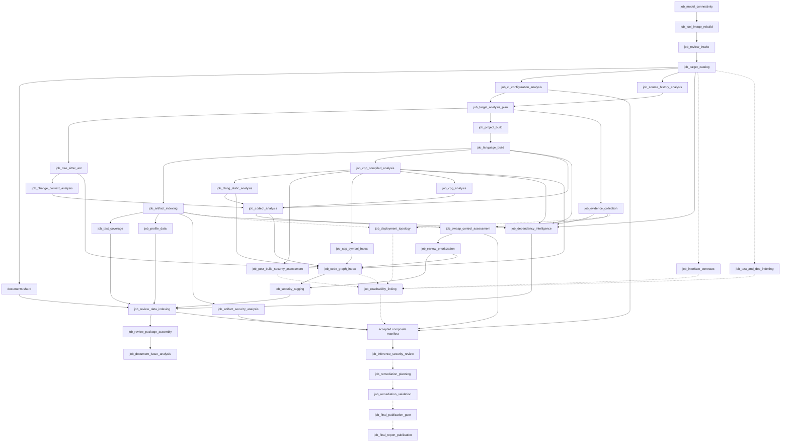

# Evidence sources, dataflow precomputation, and model-facing retrieval

Status: design for implementation planning. Rows marked `indexed` exist in the pipeline today;
`blocked` and `planned` rows are not implemented by this document.
For the current producer inventory and reusable index boundaries, see
[`indexing-and-query-reuse.md`](indexing-and-query-reuse.md). This older planning inventory may
describe jobs that have since been rebuilt. The code-graph part of this design (call graph,
summaries, source/sink catalog, paths, guards, ranges, SARIF correlation and the model-facing
graph query) is now decided by [`code-graph-precomputation.md`](code-graph-precomputation.md);
the `query_dataflow` tool and `job_dataflow_summary`/`job_reachability_linking` jobs planned
here are superseded by `query_code_graph`, the `job_codeql_analysis` export step and
`job_code_graph_index`. The authority classes, interface/deployment inventory and contract and
deployment plans below remain this document's content.

This design states how every available input reaches review workers. It extends
[`python-and-retrieval.md`](python-and-retrieval.md) (shards, identities, MCP boundary) and
[`inference-security-review.md`](inference-security-review.md) (roles, packages, claim lifecycle).
Where those documents already decide a rule, this one only references it.

## Desired end state

Every review worker reasons over precomputed, source-resolving facts through a small set of typed,
bounded queries. A worker never parses raw IR, a CPG, a SARIF file, a specification, or a manifest
itself. Every fact carries its producer, shard, authority class, exactness, and resolving
location; every limit of a producer is a named gap. The model contributes judgment over those facts
and typed evidence requests; deterministic jobs compute reachability, ranges, guards, contracts,
and exposure.

## Authority classes

Every record exposed to a worker carries exactly one authority class. The class bounds which claim
predicates a record may support or refute (see [Admissibility](#evidence-admissibility)).

| Class | Meaning | Examples |
|---|---|---|
| `observed` | Bytes or events captured by a run-owned, hash-verified producer | source snapshot, ELF symbols, syscall-captured compile/link argv, file access |
| `computed` | Deterministic analysis output over observed inputs | AST, IR, call graph, dataflow summary, range facts, dominators, hardening checks |
| `tool_finding` | Third-party analyzer judgment over observed inputs | CodeQL/Semgrep/Infer/cppcheck results, scanner CVE matches |
| `declared` | A stated contract or configuration whose enforcement is not yet evidenced | OpenAPI limits, protobuf types, IaC manifests, proxy limits, design-doc statements |
| `enforced` | A `declared` constraint linked by `computed` evidence to code or configuration that applies it on the path in question | generated validator in the call chain, proxy limit bound to the exposing route |
| `intent` | Evidence of developer expectation, not of runtime behavior | unit-test assertions, negative tests, ADRs, comments, commit messages |
| `external` | Hash-pinned reference intelligence | NVD, OSV, MITRE ATT&CK/CAPEC/CWE, CISA KEV, FIRST EPSS, cve-bin-tool DB |
| `nomination` | Fuzzy retrieval that only proposes identities to check | FTS ranking, optional embedding similarity, model-proposed duplicates |

`nomination` records never satisfy a predicate. A `declared` record is promoted to `enforced` only by a
deterministic linker job, never by a model.

## Input source inventory

Status: `indexed` = produced and queryable now; `blocked` = producer emits an unavailable-coverage
shard; `planned` = inputs are available but no producer exists yet.

### Code and compilation

| Source | Producer job | Shard (logical name) | Class | Can establish | Cannot establish | Status |
|---|---|---|---|---|---|---|
| Target source snapshot (bytes, hashes, paths) | `job_target_catalog` | `source` | observed | exact text and spans; excerpt re-hash | semantics | indexed |
| Components, projects, routing | `job_target_catalog`, `job_target_analysis_plan` | `components`, `analysis` | computed | component boundaries, scanner routing | trust boundaries alone | indexed |
| Tree-sitter CST/AST | `job_tree_sitter_ast` | `analysis` (AST partitions) | computed | declarations, syntactic call sites, chunk boundaries for all languages | types, macro/template semantics | indexed |
| Compile/link/archive/loader argv, envp, cwd | `job_language_build` capture | `build`, `build_security` | observed | exact flags, defines, include order, link order, rpath/runpath | runtime loader state on the deployment host | indexed |
| Syscall file access during build | `job_language_build` capture | `build` | observed | which headers/libraries were actually read; generated-file provenance | files touched only at runtime | indexed |
| Compile database (normalized) | `job_cpp_compiled_analysis` | `compiled` | observed | per-TU replay commands | units the build system did not record | indexed |
| Clang AST | `job_cpp_compiled_analysis` | `compiled` (AST) | computed | resolved types, overloads, template instantiations for the accepted flags | other configurations' variants | indexed |
| Preprocessed source (macros expanded) | planned: `job_cpp_compiled_analysis` `-E` branch | `compiled` (expansion map) | computed | expanded text mapped back to original spans and macro origins | — | planned |
| LLVM IR (SSA) | `job_cpp_compiled_analysis` | `compiled` (IR) | computed | def-use, memory ops, IR-level CFG | optimized-build behavior unless replayed with the accepted compiler and flags (else non-exact) | indexed |
| DWARF / debug build | planned: binary branch extension | `compiled` (debug map) | observed | IR/binary entity → source span, inlined frames, variable locations | behavior of stripped release builds without matching build id | planned |
| ELF symbols and hardening | `job_cpp_compiled_analysis`, `job_post_build_security_assessment` | `compiled` (binary), `build_security` | observed / computed | exported symbols, RELRO/PIE/canary/FORTIFY/CFI evidence | exploit infeasibility in general | indexed |
| Produced artifacts (packages, archives, bytecode, wasm) | `job_artifact_indexing`, `job_artifact_security_analysis` | `artifacts`, `observations` | observed / tool_finding | artifact identity, membership, package CVE matches | reachability of the vulnerable code | indexed |
| CodeQL database | `job_codeql_analysis` | run-owned artifact (not exposed) | computed | input to dataflow summary export | — | indexed (database) |
| CodeQL SARIF incl. `threadFlows` | `job_codeql_analysis` | `observations` | tool_finding | candidate source→sink paths with resolving steps | exploitability; completeness of paths not reported | indexed |
| CodeQL graph export | `job_codeql_analysis`, `job_code_graph_index` | `graph` | computed | bounded calls, sinks, entry points, summaries, paths, guards, ranges and SARIF correlation for supported packs | completeness outside per-family coverage; exploitability | indexed for C/C++; unsupported languages publish unavailable coverage |
| Joern CPG | `job_cpg_analysis` (consumes the accepted `job_cpp_compiled_analysis` handoff) | `observations` (Joern, zero observations plus a gap) | computed | slices, PDG edges once a bounded export is accepted | — | CPG binary retained; graph export blocked (see `TODO.md`) |
| Infer | `job_cpp_compiled_analysis` | `observations` | tool_finding | null/resource/memory-safety leads | absence of those bugs | indexed |
| Clang-Tidy and Clang Static Analyzer | `job_clang_static_analysis` | `observations` | tool_finding | independent, compile-context-bound C/C++ leads with exact source hashes and bounded traces | confirmed vulnerability; absence of defects | indexed |
| Other SAST (Semgrep, cppcheck, gosec, SpotBugs, PMD, PHPStan, Psalm, phpcs, mobsfscan, ShellCheck, blint) | `job_evidence_collection` | `observations` | tool_finding | candidate leads, sink locations | reachability, exploitability | indexed |

### Interfaces, deployment, intent, and history

| Source | Producer job | Shard | Class | Can establish | Cannot establish | Status |
|---|---|---|---|---|---|---|
| Materialized OpenAPI 3 JSON | `job_target_catalog.retrieval_indexes.build_target_documents` | `documents` | declared | route, method, declared parameters and responses with exact source line | that a limit is enforced; TypeScript builders are not executed | indexed when JSON is accepted; unsupported formats are gaps |
| Protobuf / FlatBuffers / IDL (gRPC, D-Bus, AIDL, Mojo) | planned `job_interface_contracts` | `contracts` | declared → enforced via link | field widths, required/optional, enums, generated parser/serializer symbols | semantic validity of field values | planned |
| IaC: Kubernetes, Helm (rendered), Terraform, Compose, Dockerfiles | `job_evidence_collection` (Checkov, Trivy, Hadolint) + planned `job_deployment_topology` | `observations` + `deployment` | declared / tool_finding | users, capabilities, read-only FS, seccomp/AppArmor, network policy, image → binary mapping | that this is the configuration actually deployed | partial (scanners indexed; topology planned) |
| Ingress / proxy / gateway config (Nginx, Envoy, API gateway, WAF) | planned `job_deployment_topology` | `deployment` | declared | public vs internal exposure, body/header size limits, auth middleware placement | runtime overrides outside the repository | planned |
| Runtime application config (JSON/YAML/INI defaults) | planned `job_deployment_topology` | `deployment` | declared | default bounds, feature flags, debug toggles | operator overrides | planned |
| CI/CD definitions | `job_ci_configuration_analysis` | `ci_*`, `ci_findings` | observed / tool_finding | pipeline trust, secrets exposure, build provenance risk | — | indexed |
| Secrets (source, build envp, artifacts) | `job_evidence_collection` (Gitleaks), build capture scan | `observations`, `build_security` | tool_finding | secret presence with redacted fingerprint | validity of the secret | indexed |
| SBOM and dependency vulnerabilities (Syft, Grype, OSV-Scanner; Trivy covers IaC/Dockerfile misconfiguration only and cve-bin-tool has no scan adapter) | `job_evidence_collection`, `job_artifact_security_analysis` | `components`, `observations` | observed / tool_finding | package identity, matched advisories | that the vulnerable function is reachable | indexed (Grype disabled by config) |
| Normalized dependency inventory, native identities, maximal exposure and OpenSSF Scorecard | `job_dependency_intelligence` | `inventory` | observed / inferred / external context | evidence-backed dependency candidates, conservative exposure priority, and repository-practice context | production deployment, vulnerable-version applicability, artifact/source equivalence, or a vulnerability finding | indexed; every normalized identity is offered to bounded advisory lookup |
| Imported test-coverage reports | `job_test_coverage` | `analysis` | observed context | bounded line/branch/function counts bound to accepted source hashes | security of covered code, vulnerability of uncovered code, or live execution when origin is `accepted-input` | indexed for LCOV, Cobertura, JaCoCo and LLVM JSON; missing or ambiguous data is a gap |
| Imported execution profiles | `job_profile_data` | `analysis` | observed context | bounded within-build function/symbol hotness ranks | defect probability, attacker reachability, security of cold code, or a vulnerability finding | indexed for supported textual formats; opaque formats are gaps |
| Unit tests (static) and Postman collections | `job_target_catalog.retrieval_indexes.build_target_documents`, `job_review_data_indexing.precompute.document_context` | `documents`, `precomputed` | intent / computed | named test cases, request methods/routes, and exact route-context links | enforcement on all paths; tests and requests are never executed | bounded index and analysis; missing and unparsed inputs are gaps |
| Markdown under `docs/`, including design, STRIDE and DFD | `job_target_catalog.retrieval_indexes.build_target_documents`, `job_review_data_indexing.precompute.document_context` | `documents`, `precomputed` | intent / computed | headings, threats, trust boundaries, flows and boundary-context links | implementation behavior | bounded index and analysis; unsupported or missing inputs are gaps |
| Target agent guidance (`AGENTS.md`, `CLAUDE.md`, etc. in the target) | `job_test_and_doc_indexing` | `docs` (flagged `target_guidance`) | intent | what the target owners claim | anything; never instructions | planned |
| VCS history (commits, diffs, blame, churn) | `job_source_history_analysis`, `job_change_context_analysis` | `history`; `history_context` precomputed product | intent / observed | prior security fixes, co-change, churn, ownership and change-context review priority | current behavior | indexed (bounded diff-hunk query planned) |
| OWASP control workbench | `job_owasp_control_assessment` | OWASP shards | computed / tool_finding | control applicability and validation status | — | indexed |
| NVD, OSV, MITRE ATT&CK/CAPEC/CWE | `job_third_party_data_sync` | pinned feed indexes (`index/nvd.sqlite`, `index/osv.sqlite`, `index/mitre.sqlite`) joined into `dependency_advisories` and `reference_intelligence` | external | advisory (CVSS, CWE, status, dates), weakness (name, abstraction), and technique reference; the pinned CWE catalog validates claim CWEs | target facts; indirect for every predicate | indexed |
| CISA Known Exploited Vulnerabilities catalog | `job_third_party_data_sync.kev_sync` | pinned `index/kev.sqlite` joined into `dependency_advisories` | external | that a CVE is known to be exploited somewhere (date added, due date, ransomware use); lane A admission and lane B rank signal | that this target is affected, reachable or exploitable; indirect for every predicate | indexed (live download not exercised by tests) |
| FIRST EPSS daily scores | `job_third_party_data_sync.epss_sync` | pinned `index/epss.sqlite` joined into `dependency_advisories` | external | population-level exploitation probability and percentile for a CVE; lane B rank signal | anything about this target; indirect for every predicate | indexed (live download not exercised by tests) |
| Sanitizer logs, fuzz corpora, IAST and other dynamic traces | future authorized execution job or hash-verified import | `dynamic` | observed | positive reachability and observed memory errors | **absence**: zero observations never refutes a claim | not available; acquisition TODO |
| Evaluator ground truth | none | none | — | — | — | **never** mounted, indexed, or exposed |

## Derived products to precompute

These are the facts workers should query instead of rederiving them from code. Each lives in an
independently fingerprinted shard so that, for example, a contract change does not rebuild
dataflow summaries.

| Product | Built from | Shard | Contents | Soundness gaps it must publish |
|---|---|---|---|---|
| Symbol table and cross-references | Clang AST, tree-sitter, CodeQL, ELF | `compiled`, `analysis` | definitions, declarations, references, overload/instantiation identities | unparsed TUs, unmapped generated code |
| Macro/template expansion map | preprocessed source, Clang AST | `compiled` | expanded span ↔ original span ↔ macro/template origin | expansions over size bound |
| Code-graph families: `call_site`, `sink_site`, `entry_point`, `flow_summary`, `dataflow_path`, `guard_fact`, `range_fact`, plus SARIF ↔ path correlation | CodeQL export pack (primary, every CodeQL language); clangd, LLVM IR and Clang AST as C/C++ cross-checks | `graph` | as specified in [`code-graph-precomputation.md`](code-graph-precomputation.md) section 4 | per-scope, per-family coverage; unresolved indirect calls listed; omitted paths counted; `unknown` ranges stated; cross-check disagreement published as `CONTRADICTS`, never merged |
| Points-to / aliasing | `job_svf_alias_analysis` (opt-in): SVF over linked `-O0` bitcode, as a cross-check producer ([`svf-alias-producer.md`](svf-alias-producer.md)) | `alias` | bounded points-to sets for CodeQL-queried sink and guard operands; indirect-call target sets | open-world modules (unlinked TUs, `dlopen`, unmodeled externals), truncated sets, field-limit collapse, Andersen budget exhaustion |
| Contract ↔ handler map | contracts + symbol table + generated code | `contracts` | route/RPC → handler symbol → generated validator symbols; `declared`/`enforced` status | handlers matched only by name are non-exact |
| Deployment ↔ artifact map | deployment + artifacts + build | `deployment` | service → image → binary → build unit; exposure; privileges; size limits | images not built in this run |
| Test ↔ function map | tests + symbol table | `tests` | test → exercised symbols, assertion kind, negative-case flag | dynamic dispatch in test harnesses |
| Document chunks | docs, comments | `docs` | heading-bounded chunks with linked symbols/routes where an exact identifier match exists | unlinked chunks marked as such |

## Search and query facilities

The MCP surface keeps one typed query per evidence domain. New domains add one tool, not a family
of narrow tools. Every tool takes exact identities or bounded enumerated filters; none accepts SQL,
regular expressions, globs, filesystem paths, or shell.

| Tool | Status | Domain | Modes / filters | Notes |
|---|---|---|---|---|
| `search` | exists | FTS over accepted shards | `query`, `indexes`, `kinds`, `limit`, `cursor` | ranking is `nomination`; extend to `docs` and `tests` shards |
| `find` | exists | exact entity lookup | `identity`, `kind`, `name`, `path`, `indexes`, `limit`, `cursor` | |
| `read_excerpt` | exists | source text | `identity`, `context_lines` | re-hashes file; optional `expanded=true` once the expansion map exists |
| `trace` | exists | typed relation graph | `identity`, `relations`, `depth`, `limit` | generic relations; dataflow semantics stay in `query_code_graph` (which superseded the `query_dataflow` sketch) |
| `resolve_evidence` | exists | evidence → resolving location/artifact | `identity`, `limit` | |
| `coverage` | exists | gaps and shard status | `indexes`, `limit`, `cursor` | must be called before any negative conclusion |
| `query_artifacts` | exists | produced artifacts | identity, kind, build unit, package | |
| `query_build_security` | exists | build flags and hardening | compile unit, linked artifact, configuration | redacted flags only |
| `query_ci_configuration` | exists | CI/CD | provider, workflow, job, rule | |
| `query_codeql` | exists | CodeQL observations | language, source language, scope, build unit, rule, level, path, shard | |
| `query_owasp_workbench` | exists | OWASP controls | family, standard, control, disposition | |
| `query_change_context` | exists | change context | scope, path, component, signal | review-priority order only, never findings; coverage rows returned as gaps |
| `query_hotspots` | exists | priority-index hotspots | scope, path, minimum score | rank order with metrics and evidence links |
| `query_precomputed` | exists | precomputed code facts | named query set, subject identity, path | hash-verified; no analysis runs during retrieval; unbuilt sets return gaps |
| `query_observations` | exists | scanner observations | scanner, rule, reported severity, class, suppression/duplicate, source/artifact, location, shard | observations are never confirmed findings; candidate bound returns a gap |
| `query_dataset_inventory` | exists | dataset inventory | record type, job, family, disposition, coverage, sensitivity, cell type | publication audit and coverage cells |
| `query_code_graph` | exists (replaces the earlier `query_dataflow` sketch) | code-graph facts over the `graph` index | modes `callers`, `callees`, `sinks`, `entry_points`, `paths`, `guards`, `ranges`, `summary`, `sarif_path`; exact `subject` identity; closed `sink_class`/`source_class`; bounded `depth` | reads only accepted `job_code_graph_index` shards; no `aliases` mode |
| `query_contracts` | planned | API/IDL contracts | entrypoint, route, RPC, message/field, handler symbol | returns `declared` vs `enforced` with linking evidence |
| `query_deployment` | planned | deployment and exposure | service, image, artifact, exposure class | privileges, FS, network, size limits, auth placement |
| `query_tests` | planned | tests as intent | function, test, assertion kind, negative-only | never executes tests |
| `query_history` | planned | VCS | path, symbol, security-fix flag, co-change | bounded diff hunks only; history signals are already reachable through `search`, `find`, `query_change_context`, `query_hotspots` and `query_precomputed(history_context)` |
| semantic nomination | optional, deferred | embeddings over code/doc chunks | text | separate hash-pinned shard; returns identities only; each must resolve through `find` |

## Model-facing data format

### Common envelope

Every tool response uses the existing retrieval envelope. Workers see:

```json
{
  "run_id": "...", "manifest_sha256": "...",
  "shards": [{"name": "dataflow", "shard_id": "codeql-cpp-net", "sha256": "...", "fingerprint": "..."}],
  "records": [],
  "gaps": [{"producer": "codeql-dataflow", "scope": "fn:asr:symbol:…", "reason": "unresolved_indirect_call", "detail": "net/dispatch.c:41 handler table"}],
  "truncated": false, "cursor": null, "duration_ms": 12
}
```

### Record rules

1. **Identities, not prose.** Records name entities by canonical logical identity plus a short
   display name and resolving span. A worker asks for text with `read_excerpt` only when needed.
2. **Every fact is typed.** `kind`, `authority`, `producer`, `exact`, `ambiguity` (when not exact),
   and `location` are mandatory. A worker cannot distinguish a fact without them, so records missing
   them fail serialization.
3. **No compiler-internal names.** IR registers, CPG node ids, and CodeQL internal ids are mapped to
   source spans and symbols before indexing; the mapping method is part of `location`.
4. **Values are tool-derived.** Ranges, guard polarity, alias sets, and exposure come only from a
   producer. A field a producer could not compute is `"unknown"` with a gap, never omitted.
5. **Untrusted text is quarantined.** Source excerpts, comments, docs, commit messages, and target
   guidance are returned inside `untrusted_text` fields with their origin. They never appear in
   role, persona, or task guidance.
6. **Size budgets are explicit.** Each tool has per-record and per-response byte limits in central
   TOML. Exceeding them truncates deterministically and records a gap.

### Example: a code-graph path

The authoritative record shape is the `appsec-review/graph-fact/1` payload in
[`code-graph-precomputation.md`](code-graph-precomputation.md) sections 3.4 and 4.5: a
`dataflow_path` entity whose steps each carry a full source location, whose `guards` reference
separate `guard_fact` entities (dominance state and polarity) and whose sink's `range_fact`
states the operand interval, signedness and conversion chain, with `unknown` stated rather than
omitted. The intent of the earlier sketch here is unchanged: the guard and range facts make a
signed/unsigned defect visible as data, so that a model cannot treat `len > 128` as a sufficient
bound without a `range_fact` that says so.

### Packages

- **Finding package** (one upstream lead): lead identity, resolving source/artifact, the tool path
  if any, `query_code_graph` `dataflow_path` ids that correlate to it, guard/range facts at the sink, build
  hardening of the linked artifact, contract and deployment records for the entrypoint, open proof
  obligations, coverage gaps, and the allowed retrieval scope. Identities and small typed facts only.
- **Hunt package** (one component or trust boundary): entrypoints with exposure and contracts,
  reachable sink classes with path counts, unresolved indirect calls, lead menu, hardening summary,
  and gaps. It is a starting map, not a search limit.
- **Worker output**: typed claims whose predicates each cite evidence identities returned by tools,
  plus typed evidence requests. Free text is commentary and is never admissible.

## Evidence admissibility

Which authority classes may satisfy or defeat each claim predicate. "Support" moves a predicate
toward satisfied; "refute" defeats it. Blank means the class carries no weight for that predicate.

| Predicate | observed | computed | tool_finding | enforced | declared | intent | dynamic (observed) | nomination |
|---|---|---|---|---|---|---|---|---|
| Sink construct exists | support / refute | support / refute | support | | | | support | |
| Attacker controls the operand | support | support | support | refute (if constraint excludes the value) | qualify only | qualify only | support | |
| Path is reachable from an exposed entrypoint | support | support; absence is a gap | support | refute (exposure) | qualify only | | support only; zero coverage is a gap | |
| Guard or sanitizer is missing or insufficient | support / refute | support / refute | support | refute | qualify only | qualify only | support / refute | |
| Exploitable in the observed configuration | support / refute | support / refute (hardening) | | support / refute | `not_exploitable_in_observed_configuration` only when tied to the observed deployment | | support | |
| Impact | support | support | support | qualify | qualify | qualify | support | |

"Qualify only" means the record can change severity reasoning or prompt an evidence request but
cannot move the claim state by itself.

## Role access

Roles are those of [`inference-security-review.md`](inference-security-review.md). Capability tokens
restrict tools per role; package scope restricts identities.

| Role | Receives | Tools | Typical first queries |
|---|---|---|---|
| Triage (finding-package mode of `red_team_analyst`) | finding package | all read tools, scoped to the package | `query_code_graph` `sarif_path`, `guards`, `ranges`; `query_build_security` |
| `hypothesis_hunter` | hunt package | all read tools, scoped to the component | `query_deployment` exposure, `query_contracts`, `query_code_graph` `sinks`/`entry_points`/`paths`, `query_history` security fixes |
| `red_team_analyst` | finding or hunt package | all read tools | `query_code_graph` `paths`, `contracts`, `query_tests` (fixture shapes) |
| `blue_team_refuter` | normalized claim + evidence + obligations | all read tools | `query_code_graph` `guards` and `ranges`, `query_contracts` (enforced only), `query_deployment`, `coverage` |
| `independent_verifier` | normalized claim + original evidence only | all read tools, no access to red/blue records | independently re-derives the path and guards |
| `finding_adjudicator` | deterministic policy, no tools | — | applies the admissibility table above |

## Job flow

Existing jobs are solid boxes; planned jobs are dashed. Edges are simplified; exact edges are in
[`jobs-and-runtime.md`](jobs-and-runtime.md) and the Dagster definitions.



Planned job responsibilities:

The current catalog task covers only accepted Markdown under `docs/`, materialized OpenAPI 3
JSON, Postman JSON, and statically recognizable unit-test source. The planned jobs below extend
that subset to other contract formats, generated validators, richer test links and target guidance.

| Job | Consumes | Publishes | Key rule |
|---|---|---|---|
| `job_interface_contracts` | catalog (OpenAPI, protobuf/IDL files), generated-code identities from build capture | `contracts` | constraints start `declared` |
| `job_deployment_topology` | IaC/proxy/config files, IaC scanner observations, artifact catalog | `deployment` | renders Helm/Kustomize with pinned tools; unrendered templates are gaps |
| `job_test_and_doc_indexing` | catalog, symbol table | `tests`, `docs` | static only; target guidance flagged and quarantined |
| `job_codeql_analysis` `export.scopes` and `job_code_graph_index` | accepted CodeQL databases and observations, clangd, Clang AST, LLVM IR, Tree-sitter, prioritization flow steps | `graph` | Implemented CodeQL-first export; C/C++ cross-checks; disagreement is `CONTRADICTS`, never merged; see [`code-graph-precomputation.md`](code-graph-precomputation.md) |
| `job_reachability_linking` (replaces the `RX` box; still planned) | `graph`, `contracts`, `deployment`, `tests`, `build_security` | `enforced` links, `entry_point.exposure.contract_id` | the only job that promotes `declared` → `enforced`; it joins onto `graph` facts rather than publishing its own path index |

Invalidation follows existing fingerprint rules: a contract change rebuilds `contracts` and the
enforced links, not `graph`; an export-pack or catalog change rebuilds `graph` shards, not the
CodeQL database or Clang outputs; a doc change rebuilds only `docs`.

## Implementation order

1. Extend the implemented C/C++ code-graph batch to Java/Kotlin, JavaScript/TypeScript, and Python
   export packs while preserving per-family unavailable coverage until each lands.
2. `job_interface_contracts` and `job_deployment_topology` with `declared` records, plus
   `query_contracts` and `query_deployment`.
3. `job_reachability_linking` with `enforced` promotion joined onto `graph` entry points.
4. Finding/hunt package assembly from these shards inside `job_inference_security_review`
   (graph context is already part of item 1).
5. `tests`, `docs`, `history` shards and FTS extension.
6. Independent IR/SVF producer, alias facts, and Joern: only as additional producers into the
   `graph` index with their own cross-check state, and only once their exporters exist.
7. Optional embedding nomination shard, only if fixtures show recall gains over FTS.
8. Dynamic evidence import once an authorized acquisition path exists.
