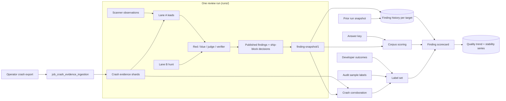

# Finding metrics

Status: **implemented 2026-11-11 as an offline operator domain**
(`src/appsec_review/observability/findings/`, operator guide
[`../operations/finding-metrics.md`](../operations/finding-metrics.md)), with the parts listed in
[section 11](#11-implementation-map) still open. Section 12 records where the implementation
differs from the design text and why. The unit tests have been run; the integration and acceptance
suites are written and have not been run. Work is tracked in [`../TODO.md`](../TODO.md) as T-060 to
T-077; this document does not carry its own backlog.

Finding metrics answer one question: *are the findings this system publishes correct, useful to
the team that must fix them, repeatable, and acted on?* They are distinct from the performance and
provenance metrics in [`../operations/metrics.md`](../operations/metrics.md) (throughput, timing,
receipts, resource spans, cost provenance), which answer *did the run execute and what did it
cost?* A run can score perfectly on the second and be useless on the first.

## 1. Questions and where each is answered

| # | Question | Metric family | Before this work | Item |
| --- | --- | --- | --- | --- |
| 1 | How many observations, leads, claims and findings did the run produce? | Volume (§5.1) | exists as event counts; no final-state snapshot | T-064 |
| 2 | How much did triage remove, and did it remove the right things? | Triage (§5.2) | volume exists (`triage_reduction`); effectiveness does not | T-062 |
| 3 | Are the published findings worth a developer's time? | Usefulness (§5.3) | not measured | T-064 |
| 4 | Against known answers, what is found and what is wrongly reported? | Correctness (§5.4) | exists for scanners; review output is optional | T-063, T-067 |
| 5 | Does the same input give the same findings? | Stability (§5.5) | formulas exist offline; no real run feeds them | T-065 |
| 6 | Was a previous finding fixed, or did it only stop being reported? | Lifecycle (§5.6) | not possible | T-060, T-061 |
| 7 | How much of the exposed code was reviewed? | Coverage (§5.7) | partial (`not_admitted` leads by reason) | T-068 |
| 8 | What did the model review find that scanners did not? | Hunt-lane value (§5.8) | not measured | T-068 |
| 9 | Can a developer act on a finding as written? | Actionability (§5.9) | not measured | T-069 |
| 10 | What did the developers do with the findings? | Outcomes (§5.10) | no ingestion | T-069 |
| 11 | Do field crashes agree with the findings? | Crash corroboration (§7) | no ingestion | T-072 |
| 12 | Is the reviewer itself failing in model-specific ways? | Reviewer integrity (§5.11) | not measured | T-071 |
| 13 | Did a prompt, model or configuration change help? | Trend comparison (§8) | blocked by identity rule | T-066 |

Every family is sliced by the dimensions of §4.4, including the game threat model (T-070).

## 2. Principles

1. **The published finding set is the subject.** Scanners are inputs. Scanner scores are kept
   because they explain where a miss originated, never as the headline.
2. **Every ratio travels with its counterweight.** Triage reduction is shown only beside true-lead
   retention; precision only beside recall or yield; stability only beside precision (a stable
   false finding is stable). A metric that can be maximised by doing nothing is never shown alone.
3. **Null is not zero.** An unavailable input yields `null` with a named reason, as in the existing
   run metrics. A missing prior run, key, label set or crash feed disables a metric; it never
   produces a clean-looking number.
4. **Labels are independent of the detector.** A label comes from an answer key, a developer
   outcome, a human audit sample or a crash report. A model's own dismissal, confidence or
   agreement with another model is a triage outcome, never a label.
5. **Units are stated.** Observation, lead, claim, finding (root cause), report occurrence, key
   case and crash bucket are different units. No ratio mixes them.
6. **Small denominators carry intervals.** A proportion over key cases or sampled leads is
   reported with its numerator, denominator and a binomial interval. Stability statistics over
   overlapping run pairs keep the existing rule of no interval without a predeclared method.
7. **Absence is not evidence.** A finding absent from a later run is not fixed, and code with no
   finding is not clean, unless coverage and a targeted check say so.
8. **Derived, rebuildable, bounded.** Metrics are recomputed from accepted, hash-bound artifacts.
   Nothing here scans a target at metric time, and no metric label carries a path, symbol, finding
   id or message.

## 3. System overview

Three stores, all derived:

- **Per run:** an immutable `finding-snapshot/1` of the published findings and, on request, a
  `finding-metrics/1` document built from it. Neither is written into the run-owned telemetry
  summary (decision 1 of section 12).
- **Per target, across runs:** a finding history under `runs/metadata/finding-history/<target-id>/`,
  content-addressed and rebuilt from the snapshots it names. It holds identities, lifecycle states,
  labels and crash links. It is not evidence authority and never feeds a worker prompt.
- **Per corpus, across runs:** the existing quality-trend artifacts and experiment snapshots
  (`observability.quality`, `observability.experiments`), fed by an adapter instead of by hand.

## 4. Entities

### 4.1 Finding identity (T-060)

A finding is one root cause. Its **fingerprint** is a hash over: weakness family, normalized
target-relative path, enclosing function (qualified symbol), source and sink symbols where the
claim names them, and a hash of the normalized code context of the affected construct. It excludes
the commit, line numbers, severity, confidence and prose. Two match tiers:

| Tier | Rule | Use |
| --- | --- | --- |
| `exact` | identical fingerprint | same finding |
| `relocated` | same weakness family, function symbol and code-context hash; path or line moved | same finding after a move or rename |

Anything weaker is not a match. The experiment normalizer's revision-bound `root_cause_id` stays
as it is for within-revision stability; the fingerprint is the cross-revision identity.

### 4.2 Lifecycle against a named prior run

Each prior finding gets exactly one state in the new run:

| State | Condition |
| --- | --- |
| `persisting` | matched in the new run |
| `not_covered` | not matched, and the unit holding it was not reviewed this run |
| `not_redetected` | not matched, unit reviewed, code context unchanged |
| `fix_candidate` | not matched, unit reviewed, code context changed |
| `fixed` | a targeted re-check (T-061) cited the change that removes the defect |
| `still_present` | the targeted re-check reproduced the claim although discovery missed it |

New-run findings are `new` or, when the history holds an earlier `fixed` state for the same
fingerprint, `regressed`. `not_redetected` is an instability signal, `not_covered` a coverage gap;
neither is progress. Only `fixed` counts toward a fix metric.

### 4.3 Labels

One label set per target or corpus, versioned like the experiment adjudications. Sources, in
descending authority for correctness:

| Source | Unit | Says |
| --- | --- | --- |
| Answer key (`expectations.toml`) | key case | defect or control, CWE, expected severity |
| Developer outcome file | finding fingerprint | fixed, rejected as false, accepted risk (with expiry), duplicate |
| Human audit sample | lead or finding | true, false, unresolved |
| Crash corroboration | finding fingerprint | observed in the field, with fault class |

A crash link supports that a defect is real and reachable; it does not label severity and its
absence labels nothing.

### 4.4 Slices

Every count and ratio can be cut by: severity band, ship-block status, weakness family, lane
(lead or hunt), lead family and scanner, component, and the game dimensions of T-070:

- **Attacker position:** client to dedicated server, server to client, peer to peer, hostile
  content (mods, maps, replays, save files, asset bundles), local.
- **Ownership:** first-party, engine, middleware. Engine and middleware findings are routed as
  dependency findings and counted separately, because the team cannot fix them in place.
- **Build configuration:** shipping, development, editor or test only.

A dimension that was not established for a finding is `null` and appears as its own row.

## 5. Metric catalogue

### 5.1 Volume

A **final-state snapshot**, not an event count: observations, leads collected and admitted,
claims by final state, published findings deduplicated by fingerprint, and the duplicate rate
(claims that collapsed into another finding). `finding_states` stays as lifecycle telemetry and is
no longer read as a finding count.

### 5.2 Triage

Kept from `triage_reduction`: the disposition partition and its integrity rules. Changed:

- `no_claim_raised` and `dismissed_by_adjudication` are separate ratios. Silence and a reasoned
  refutation are different outcomes.
- With labels: **true-lead retention** (labelled-true leads that survive / labelled-true leads
  admitted), **false-lead removal**, and for each removed true lead the **stage that removed it**
  (red no-proposal, blue, judge, verifier). The share of negative controls ending `supported` or
  `confirmed` is the end-to-end false-positive rate.
- On a real target: the **audit miss rate**, from a reproducible random sample of dismissed and
  no-claim leads labelled by a person, with its interval.
- The unresolved share (`insufficient_evidence`, `coverage_gap`, blocked) is reported as a product
  metric: it is the pile a team has to triage by hand.

### 5.3 Usefulness

- **Actionable yield:** confirmed findings in the high and critical bands, per run, per reviewed
  KLOC, and per known cost. Supported-but-unconfirmed findings are shown separately.
- **Severity distribution** of published findings and the **unrated share** (`decision_pending`).
- **Precision within the high and critical band**, where labels exist.
- **Severity agreement** with the key or developer label: equal, over-rated, under-rated.
- **Precision at a fixed alert budget:** correctness of the top N findings as ranked for the team.

### 5.4 Correctness on a keyed corpus

Per-producer TP, FP, FN, TN, precision and recall stay. Changes (T-063):

- `review` (the published findings) is scored by default; a missing final report is a named gap.
- `review` is matched at function scope and weakness family, with the strict line-and-CWE match
  reported beside it. Scanners keep the strict match.
- `accuracy` is dropped or recomputed on cases; it currently mixes report and case units.
- The CASTLE score is kept only in the paper-reference comparison. Marginal contribution of a
  producer is computed on true and false positives.
- Recall is reported per defect as a **detection rate over repeated runs** (§5.5), because one
  miss on a small key moves single-run recall by many points.

### 5.5 Stability

The definitions in [`../operations/glasswing-experiments.md`](../operations/glasswing-experiments.md)
stand: adjacent run-over-run Jaccard, mean pairwise stability, retention, recurrence, change
counts, at the candidate, verified and published stages as separate series. Added:

- An adapter that registers each corpus run as a launch and completion (T-065).
- Stability of the high and critical subset alone.
- **Flapping:** root causes whose severity band or disposition differs between comparable runs.
- Per-defect detection rate against the key, with interval, over at least five runs.

### 5.6 Lifecycle and fix tracking

Counts of each state of §4.2 against the named prior run; `null` when none is named. Fix metrics
use `fixed` only. Paired signals: `not_redetected` rate (instability), `not_covered` rate
(coverage loss), regressions, and median age of persisting high and critical findings.
For a changelist-scoped run: findings introduced by the change, and elapsed time to the result.

### 5.7 Coverage

The denominator for everything else: catalogued entry points (network handlers, parsers, RPC
handlers, file loaders) as reviewed, not admitted (by residual-coverage reason) and not built;
share of translation units built and extracted; share of shipping-configuration code reviewed.
A finding count is never shown without it.

### 5.8 Hunt-lane value

Confirmed and supported lane B findings with no scanner observation at the same root cause, by
weakness family and severity band. This is the measured difference between this system and
running the scanners alone.

### 5.9 Actionability

Per published finding, presence of: a resolving entry-to-sink path, stated preconditions and
attacker position, an owner, a remediation, and whether the remediation was validated. Reported
as completeness shares and listed per finding in the report.

### 5.10 Developer outcomes

From the outcome file: fix rate, rejected-as-false rate, accepted-risk count with expiry, and
time to disposition, by severity band and ownership. Rejections feed the label set and therefore
precision on the real target.

### 5.11 Reviewer integrity

Citation-resolution failure rate per role; outcome of a corpus case whose comments address the
reviewer; verifier overturn rate and distinct-model verification share; detection-rate change on
a scheduled canary series with fixed corpus and configuration (provider-side drift).

## 6. Corpus program

| Corpus | Purpose | State |
| --- | --- | --- |
| Seeded pairs (`appsec-multi-vuln` case-094) | defect and fixed-twin controls; false-positive rate | exists |
| CASTLE-C250 | scanner-wrapper regression against published numbers | exists; public, so not a model-quality measure |
| CVE fix pairs from open game and engine code | recall on real defects; `fixed` versus `still_present` validation | T-067 |
| Game weakness cases | server trust in client state, replication RPC validation, bitstream lengths, entitlement bypass | T-070 |
| Private holdout | never used for prompt or guidance tuning; guards against tuning to the key | T-067 |
| Reviewer-directed comment case | reviewer integrity | T-071 |

Keys gain an optional `severity` per defect. Keys stay outside targets.

## 7. Crash evidence ingestion (T-072)

Field crashes are the cheapest independent evidence a game team already has. The design treats
them as an operator-supplied data source, in the manner of
[`test-coverage-ingestion.md`](test-coverage-ingestion.md) and [`profile-data.md`](profile-data.md):
parse what was exported, never fetch, never execute.

### 7.1 Boundary

- `job_crash_evidence_ingestion` reads a directory the operator exported and registered for the
  run. It makes no network call and contacts no crash service.
- Crash bytes, module names, symbols, annotations and messages are untrusted data. They never
  reach a worker prompt as instructions and never become metric labels.
- A minidump contains process memory. The job keeps **only** the normalized record below. Raw
  dumps are not copied into the run, annotations pass an allowlist, and user, device and session
  identifiers are dropped at parse time.
- Crashpad and Breakpad capture and upload minidumps; they do not symbolicate. Symbolication is a
  separate step with a pinned tool, and an unsymbolicated frame is kept as module and offset with a
  named gap.

### 7.2 Pluggable adapters

One adapter per format, registered by name in typed configuration; each is a pure, bounded parser
from files to `crash-report/1` records. Adding a format adds an adapter and a fixture, nothing
else.

| Adapter | Input | Covers | Tranche |
| --- | --- | --- | --- |
| `stackwalk_json` | stackwalker JSON produced from a minidump (for example rust-minidump `minidump-stackwalk --json`) | Crashpad, Breakpad, Windows minidumps, Unreal `UEMinidump.dmp` once walked | 1 |
| `sanitizer_report` | ASan, UBSan and TSan text reports | the sanitizer build and later fuzzing (T-026) | 1 |
| `sentry_event` | exported Sentry event JSON | teams that route Crashpad or native SDK crashes to Sentry | 1 |
| `unreal_crash_context` | Unreal crash-report folders (`CrashContext.runtime-xml`) | build configuration, changelist, engine version, assert text | 2 |
| `minidump` | raw `.dmp` files, walked in a pinned tool container | Crashpad database exports without a prior walk | 2 |
| vendor JSON | Backtrace or BugSplat exports | as needed | later |
| `android_tombstone`, `apple_ips` | platform crash logs | mobile (T-007) | later |

Field names of each vendor format are confirmed against a real export before its adapter is
written; this table names the sources, not their schemas.

### 7.3 Normalized record

`appsec-review/crash-report/1`, one per crash occurrence or pre-aggregated bucket:

- `adapter`, `source_sha256`, `bucket_id` (the source's own grouping, else a hash of the top
  symbolicated frames), `occurrences`, `first_seen`, `last_seen`;
- `build`: module code and debug identifiers, version, changelist, configuration, platform;
- `fault`: signal or exception code, access type (read, write, execute), address class
  (near-null, non-canonical, arbitrary), and a sanitizer bug type when the source states one;
- `frames` of the crashing thread: module, function, file, line, offset, and whether the frame
  was symbolicated;
- `gaps`: unsymbolicated frames, truncated stack, unknown build.

Counts and identifiers are bounded centrally; a bound hit is a named gap.

### 7.4 Binding to the reviewed revision

A crash is from some shipped build, rarely the revision under review. Binding has three tiers:

| Tier | Rule |
| --- | --- |
| `build_matched` | module debug identifier equals one in the accepted debug-symbol index (ELF build-ID, PDB GUID and age; see [`debug-symbol-indexing.md`](debug-symbol-indexing.md)) |
| `revision_matched` | the crash's changelist or version maps to the reviewed revision |
| `symbol_matched` | frames resolve to functions that exist at the reviewed revision, by qualified symbol |

`symbol_matched` is the common case and is marked as such wherever it is used. A crash that binds
at no tier is counted and otherwise unused.

### 7.5 What crash evidence is used for

1. **Leads.** A new lane A lead family, `crash_report`. A deterministic fault classification
   orders them: write access violations, non-null wild reads, execute faults, stack-cookie and
   heap-corruption aborts and sanitizer memory errors first; near-null reads and assertions last.
   This ordering is reported severity for review ordering, as for other lead families, never an
   adjudicated severity.
2. **Corroboration.** A published finding is `crash_corroborated` when a bound crash has a frame
   in the finding's function (or on its cited path) and a fault class compatible with the
   weakness family. It is recorded as evidence on the finding and as a label source (§4.3). It
   does not move a claim to `confirmed` by itself; the judge sees it as evidence.
3. **Missed-defect signal.** Crash buckets with a memory-safety fault class, bound to reviewed
   code, with **no** finding at any frame: the nearest thing to a recall measure on a real target.
   Each is listed with the stage at which the location dropped out (not covered, no lead, lead
   dismissed), reusing the funnel's vocabulary.
4. **Fix support.** For a `fixed` finding, the bucket's occurrences in builds after the fixing
   revision. A falling count supports the fix; it never establishes one, and a build with no
   crash data says nothing.
5. **Prioritization.** Crash volume per function as one more review-ordering signal.

### 7.6 Crash metrics

Crash reports ingested, by adapter and binding tier; symbolicated-frame share; buckets by fault
class; share of high and critical findings that are crash-corroborated; memory-safety buckets with
no finding (count and list); crash-originated leads by final disposition. All `null` when no crash
source was registered.

## 8. Comparison and gating

**Comparison (T-066).** Two observations are comparable when corpus, key, scorer, role and case
count are equal. Prompt, model and configuration identities are recorded independent variables,
read from the run's frozen configuration and guidance bundle, and the comparison names which of
them changed. This is what lets a prompt or model change be judged.

**Gating.** Scores stay *reported, never asserted* for a single run. Two alarms are added once
repeated corpus series exist: a per-defect detection rate that falls below its prior interval, and
a rise in the control false-positive rate. They are alarms for the operator, not run verdicts,
and they never mark a target clean.

## 9. The finding scorecard

One page per run, rendered from the `finding-metrics` section, in this order:

1. **For the team:** confirmed high and critical findings (count, list, owner, attacker position),
   crash-corroborated share, what is new, persisting, regressed and fixed since the prior run.
2. **How far to trust it:** coverage of entry points, unresolved share, precision and detection
   rate on the last corpus series with intervals, stability of the high and critical set.
3. **What triage did:** leads admitted, removed by refutation, removed by silence, true-lead
   retention on the corpus, audit miss rate on this target when sampled.
4. **Where it is blind:** uncovered entry points, memory-safety crash buckets with no finding,
   unrated findings, named gaps.

Operational timing and cost stay in the telemetry report; the scorecard cites only cost per
confirmed high or critical finding.

## 10. Removed or demoted

| Item | Change | Reason |
| --- | --- | --- |
| CASTLE score in trends and summaries | paper-comparison only | arbitrary weights; Top-25 bonus favours web weaknesses |
| `accuracy` in detector scoring | removed or case-based | mixes per-report and per-case units |
| Combined `ratio_over_resolved` as a headline | split, and paired with retention | maximised by dismissing everything |
| `finding_states` as a finding count | lifecycle telemetry only | counts transitions |
| Operator-supplied identities on trends | read from the run | unverifiable annotation |
| Occurrence, macro and pending-bound precision in summaries | kept in experiment snapshots only | distinct precision and precision at budget are enough for a reader |
| Identical-identity rule in `compare_trends` | replaced by §8 | made every real comparison `incomparable` |

## 11. Implementation map

| Part of this design | Module (`observability/findings/`) | State | Item |
| --- | --- | --- | --- |
| Fingerprint, lifecycle, finding history | `identity`, `lifecycle`, `history` | implemented | T-060 |
| Reviewed units and entry points derived from a run | caller-supplied today | open | T-073 |
| Targeted fix re-check: requests, admission, scoring | `recheck` | implemented, model-free | T-061 |
| Live verifier transport for the re-check | none | open | T-074 |
| Labelled triage effectiveness, split ratios, audit miss rate | `triage`, `labels` | implemented | T-062 |
| Lead records with stage attribution derived from a run | `lead_adapter` | implemented for `scorecard --run`; not printed by `stepwise.py system` | T-077 |
| Review scored by default; scope and family match | `acceptance/scoring` | implemented | T-063 |
| Final-state snapshot, usefulness, severity in keys | `run_adapter`, `usefulness` | implemented | T-064 |
| Run adapter into experiments, series, detection rates, flapping | `stability` | implemented | T-065 |
| Trend comparability | `observability/quality` | implemented | T-066 |
| Fix-pair corpus format, key writer, holdout ledger | `corpus` | implemented; no real pairs yet | T-067 |
| Hunt-lane value and coverage | `coverage` | implemented | T-068 |
| Developer outcomes, audit sample, actionability | `labels`, `actionability` | implemented | T-069 |
| Game slices from path rules | `slices` | implemented | T-070 |
| Attacker position, owner, function and remediation recorded by the review; game cases and guidance | none | open | T-076 |
| Reviewer integrity: citations, verification, canary drift | `integrity` | implemented; injection case not keyed | T-071 |
| Crash adapters, binding, corroboration, missed buckets, lead candidates | `crash/` | implemented | T-072 |
| Crash evidence as a review-graph job and lane A lead family; raw minidumps | none | open | T-075 |
| Scorecard and operator command line | `scorecard`, `cli` | implemented | T-060 to T-072 |

Corpus series, canary runs and live reviews remain user-owned manual validation.

## 12. Implementation decisions

Where the code differs from the text above, the code is authoritative and this section says why.

1. **A separate document, not a run-summary section.** `finding-metrics/1` is built on request by
   the operator command. The run-owned telemetry summary and its schema are unchanged: the summary
   is recomputed at every job completion, and verifying the whole review there would add cost to
   every run and couple a derived view to the run lifecycle.
2. **Triage reduction is not edited.** The split ratios are computed from the existing
   `triage_reduction` section by `triage.split_ratios`; the section keeps its `/1` schema.
3. **Coverage is supplied, not derived.** A run records review units by component, not by source
   file, so `reviewed_units` and the entry-point catalogue are operator inputs. Without them an
   absent finding is `not_covered` and the snapshot names the gap (T-073).
4. **Code change is judged per file.** `fix_candidate` needs a known, different content hash for a
   file of the prior finding; an unknown hash is `not_redetected`, never a candidate.
5. **The fingerprint works with what a run records.** Enclosing functions and source and sink
   symbols are not recorded by the review, so run-built fingerprints rest on weakness family, path
   and normalized code context (`basis: "code"`); the stronger bases apply when a caller supplies
   functions (T-076). A finding known only by its path cannot be recognised after a move.
6. **The re-check never calls a model.** `recheck.run_rechecks` takes an injected transport. A
   `fixed` result is admitted only when it cites a reviewed unit whose content changed; otherwise it
   is downgraded to `insufficient_evidence`. The live verifier transport is T-074.
7. **Scanner backing of a hunt-lane finding** is an overlap test against the run's observation
   index (two lines either side). Without an index it is unknown, and unknown is never counted as
   scanner-independent.
8. **"Verifier overturn"** is read from the judge verdict's disagreement with the claim state.
9. **Slices come from path rules.** Ownership, build configuration and component are assigned from
   an operator rules file when every location of a finding agrees. Attacker position is never
   inferred; it stays null until the review records it (T-076).
10. **Crash evidence is an operator facility, not yet a job.** Adapters, binding, corroboration,
    the missed-bucket list and lead candidates are implemented and unit tested.
    `job_crash_evidence_ingestion`, the `crash_report` lane A lead family, raw minidump walking and
    symbolication are not (T-075): registering a job changes the review graph and the lead family
    changes what a model reviews, and neither can be validated without live runs.
11. **The experiments domain has no `published` stage.** The adapter registers published snapshots
    as `verified` and says so in its result. The experiments root-cause identity includes line
    ranges and the fingerprint does not, so a finding cited on different lines in two runs counts
    once in `stability.series` and twice in `experiments.rebuild`; the adapter names that gap.
12. **Detector scoring keeps the CASTLE figures** in its report for the paper comparison and adds
    the scope-and-family match, case-based accuracy and detection marginals beside them (`/2`).
13. **No real fix pairs are checked in.** The corpus format, loader, key writer and holdout ledger
    exist; selecting and pinning real advisories and commits is user-owned (T-067).
14. **Crash annotations are all dropped.** Section 7.1 describes an allowlist; none exists yet, so
    no annotation, tag or message is read. Stackwalker JSON carries no access type, so a POSIX
    fault from that adapter classifies as `unknown` with the gap `no_access_type`.
15. **Crash symbols match by exact name.** Binding and corroboration compare a frame function with
    a finding function as strings, or a frame file and line with a finding location. Crash symbols
    often carry signatures, and run-built findings carry no function (decision 5), so on real data
    corroboration rests mainly on file and line until a symbol-normalization rule exists (T-075).
16. **Crash buckets merge across builds.** Reports merge on adapter and bucket and keep one
    report's build, so `crash.fix_support` cannot split occurrences by version precisely; its
    result always carries `establishes_fix: false`.
17. **Crash adapters were written from public format documentation**, not real exports. Each
    adapter's docstring lists the fields it could not confirm (most of the Sentry exception
    interface, several sanitizer header variants).
18. **The removing stage is read from counted evidence, and `judge` is never derived.** Section 5.2
    lists red no-proposal, blue, judge and verifier. Only the deterministic adjudication table
    moves a claim, and it dismisses one when a required predicate has a counted `contradicts`
    relation and no counted support. `lead_adapter` therefore names the role of the cell that
    produced that relation: `blue` for a refuter, `verifier` when only the independent verifier
    did. A judge sets no state and its relations are not counted, so no lead is attributed to it.
    `out_of_scope`, an unrecorded deciding row, an unknown producer and claims dismissed by
    different stages are `unattributed` with a counted gap. Lead labels from a key use location
    only, because a scanner rule often carries no reliable CWE.
