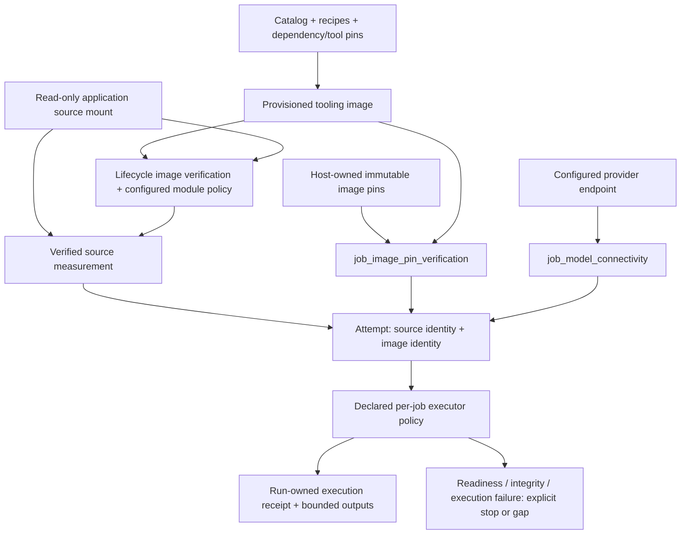

# Images and deployment

## As built today

The application separates tooling-image identity, mounted implementation identity and
run-owned evidence identity. None substitutes for the others. The checked-in
[container catalog](../../containers/catalog.toml) describes recipes and execution policy;
host-owned pins supply actual provisioned image identities. The generated
[inventory](../generated/inventory.json) and [tool matrix](../generated/matrix-tool-bucket.md)
describe declarations, not images observed on this host or successful tool executions.

The production stages of the [Dagster Dockerfile](../../deploy/dagster/Dockerfile) contain the
interpreter, dependencies, Docker client, provider CLIs and bootstrap verifier. Application
code, configuration, schemas, guidance and tool assets arrive through read-only checkout mounts
in [Compose](../../deploy/dagster/compose.yaml). Its test stage deliberately copies source for
testing without those mounts. Writable run/data/target mounts remain separate; this is not a
claim that every filesystem object or controller pointer is immutable.

The [source-mount contract](deployment-image-and-source-mount.md) is the detailed home for the
mount closure and source measurement. [Lifecycle](../../deploy/dagster/bin/lifecycle.py) verifies
the selected tooling image, signs/verifies the mounted package for the configured launch mode
and recreates the image services on reload. PostgreSQL is not part of that recreation set.
An application-code change needs a measured-source reload, not an image rebuild; changed
dependencies, tools or verifier bytes can require rebuilding the affected image.

Image and Python-module signing are implemented but have distinct policy boundaries.
[Typed image configuration](../../src/appsec_review/config/signing.py) defaults general launch
enforcement to `disabled`; `required` makes the configured image gate fail closed. Explicit
verification and deployment lifecycle checks still verify signatures. The production deployment
also has its existing signed-module bootstrap policy and explicit development opt-out.
[Signing operations](../operations/signing.md) owns those procedures. Documentation reconciliation
does not enable enforcement, provision keys or authorize an opt-out.

Tool execution policy is not universally "all tools in offline containers." Acquisition uses
host/provider boundaries. Some build lanes and image preparation permit declared networking;
analysis execution and the debug-symbol exporter have their own bounded policies. The relevant
job page and actual executor receipt establish what ran, under which image and policy, with which
inputs. A catalog entry or signature alone cannot establish target coverage.

`job_image_pin_verification` and `job_model_connectivity` are readiness gates, not analysis
producers. A reachable provider is not evidence that a later model call succeeded. A verified
image is not evidence that its tool was executed. Attempts retain source and image identities
separately through [release measurement](../../src/appsec_review/runtime/release.py) and
[repair binding](../../src/appsec_review/runtime/repair.py). Keep a deployed source mount fixed
while a review uses it; a new release requires explicit recovery admission rather than a silent
identity replacement.

## Decisions

| Date | Retained record | Current consequence |
|---|---|---|
| 2026-11-07 | [Deployment image/source-mount decision](deployment-image-and-source-mount.md#decision) | Tooling images and application-source releases change independently; reload measures and verifies mounted source. |
| 2026-11-13 | [Documentation program](../tasks/2026-11-13-docs-program-prompt.md) | Generated catalog projections describe declarations; authored pages explain their execution and authority limits. |

These are decision references, not fresh deployment acceptance. The source-mount page's historical
implementation and test statements retain their original scope.

## Named gaps

- [T-147](../TODO.md) tracks missing or inconsistent task/dataset publication bindings. A matrix
  cannot infer an executed tool from an undeclared task adapter.
- [T-157](../TODO.md) tracks language/applicability metadata absent from the typed inventory.
  An unclassified cell is not evidence of tool support or non-applicability.
- [T-148](../TODO.md) records unavailable historical archive citations. Their named coverage gap
  is not permission to restore or execute the archived system.

No live image, signature, reload or provider validation is established by this architecture page.
Deployment procedures retain their separately authorized manual checks.

## Jobs and pages

| Boundary | Canonical job or mechanism |
|---|---|
| Image readiness | [Image-pin verification job](../operations/job_image_pin_verification.md) |
| Model-provider readiness | [Model connectivity job](../operations/job_model_connectivity.md) |
| Provider/source acquisition | [Target acquisition job](../operations/job_target_acquisition.md) |
| Build and analysis execution | [Target acquisition and build](target-acquisition-and-build.md), [code intelligence](code-intelligence.md), [scanners](scanners-and-evidence-collection.md) |
| Packaging and host custody | [Container operations](../../containers/README.md), [source mount](deployment-image-and-source-mount.md), [signing](../operations/signing.md) |
| Attempt/release binding | [Runtime interchange](runtime-interchange.md), [recovery runbook](../operations/recovery-repair.md) |

## Dataflow

