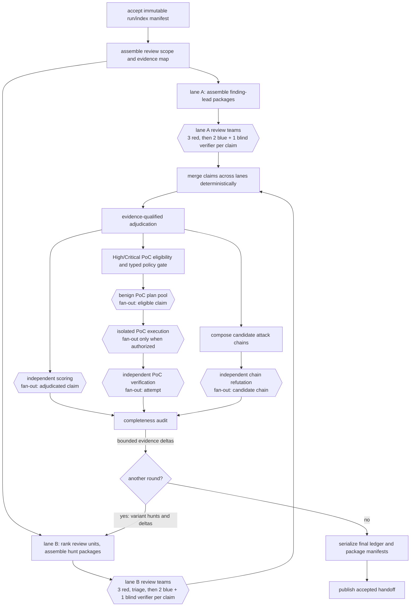
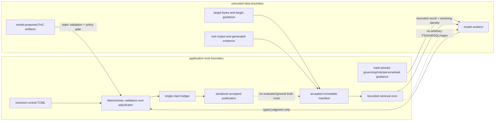
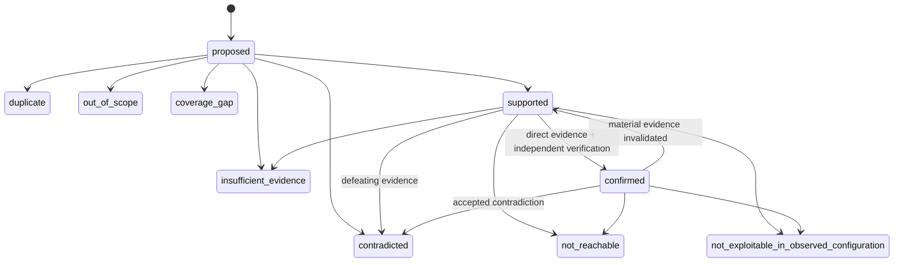
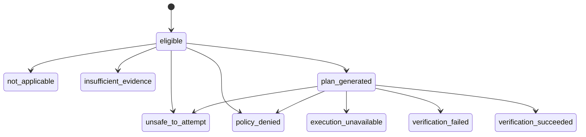

# Near-terminal inference security review

Status: design approved; vertical slice 1 is implemented as the registered
`job_inference_security_review` (`src/appsec_review/jobs/job_inference_security_review/`) under the
binding decisions in [Implementation readiness decisions](#implementation-readiness-decisions), and
its definition of done passes with an injected deterministic `Infer` double
([slice 1 implementation notes](#slice-1-implementation-notes)). Where an earlier section and that
section differ for slice 1, the readiness decisions govern. `ship-block-policy/1`, verifier model
distinctness, remediation intake and the planned downstream job names are implemented
([decisions](#decisions-and-open-questions) 1, 2, 4 and 8). Slices 2-4 (CVSS and SSVC scoring, PoC,
chains, rounds and variant hunts) remain design only, and no live-model acceptance has run.
The separate `job_document_issue_analysis` publishes a private, hash-pinned candidate ledger;
its document hunts are not yet consumed by the inference review job.

## Purpose and governing decisions

`job_inference_security_review` is the near-terminal, evidence-bound inference job that turns the
accepted outputs of deterministic and specialist analysis into exactly accounted security claims,
independent scores, bounded benign proofs of trigger, and independently challenged attack chains.
It is one resumable Dagster subgraph, not a collection of opaque review scripts.

The job follows these non-negotiable rules:

1. Model output is judgment data, never evidence. A claim changes state only through typed fields
   validated against resolving source lines or a run-owned, hash-verified tool artifact.
2. The only review input authority is one immutable accepted run/index manifest. Workers query it
   through the bounded retrieval core or read-only MCP adapter. No prompt receives a repository
   dump, an evidence dump, an arbitrary target path, or an arbitrary query surface.
3. Target guidance, retrieved text, tool output, generated evidence, and model output are untrusted
   data. They cannot alter governing rules, configuration, role, persona, tools, or claim limits.
4. The job and all workers are technically unable to read `appsec-multi-vuln-guide`, evaluator
   labels, expected findings, or any other ground truth. Those roots are absent from readable-input
   capabilities and container mounts; a startup validator rejects a manifest or tool scope that
   names them.
5. Red proposes; blue attempts falsification; a blind verifier independently investigates; a
   deterministic adjudicator applies evidence-qualified policy. Agreement among models is not
   evidence and is never a vote.
6. Every accepted input, worker cell, failure, gap, retry, state transition, score, proof attempt,
   chain, and final package is represented exactly once in the run-owned ledger or its accepted
   manifest. Missing work is a named gap, not a clean result.
7. High/Critical or ship-blocking findings require direct resolving evidence and independent
   verification. Proof-of-trigger execution is separately authorized and is never a prerequisite
   for truthful confirmation when the other evidence is sufficient.

Repository-agent authority lives in root `AGENTS.md`. Development skills live under
`.claude/skills/` and never reach a job. Runtime skills live under `pipeline/skills/` and are
loaded only through the registered runtime-skill loader; this job uses none. Shared review-worker rules live once in `pipeline/prompt-fragments/governing-rules.md`,
with personas, stack profiles, and roles under `pipeline/prompt-fragments/personas/`,
`pipeline/prompt-fragments/stacks/`, and `pipeline/prompt-fragments/roles/`; runtime configuration lives in `appsec-review.toml`. This design uses those rebuilt
sources directly and does not depend on or recover the archived process harness.

## Placement and consumers

The job starts only after the run's accepted manifest has composed every applicable source, SAST,
AST, IR, CPG, CodeQL, build, binary, CI, IaC, SBOM, CVE, OWASP, and post-build index shard. A
producer may be unavailable, but its accepted coverage shard and gap must be present. The manifest
is frozen for the lifetime of this review attempt; newly accepted upstream evidence creates a new
manifest identity and selective invalidation, never an in-place update.

The proposed application graph is:

```text
accepted analysis/index manifest
  -> job_inference_security_review
     -> job_remediation_planning
     -> job_remediation_validation
     -> job_final_publication_gate
        -> job_final_report_publication
```

Downstream contracts are exact:

| Consumer | Packages consumed | Explicitly not consumed |
|---|---|---|
| `job_remediation_planning` | the handoff's `remediation_intake` (confirmed final finding packages only, decision 4), score packages, evidence requests that remain gaps, safe regression-test specifications derived from successful PoCs | the `verification_backlog` (supported findings), raw worker narratives, rejected claims, raw PoC payloads |
| `job_remediation_validation` | finding identity and evidence, remediation proposal, safe regression-test artifact, sanitized PoC result/observed signal, score policy identity | the PoC executor, production credentials, offensive tooling |
| `job_final_publication_gate` | accepted claim-ledger manifest, exact claim accounting, finding-package manifest, score-package manifest, attack-chain manifest, sanitized PoC status manifest, completeness and coverage gaps | unaccepted shards or model transcripts |
| `job_final_report_publication` | publishable finding packages, separate score dimensions, confirmed/qualified chain packages, PoC outcome summaries, limitations/gaps | reusable exploit code, sensitive queries, secrets, raw prompts, private scratch artifacts |
| retrieval finding index publisher (inside final publication) | sanitized final finding packages and their resolving citations | proposed/duplicate/out-of-scope claims unless the operator requests an internal audit view |

No remediation or report job may reinterpret a claim state or a `ship-block-policy/1` status. It
projects the accepted state and provenance from this job. The four job names are fixed (decision
8): each is a `planned:` producer in `indexing/input_matrix.py` (`INPUT_SOURCES` and
`PLANNED_CONSUMERS`), and the handoff's `planned_consumers` lists them with the handoff fields each
reads (`jobs/job_inference_security_review/datasets.py::PLANNED_CONSUMERS`). None is implemented.

## Dagster graph

Each box below is a visible step; bracketed boxes dynamically map over claims, shards, roles, or
chains. The two publication steps are deliberately serialized.



Lanes A and B run fully in parallel and share one pool of review teams (see
[Two-lane intake and review teams](#two-lane-intake-and-review-teams)). Dagster owns stage
dependencies, pool limits, unit retries, and selected re-execution of visible units. The bracketed
fan-out boxes are, in slice 1, single visible units whose handlers run an
application-owned bounded cell executor, and the round loop is an in-application controller (see
[R1](#r1-execution-model)); the current `ExecutionPlan` has no dynamic mapping or cycles. Application
code owns immutable configuration, cell fingerprints, typed validation, deterministic merge,
ledger transitions, evidence resolution, safety policy, receipts, and accepted publication.
Suggested Dagster pools are `inference_review`, `inference_verify`, `inference_score`,
`poc_plan`, `poc_isolated`, and the existing single-slot `lifecycle` pool for manifest publication.

Pool outcomes are `COMPLETE`, `DEGRADED`, `FAILED`, `CANCELED`, or `EMPTY`. Every expected cell has
one terminal record such as `succeeded`, `failed`, `blocked`, `timed_out`, `canceled`, `invalid`, or
`not_launched`. A failed or timed-out analysis cell creates a typed gap for its exact claim, role,
round, and package; sibling cells continue. Framework-integrity failures—tampered inputs, invalid
accepted pointers, identity collisions, schema contradictions, unauthorized capability requests,
or non-deterministic merge—fail the job and prevent publication.

## Trust boundaries and data flow



Workers receive capability tokens scoped to one run, one accepted manifest, one package, one role,
one round, and a closed tool allowlist. The review surface is limited to bounded forms of `search`,
`find`, `read_excerpt`, `trace`, `resolve_evidence`, `coverage`, and typed domain queries such as
`query_build_security`. It exposes neither arbitrary filesystem paths nor shell, SQL, caller-supplied
regular expressions, target-guide lookup, network access, or write operations. Result rows retain
manifest, shard, entity, location, artifact, pagination, truncation, and coverage-gap identities.

## Stage contracts and concurrency

### Scope and package assembly

`assemble_review_scope` verifies the accepted pointer, handoff, manifest, every physical shard, and
embedded shard identity. It emits a deterministic evidence map of available coverage, missing
coverage, components, trust boundaries, build/deployment identities, external-intelligence
freshness, and exact retrieval scopes. It never infers that an unavailable shard is clean.

`assemble_review_packages` creates three bounded package kinds:

- A **finding package** groups one normalized upstream lead with its source/artifact identities,
  original evidence, known supporting and contradicting relations, proof obligations, coverage,
  and allowed retrieval scope.
- A **hunt package** groups an evidence-map slice by component/trust boundary and includes bounded
  lead summaries as a menu rather than a search limit. It contains identities, not a source dump.
- A **document hunt package** grants one accepted route or trust-boundary context fact and bounded
  source-record identities, with no scanner lead. It nominates a question, not a finding.

Packages are independently fingerprinted and size-limited. Oversized scopes split deterministically
by component, trust boundary, and stable entity range. Truncation creates a coverage gap.
The pre-adjudication input format is
[`review-packages.schema.json`](../schemas/review-packages.schema.json) as specialized by the
[review package contract](review-package-contract.md); the broader
[`review-input-package.schema.json`](../schemas/review-input-package.schema.json) is not an
assembler contract. Inference `finding_lead` and `hunt` variants and the separate
`document_hunt` variant carry accepted-manifest identity and applicable lead membership,
history/complexity metrics, safe build-command and environment facts, graph/evidence references,
retrieval scope and gaps. The package assembler audits that every lead admitted to lane A, from
any family and including suppressed or deduplicated leads, has exactly one finding-lead package.
Every hunt unit above the cutoff lists each of its leads exactly once in its menus. Leads in
units below the cutoff are accounted for by that unit's `below_hunt_cutoff` gap. Reported scanner severity is a nomination signal, never
adjudicated technical severity. Exact command lines, environment values and secrets remain
protected artifacts; workers receive classified, redacted facts only.

### Discovery, merge, refutation, and verification

Red cells run inside review teams in two lanes (see
[Two-lane intake and review teams](#two-lane-intake-and-review-teams)). In lane B,
`hypothesis_hunter` searches hunt packages for novel conditions. In lane A, `red_team_analyst`
develops the attacker-controlled preconditions and explicit evidence requests
for normalized leads. Both emit only `proposed` claims and evidence requests. They cannot set
confirmation, severity, priority, exploitability, PoC eligibility, or chain state.
Their single versioned output contract, [`red-discovery-result/1`](red-discovery-output.md),
carries lead accounting, provisional claims, source-to-sink path segments, chain seeds, citations,
open obligations and gaps; `review/red_discovery.py` enforces its admission rules at cell
validation. A chain seed remains a hypothesis: lane units persist the admitted seeds as a bounded
run-owned artifact (`chain-seeds.json`, `appsec-review/red-chain-seeds/1`) for the attack-chain
slice and never as claims; canonical attack-chain composition follows claim adjudication.
Package construction does not prove a scanner lead. For C/C++ claims, accepted source-mapped
post-macro and template-expanded Clang artifacts can help these pools assess the compiled construct;
blue and blind verification still challenge the relevant predicates before adjudication.

Normalization resolves locations and evidence identities, canonicalizes statements and
preconditions, calculates identities, and merges exact duplicates. Semantic similarity may nominate
possible duplicates but cannot merge them without deterministic identity/equivalence rules or an
adjudicator decision. Conflicting evidence is retained as distinct relations, never silently
collapsed. Ordering is by canonical claim id, then relation id, never worker completion order.

Blue and verifier pools fan out concurrently after normalization:

- `blue_team_refuter` receives the normalized claim, original evidence, open obligations, and
  bounded retrieval scope. It actively seeks counterexamples, guards, reachability breaks,
  configuration exclusions, and integrity problems. It may support, contradict, qualify, or leave
  unresolved; it is not required to reject.
- `independent_verifier` initially receives the normalized claim and original evidence only. It does
  not receive red/blue narratives, dispositions, identities, scores, or confidence. This blind
  phase returns an independently gathered evidence set and proposed disposition. Only after its
  response is sealed may adjudication join red, blue, and verifier records.

Model/provider independence is enforced by actor identities and policy. A verifier cell cannot use
the hypothesis author's request, response cache entry, conversation, or derived evidence record.
For ship-blocking findings, `ship-block-policy/1` additionally requires the verifier to run on a
different model profile than the red cells (decision 2). That requirement never changes the claim
state: a confirmed finding verified on the red cells' model is published as
`ship_blocking_pending_distinct_verification` (see [R6](#r6-independence)).

### Evidence-qualified adjudication

`finding_adjudicator` is a responsibility role for structured review, but the final transition is
performed by deterministic application policy. It evaluates evidence resolution, independence,
freshness, integrity, proof-obligation coverage, contradictions, and policy—not the number of
supporting opinions.

A claim may be `confirmed` only when all required predicates have direct resolving evidence, all
required evidence is bound to the accepted manifest or an authorized run-owned PoC receipt, no
unresolved contradiction defeats a required predicate, and the configured independent-verification
requirement is met. Ten identical unsupported model outputs still produce no admissible support.
Blue support does not substitute for verification; verifier agreement without new or independently
resolved evidence does not confirm.

For High/Critical eligibility or a ship-blocking decision, direct evidence must resolve the affected
construct or artifact and the reachability/configuration predicates material to the claim.
Heuristics, incomplete traces, fuzzy retrieval, model prose, and external severity labels may guide
search but cannot satisfy those obligations.

## Claim lifecycle



State meanings are exact:

| State | Meaning |
|---|---|
| `proposed` | a bounded hypothesis awaiting sufficient evidence; never a finding |
| `supported` | some material predicates have resolving evidence, but confirmation policy is not fully met |
| `confirmed` | every required predicate is evidence-resolved and independent-verification policy is satisfied |
| `contradicted` | accepted evidence defeats at least one necessary predicate |
| `not_reachable` | the condition exists but accepted reachability evidence excludes the reviewed entry/configuration scope |
| `not_exploitable_in_observed_configuration` | the mechanism exists, but accepted configuration/environment evidence blocks exploitability in the observed deployment; not a universal absence claim |
| `insufficient_evidence` | an evidence obligation is unresolved, unsatisfiable in available indexes, stale, incomplete, or unavailable |
| `duplicate` | canonical equivalent of another ledger claim; retains `duplicate_of` and provenance |
| `out_of_scope` | outside the accepted engagement scope, with the scope rule and evidence recorded |
| `coverage_gap` | a typed accounting record for work/evidence that could not be obtained; not a vulnerability claim |

States are enums; rationales are commentary. Transitions append immutable events and never rewrite
history. Contradictory evidence remains linked with `supports` or `contradicts`; adjudication records
which predicate it affects and why it is unresolved, defeated, or outweighed by higher-integrity
evidence. Evidence integrity includes manifest membership, content hash, producer identity, source
snapshot, resolving locator, completeness/truncation, and authorization. Freshness is evaluated
against the frozen run time and source-specific policy: source/build artifacts are immutable within
the manifest; configuration and external intelligence carry `observed_at`, `effective_at`, and
optional `expires_at`. Stale evidence remains auditable but cannot satisfy a freshness-sensitive
obligation.

Exactly-once accounting requires every proposed canonical claim to appear once in the final
projection as one of the states above. Every duplicate points to one canonical claim; every expected
cell has one terminal record; every evidence request is satisfied, unsatisfied, superseded, or
withdrawn; and every High/Critical-eligible finding has exactly one PoC eligibility record.

## Roles, personas, stack profiles, and guidance composition

A worker cell is the composition of three independent dimensions. Exactly one of each applies to
every cell.

| Dimension | Answers | Selected by | Carries authority? |
|---|---|---|---|
| **role** | What may this cell propose, refute, or decide? | the stage that launches the cell | yes: the authority ceiling, allowed outputs, and closed tool allowlist |
| **persona** | Which security domain is this cell looking through? | deterministic taxonomy rollup ([Persona assignment](#persona-assignment)) | no |
| **stack profile** | Which technology is this cell in? | deterministic component facts ([Stack profiles](#stack-profiles)) | no |

Roles express responsibility and authority ceilings:

`hypothesis_hunter`, `red_team_analyst`, `blue_team_refuter`, `independent_verifier`,
`independent_scorer`, `poc_designer`, `poc_verifier`, `attack_chain_analyst`,
`finding_adjudicator`, and `completeness_reviewer`.

Technology stacks are never roles. Folding them into roles would multiply authority rules by
technology (red C++ role, blue C++ role, and so on). Personas and stack profiles are knowledge only.
Each has exactly one value per cell, so neither enlarges the number of cells: combinations exist
only in composed text, never as authored pairs. A role's authority ceiling always wins over a
persona's or stack profile's content.

### Personas

Persona files live under `pipeline/prompt-fragments/personas/<persona_id>.md`. Each persona is a
carefully written domain specialist, not a single taxonomy entry. The security tag taxonomy
([`security-tag-taxonomy.md`](security-tag-taxonomy.md)) rolls up into personas, and the personas
partition it.

| Persona | Primary taxonomy coverage (non-exhaustive; the `covers` front matter is authoritative) |
|---|---|
| `memory_safety_native` | CWE-119 family, integer overflow and undefined behaviour, `cert-c:*`, `cert-cpp:*`, `misra-*`, `func:exec:unmanaged-memory`, `func:exec:ffi`, native `func:exec:concurrency` |
| `injection_interpreters` | CWE-78, CWE-79, CWE-89, CWE-94/95, `func:data:sql-query`, `orm`, `nosql-query`, `ldap-query`, `template-render`, `func:exec:shell`, `process-spawn`, `dynamic-eval` |
| `parsing_deserialization` | CWE-502, CWE-611, CWE-1333, `func:data:parse-*`, `deserialize-native`, `archive-extract`, `regex` |
| `authentication_session` | `func:authn:*`, `func:session:*`, CWE-287, CWE-347, CWE-352, ASVS v6, v7, v9, v10 |
| `authorization_access_control` | `func:authz:*`, CWE-639, CWE-862, tenant scope, ASVS v8 |
| `cryptography_data_protection` | `func:crypto:*`, `func:secrets:*`, `data:*`, CWE-327, CWE-798, sensitive data in `func:telemetry:*`, ASVS v11, v14, v16 |
| `network_api_surface` | `func:net:*`, CWE-918, CORS and redirects, ASVS v4, v12, API Security Top 10 |
| `filesystem_resources` | CWE-22, `func:fs:*`, `func:data:file-upload`, temporary files and permissions, resource exhaustion, ASVS v5 |
| `business_logic_abuse` | ASVS v2 and workflow or state abuse; weakly routed, so used mainly in hunt panels |
| `build_supply_chain` | `infra:supply:*`, `vuln:*`, SSDF, SLSA, Scorecard dependency checks |
| `ci_cd_pipeline` | `infra:ci:*`, CI/CD Top 10, Scorecard workflow checks |
| `cloud_container_deployment` | `infra:container:*`, `infra:kube:*`, `infra:iac:*`, `infra:cloud:*`, Kubernetes Pod Security Standards, Kubernetes Top 10, NIST SP 800-53 `infra` routes |
| `mobile_platform` | `func:mobile:*`, MASVS |
| `generalist` | fallback when no other persona's coverage matches; recorded as a routing gap |

`ai_llm_integration` (`func:ai:*`) is reserved until a target requires it; until then `func:ai`
routes to `generalist`. The existing registry personas migrate as follows:
- `api_web` → `network_api_surface`;
- `deployment_operations` → `cloud_container_deployment`;
- `devops_engineer` stays the build-recipe viewpoint, outside this job.

Each persona file has closed front matter followed by fixed sections:

```markdown
---
id: memory_safety_native
version: 1
covers: ["cwe:119/*", "cwe:190", "func:exec:unmanaged-memory", "cert-c:arr*", ...]
standards: ["cwe", "cert-c", "cert-cpp", "misra-c2012", "capec", "attack", "asvs5"]
max_tokens: 1500
---
## Viewpoint            what this specialist cares about and why
## Coverage             GENERATED at assembly; never hand-written in the file
## Likely failure modes concrete code patterns, sources, sinks, and preconditions
## Effective controls   what a real guard, bound, encoder, or check looks like
## False positives      common non-issues and why they are not defects
## Evidence by predicate what direct evidence for each R4 predicate looks like here
## Hand-offs            adjacent concerns that belong to another persona
```

- **Generated coverage.** The coverage section is generated at assembly from the taxonomy and its
  crosswalks: each covered tag is expanded into its CWE, CERT/MISRA, ASVS/MASVS, CAPEC, ATT&CK, and
  NIST SP 800-53/SSDF items. The generated text is hash-pinned in the guidance bundle. A taxonomy
  change therefore changes the bundle hash and invalidates the affected cells. Taxonomy lists are
  never copied by hand into a persona file.
- **Sections by role.** The assembler selects persona sections deterministically from the cell's
  role. Red roles receive Viewpoint, Coverage, Likely failure modes, and Evidence by predicate.
  Blue, verifier, and PoC verifier roles receive Viewpoint, Effective controls, False positives,
  and Evidence by predicate. Red stays generative and blue stays skeptical without the persona
  gaining any authority.
- **Validator.** A persona that exceeds `max_tokens` fails validation. So does one that names a
  tool, budget, severity, confirmation, claim state, or output field.

#### Persona assignment

A deterministic assignment rule (`persona-routing/1`) picks one primary persona per finding-lead
package and per claim. It tries these bases in order and records the one that decided:

1. the lead's normalized CWE, when it is in the CWE mapping;
2. the `func:*`, `infra:*`, and `data:*` tags assigned at the lead or claim location;
3. the component's tag cloud;
4. `generalist`, with a `routing_gap`.

A partition test enforces that every `cwe`, `func`, `infra`, and `data` tag in the taxonomy maps to
exactly one primary persona. There are no orphans and no double claims. Hunt packages have no
finding yet, so they use a panel instead (see [Review teams](#review-teams)).

### Stack profiles

Stack profile files live under `pipeline/prompt-fragments/stacks/<stack_id>.md`. They use the same
front matter and validator as personas, and these sections:
- Runtime and framework model;
- Trust and interface layer;
- Idiomatic security mechanisms;
- Stack-specific pitfalls;
- Build and deployment facts to check.

| Stack profile | Selected when the component's accepted facts show |
|---|---|
| `cpp_rpc_service` | C/C++ plus `func:net:grpc` or an accepted protobuf, Thrift, or IDL interface. The profile covers generated stubs, message size and depth limits, authentication interceptors, deadlines, and arena/lifetime issues |
| `cpp_native_service` | C/C++ server or library component without an RPC interface |
| `c_systems_embedded` | C with freestanding, kernel, firmware, or no-libc build facts |
| `jvm_service`, `dotnet_service`, `go_service`, `rust_service`, `python_service`, `node_web`, `php_web` | the matching `lang:*` and server/web `component` facts |
| `android`, `ios` | mobile platform facts |
| `wasm` | WebAssembly output-family build facts |
| `ci_pipeline` | CI workflow subjects |
| `iac_kubernetes` | container, Kubernetes, IaC, or cloud subjects |
| `generic` | none of the above; recorded as a routing gap |

Stack routing (`stack-routing/1`) uses accepted `lang`, `component`, build, and interface facts
only. A cell's stack profile is the profile of the component that owns its package.

### Guidance assembly

Guidance is assembled in this order as separately delimited, hash-pinned sections:

1. `pipeline/prompt-fragments/governing-rules.md`: shared authority, untrusted-data handling,
   evidence rules, prompt-injection resistance, secrets/redaction, and universal claim limits.
2. One role record: task responsibility, allowed outputs/transitions, prohibited decisions,
   independence requirements, and closed tool capabilities.
3. One persona record: the role-selected sections plus generated coverage. It makes no authority,
   tool, budget, or output changes.
4. One stack profile record, with the same restrictions as the persona.
5. One task prompt: the bounded question for this package and stage, expected schema, and package
   references, including the lane B strategy question when one applies. It does not repeat
   governing rules or central settings.
6. A generated capability/budget receipt: resolved configuration and tool ids, supplied as trusted
   structured metadata rather than prose.

Models, reasoning levels, token/query/time limits, worker counts, team counts, retries, rounds,
active-claim and chain caps, pool assignments, and policy thresholds live only in central TOML.
Prompt assembly fails before dispatch if sections conflict, for example when:
- a persona requests confirmation while the role allows only hypotheses;
- a task requests a tool absent from the role;
- two sections define the same policy key;
- a task attempts to widen readable roots.

The resolved guidance bundle is canonicalized and stored once under
`runs/<run-id>/data/guidance/<bundle-sha256>/`. Every cell records the bundle hash and each
section's hash.

## Two-lane intake and review teams

The job runs two intake lanes, fully in parallel, that feed one shared claim back end.
Normalization, blue refutation, blind verification, adjudication, scoring, PoC, and chains are the
same code, schemas, and policy for both lanes. Only claim production, admission, triage, and
budget accounting differ.

```text
Lane A (lead): admitted leads ─► finding-lead packages ─► team: 3 red ─┐
                                                                         ├─► normalize ─► team: 2 blue ∥ 1 verifier ─► adjudicate ─► score ─► PoC/chains
Lane B (hunt): ranked review units ─► hunt packages ─► team: 3 red ─► triage ┘
                    ▲                                                                            │
                    └──────────── round 1: variant hunts seeded by round-0 confirmed claims ◄────┘
```

### Lane A: lead review

- **Admission.** Lane A admits every accepted lead whose normalized *reported* severity is
  `critical`, `high`, or `unknown`, from **every** lead family:
  - source SAST;
  - CodeQL;
  - artifact scanners;
  - dependency advisories, using the advisory's own CVSS; when the scanner reports no CVSS, the
    run-pinned NVD CVSS (v4.0, then v3.1, then v3.0, then v2) with severity basis `nvd-cvss-band`;
    otherwise the advisory's severity label;
  - CI rules;
  - post-build hardening;
  - OWASP control failures.

  Each family has a versioned normalization rule (`lead-family/dependency_advisory/2` and
  `lead-family/artifact_scanner/2` add the NVD band). Unknown severity is never treated as low.
  Lane A also admits every dependency or artifact-scanner lead whose advisory is listed in the
  run-pinned CISA KEV catalog, whatever its reported severity (`lanes.lead_admission_kev`, default
  `true`). Each lead package records its `admission_reasons` (`reported_severity`, `kev_listed`).
  EPSS is context only and has no admission effect.
- **Reported severity orders work only.** It is a nomination, never an adjudicated severity. The
  independent scorer assigns technical severity after adjudication, and only that score drives PoC
  eligibility and reporting.
- **Packages.** Each admitted lead gets exactly one finding-lead package. The membership audit of
  the [review package contract](review-package-contract.md) applies to every admitted family.
- **No triage.** Lane A has no triage gate: every claim from an admitted lead receives the full
  blue and verifier treatment, up to `lead_max_claims_per_package`.

### Lane B: open discovery

- **Unit of work.** The unit of work is a ranked review unit: a component, trust boundary, or
  function cluster. Units are ranked deterministically from accepted signals:
  - review-prioritization LPS;
  - source-history instability (SII);
  - hotspots;
  - security tag density;
  - medium, low, and info leads, which also appear on the hunt menu as hints;
  - advisory reference signals (`review-unit-rank/2`): `advisory_kev` is 250 points when any
    dependency/artifact advisory in the unit is KEV-listed, and `advisory_epss` is the unit's highest
    EPSS percentile times 250. A unit with no advisory lead scores a true zero; an advisory whose KEV
    or EPSS feed was unavailable makes the signal `unknown` (`feed_unavailable`), never zero. Both
    weights sit below a full LPS or SII signal (1000) because they order hunting and are not evidence
    that the target is affected.

  A unit's rank score is the sum of its known signal points, ties broken by the count of known
  signals and then by unit key. Every weight is configurable (decision B2) in the typed, validated
  table `[jobs.job_inference_security_review.settings.ranking]` (`review/ranking.py::RankWeights`).
  Unknown keys are rejected, and every weight is an integer in `[0, 1000]`. The defaults are the
  shipped `review-unit-rank/2` values and reproduce its order byte for byte:

  | Key | Default | Signal points |
  |---|---|---|
  | `lps`, `sii`, `hotspot` | 1000 each | producer score in [0, 1] (or a percentage) times the weight, capped at the weight |
  | `tag_density` | 1000 | `tags x weight / (tag_density_full_tags_per_file x member files)`, capped at the weight |
  | `tag_density_full_tags_per_file` | 4 | tags per member file that earn the full `tag_density` weight |
  | `lead_hint_medium`, `lead_hint_low`, `lead_hint_info` | 100, 30, 10 | per medium/low/info lead hint |
  | `lead_hints_max` | 1000 | cap on the summed lead hints |
  | `advisory_kev` | 250 | any advisory in the unit is KEV-listed |
  | `advisory_epss` | 250 | times the unit's highest EPSS percentile |

  The weights reach `review/units.py` through `PackageSettings.rank_weights`. They are recorded in
  the package manifest's `settings` and are semantic settings, so they enter every fingerprint
  derived from the settings. Changing a weight changes the order, not the rule, so `RANK_RULE`
  stays `review-unit-rank/2`.

  The top `hunt_max_units` units, by rank then `package_id`, receive hunt packages. Every other unit
  is a `coverage_gap` with reason `below_hunt_cutoff`.
- **Panel.** Each hunt package's three red cells use distinct (strategy, persona) pairs. They are
  chosen by `hunt-panel/1` from the unit's tag cloud and from the data sources available.
- **Strategies.** Strategies are task prompts, not roles; the red role is always
  `hypothesis_hunter`.

| Strategy | Bounded question | Requires |
|---|---|---|
| `variant` | "Claim X was confirmed; where else in this unit does the same pattern occur?" | a round-0 confirmed claim (round 1 only) |
| `sink_up` | "Which dangerous sinks here take caller-controlled data, and what guards them?" | an accepted `sink_site` family (any state but `unavailable`) for the unit's scope (`symbol_links` alone no longer unlocks it; [code graph](code-graph-precomputation.md) decision 3) |
| `entry_down` | "Follow this entry point's inputs inward." | an accepted `entry_point` family for the unit's scope |
| `control_gap` | "This control failed or is missing here; what can an attacker do?" | an accepted OWASP workbench result |
| `persona_sweep` | "Review this unit as the assigned specialist." | none |

A strategy whose required source is unavailable is skipped with a `coverage_gap`. The panel falls
back to `persona_sweep` with the next-ranked persona.

- **Known claims.** Hunters receive the canonical ids and statements of claims already known in
  their unit, never the reasoning behind them, so that they do not re-report them. Claim ids are
  identity-only (lane, package and statement are excluded), so a lane B proposal whose identity
  matches an existing claim is a *duplicate proposal*: it merges into the existing claim (the lead
  lane wins, then the lowest `package_id`; origin cells are combined), any new admissible evidence it
  carries attaches to that claim as relations, and accounting counts it per lane as
  `duplicate_proposals`. The `duplicate` claim state is reserved for distinct claim ids judged
  equivalent; in slice 1 such near-duplicates stay separate claims nominated as
  `possible_duplicates` (R7). In round 0 the two lanes run in parallel, so hunters receive no lane A
  claims and the gate's "existing claim" check is package-local.
- **Triage gate.** A lane B hypothesis passes deterministic gate checks:
  - it cites only resolvable locations;
  - it uses the closed R4 predicate and precondition vocabularies;
  - it does not match an existing claim.

  It is then admitted for blue and verifier review in deterministic order: the count of predicates
  with direct support, descending, then claim id. Admission is capped at
  `hunt_max_claims_per_package`. Each hypothesis that fails the gate is recorded as an
  `evidence_gap` with its reason. Each one over the cap becomes `insufficient_evidence` with a
  `budget_gap`.
- **Coverage.** Lane B reports coverage as a unit × strategy × persona matrix whose cells are
  `reviewed`, `gap`, or `not_launched`. Lane B can never conclude that a unit is free of defects,
  only which lenses reviewed it.

### Review teams

The unit of review capacity is the **review team**: `red_per_team` (default 3) red cells,
`blue_per_team` (default 2) blue cells, and `verifier_per_team` (default 1) independent verifier.

- **One package per team.** A team takes one package and holds its worker slots until the blue and
  verifier cells of every claim admitted from that package have finished. Inside the team, the
  order is red, then package-local normalization (and triage in lane B), then blue and the
  verifier concurrently, for each admitted claim. Adjudication runs afterwards over the claims
  merged from all packages; it is deterministic and holds no team. The
  `red_per_team` cells run once per package; the blue and verifier cells run once per admitted
  claim.
- **Distinct lenses.**
  - *Lane A reds* use the lead's assigned persona with three lenses: the stack profile, attacker
    preconditions, and the persona's likely failure modes.
  - *Lane B reds* use the panel's distinct (strategy, persona) pairs.
  - *The two blues* use the claim's persona and receive distinct task questions: one seeks an
    effective guard or control (`blue_control`), the other seeks a reachability or configuration
    break (`blue_reachability`). The blues never see each other's output.
  - *The verifier* stays blind under [R6](#r6-independence).
- **Concurrency.** `review_teams` (default 5) is the number of teams that may run at once on the
  host. A local overlay commonly sets it to 1. Teams are slots in one application-owned
  cross-process semaphore, built on the kernel file locks in `storage/lock.py` and held under the
  run's data directory. Both lane units acquire teams from it, so `review_teams = 1` means exactly
  one team on the machine regardless of how many Dagster units are active.
- **Scheduling.** The scheduler is fair-share and work-conserving. The next free team goes to the
  lane that has consumed the smaller fraction of its budget share. A lane with no queued packages
  releases its unused share to the other lane. Packages within a lane are taken in canonical
  order: by rank, then `package_id`.
- **Semantics.** `review_teams` and pool limits are capacity, not semantics: they are excluded
  from every cell fingerprint, so runs at different concurrency reuse each other's cells. Budgets,
  team composition, caps, and lane shares are semantic: they decide what gets reviewed, and they
  are part of the round and lane fingerprints.

### Budgets

Budgets are expressed per lane in team-packages, with cell-level caps beneath them:

- `budget_team_packages` is the job total. `lead_budget_share` (default 0.5) splits it between the
  lanes, and unused share flows to the other lane as described above.
- Each cell is bounded by its model profile's turn, token, query, and timeout caps from
  [R2](#r2-worker-transport-and-bounded-retrieval-loop).
- `max_model_turns` and the token totals are hard job ceilings. Reaching any ceiling stops new team
  launches. Every queued package then ends `not_launched` with a `budget_gap`.

### Parallel lanes, rounds, and determinism

Round 0 runs lane A and lane B fully in parallel. Variant hunts are not inserted while round 0 is
running, because that would make *what gets reviewed under a budget* depend on timing. Round 1
creates `variant` hunt packages from round 0's confirmed claims, in canonical order, and runs them
under the remaining lane B budget. Package order, panel selection, triage, and team assignment are
deterministic functions of accepted inputs and configuration. Only wall-clock interleaving varies,
and nothing semantic depends on it.

### Failure is a gap; integrity is not

Every ordinary failure becomes a typed, recorded gap, and the job publishes with status
`DEGRADED`. This covers:
- a provider outage, timeout, crash, or invalid output after retries;
- a team failure;
- a tool error;
- a missing upstream shard;
- a failed strategy;
- an entire lane failing.

A model *requesting* a forbidden tool, path, or capability is expected adversarial input. It
produces a cell `authority_error` gap and a security event, not a job failure.

Only framework-integrity failures block publication:
- a tampered or swapped manifest or shard;
- a broken ledger hash chain;
- a non-deterministic merge;
- an identity collision;
- the application *granting* an unauthorized capability;
- a receipt that cannot be verified.

Publishing in those cases could present corrupted or injected results as accepted.

When the ratio of gapped to expected cells or packages exceeds `incomplete_gap_ratio`, the handoff
carries `review_incomplete = true` with per-lane counts. It is still published, but no consumer may
present it as a complete review.

## Delta-driven rounds and resumption

A round is not a repeated full review. Round 0 creates the initial scope, packages, claims, reviews,
scores, PoC decisions, and chain candidates. A later round contains only deltas produced by the
previous completeness audit:

- novel accepted evidence for an open obligation;
- an unsatisfied evidence request routed to a bounded retrieval query or applicable upstream shard;
- a claim whose disposition changed or whose supporting/contradicting set changed;
- a newly eligible or invalidated score/PoC decision;
- a new or invalidated chain edge; or
- an uncovered scope item selected by the completeness reviewer.

The round controller stores `delta_manifest_sha256`, parent round, changed identities, reason, and
the exact downstream closure. It refuses a delta that contains no changed identity, widens scope
beyond the accepted manifest, or re-enqueues an identical unsatisfiable request.

Termination occurs at the first applicable condition:

1. no novel evidence-backed claims and no disposition, score-input, PoC, or chain change for
   `stable_rounds_required` consecutive rounds;
2. every remaining evidence request is deterministically unsatisfiable within the accepted
   manifest/capabilities and is recorded as a gap;
3. the job, model, token, query, cost, or wall-clock budget is exhausted;
4. `max_rounds` is reached; or
5. there are no active claims and no uncovered scope obligations.

Budget exhaustion and maximum rounds publish a degraded but complete accounting package; they do
not imply a clean target. Framework-integrity failures still block acceptance.

The unit of reuse is `claim × role × round × evidence_manifest`, refined by lane, persona, stack
profile, strategy, guidance
bundle, model identity, task schema, and policy where relevant. A cell fingerprint is the canonical
hash of:

```text
cell/v1(
  run_input_manifest, lane, package, canonical_claim, role, persona, stack_profile,
  optional_strategy, task_question,
  round_delta, readable_evidence_set, guidance_bundle, model_provider_version,
  tool_capabilities, budgets, output_schema, validator_version
)
```

Re-execution reuses a successful, revalidated cell with the same fingerprint. Changing a claim's
evidence invalidates its red/blue/verifier/adjudication closure and derived score/PoC/chain edges,
not unrelated claims. A role-guidance change invalidates only cells using that role. Provider or
score-policy changes invalidate score packages and eligibility decisions without rerunning claim
discovery or verification. A PoC image/policy change invalidates PoC policy and attempts without
changing the underlying claim. An accepted-manifest change first compares physical shards and
entity dependencies; only affected packages and their closure rerun.

Retries create new attempt identities under the same cell fingerprint. They may repair transport,
schema, or transient provider failures up to policy limits but may not silently increase tools,
budgets, readable roots, or output authority. A deterministic invalid response is retried only when
`retry_on_invalid_output` is enabled and always retains the failed attempt receipt.

## Independent pluggable scoring

Scoring starts only after adjudication and is performed by `independent_scorer` using a worker and
provider identity independent of the hypothesis author, red pool, blue pool, and verifier. A
deterministic provider implementation may run in-process, but its input selection and any
judgment-bearing factor assignment must still have a separate scorer actor and provenance. Scoring
cannot promote a claim or repair missing evidence.

The scoring contract keeps distinct concepts distinct:

- **technical severity**: intrinsic technical consequence under a named standard/provider;
- **exploitability confidence**: confidence that the required path and preconditions hold, with
  evidence quality and missing predicates;
- **environmental/business impact**: organization- and deployment-specific consequence;
- **remediation priority**: a policy decision that may use severity, exploitation, exposure,
  business criticality, compensating controls, and deadlines.

Providers may emit one or more of these dimensions, but absent dimensions remain `null` with
`missing_factors`; the system never adds unlike numbers or coerces an SSVC decision into a CVSS
score. A policy may display multiple provider outputs side by side and separately derive a
remediation priority.

The versioned application protocol is:

```python
class ScoringProvider(Protocol):
    provider_id: str                 # e.g. "cvss_v4"
    interface_version: str           # "appsec-review/scoring-provider/1"
    implementation_version: str

    def input_schema(self) -> Mapping[str, object]: ...
    def output_schema(self) -> Mapping[str, object]: ...
    def validate_inputs(self, request: ScoreRequest) -> ValidationResult: ...
    def score(self, request: ScoreRequest) -> ScoreProviderResult: ...

# ScoreRequest binds claim/adjudication/evidence/environment/policy hashes and scorer actor.
# ScoreProviderResult is deterministic for the same canonical request and implementation.
```

Every normalized score package contains:

- `score_id`, claim id, adjudication event id, scorer actor, provider/interface/implementation
  versions, provider configuration hash, policy hash, and input fingerprint;
- provider-native output (`vector`, decision path, matrix cells, or organization plugin record),
  its declared nomenclature, and a canonical result hash;
- normalized `technical_severity`, `exploitability_confidence`,
  `environmental_business_impact`, and `remediation_priority` objects, each with its own scale id;
- exact evidence inputs and factor-to-citation mappings, assumptions, missing factors, confidence,
  freshness, and limitations;
- deterministic and human overrides as append-only records with author/authority, reason, prior and
  replacement values, scope, expiry, and policy identity. An override never edits provider-native
  output.

Initial providers are:

- `cvss_v4`, implementing FIRST CVSS v4.0 and retaining vector, score, qualitative rating,
  nomenclature (`CVSS-B`, `CVSS-BT`, `CVSS-BE`, or `CVSS-BTE`), calculator implementation, and
  specification version. FIRST explicitly separates Base, Threat, Environmental, and Supplemental
  metrics; supplemental metrics do not change the score.
- `cvss_v31_compat`, an explicitly labeled compatibility provider that retains its v3.1 vector and
  must never masquerade as v4.
- `application_risk_matrix`, a versioned configurable model over evidence-derived factors (see
  [Evidence-derived scoring factors](#evidence-derived-scoring-factors-score-factors1)).
- `ssvc_decision`, an SSVC-style decision-tree result with decision path and outcome, not a numeric
  severity.
- organization plugins loaded from a closed registry, with signed/pinned package identity and no
  dynamic import path from target data.

Authoritative provider references are the
[FIRST CVSS v4.0 specification](https://www.first.org/cvss/v4.0/specification-document),
[FIRST CVSS v4.0 user guide](https://www.first.org/cvss/user-guide),
[FIRST CVSS v3.1 specification](https://www.first.org/cvss/v3-1/specification-document), and
[CISA SSVC guide](https://www.cisa.gov/sites/default/files/publications/cisa-ssvc-guide%20508c.pdf).
Provider conformance fixtures pin the applicable revision and reference calculator/test vectors.

High/Critical eligibility is configured as a predicate over named provider outputs, never hardcoded
to a particular 0–10 scale. For example, policy may require a `cvss_v4` qualitative rating in
`[HIGH, CRITICAL]`, or an application-matrix band in `[high, critical]`, plus minimum adjudication
and evidence confidence. A change to evidence, observed environment, provider implementation,
provider version, factor assignment, policy, override, or any score input deterministically changes
the score fingerprint and invalidates score-dependent priority, PoC eligibility, and report
projection.

The archived scorer is intentionally replaced. It summed four 0–4 factors, embedded fixed P0–P3
thresholds, optionally let CVSS overwrite severity, and carried remediation proposals in the same
record. That mixed technical severity, confidence, exposure, remediation, and provider semantics.
The new provider boundary retains the useful hash-pinned calculator provenance while separating
native provider output from organization policy and remediation.

### Evidence-derived scoring factors (`score-factors/1`)

Decision B1 (user, 2026-10-12): a score must reflect the adjudicated evidence, not only the CWE
class and whether the claim is confirmed or supported. `review/scoring/factors.py` derives a closed
set of factors per scored claim. Each factor is computed deterministically from inputs that
adjudication already accepted:

- the claim's counted supporting relations (R3/R5);
- the entities those relations cite, re-resolved by the scoring stage against the accepted
  manifest and accepted only when the content hash equals the relation's `content_sha256`;
- accepted security-tag assignments on the affected entities or their component;
- the claim's CWE and the labelled KEV reference input.

Model prose, reported scanner severity and FIRST EPSS have no field in the factor input. A factor
never promotes a claim: only `confirmed` and `supported` claims are scored, and contradicting
relations never set a factor.

| Factor | Closed scale (weakest first) | Derived from | Cites |
|---|---|---|---|
| `verification` | `supported`, `confirmed` | the R5 claim state | adjudication id |
| `taint_path` | `code_evidence`, `tool_observation`, `codeql_path_observation`, `graph_dataflow_path` | counted direct support on `source_to_sink_reachability`; strongest cited kind wins (a CodeQL path-problem observation needs its re-resolved payload) | relation ids and entity ids |
| `attacker_control` | `internal`, `direct_unclassified`, `local`, `remote` | `source_class` of re-resolved `entry_point`/`dataflow_path` facts (`remote`; `local_user`/`argv`/`environment`/`file`/`ipc` are `local`; `database`/`internal` are `internal`), else `direct_unclassified` for other direct support on `attacker_input_control`; best class wins | relation ids and entity ids of the winning class |
| `guard_absent` | `code_evidence`, `tool_observation`, `graph_fact` | counted direct support on `missing_or_ineffective_guard` (`guard_fact`/`range_fact` are `graph_fact`) | relation ids and entity ids |
| `exposure` | `local`, `internal_network`, `public` | accepted `surface:entry:*` tags (`http-public`, `cloud-public`, `mobile-deeplink`, `ci-untrusted` are `public`; `http-internal`, `rpc`, `message-consumer` are `internal_network`; `cli`, `env-config`, `file-input`, `local-ipc` are `local`) | tag assignment ids |
| `privilege` | `sandboxed`, `elevated` | accepted `surface:priv:*` tags (`elevated`, `host`, `cluster-admin`, `cloud-admin`, `ci-write` are `elevated`) | tag assignment ids |
| `data_sensitivity` | `sensitive`, `secret` | accepted `data:*` tags (`credential`, `key-material`, `session-token` are `secret`; `pii`, `financial`, `health` are `sensitive`) | tag assignment ids |
| `impact_class` | `low`, `medium`, `high`, `critical` | a `cwe_impact_overrides` entry, else derived from the run's pinned MITRE CWE catalog consequences (`cwe-impact-derivation/1`, below): one factor among many | `cwe_impact_overrides.<CWE>`, or `mitre-cwe:<snapshot>:<CWE>:consequence/<n>` per producing catalog entry |
| `threat` | `not_listed`, `kev_listed` | the lead advisory's CISA KEV listing only | `kev_listed` reference input |

A tag applies when its subject is an affected or cited entity (`entity`), or when it belongs to
the same component as one (`component`). Only `declared`, `invoked` and `derived` bases count. A
factor with no qualifying evidence is listed in `missing_factors` with a reason in
`missing_factor_reasons`. Graph facts exist only for scopes with an accepted C/C++ graph export
(other languages have no export pack yet). When they are absent, the factor is a named gap, never
the lowest value. With them, `taint_path` reaches `graph_dataflow_path`, `attacker_control` takes
the cited path's or entry point's `source_class`, and `guard_absent` reaches `graph_fact`
(`tests/integration/test_code_graph_end_to_end.py`).

Extraction is pluggable. `FactorRegistry` maps each factor id to its extractor. A provider
declares `consumed_factors`, and `scoring.score_claims` asks the registry for exactly those. A new
factor or provider needs no change to the stage. A provider that consumes no factors (such as
`application_risk_matrix/1`) receives a request that canonicalizes exactly as before.

`application_risk_matrix/2` is the default provider (`providers.application_risk_matrix.implementation`).
It rates the factors with a declarative model held in TOML and validated in
`config/inference_review.py`. The model keeps the four dimensions separate:

- **`exploitability_confidence`** (scale `exploitability_evidence/1`, `low`/`medium`/`high`). The
  provider sums the configured points of the present `verification`, `taint_path`,
  `attacker_control`, `guard_absent` and `exposure` values (`privilege` may also be configured)
  and maps the total at the `bands.medium` and `bands.high` thresholds. A missing factor adds
  nothing. KEV keeps its one-band rule: a KEV-listed lead raises an already scored claim one
  band, recorded as an assumption and as `kev_adjusted`.
- **`technical_severity`** (scale `application_risk_matrix/2`). It looks up `impact_class` against
  the exploitability rating in the configured matrix. It is `null` when `impact_class` is missing
  (no CWE, no usable catalog, or no mapped consequence, and no override).
- **`environmental_business_impact`** (scale `environmental_exposure/1`). It uses points for
  `exposure`, `privilege` and `data_sensitivity` and is produced only when at least one of them
  is present.
- **`remediation_priority`** stays `null` because no priority policy implementation is registered.

Validation rejects a model that is not monotone. Points must be non-negative integers that never
decrease along a factor's scale, and the severity matrix must never decrease along either axis.
Stronger evidence therefore never lowers a rating. `impact_class` and `threat` may not carry
points, and `epss` is not a factor. The defaults rate a confirmed claim with the minimum direct
evidence (verification 40, taint 10, control 10, guard 15 = 75) as `high`, as
`application_risk_matrix/1` did. A supported claim reaches `medium` only with real path, control
or guard evidence.

EPSS never affects a score (decision 6). The stage does not pass it, and
`application_risk_matrix/2` excludes it from its input fingerprint and writes
`reference_inputs.epss = null`. Varying EPSS leaves every score package byte-identical. The model,
the impact derivation rule id, the override table and the pinned catalog's identity (status,
snapshot id, manifest hash, CWE version, gap) enter `provider_config_sha256`, and the factor set
enters the input fingerprint. Retuning any of them, or pinning a new catalog snapshot, changes
`score_id`.

#### CWE impact class (`cwe-impact-derivation/1`)

Decision 11: `impact_class` is derived from the run's pinned MITRE CWE catalog, not from a
hand-maintained table (`review/scoring/cwe_impact.py`). `mitre_sync` captures each weakness's
Common_Consequences (scopes and technical impacts, bounded) into the `cwe_consequence` table of
`index/mitre.sqlite` (`mitre-index/2`). The review reads it through the same pin and hash check as
claim CWE validation (`review/references.py`). Precedence:

1. an override in `scoring.cwe_impact_overrides` (exceptions only, each with a reason);
2. derivation from the pinned catalog;
3. a missing factor with its reason, never a low value.

Each technical impact maps to a class, and the highest class over all of the weakness's
consequences wins:

| Catalog technical impact | Class |
|---|---|
| Execute Unauthorized Code or Commands | `critical` |
| Modify Memory; Gain Privileges or Assume Identity; Bypass Protection Mechanism; Modify Application Data; Modify Files or Directories | `high` |
| Read Memory; Read Application Data; Read Files or Directories | `medium`, or `high` when the weakness has an `Integrity`-scoped consequence whose impacts are not all rated `low` (an Integrity scope with only Unexpected State or quality impacts does not raise it) |
| Alter Execution Logic; DoS: Crash, Exit, or Restart; DoS: Instability; DoS: Amplification; DoS: Resource Consumption (CPU/Memory/Other) | `medium` |
| Hide Activities; Unexpected State; Quality Degradation; Reduce Performance; Reduce Reliability; Reduce Maintainability | `low` |
| Varies by Context; Other; any other string | nothing (no contribution) |

Matching ignores case and whitespace runs. A weakness absent from the catalog, with no
consequences, or with no mapped impact leaves `impact_class` missing with that reason. A derived
factor cites `mitre-cwe:<snapshot>:<CWE>:consequence/<n>` for every consequence that produced the
winning class (plus the integrity-scoped entry when it raised a read), and its detail records the
rule, the catalog snapshot and status, the winning technical impacts and their scopes. An override
cites `cwe_impact_overrides.<CWE>` and records its reason and, when the catalog derives one, the
derived class, so drift between an exception and the catalog stays visible.

Catalog states follow decision 5's MITRE fallback. An unpinned, mismatched or unreadable catalog,
or a pinned `mitre-index/1` index without consequences, derives nothing: every non-overridden
`impact_class` is missing with the catalog gap as its reason, and technical severity is `null`.
A stale catalog still derives, just as it still supplies CWE names and abstractions, because the
consequences are reference data about the weakness class. Each such factor records
`catalog_status = stale` and the stale gap, and the score package gains an assumption naming the
stale snapshot. The claim-CWE fallback gap is recorded once per run by `completeness.audit`, and
the scores document records the rule and catalog identity it used (`impact_class`).

`application_risk_matrix/1` stays selectable (`implementation = "application_risk_matrix/1"`, with
no model tables) so that ratings can be compared across a rollout or rolled back. It rates only
the hand-maintained CWE table shipped before decision 11, frozen in code with the implementation
version (`LEGACY_CWE_IMPACT_CLASSES`) so that its ratings and score ids are reproduced, and the
claim state. It does not satisfy B1 and is not the default.

Score packages are `appsec-review/score-package/2`. They add `factors` (factor, scale, value,
detail), `missing_factor_reasons`, and populated `factor_citations` (relation ids, entity ids, tag
assignment ids and reference/configuration ids per factor).

## Central TOML

Predictable keys follow the repository's `jobs.<job>.steps.<step>.tasks.<task>` convention. Values
below are illustrative defaults, not runtime configuration added by this design task.

```toml
[orchestration.dagster.pools]
inference_teams = 2              # one per lane unit; model concurrency is set by review_teams
inference_score = 4
poc_plan = 2
poc_isolated = 1

[jobs.job_inference_security_review]
name = "inference_security_review"
workers = 8

[jobs.job_inference_security_review.settings.rounds]
max_rounds = 3
stable_rounds_required = 1
max_active_claims = 500
max_attack_chains = 50

[jobs.job_inference_security_review.settings.teams]
review_teams = 5                 # capacity only; local overlay commonly sets 1; not fingerprinted
red_per_team = 3
blue_per_team = 2
verifier_per_team = 1

[jobs.job_inference_security_review.settings.lanes]
lead_admission = ["critical", "high", "unknown"]   # normalized reported severity, every lead family
lead_admission_kev = true        # KEV-listed advisory leads enter lane A whatever their severity
lead_budget_share = 0.5          # unused share flows to the other lane
lead_max_claims_per_package = 3
hunt_max_units = 50
hunt_max_claims_per_package = 5
hunt_panel_rule = "hunt-panel/1"
incomplete_gap_ratio = 0.25      # above this, the handoff is marked review_incomplete

[jobs.job_inference_security_review.settings.red_output]
max_result_bytes = 65536         # closed red-discovery-result/1 limits (admission rule 1); they
max_proposals = 8                # tighten the schema's hard ceilings and enter the red cell validator
max_obligations = 48
max_taint_paths = 8
max_path_nodes = 16              # taint path depth
max_chain_seeds = 4
max_chain_steps = 8
max_evidence_refs = 64
max_evidence_requests = 16
max_gaps = 32
max_text_chars = 2000

[jobs.job_inference_security_review.settings.packages]
hunt_menu_partition_size = 25    # package assembly bounds; admission and cutoff come from lanes
unit_max_files = 200
max_context_entries = 64
max_package_bytes = 65536
max_page_size = 20
max_pages = 5
max_depth = 4

[jobs.job_inference_security_review.settings.budgets]
budget_team_packages = 200       # split between lanes by lead_budget_share
max_model_turns = 12000
max_input_tokens = 60000000
max_output_tokens = 6000000
max_retrieval_queries = 40000
timeout_seconds = 28800

[jobs.job_inference_security_review.settings.retry]
max_attempts = 2
retry_on_timeout = true
retry_on_provider_error = true
retry_on_invalid_output = true
backoff_seconds = [2, 10]

[jobs.job_inference_security_review.settings.models.default]
provider = "claude-cli"
model = "configured-review-model"
reasoning = "high"
max_input_tokens = 32000
max_output_tokens = 8000
max_queries = 40
max_turns = 12
timeout_seconds = 600

[jobs.job_inference_security_review.settings.roles.independent_verifier]
workers = 4
model_profile = "default"
require_distinct_from_roles = ["hypothesis_hunter", "red_team_analyst", "blue_team_refuter"]

[jobs.job_inference_security_review.settings.routing]
persona_rule = "persona-routing/1"
stack_rule = "stack-routing/1"

[jobs.job_inference_security_review.settings.scoring]
enabled_providers = ["cvss_v4", "application_risk_matrix", "ssvc_decision"]
priority_policy = "organization_default/1"
override_policy = "review_lead_only/1"

[jobs.job_inference_security_review.settings.scoring.providers.cvss_v4]
implementation = "first-reference-compatible/1"
metric_groups = ["base", "threat", "environmental", "supplemental"]

# Model tables (exploitability, environmental, technical_severity) are described under
# "Evidence-derived scoring factors"; appsec-review.toml holds the full defaults.
[jobs.job_inference_security_review.settings.scoring.providers.application_risk_matrix]
implementation = "application_risk_matrix/2"

# Every lane B rank weight; see "Lane B: open discovery".
[jobs.job_inference_security_review.settings.ranking]
advisory_kev = 250
advisory_epss = 250

[[jobs.job_inference_security_review.settings.poc.eligibility_rules]]
provider = "cvss_v4"
field = "technical_severity.rating"
operator = "in"
values = ["HIGH", "CRITICAL"]

[jobs.job_inference_security_review.settings.poc]
execution_enabled = false
require_target_authorization = true
require_isolation = true
network = "none"
read_only_target = true
allow_host_execution = false
allow_production_services = false
allow_real_credentials = false
allow_privileged_containers = false
allow_docker_socket = false
allow_deploy_sign_publish = false
max_attempts_per_claim = 1
cpu_limit = 1.0
memory_mb = 1024
timeout_seconds = 60
scratch_mb = 256

[jobs.job_inference_security_review.steps.lead_review]
workers = 1
[jobs.job_inference_security_review.steps.lead_review.tasks.teams]

[jobs.job_inference_security_review.steps.hunt_review]
workers = 1
[jobs.job_inference_security_review.steps.hunt_review.tasks.teams]

[jobs.job_inference_security_review.steps.publication]
workers = 1
[jobs.job_inference_security_review.steps.publication.tasks.publish_claim_ledger]
[jobs.job_inference_security_review.steps.publication.tasks.publish_handoff]
```

## Benign proof-of-trigger lane

Only adjudicated findings that satisfy a configured High/Critical eligibility predicate enter this
lane. A PoC means a non-malicious, bounded demonstration that the claimed condition can be
triggered. It is not exploit development and may not perform persistence, privilege escalation,
data theft, destructive action, evasion, credential collection, lateral movement, production
interaction, or weaponization.



The statuses are `eligible`, `not_applicable`, `insufficient_evidence`, `unsafe_to_attempt`,
`plan_generated`, `verification_succeeded`, `verification_failed`, `execution_unavailable`, and
`policy_denied`. Eligibility does not authorize execution. `verification_failed` means an
authorized attempt did not demonstrate the claim; it does not automatically contradict the claim,
because harness or environment limitations may be responsible.

### Typed policy gate

The gate consumes a target authorization receipt, isolation profile, plan capabilities, platform,
required services, credential class, network destinations, possible side effects, target mutation,
target-produced executable use, and evidence sufficiency. Every dimension is an enum or bounded
list. Unknown is deny. The decision records `allow`, `deny`, or `manual_approval_required`, reasons,
policy/version hash, approver authority when applicable, and the exact plan hash.

Default policy is:

- no external network and no host execution;
- no production services or real credentials;
- no deployment, signing, publishing, package upload, or registry action;
- no privileged container, host namespace, device, Docker socket or other container-engine socket,
  or writable target mount;
- read-only target inputs and a disposable run-owned scratch filesystem;
- bounded CPU, memory, output, process count, file count, and time;
- only synthetic resources and local mocks on an isolated internal network when needed;
- no target-produced binary outside an approved isolated test container whose image and policy are
  hash-pinned; and
- cleanup verification before an execution receipt can be accepted.

A target cannot authorize itself. Authorization comes from resolved run configuration or a trusted
operator receipt. Model text, target docs, build scripts, and discovered configuration cannot widen
the gate.

### Planning, validation, execution, and verification

`poc_designer` receives the confirmed finding, direct evidence, eligibility record, and a catalog of
allowed proof strategies. It emits a typed plan, optional bounded harness/regression artifact, exact
expected signal, negative control, capabilities, inputs, cleanup, and limitations. It does not
execute anything.

Deterministic validators reject unbounded input, obfuscation, shell/interpreter pipelines,
unexpected processes, unrestricted file paths, non-local addresses, real-looking secrets,
privilege changes, persistence, destructive operations, deployment/publishing, missing negative
controls, and capabilities not declared by the plan. Language-specific parsers or allowlisted test
templates are preferred to text deny lists. Suspicious or unparseable model output is
`policy_denied`, never repaired into execution by a model alone.

When enabled and authorized, a narrow executor runs the validated artifact in a disposable,
network-denied test container. The executor writes an environment/image receipt before launch,
captures bounded stdout/stderr and declared signals, records resource limits and termination, then
destroys scratch and writes a cleanup receipt. The application never asks a general model worker to
run the target.

A separate `poc_verifier`, with no access to the designer's narrative or expected conclusion,
receives the claim, plan schema, execution receipt, declared observed signals, negative-control
results, and resolving evidence. Deterministic validators decide signal matches; the verifier judges
whether the demonstrated condition maps to the claim and records limitations. Designer and
verifier identities must differ. A successful result supplements the finding but never replaces
the source/artifact evidence required for confirmation.

Allowed proof strategies include:

| Domain | Benign proof |
|---|---|
| memory safety | sanitizer-detected fault from one bounded synthetic input in an approved test image |
| command injection | mocked/intercepted command sink, or an inert marker command wholly inside isolation |
| path traversal | access only to a generated harmless canary under disposable scratch |
| SSRF | request only to a local mock service on an isolated internal network |
| secret exposure | generated fake secret with a unique run marker |
| authentication/authorization | synthetic accounts and resources in an isolated fixture |
| build/CI | static or modeled trigger proof when workflow execution is unnecessary; no pipeline dispatch |

Proof generation is `not_applicable`, `insufficient_evidence`, `unsafe_to_attempt`, or
`execution_unavailable` when the condition cannot be isolated, the required platform/service image
is absent, only production/privileged/external interaction could demonstrate it, side effects cannot
be bounded, target binaries lack an approved container, credentials cannot be synthetic, the signal
is ambiguous, or evidence does not justify a safe plan. That result remains an explicit gap.

PoC artifacts stay under
`runs/<run-id>/data/jobs/job_inference_security_review/poc/...`; they are never promoted to a shared
tool catalog. Each record binds finding, plan, artifact hashes, exact synthetic inputs, image digest,
environment, policy, execution and cleanup receipts, observed signals, negative controls, verifier,
and timestamps. Publishable outputs expose status and a sanitized description, not reusable
offensive payloads. A successful proof may be converted into a safe regression test only after a
converter removes executor-specific material, replaces all secrets/resources with fixtures,
verifies deterministic failure-before/fix-after behavior in the approved test environment, and
publishes a separate remediation-validation artifact with its own hash and review.

The archived `12b-poc-and-fix` lane is not restored. Its good constraints—one bounded cell per
eligible finding, static validation, deny-by-default behavior, no target mutation, and failure as a
gap—remain. Its combined PoC/fix record, Critical-and-reachable hardcoding, text-focused deny list,
and assertion that PoCs are never executed are replaced by independent eligibility, plan, policy,
isolated execution, verification, and regression-conversion stages.

## Single claim ledger and package identities

The claim ledger is the only coordination mechanism. Workers never message one another and never
read another worker's transcript. They publish typed result shards; deterministic fan-in appends
ledger events and constructs the next packages.

Canonical ids use lowercase prefixes plus SHA-256 over versioned canonical JSON (full hashes remain
in the record; displayed ids may use a collision-checked 24-byte prefix):

| Identity | Canonical input |
|---|---|
| `claim_id` | normalized affected entity/location set, weakness/mechanism, security predicate, preconditions, and scope—not worker wording |
| `evidence_request_id` | claim, predicate/obligation, requested evidence kind, bounded scope, and originating round |
| `review_id` | claim, role, persona, stack profile, strategy, lane, round, evidence manifest, guidance bundle, actor/model, and response hash |
| `adjudication_id` | claim, prior state, accepted support/contradiction relation ids, verification policy, and adjudicator policy hash |
| `score_id` | claim adjudication, scorer, provider/interface/implementation, canonical inputs, environment, policy, and override head |
| `poc_plan_id` | finding, eligibility, designer, strategy, canonical plan/artifact hashes, and policy version |
| `poc_attempt_id` | plan, authorization, image/environment, inputs, resource policy, and monotonic attempt number |
| `poc_result_id` | attempt, execution/cleanup receipts, signals, controls, verifier, and disposition |
| `attack_chain_id` | ordered component claim ids plus canonical edge identities, objective, and observed deployment identity |
| `finding_package_id` | confirmed/supported adjudication, accepted score package set, PoC status/result, chain memberships, and publication policy |
| `evidence_relation_id` (`evrel-`) | claim, predicate, relation kind, cited logical identity, resolved content hash and locator, producing cell, and retrieval receipt hash |
| `cell_id` | cell fingerprint (`cell/v1`); attempts add a monotonic attempt number |
| `actor_id` | role, cell id, provider, model, and conversation identity; never reused across cells |
| `gap_id` | gap class, subject identity (claim, package, cell, shard, or request), predicate when applicable, and round |
| `event_id` | ledger stream, sequence number, previous event hash, and canonical event body |

The ledger stores append-only events and a deterministic current projection. Relations are typed
`supports`, `contradicts`, `duplicates`, `derives_from`, `supersedes`, `qualifies`,
`component_of_chain`, and `requests_evidence`. Every relation identifies its source event, target,
predicate, citations, round, and derivation. Each claim retains all round dispositions and the
reason/evidence delta between them.

Physical outputs are immutable, independently fingerprinted shards—scope/evidence maps, packages,
red results, normalized hypotheses, blue results, blind verifier results, adjudications, scores,
PoC plans/attempts/results, chain proposals/refutations, audits, and ledger events. A shard receipt
contains schema, producer step/task/attempt, fingerprint, content hash, row count, dependency hashes,
coverage/gaps, and validator version. The accepted job manifest composes only reverified shards,
then a serialized publisher writes the claim-ledger head, package manifests, `handoff.json`, and
finally advances `latest.json`. A manifest is a cacheable description, not authority by itself; a
reader re-hashes and revalidates it.

## Attack-chain composition and refutation

Composition starts after claim adjudication. A chain link must reference a `confirmed` claim or an
explicitly qualified `supported` claim whose missing predicate is recorded. Supported links cap the
chain at `qualified_supported`; a chain is `confirmed` only when every link and edge satisfies chain
confirmation policy and an independent refuter fails to defeat it with accepted evidence.

For every ordered edge `A -> B`, application validation requires:

1. **identity continuity**: the principal, resource, process, token, data object, or artifact leaving
   A is the one entering B, with an exact mapping or a named ambiguity;
2. **privilege continuity**: A's resulting privilege satisfies B's required privilege and no
   unproved privilege gain is inserted;
3. **trust-boundary continuity**: each boundary crossing names source/destination zones, transport,
   enforcement point, and supporting flow/configuration evidence;
4. **deployment-artifact continuity**: source, built artifact, image/package, configuration, and
   deployed service identities resolve through accepted `GENERATED_FROM`, `COMPILES_TO`,
   `LINKS_INTO`, or deployment relations; and
5. **temporal continuity**: ordering, lifetime, session/state persistence, race window, version, and
   configuration coexist in the observed environment.

An absent continuity predicate is never filled by narrative. It either creates an evidence request
or keeps the chain qualified/insufficient. Candidate chains are bounded by configured active-claim,
link, edge, and maximum-chain counts and deduplicated by canonical identity.

Each candidate fans out to an independent refutation cell. The refuter receives the normalized
chain, component claim packages, original evidence, and continuity obligations, but not the
composer's rationale. It tries to break every edge, starting with the least-supported obligation.
One accepted defeating edge refutes the composed chain without changing the component claims.
Failed or capped refutation leaves a gap and cannot produce a confirmed chain.

Chain scoring is a separate versioned policy output. It reports objective/impact, path confidence,
boundary exposure, prerequisite burden, and remediation leverage. It does not sum or average
component severities, count the same impact more than once, or rewrite individual score packages.
A policy may use the maximum component technical severity as context and identify choke points, but
the chain result remains a distinct record with its own assumptions and missing edges.

The archived chain work correctly enforced weakest-link state, deterministic identities, per-edge
citations, bounded composition, and independent refutation. This design retains those ideas but
replaces the separate chain ledger, the stage vocabulary's exploit-kill-chain bias, and
`model_flow` as implicit support. Chains now live as typed objects linked from the single claim
ledger and must prove all five continuity dimensions.

## Telemetry and audit

The central event stream records, with run/job/step/task/attempt and correlation ids:

- lifecycle start/finish/status for job, step, task, dynamic cell, round, and publication;
- worker/provider/model identity, role/persona/guidance hashes, call status, retry, tokens, cost,
  latency, timeout, cache/reuse, and output-validation status;
- retrieval/MCP tool id, bounded filter hash, parent call, result counts/bytes, duration,
  truncation, gaps, and accepted manifest/shards;
- claims proposed, normalized, merged, duplicated, supported, contradicted, confirmed, qualified,
  out of scope, and left insufficient; state transitions and invalidations;
- evidence requests created, satisfied, unsatisfied, superseded, withdrawn, and declared
  unsatisfiable;
- score-provider invocations, versions, missing factors, overrides, recomputations, and
  eligibility-policy decisions;
- PoC eligibility, gate decisions, plans, validator rejections, attempts, execution/cleanup
  receipts, observed-signal hashes, results, and regression conversion;
- attack chains proposed, deduplicated, refuted, qualified, confirmed, capped, and invalidated;
- gaps by taxonomy, budget counters, retries, resumptions, reused cells, selective invalidations,
  and exactly-once accounting totals.

Logs never contain raw prompts, responses, source excerpts, exact sensitive queries, secrets,
credentials, protected build arguments, or PoC payload details. They retain content hashes, byte
counts, schema/error codes, redacted identifiers, and artifact references sufficient for audit.
Sensitive run-owned artifacts use access-controlled paths and separate retention policy. Redaction
itself emits a receipt with rule/version and before/after hashes; it never treats redaction as proof
that content is safe to publish.

## Schema sketches and examples

Normative schemas live under `docs/schemas/inference-security-review/` as each stage is defined.
The red discovery result has a closed versioned schema; later stage schemas remain to be defined.
They use closed objects, bounded strings/arrays, enums for state, and reusable definitions for
artifact/evidence references.
The following documents are concise shape examples; hashes are shortened only for readability.

### Claim

```json
{
  "schema": "appsec-review/claim/1",
  "claim_id": "claim-9a31...",
  "state": "confirmed",
  "statement": "A bounded request path reaches a fixed-size copy without a length guard.",
  "affected_entities": ["source_span:sha256:3b6e..."],
  "weakness": {"namespace": "CWE", "id": "CWE-120"},
  "preconditions": ["attacker_controls_request_field"],
  "proof_obligations": [
    {"predicate": "source_to_sink_path", "status": "satisfied", "evidence": ["evrel-51..."]},
    {"predicate": "missing_effective_bound", "status": "satisfied", "evidence": ["evrel-c2..."]}
  ],
  "relations": {"supports": ["evrel-51...", "evrel-c2..."], "contradicts": []},
  "verification_review_id": "review-831c...",
  "round_history": ["adjudication-a1...", "adjudication-b4..."]
}
```

### Score

```json
{
  "schema": "appsec-review/score-package/2",
  "score_id": "score-0fe2...",
  "claim_id": "claim-9a31...",
  "provider": {"id": "cvss_v4", "interface": "1", "implementation": "first-compatible/1"},
  "native": {
    "nomenclature": "CVSS-B",
    "vector": "CVSS:4.0/AV:N/AC:L/AT:N/PR:N/UI:N/VC:H/VI:H/VA:H/SC:N/SI:N/SA:N",
    "score": 9.3,
    "rating": "CRITICAL"
  },
  "technical_severity": {"scale": "cvss_v4", "rating": "CRITICAL", "value": 9.3},
  "exploitability_confidence": {"scale": "evidence_confidence/1", "rating": "high"},
  "environmental_business_impact": null,
  "remediation_priority": null,
  "assumptions": ["deployed route matches accepted configuration shard"],
  "missing_factors": ["business_asset_criticality"],
  "missing_factor_reasons": [{"factor": "business_asset_criticality", "reason": "no deployment data"}],
  "evidence_relations": ["evrel-51...", "evrel-c2..."],
  "factors": [{"factor": "taint_path", "scale": "score-factors/1:taint_path",
               "value": "graph_dataflow_path", "detail": {"entity_kind": ["dataflow_path"]}}],
  "factor_citations": [{"factor": "taint_path", "evidence_relations": ["evrel-c2..."],
                        "entities": ["asr:dataflow_path:7d1e..."], "tag_assignments": [],
                        "references": []}],
  "scorer": "actor-independent-scorer-02",
  "input_fingerprint": "sha256:44a1...",
  "overrides": []
}
```

### PoC plan and result

```json
{
  "schema": "appsec-review/poc-plan/1",
  "poc_plan_id": "pocplan-c21a...",
  "finding_package_id": "finding-6fd1...",
  "status": "plan_generated",
  "strategy": "sanitizer_synthetic_input",
  "artifact": {"path": "poc/plans/c21a/harness.tar", "sha256": "sha256:9bc2..."},
  "inputs": [{"kind": "synthetic_bytes", "sha256": "sha256:31d0...", "bytes": 128}],
  "expected_signal": {"kind": "sanitizer_finding", "rule": "heap-buffer-overflow"},
  "negative_control": {"input_sha256": "sha256:880e...", "expected": "no_signal"},
  "capabilities": {"network": "none", "target_mount": "read_only", "privileged": false},
  "policy_decision": "pocpolicy-a8d2..."
}
```

```json
{
  "schema": "appsec-review/poc-result/1",
  "poc_result_id": "pocresult-77b0...",
  "poc_attempt_id": "pocattempt-51c3...",
  "status": "verification_succeeded",
  "image_digest": "sha256:bb11...",
  "execution_receipt": "artifact:receipt/exec/51c3",
  "cleanup_receipt": "artifact:receipt/cleanup/51c3",
  "observed_signals": [{"kind": "sanitizer_finding", "digest": "sha256:d031..."}],
  "negative_control_passed": true,
  "verifier": "actor-poc-verifier-01",
  "limitations": ["demonstrated only in the accepted isolated test configuration"]
}
```

### Finding package

```json
{
  "schema": "appsec-review/finding-package/2",
  "finding_package_id": "finding-6fd1...",
  "claim_id": "claim-9a31...",
  "lane": "lead",
  "state": "confirmed",
  "title": "Unbounded copy on the accepted request path",
  "direct_evidence": ["evrel-51...", "evrel-c2..."],
  "missing_predicates": [],
  "verification_review_id": "review-831c...",
  "independence": {"independent": true, "provider_distinct": false, "verifier_model_distinct": true},
  "ship_block": {"policy": "ship-block-policy/1", "status": "ship_blocking",
                 "reasons": ["technical_severity_critical"],
                 "inputs": {"technical_severity": {"provider": "application_risk_matrix/2", "rating": "critical",
                                                   "score_id": "score-application-matrix-31..."},
                            "lead_families": ["source_sast"], "kev_listed": null,
                            "verifier_model_distinct": true},
                 "displayed_context": {"decides": false, "reference_cvss": [], "non_deciding_scores": []}},
  "scores": ["score-0fe2...", "score-application-matrix-31..."],
  "poc": {"status": "verification_succeeded", "result_id": "pocresult-77b0..."},
  "attack_chains": ["chain-a37c..."],
  "remediation_inputs": {"safe_regression_artifact": "regression-14d9..."},
  "gaps": ["business_asset_criticality_missing"],
  "provenance": {"run_manifest": "sha256:12a4...", "ledger_head": "sha256:71ee..."}
}
```

## Fingerprints and invalidation

| Artifact | Fingerprint inputs | Change invalidates | Does not invalidate |
|---|---|---|---|
| review scope/evidence map | accepted pointer/manifest, all shard identities, scope policy, assembler/schema | all packages that reference changed scope/shards | unaffected upstream producers |
| finding/hunt package | evidence map, entity set, lead/evidence relations, bounds, package schema | cells reading that package and their derived closure | unrelated packages |
| role cell | package/claim, role/persona/stack profile/strategy, round delta, evidence set, guidance/model/tools/budget/schema | that claim-role cell, merge/adjudication dependants | sibling role cells when their inputs are unchanged |
| adjudication | normalized claim, accepted reviews/evidence relations, state policy | claim state, score, PoC eligibility, component chain edges, finding package | discovery for unchanged claim |
| score | adjudication, evidence/environment, provider/version/config, scorer, score/override policy | score, priority, PoC eligibility, report projection | claim verification |
| PoC eligibility/plan | adjudication, score predicates, authorization/policy, plan guidance | plan and attempts for that finding | claim state and unrelated scores |
| PoC attempt/result | plan/artifact, image/environment, inputs, execution policy, verifier | PoC result and regression conversion | plan when plan inputs are unchanged |
| attack chain | ordered claims, accepted claim states, continuity evidence, deployment identity, chain policy | that chain/refutation/chain score | component claim scores unless their inputs changed |
| round delta | parent round, changed claims/evidence requests/gaps, budgets | only named claim-role closures | stable claims |
| final manifest | all accepted physical shard hashes, ledger head, schemas/validators | publication and downstream consumers | immutable underlying shards |

## Error and gap taxonomy

Errors are split so operators can distinguish an incomplete review from a compromised framework.

| Class | Examples | Result |
|---|---|---|
| `integrity_error` | hash mismatch, accepted-pointer drift, shard identity mismatch, duplicate canonical id with unequal content, tampered receipt | fail job; no publication |
| `authority_error` | model output requesting target/evaluator-guide access, a widened readable root, or an unapproved tool/capability; conflicting guidance; unauthorized transition | cell gap plus security event; the job fails only if the application granted the request (an `integrity_error`) |
| `routing_gap` | no persona or stack profile matched, a hunt strategy's required source is unavailable, a unit is below the hunt cutoff | `generalist`/`generic` routing or a skipped lens; recorded in the coverage matrix |
| `schema_error` | malformed worker output, unknown enum, missing required identity, oversize output | bounded repair/retry, then exact cell gap |
| `worker_gap` | provider unavailable, timeout, crash, budget denial, canceled/not launched cell | gap; siblings continue |
| `coverage_gap` | missing/unavailable producer shard, truncated query, unsupported language/platform, incomplete graph | ledger gap; never clean evidence |
| `evidence_gap` | unresolved locator, stale evidence, unsatisfied/unsatisfiable request, missing direct evidence, unresolved contradiction | claim remains proposed/supported/insufficient |
| `independence_gap` | same actor/cache/provider where policy forbids it, verifier saw narratives, verifier produced no independent evidence | no confirmation; reroute or gap |
| `score_gap` | provider unavailable, missing factor, invalid vector, provider/policy mismatch | provider result absent/degraded; no fabricated replacement |
| `poc_policy_gap` | no authorization/image/isolation, unsafe side effect, real credential/service required | denied/unsafe/unavailable status |
| `poc_execution_gap` | harness failure, ambiguous signal, resource limit, cleanup failure | verification failed or integrity failure if cleanup cannot be established |
| `chain_gap` | missing continuity dimension, cap exceeded, composer/refuter failure, temporal/config ambiguity | qualified/insufficient/refuted chain; never confirmed |
| `budget_gap` | token/query/cost/time/round/active-claim cap | degraded terminal accounting with unreviewed ids |
| `publication_error` | non-exact accounting, unverified shard, concurrent publisher, handoff mismatch | fail publication; accepted pointer unchanged |

Free-text error details are bounded and redacted. Machine decisions use only the taxonomy and typed
fields, never phrase matching.

## Proposed source, package, and schema locations

```text
src/appsec_review/
  review/
    models.py                    # claim/relation/review/package types
    identity.py                  # canonical ids and canonical JSON
    ledger.py                    # append-only events and projections
    obligations.py               # predicate vocabulary and obligation rules (R4)
    cells.py                     # bounded cell executor and retrieval loop (R1, R2)
    packages.py                  # evidence-map/finding/hunt packages
    adjudication.py              # evidence-qualified state policy
    rounds.py                    # delta controller and termination
    scoring/
      interface.py               # ScoringProvider protocol
      cvss_v4.py
      cvss_v31.py
      application_matrix.py
      ssvc.py
    poc/
      policy.py
      plans.py
      validators.py
      executor.py
      verification.py
      regression.py
    attack_chains.py
  jobs/job_inference_security_review/
    __init__.py
    job.py                       # semantic Job and ExecutionPlan
    scope.py
    discovery.py
    review.py
    scoring.py
    poc.py
    chains.py
    completeness.py
    publication.py
pipeline/
  prompt-fragments/governing-rules.md
  prompt-fragments/roles/*.md
  prompt-fragments/personas/*.md     # domain personas; taxonomy coverage generated at assembly
  prompt-fragments/stacks/*.md       # stack profiles
  guidance/registry.json         # composed by the generalized owasp_workbench/guidance.py (R9)
  guidance/tasks/inference-security-review/*.md
docs/schemas/inference-security-review/*.schema.json
tests/review/
tests/orchestration/dagster/test_inference_security_review.py
```

Runtime configuration remains in `appsec-review.toml`, validated by `appsec_review.config`; resolved
configuration and guidance are copied by hash into each run. No model, budget, pool, round, policy,
or timeout setting is embedded in a prompt.

## Test and acceptance plan

### Unit tests

- Guidance assembly accepts exactly one role, one persona, and one stack profile; selects persona
  sections by role; generates coverage from the taxonomy; produces stable hashes; rejects
  conflicting authority/tool/output/budget clauses and over-budget or authority-bearing persona or
  stack text; and excludes target guidance from every prompt.
- The persona partition test proves that every `cwe`, `func`, `infra`, and `data` taxonomy tag routes
  to exactly one primary persona. Persona, stack, and hunt-panel routing are deterministic, and
  each records its deciding basis.
- The lane A admission audit covers every lead family, including unknown severity. Lane B ranking,
  cutoff gaps, triage ordering and caps, and the unit × strategy × persona coverage matrix are
  exact.
- The review-team semaphore admits at most `review_teams` concurrent teams across processes. The
  scheduler is fair-share and work-conserving. Changing `review_teams` changes no cell
  fingerprint.
- A whole-lane failure publishes `DEGRADED` with gaps. `review_incomplete` is set above
  `incomplete_gap_ratio`. A model requesting a forbidden capability yields a cell gap, while the
  application granting one blocks publication.
- Package and MCP capability builders reject arbitrary path, shell, SQL, regex, network, and
  evaluator/ground-truth scopes. Blind verifier packages exclude red/blue narratives and identities.
- Evidence resolvers verify manifest membership, artifact/source hashes, locators, completeness,
  freshness, producer identity, and tamper detection. Incomplete results cannot confirm.
- Canonical identities are stable under ordering/whitespace changes, distinguish material predicate
  changes, detect prefix collisions, and retain exact derivation lineage.
- Deterministic merge is independent of worker completion order; duplicate/evidence conflicts are
  retained; every expected cell receives one terminal record.
- Adjudication proves repeated unsupported opinions cannot confirm, blue is not forced to reject,
  verifier evidence is independent, contradictions affect named predicates, and High/Critical or
  ship-blocking states require direct evidence and independent verification.
- Every scorer conforms to the protocol; CVSS reference vectors match pinned authoritative fixtures;
  v3.1 compatibility stays labeled; matrix and SSVC outputs remain distinct; provider/version/policy
  changes recompute deterministically; overrides append rather than mutate; missing inputs remain
  explicit.
- Eligibility predicates select configured High/Critical equivalents without assuming CVSS.
- PoC policy denies host/external-network/credential/production/privileged/destructive/mutation/
  Docker-socket/deploy-sign-publish plans and permits representative isolated strategies. Static
  validators reject malicious, obfuscated, unparseable, or capability-smuggling model artifacts.
- PoC verifier identity differs from designer; deterministic signal/negative-control checks cannot
  be overridden by prose; target binaries are permitted only in approved test images.
- Chain validation checks identity, privilege, trust-boundary, deployment-artifact, and temporal
  continuity; component severity is not double-counted; independent refutation can break a chain
  without changing component claims.
- Round controller stops on stable/no-novel evidence, unsatisfiable requests, budget exhaustion, and
  max rounds; it rejects identical empty deltas and calculates minimal invalidation closures.
- Telemetry redacts prompts, source/query text, secrets, protected arguments, and PoC payloads while
  preserving audit hashes and parent/child call accounting.

### Property tests

- Permuting pool completion, shard enumeration, relations, or input map ordering yields identical
  canonical outputs and manifest hashes.
- For arbitrary valid ledgers, every event chain verifies, every current claim has one state, no
  duplicate creates a second canonical finding, and final counts partition all proposed claims.
- Removing or changing any evidence byte invalidates every dependent object and no independent
  object; adding unsupported model votes never changes evidence-qualified state.
- Policy monotonicity: removing authorization or isolation cannot turn deny into allow; widening a
  PoC capability changes its policy fingerprint; lowering evidence integrity cannot increase claim
  or chain state.
- Resume after interruption is observationally equivalent to an uninterrupted run for accepted
  manifests, except attempt/telemetry identities explicitly defined as non-semantic.

### Integration and adversarial tests

- Use a fixture accepted manifest containing source/SAST/AST/IR/CPG/build/binary/CI/IaC/SBOM/CVE/
  OWASP/post-build shards plus deliberate unavailable shards. Resolve citations end to end and prove
  unavailable coverage is reported, not treated as clean.
- Inject target README instructions, forged target guidance, evidence text that asks for tools,
  malicious model output, fake hashes, stale intelligence, traversal paths, manifest swaps, and
  evaluator-guide names. None changes prompt authority or gains a capability.
- Run red, blue, and blind verifier fixtures with controlled disagreements. Verify evidence-qualified
  quorum, independent actors/caches, contradiction retention, and exact claim accounting.
- Run at least one allowed proof for memory safety, mocked command injection, canary traversal, local
  mock SSRF, fake-secret exposure, synthetic authorization, and static CI; assert no host process,
  external network, real credential, persistent resource, target write, privileged container,
  engine socket, destructive action, signing, deployment, or publishing occurs.
- Attempt malicious PoC plans containing encoded payloads, shell pipelines, unexpected executables,
  host mounts, metadata endpoints, credential-shaped inputs, fork/resource bombs, cleanup bypasses,
  and test-produced binaries on the host. Each is rejected before execution and audited.
- Change one accepted evidence shard, one role bundle, one score provider, one score policy, one PoC
  image, and one chain edge independently; assert claim-level selective invalidation matches the
  fingerprint table.

### Dagster acceptance

The minimum acceptance run uses injected deterministic worker providers and a real accepted fixture
manifest. Dagster must display every stage in the graph, fan out multiple red/blue/verifier/score
cells under configured pool caps, fan in deterministically, serialize publication, and produce an
accepted handoff. Acceptance interrupts cells at discovery, verification, scoring, PoC, chain
refutation, and final publication; selected re-execution must reuse valid cells and rerun only the
affected closure.

The run passes only when:

- failure-as-gap is visible for ordinary cell/tool/provider failures while integrity failures block;
- round stability and budget exhaustion both reach truthful terminal accounting;
- every expected claim, review, score, PoC eligibility, chain, gap, retry, reuse, and invalidation is
  counted exactly once;
- the central log contains complete lifecycle/token/cost/duration/tool metrics with redaction;
- final manifests and handoff revalidate from bytes on disk; and
- downstream remediation/publication fixtures can consume only the packages listed in the consumer
  table.

A later live-model acceptance repeats the same fixture with pinned guidance/model identities and
verifies budgets and schema repair. Live PoC execution remains disabled until the isolation runner
and policy-denial suite pass on the deployment host.

## Implementation readiness decisions

Readiness review, 2026-10-12. The authority model, invariants, lifecycle, scoring boundary, PoC
safety posture, and test plan are sufficient. Slice 1 was not startable as written: eight
contracts were missing or contradicted the current runtime. The decisions below close them for
slice 1 and bind its implementation. Values marked *default* are configuration, not code.

### R1 Execution model

The runtime `ExecutionPlan` (`runtime/plan.py`) is a static DAG of `step.task` units. The Dagster
adapter has no dynamic outputs, cannot express the round cycle, and assigns pools by step name in
`orchestration/dagster/adapter.py::_pool_for`.

- Each fan-out stage is one visible unit. Its handler runs a bounded in-unit cell executor that
  writes one receipt per cell under the unit root and reuses a receipt whose `cell/v1` fingerprint
  and validator still match. `job_tree_sitter_ast` `parse.dynamic_scopes` is the precedent. Cell
  concurrency is the step's configured `workers`; Dagster pool limits cap concurrent units.
- Slice 1 runs round 0 only. Slice 4 adds `rounds.controller`, an in-unit loop that re-invokes the
  stage functions over the delta closure. It does not use Dagster cycles.
- "Selected re-execution" means re-executing a visible unit. Cell-level reuse comes from the
  fingerprint check, not from Dagster.
- Slice 1 unit ids, in dependency order:

  | Unit | Pool |
  |---|---|
  | `scope.accept_manifest`, `scope.assemble_scope` | `application` |
  | `packages.assemble_lead_packages`, `packages.assemble_hunt_packages` | `application` |
  | `lead_review.teams` | `inference_teams` |
  | `hunt_review.teams` | `inference_teams` |
  | `merge.claims` | `application` |
  | `adjudicate.apply_policy` | `application` |
  | `scoring.score_claims` | `inference_score` |
  | `completeness.audit` | `application` |
  | `publication.publish_claim_ledger`, `publication.publish_handoff` | `lifecycle` |

  `lead_review.teams` depends only on lead packages, and `hunt_review.teams` only on hunt packages,
  so the two lanes run in parallel. Each team handler runs red, package-local normalization, triage
  (lane B only), and the blue and blind-verifier cells for one package, writing one receipt per
  cell. `merge.claims` deduplicates across packages and lanes by canonical identity.
  `adjudicate.apply_policy` then applies R5 to the merged set.
  - The Dagster `inference_teams` pool limit is 2, one per lane unit. Actual model concurrency is
    governed by the cross-process review-team semaphore, not by Dagster.
  - Step names must not be `verification`, `inference`, or any other
  name `_pool_for` already maps to OWASP or C++ pools. Make `_pool_for` job-aware, or add explicit
  entries for these steps. Add the new pools to `[orchestration.dagster.pools]`.

### R2 Worker transport and bounded retrieval loop

Every inference transport grants the model no tools: `claude_cli.py` passes `--allowedTools ""`,
and `anthropic_api.py` uses no agent tools. `ModelRequest` carries fields specific to build
planning. Workers therefore cannot call MCP, and slice 1 does not expose MCP to them.

- Add a sibling `ReviewModelRequest` in `inference/request.py` that carries role, persona, stack
  profile,
  guidance-bundle hash and text, task input, transcript turns, provider/model/reasoning, and token
  caps. `infer` dispatches it through the same provider table. Transports never receive
  build-only fields.
- A cell is an application-mediated loop. Each model turn returns exactly one closed object:
  `{"action": "retrieve", "requests": [...]}` or `{"action": "final", "result": {...}}`.
  Each request names a tool from the role's allowlist and that tool's schema parameters from
  `docs/schemas/retrieval-mcp-tools.json`.
- The application validates each request against the cell capability, runs it in-process through
  `RetrievalCore` (not over MCP stdio), and returns bounded rows with their identities in the next
  turn. The loop counts against the profile's `max_queries`, token, and timeout caps. When a cap
  is reached, the next turn must be `final` or the cell ends `timed_out`/`invalid` with a gap.
- The capability is an in-process frozen record bound by hash to run, manifest, package, role,
  round, tool, index, and entity scope, plus caps. A MAC-protected token is required only if MCP
  is later exposed to workers (see the [review package contract](review-package-contract.md)).
- A `final` result may cite only identities returned in this cell's own retrieval transcript or
  supplied in its package. Any other citation is a `schema_error`.

### R3 Evidence relations and "direct" evidence

An evidence relation is the only way a model citation reaches the ledger. The validator
re-resolves the cited `LogicalIdentity` through `find`/`read_excerpt`/`resolve_evidence` against
the accepted manifest. It records the shard, content hash, locator, completeness, and the cell's
retrieval receipt hash, then derives `evidence_relation_id`. A citation that cannot be resolved is
recorded as an `evidence_gap`, not as a relation.

| Admissibility | Cited entity kinds (`retrieval/model.py::EntityKind`) |
|---|---|
| direct, when the entity is the construct named by the predicate | `source_span`, `ast_node`, `ir_entity`, `symbol`; build kinds (`build_action` through `wasm_module`); `evidence_artifact` |
| direct only for the predicate the producing rule's versioned mapping names | `tool_observation` (SAST, CodeQL path, post-build, CI) |
| direct only for the predicate the graph-fact family's versioned mapping (`graph-fact-predicates/1`) names, and only when the **re-resolved** fact's `admissibility.direct_eligible` is `true` (every cited location exact, fact coverage complete, no cross-check disagreement, classified source/sink) | `call_site` and `sink_site` (`affected_construct`); `entry_point` (`attacker_input_control` for attacker-reachable source classes); `dataflow_path` (`source_to_sink_reachability`, and `attacker_input_control` when its source class is attacker-reachable); `guard_fact` and `range_fact` (`missing_or_ineffective_guard`, support or contradict) |
| indirect: may guide search, never satisfies an obligation | `hotspot`, `priority_item`, `history_signal`, `change`, `change_context_signal`, `review_signal`, `tag_assignment`, `review_unit`, `flow_summary`, any graph kind whose `direct_eligible` is `false`, reported scanner severity, model prose |
| indirect for **every** predicate: reference context (`review/evidence.py::REFERENCE_KINDS`) | `advisory`, `dependency_package` (a scanner-reported match), `precomputed_fact` (including `dependency_advisories` and `reference_intelligence` facts), and every OSV, NVD, CISA KEV, FIRST EPSS, and MITRE record they carry |

Reference records describe an advisory or weakness everywhere, never this target. A dependency
claim still needs target evidence for `affected_construct`: the resolved package version from an
SBOM, lockfile, or artifact inventory (`package`, `archive_member`), which is direct. NVD CVSS, KEV,
and EPSS can order work and inform workers. NVD CVSS and KEV also enter scoring as labelled
reference inputs; EPSS never does. None of them satisfies an obligation alone.

Graph-fact admissibility (`evidence-admissibility/2`) is decided from the fact the
validator re-resolves through `find`, never from the model's copy: a citation whose resolved
payload has `direct_eligible = false` is indirect whatever the model claims. Static absence of a
graph fact is never a relation, so `not_reachable` stays unreachable through graph evidence; a
`dominating` guard or a bounded range contradicts `missing_or_ineffective_guard` instead. The
mapping, the eligibility rule and the tool that returns these kinds are specified in
[`code-graph-precomputation.md`](code-graph-precomputation.md) sections 5 and 6.

### R4 Predicate vocabulary and obligations

Slice 1 has a closed predicate enum (`obligation-rules/1`, in `review/obligations.py`):
`affected_construct`, `attacker_input_control`, `source_to_sink_reachability`,
`missing_or_ineffective_guard`, `configuration_enables`, and `security_impact`. Every claim
requires the first four and `security_impact`. `configuration_enables` is also required when any
precondition is configuration-scoped. Preconditions use a closed vocabulary (`preconditions/1`)
owned by the same module. The rules are application policy, not prompt text. A change to them
changes the adjudication policy hash.

### R5 Adjudication decision table

`adjudicate.apply_policy` evaluates each canonical claim in canonical id order. The first matching
row wins.

1. Equal canonical identity with an earlier claim → `duplicate`.
2. Every affected entity lies outside the package scope or accepted components → `out_of_scope`.
3. A required predicate has both direct support and direct contradiction → `insufficient_evidence`
   with an `unresolved_contradiction` evidence gap. Slice 1 does not rank integrity classes.
4. Direct contradiction, and no direct support, on `source_to_sink_reachability` →
   `not_reachable`; on `configuration_enables` → `not_exploitable_in_observed_configuration`; on
   any other required predicate → `contradicted`.
5. Every required predicate has direct support and R6 independence holds → `confirmed`.
6. At least one required predicate has direct support → `supported`.
7. Otherwise → `insufficient_evidence`. This includes a claim whose verifier cell failed; the
   claim links that cell's `worker_gap`.

`coverage_gap` is never assigned to a proposed claim. It is the terminal record for scope
obligations, such as a package or hunt partition that produced no completed cell. Every claim
receives a blind verifier cell in slice 1, so confirmation does not depend on severity, which is
only known after scoring.

### R6 Independence

A verifier result is independent only when all of these hold:

- its `actor_id` differs from every red and blue actor on the claim;
- it ran in a fresh conversation with no `prior_response` and no shared cache entry;
- its input excluded red/blue narratives, dispositions, and actor ids (asserted against the
  stored request bytes);
- for every required predicate, at least one supporting relation came from its own retrieval
  receipts. It may re-resolve the same entity red cited.

A distinct provider is not required, because only `claude-cli` is configured today; provider
distinctness becomes required once a second provider is configured. Distinct model profile is not
part of independence either: R6 and the R5 confirmation row are unchanged by it. Decision 2 adds a
separate, recorded condition. For every claim the team records
`independence.verifier_model_distinct`, which is true when the verifier cell's model profile
(provider and model) differs from every red cell's on the claim (`review/independence.py::
model_distinct`). Each finding package records it next to `independence.provider_distinct`.
`ship-block-policy/1` consumes it: with
`settings.verification.require_distinct_model_for_ship_blocking = true` (the default), a confirmed
finding that would block but was verified on a red cell's model is published as
`ship_blocking_pending_distinct_verification` instead of `ship_blocking`. A distinct verifier is
configured through the existing role mapping (`roles.independent_verifier.model_profile`); the job
records a warning in the handoff when the requirement is on but the verifier and red profiles
resolve to the same model.

### R7 Claim identity normalization

- Affected entities are accepted logical identities. A span is normalized to its enclosing
  `symbol` when an accepted symbol index covers it; otherwise it stays a `source_span`.
- The weakness is a CWE id validated against the run-pinned MITRE CWE catalog (the `mitre_sync`
  `cwe` source, `index/mitre.sqlite`, pinned by `job_review_data_indexing`), with no parent
  roll-up. An id the catalog does not contain is dropped from identity with an `evidence_gap`.
- Preconditions and the security predicate are enum members. Statement and mechanism prose are
  excluded from identity.
- The security predicate is a member of the closed, versioned `security-predicates/1`
  vocabulary (`review/models.py::SecurityPredicate`, schema `common#/$defs/security_predicate`,
  used by the claim and `red-discovery-result/1` schemas). It is the claim's security
  consequence, rolled up from the weakness classes of the
  [security tag taxonomy](security-tag-taxonomy.md) (sections 3 and 5) and their CERT C rules.
  `claims.normalize_claim` canonicalizes spelling (case, whitespace, hyphens) and accepts only
  members. Any other value becomes `other` and records an `evidence_gap` on the claim, as an
  unaccepted CWE does: the claim survives, but its identity lost precision. It is never silently
  mapped to another member. Worker results cannot reach that branch, because their schema closes
  the field; a worker that invents a predicate fails cell validation as a `schema_error`. Claim
  identity (`claim/2`) hashes the member value together with the vocabulary version, so the change
  from free tokens altered every claim id once, and a later vocabulary version alters them again.
  The roll-up below (`SECURITY_PREDICATE_CWE_ROLLUP`, `SECURITY_PREDICATE_CERT_ROLLUP`) documents
  which member a weakness normally implies. It never rewrites a worker's predicate. CWE-20 is
  deliberately unmapped, because it names no consequence.

| `security_predicate` | Taxonomy weaknesses rolled up (CWE; CERT C) |
|---|---|
| `memory_corruption` | 119, 120, 121, 122, 787, 788, 805, 134 (format string), 457, 908; `arr30-c`, `arr36-c`, `fio30-c`, `exp33-c` |
| `out_of_bounds_read` | 125, 126, 127 |
| `use_after_free` | 416, 415 (double free), 825; `mem30-c` |
| `integer_error` | 190, 191, 681, 682, 369; `int32-c` |
| `injection` | 74, 79 (XSS), 90, 91, 611 (XXE), 643, 943 |
| `command_injection` | 77, 78; `env33-c` |
| `sql_injection` | 89, 564 |
| `code_injection` | 94, 95, 96, 917 |
| `path_traversal` | 22, 23, 36, 59 |
| `ssrf` | 918 |
| `deserialization` | 502 |
| `authn_bypass` | 287, 306, 798 (hard-coded credentials), 290, 384 |
| `authz_bypass` | 284, 285, 269, 352 (CSRF), 639 (IDOR), 862, 863 |
| `info_disclosure` | 200, 209, 532, 668 |
| `crypto_weakness` | 311, 319, 326, 327, 328, 330, 338, 347 |
| `race_condition` | 362, 366, 367; `con43-c` |
| `resource_exhaustion` | 400, 674, 770, 789, 1333 (ReDoS) |
| `insecure_configuration` | 16, 250, 276, 732, 778 |
| `supply_chain_compromise` | 494, 829, 1104, 1357, 1395 |
| `other` | anything that fits no member; normalization records a gap for an unknown value |
- Near-duplicates under different CWEs remain separate claims linked by a `possible_duplicate`
  nomination for later review. They are not merged in slice 1.

### R8 Ledger, schemas, inputs, and configuration

- **Ledger storage.** Each unit writes its events as an immutable JSONL shard under its unit root.
  Each event carries `sequence`, `prev_event_sha256`, and `event_id`.
  `publication.publish_claim_ledger` merges the shards in canonical order (claim id, then event
  kind, then relation id), verifies every chain, and writes the ledger head and projection. The
  projection is a pure function of the events. Resume reuses unit receipts through the existing
  runtime checkpoint mechanism.
- **Schemas to write first.** Write these under `docs/schemas/inference-security-review/`, before
  handlers: `ledger-event`, `claim`, `evidence-relation`, `cell-record` (terminal status and
  attempts), `gap`, `worker-turn` (retrieve/final), `red-discovery-result`, `blue-result`,
  `verifier-result`, `adjudication`, `score-package`, `finding-package`, and the job
  manifest/handoff. Each role's `final.result` schema is the only output that role can produce;
  the allowed transitions follow from it.
- **Input.** The input is the accepted index set at `runs/<run-id>/data/indices/accepted.json`
  (`appsec-review/accepted-index-set/1`, resolved by `retrieval/core.py::resolve_accepted_manifest`).
  Slice 1 implements review-package-contract assembly steps 1–6 inside `scope.*` and
  `packages.*`; no separate assembler job exists. Hunt-package launch order is `package_id`
  order. Review-prioritization signals may reorder launches later, but they never change
  membership.
- **Configuration.** Add a typed `InferenceSecurityReviewSettings` to `config/loader.py` that
  rejects unknown keys. Model profiles use the existing `settings.model` field shape (`provider`,
  `model`, `reasoning`, token caps, `timeout_seconds`, `retries`) under
  `settings.models.<profile>`. Roles select a profile by name. Remove `max_cost_usd` until a
  per-model price table exists, because `ModelResult` reports tokens, not cost.
- **Local overlay.** Configuration resolution is currently a single explicit file or the
  repository default. `job_review_intake.resolve_layers` gains one optional local overlay file that
  may set only an allowlist of capacity keys:
  - `jobs.job_inference_security_review.settings.teams.review_teams`;
  - `orchestration.dagster.pools.*`.

  Any other key in the overlay is rejected. The overlay is frozen into `resolved.json` and the
  configuration manifest with its own hash. Capacity keys are excluded from cell, lane, and round
  fingerprints.
- **Budgets.** Before launch, cells are ordered canonically. Each launch checks the job counters
  first. Cells left unlaunched when a budget is exhausted end `not_launched` with a `budget_gap`.
- **Guidance.** Generalize `owasp_workbench/guidance.py` (`compose`, `pin_bundle`) into a shared
  module rather than writing a second composer. Add the ten inference roles to
  `pipeline/guidance/registry.json` as new ids; do not reuse the OWASP `independent_reviewer` or
  `result_adjudicator`. Give each role record closed `tools`, `output_schema`, and `prohibited`
  fields that the conflict validator reads. Add the task prompts under
  `pipeline/guidance/tasks/inference-security-review/`, and expand `governing-rules.md` only for
  rules shared with OWASP workers.
- **Scoring.** The default scorer is `application_risk_matrix/2`, which is fully deterministic.
  It rates the `score-factors/1` evidence factors (see
  [Evidence-derived scoring factors](#evidence-derived-scoring-factors-score-factors1)) with a
  configured, monotone model:
  - `impact_class` is one factor among many. It is a `cwe_impact_overrides` exception or is derived
    from the run's pinned MITRE CWE catalog consequences (`cwe-impact-derivation/1`, see
    [CWE impact class](#cwe-impact-class-cwe-impact-derivation1)). When neither applies, technical
    severity is `null` and `impact_class` is listed in `missing_factors` with its reason.
  - `exploitability_confidence` sums the points of the verification, taint path, attacker control,
    guard and exposure factors. When the claim's lead advisory is CISA KEV-listed, a claim that is
    already `supported` or `confirmed` is raised one band, recorded as an assumption and as
    `kev_adjusted` in the native result. KEV never makes an unsupported claim scoreable.
  - `environmental_business_impact` is produced only from accepted exposure, privilege and
    data-sensitivity tags.

  `application_risk_matrix/1` (frozen legacy CWE table x R5 state: `high` when confirmed,
  `medium` when supported) stays selectable for comparison.

  Only confirmed and supported claims are scored. Each provider implementation has its own
  deterministic `independent_scorer` actor. `ScoreRequest` also carries labelled reference inputs
  taken from the lane A lead packages that proposed the claim: `reference_cvss` (NVD CVSS vectors
  and base scores) and `kev_listed`. They are recorded in the score package's `reference_inputs`
  and `assumptions`, enter the input fingerprint only when present, and do not set a band beyond
  the KEV rule. EPSS is never passed to scoring. No CVSS provider exists yet; the vectors describe
  the advisory, not this target.
- **Downstream.** Only `confirmed` claims are remediation-planning inputs by default. `supported`
  claims are published with an explicit "not independently confirmed" label (open question 4).

### Slice 1 definition of done

- An injected deterministic `Infer` double drives a fixture accepted index set. The fixture holds:
  - lane A leads from two families, including one unknown-severity lead;
  - two ranked lane B units, plus one unit below the cutoff;
  - one failing cell;
  - one contradicted claim;
  - one lane B hypothesis that duplicates a lane A claim.
- The Dagster acceptance run shows every R1 unit, with both lanes running in parallel. It passes
  with `review_teams = 1` and with `review_teams = 5`, and both runs produce identical canonical
  outputs.
- Forcing an entire lane to fail publishes a `DEGRADED` handoff with gaps and
  `review_incomplete = true`.
- The handoff contains, in exact accounting:
  - one claim in each of `confirmed`, `supported`, `contradicted`, and `insufficient_evidence`;
  - one duplicate proposal (lane B finding a lane A claim);
  - one cell `worker_gap`;
  - one budget `not_launched` cell.
- Re-executing `lead_review.teams` or `hunt_review.teams` reuses every unchanged cell.
- Changing one evidence shard reruns only the dependent cells.
- The isolation tests prove that the verifier request bytes contain no red/blue narrative, and that
  no capability reaches an evaluator root, a target-guidance file, or an arbitrary path.

### Slice 1 implementation notes

These record how slice 1 meets the decisions above where the decisions leave a choice open.

- **Units and lanes.** The twelve R1 units are visible Dagster ops. Each lane unit launches one team
  per package under the run-wide review-team semaphore and the attempt's `JobBudget`. Team-package
  allocation is the `FairShareScheduler` run over both lanes' declared queue lengths, so unused
  share flows to the other lane deterministically; each lane also publishes its queue state as a
  small file under the attempt (`lanes/<lane>.json`), and a declared queue that disagrees with the
  accepted package manifest is an integrity failure. The team-package ceiling stops new teams; the
  turn, token, query and wall-clock ceilings stop new cells. Each cell also has a wall-clock deadline
  (its model profile's `timeout_seconds`) and a per-turn token cap (its profile's token caps); either
  ends the cell `timed_out` with a `budget_gap` and is never retried.
- **Selective invalidation.** A cell fingerprint binds a *reuse basis* in place of the whole
  manifest and package ids: the hash of the package content without run/manifest identities plus
  the accepted shards (`name/shard@sha256`) that hold any entity in the package's capability scope.
  Changing one shard therefore reruns only the cells of packages that can read it.
- **Evidence.** A tool observation is direct evidence only for the predicates of the versioned
  `tool-rule-predicates/1` mapping (for example `affected_construct` for source SAST,
  `affected_construct` and `source_to_sink_reachability` for CodeQL). Red relations may support or
  qualify, blue relations may contradict or qualify, and verifier relations may do any of the three;
  anything else is a `schema_error`. A relation carries the producing cell's receipt hash only when
  the cell retrieved the cited identity itself, which is what R6 checks.
- **State paths.** Adjudication writes `proposed → supported → confirmed`, and routes
  `not_reachable` and `not_exploitable_in_observed_configuration` through `supported`, because the
  lifecycle only permits those states from `supported`.
- **Isolation.** A manifest, shard path, or source path naming an evaluator root fails
  `scope.accept_manifest`. Target guidance files (`AGENTS.md`, `CLAUDE.md`, Copilot and Cursor rule
  files) are removed from every capability's entity scope, capabilities grant exact entities only,
  and no path, glob, or query-language parameter is ever grantable. The verifier's stored request
  bytes are checked for red and blue narratives; a reused verifier relies on its recorded check and
  fails closed when the narratives changed.
- **CWE reference.** `mitre_sync` publishes the MITRE CWE catalog (kind `cwe`, v4.20) in
  `index/mitre.sqlite`, with each weakness's name and abstraction, and `job_review_data_indexing`
  pins that snapshot per run in its hash-bound `load.accepted_inputs` artifact. The package units
  read the pin through the accepted index-set pointer, re-hash `index/mitre.sqlite` against it, open
  it read-only, and validate claim CWEs against every catalog weakness (`review/references.py`). When
  the pin is missing, mismatched, or stale, claim CWEs fall back to the narrower set named by
  accepted lead rules and the security-tagging crosswalk, and the packages document, the unit gaps,
  and a `coverage_gap` (`reference:mitre_cwe`) in the completeness ledger record it; the fallback is
  never silent. Each lead with a CWE carries `weaknesses` blocks (CWE id, name, abstraction) from the
  pinned catalog, else from accepted `reference_intelligence` facts.
- **Advisory enrichment.** `dependency_advisories` (`dependency-advisories/2`) resolves each
  advisory's CVE ids from the advisory id or its OSV aliases and joins the run-pinned NVD
  (`index/nvd.sqlite`: CVSS, CWEs, description, `vulnStatus`, dates), KEV (`index/kev.sqlite`) and
  EPSS (`index/epss.sqlite`) snapshots. Every join records its feed reference and its own gaps
  (feed unavailable, identity mismatch, stale, rejected CVE, no CVE identity). Lane A lead packages
  carry the bounded `advisory_context`; hunt menus carry the compact `advisory_summary` (CVE ids,
  KEV flag, EPSS percentile, max CVSS). Real feed downloads are not exercised by tests; offline
  fixture feeds go through the real normalize/index/publish code.

## Prioritized implementation plan

### Vertical slice 1: minimum viable terminal review

1. Define closed claim/evidence/review/ledger/package schemas, canonical identities, append-only
   projection, exact accounting, and accepted-manifest reader.
2. Add `job_inference_security_review` with visible scope/package units, the lane A review-team
   unit, cross-lane merge, adjudication, one deterministic application-risk scorer, completeness,
   and serialized publication. Use injected workers for the first real Dagster acceptance.
3. Expose only existing bounded retrieval-core/MCP tools under package capability tokens and add
   target-guide/evaluator-root isolation tests.
4. Implement central TOML role/model/budget/round settings, immutable guidance bundles, conflict
   validation, cell fingerprints, and claim-level resume.
5. Add the full review team (3 red, 2 blue, 1 blind verifier), the cross-process team semaphore,
   the fair-share scheduler, the local capacity overlay, and failure-as-gap with `DEGRADED` and
   `review_incomplete`.
6. Add persona and stack routing with the partition test, `generalist` and `generic` fallbacks, and
   two reference files that set the quality bar: `memory_safety_native` and `cpp_rpc_service`.
7. Add lane B: unit ranking and cutoff, hunt panels with `persona_sweep` and `sink_up`, the triage
   gate, the coverage matrix, and parallel execution with lane A. Write the remaining personas and
   stack profiles, each with fixtures.

This slice produces real confirmed, supported, contradicted, and insufficient finding packages from
both lanes, and one score dimension. It does not execute PoCs, run variant hunts, or resynthesize.

### Vertical slice 2: scores and policy

8. Add the scoring-provider registry, CVSS v4 conformance provider, normalized dimension records,
   organization priority policy, configurable eligibility predicates, and override provenance.
9. Add CVSS v3.1 compatibility, application matrix, and SSVC-style decision plugins only after the
   interface/parity tests are stable. Never block the MVP on every provider.

### Vertical slice 3: benign proof and chains

10. Add PoC eligibility and policy-denied/plan-only operation first. Implement safe regression-plan
   generation and malicious-artifact rejection before any executor.
11. Add the isolated executor for one strategy (sanitizer synthetic input), cleanup receipts, and an
   independent verifier. Add other proof strategies one at a time behind policy and acceptance
   fixtures.
12. Add chain composition from confirmed/qualified claims, all five continuity checks, independent
    refutation, separate chain scoring, and bounded publication.

### Vertical slice 4: completeness and advanced coverage

13. Add delta-driven completeness audit, bounded resynthesis rounds, unsatisfiable evidence-request
    detection, stable-round termination, and advanced selective invalidation.
14. Add round-1 `variant` hunts seeded by round-0 confirmed claims, and the `entry_down` and
    `control_gap` strategies once their accepted sources exist. Add any persona beyond the
    partition set (for example `ai_llm_integration`) only when fixtures show measurable coverage
    value. Never add a persona-role cross-product.
15. Add more PoC strategy plugins, organization scoring plugins, and sophisticated chain search only
    after the safety, accounting, and budget invariants remain green.

### Dependencies and current gaps

- The active OWASP assessment must publish accepted applicability/result/coverage shards with exact
  evidence identities; abridged catalog/live-model gaps remain visible.
- C++ compiled analysis must supply accepted build/AST/IR/binary shards. The separate pinned,
  licensed cross-language CodeQL job supplies database, SARIF, and observation shards when its
  operator-provided image is present. Joern/CPG is deprecated and disabled by default
  (`jobs.job_cpg_analysis.settings.enabled = false`, absent from the run); it is not a producer.
  Unavailable language scopes lower evidence confidence truthfully.
- Direct evidence for `source_to_sink_reachability`, `attacker_input_control` and
  `missing_or_ineffective_guard` comes from CodeQL `tool_observation`s (the first two, by
  `tool-rule-predicates/1`), from source constructs the model cites, and, for C/C++ scopes with an
  accepted graph export, from direct-eligible graph facts (`evidence-admissibility/2`,
  [`code-graph-precomputation.md`](code-graph-precomputation.md)): `dataflow_path`, `entry_point`,
  `sink_site`, `call_site`, `guard_fact` and `range_fact`. `sink_up` and `entry_down` launch per
  unit from its accepted graph families. Remaining gaps: export packs exist only for C/C++, so every
  other language's units fall back to `persona_sweep` with `required_source_unavailable`; the
  export queries have only run against hand-authored recordings, never the pinned CodeQL image;
  no graph family can satisfy `security_impact`, and static absence of a fact is never a relation.
- Post-build assessment must publish build-security shards with protected command references,
  binary identities, and gaps, without exposing exact sensitive arguments.
- CI analysis must publish its accepted discovery, observation, correlation, and coverage shards.
- Retrieval/MCP support capability-scoped accepted-manifest views and evidence relation
  resolution. The only graph query surface is the typed, bounded `query_code_graph`; a cell may
  receive graph rows outside its exact package entities only for the CodeQL scopes its package
  lists in `retrieval.graph_scopes`. No arbitrary query surface is required.
- Finding-package and downstream remediation/publication jobs need the contracts in this document;
  until they exist, the inference job can publish its own accepted handoff but cannot complete the
  full terminal report path.

## Archived concept assessment

Migration status is summarized separately in
[`../reviews/inference-security-review-migration.md`](../reviews/inference-security-review-migration.md).

The following `old/` concepts were reviewed as untrusted design data and are not restored.

| Archived concept | Retain | Replace or reject |
|---|---|---|
| hypothesis discovery / red lane | component/evidence sharding, lead menu not limit, resolvable locations, no severity from hunters | target-tree walking during inference, lane-specific orchestration, separate known-list persona as a default |
| blue/refutation and independent verification | active falsification, proof obligations, independent actor/evidence, incomplete evidence cannot verify | serial narrative anchoring; verifier now starts blind from normalized claim/original evidence |
| claim reviewer pools | bounded parallel cells, role authority ceilings, deterministic coverage records | one-review-exactly-once stovepipe that fails a whole stage for an ordinary cell; now failure is a claim-level gap |
| deterministic pool merge | stable ordering, reverified terminal inputs, conflicts preserved, missing workers explicit | candidate merge coupled to archived adapter/rendezvous shapes |
| evidence-qualified quorum | evidence diversity and conflict awareness | producer-count admission. Quorum is predicate/evidence policy, never majority or minimum model count |
| attack-chain composition/refutation | weakest-link ceiling, deterministic ids, per-edge evidence, independent challenger, bounds | separate chain ledger, fixed kill-chain stage vocabulary, implicit `model_flow` support, no full continuity proof |
| scoring/prioritization | verified claims only, pinned CVSS calculation/vector provenance | fixed 0–16 sum/P0 thresholds, CVSS overwrite, remediation embedded in scorer; replaced by provider protocol and separate dimensions |
| PoC/fix pool | bounded per-finding work, static validation, deny-by-default, failure as gap | combined PoC/fix, Critical+reachable hardcoding, text-only deny list, no execution verification |
| persona/role composition | governing/role/persona/task separation, hash-pinned composition, role ceiling | cached prompt layout and multi-registry complexity; use one role, one taxonomy-routed persona, and one stack profile with conflict validation |
| completeness/resynthesis/rescope | explicit obligations/gaps, bounded iterations, dependency-based affected closure, predecessor hashes | synthetic claim generation from missing ids alone and job-route tables embedded in feedback |
| rendezvous | wait-all accounting, terminal state for every instance, manifest derived from disk, single final publication | thousand-line in-process thread coordinator and one-rendezvous-per-host constraint; Dagster supplies scheduling/pools |
| schemas and ADRs | closed enums, immutable hashes, state from structured fields, citable evidence records | stage-numbered duplicated schemas, mixed draft conventions, model prose carried as quasi-authority |

Intentional rejections are therefore: worker intercom, voting by model count, prompt-order authority,
full repository/evidence dumps, target-guide access, evaluator ground truth, persona explosion,
separate lifecycle/chain ledgers, fixed scoring arithmetic, combined score/remediation/PoC/fix records,
host execution of target outputs, production proofs, and text parsing to infer state.

## Decisions and open questions

Decisions were recorded by the user on 2026-10-12. "Implementation" names where the decision is or
will be enforced in code.

1. **Ship-blocking policy — decided and implemented.** One versioned policy, `ship-block-policy/1`. A finding is
   ship-blocking when it is `confirmed` and either `application_risk_matrix/2` rates its technical
   severity `high` or `critical`, or it is a confirmed dependency finding listed in KEV. CVSS and
   SSVC outputs are displayed alongside but never decide. A `supported` finding never blocks; when
   it would otherwise qualify, it is flagged `needs_verification`. When a ship-blocking finding was
   verified by the same model as its red cells (see 2), it is published as
   `ship_blocking_pending_distinct_verification` instead of `ship_blocking`.
   Implementation: `review/ship_block.py::decide` is a pure, first-match policy applied to every
   finding package in `publication.publish_handoff`. A dependency finding is a claim proposed from
   a lane A lead whose family is in `settings.ship_block.dependency_lead_families` (default
   `dependency_advisory`, `artifact_scanner`); the KEV flag is the claim's merged reference input.
   Thresholds live in the typed `settings.ship_block` table. Each finding package records the
   status, policy version and `policy_sha256`, the evaluated conditions, the inputs (with the
   deciding score id) and citations, and CVSS/NVD reference context under `displayed_context` with
   `decides = false`. The handoff counts findings per status and lane (`ship_block`). Schemas:
   `finding-package/2`, `inference-review-handoff/2`.
2. **Verifier independence — decided and implemented.** A different provider is not required. For ship-blocking
   candidates the verifier must use a different model profile than the red cells, so their errors
   are less correlated. `provider_distinct` is still recorded, and provider distinctness becomes
   required once a second provider is configured. This refines [R6](#r6-independence).
   Implementation: `review/independence.py::model_distinct`, recorded per claim as
   `verifier_model_distinct` in the lane independence data and in `independence` of every finding
   package. `settings.verification.require_distinct_model_for_ship_blocking` (default `true`) makes
   `ship-block-policy/1` publish a same-model finding as pending. Confirmation does not depend on
   it. `InferenceSecurityReviewSettings.verifier_distinctness()` records the configured profiles and
   a warning in the handoff's `verification` record (and an `INFERENCE_REVIEW_VERIFIER_NOT_DISTINCT`
   event) when the verifier and a red role resolve to the same model, which is the checked-in
   default.
3. **PoC authorization and executor host — to be determined.** It remains open which trusted
   operator workflow issues and revokes target-specific PoC authorization receipts, and which
   environment will host the isolated executor. Until it is decided, the PoC lane is plan-only and
   no execution path is built.
4. **Remediation intake — decided and implemented.** Only `confirmed` findings enter remediation planning.
   `supported` findings are published in a separate verification backlog, labelled unconfirmed.
   Implementation: `stages.remediation_partition` writes the handoff's `remediation_intake`
   (confirmed packages only) and `verification_backlog` (supported packages, `label =
   "unconfirmed"`, with `missing_predicates` and gap ids); the handoff schema rejects a supported
   status in the intake and a confirmed one in the backlog.
5. **Freshness windows — decided.**
   - Feeds keep `feed_max_age_days = 14`, with overrides `{ kev = 7, epss = 3 }`.
   - A stale MITRE catalog falls back for claim CWE validation and records a gap.
   - A stale KEV feed still admits KEV-listed leads to lane A, with a `stale_feed` gap.
   - Deployment configuration must come from the run's own snapshot; external deployment data
     expires after 7 days.
   - Business-impact data expires after 90 days.
   - Enforcement for deployment and business-impact data comes when their producers exist.
6. **EPSS — decided.** EPSS is used only for lane B ranking and as package context. It never affects
   lane A admission or any score. Still open: should a future `cvss_v4`/`cvss_v31_compat` provider
   score target-specific vectors seeded from the NVD reference vector?
7. **Chain verification — decided.** Ship-blocking chains get an independent verifier focused on
   the chain's weakest link, in addition to the refuter. Other chains keep the refuter alone. This
   is implemented with the attack-chain slice.
8. **Downstream job names — decided and implemented.** The names are `job_remediation_planning`,
   `job_remediation_validation`, `job_final_publication_gate` and `job_final_report_publication`,
   as in [Placement and consumers](#placement-and-consumers). They are registered as planned
   producers so later work does not rename them.
   Implementation: four `planned:` rows in `indexing/input_matrix.py::INPUT_SOURCES` (with matching
   rows in the [input-source matrix](indexing-and-query-reuse.md)), the consumer graph in
   `input_matrix.PLANNED_CONSUMERS`, and the review handoff's `planned_consumers`. No job is built.
9. **`security_predicate` vocabulary — decided and implemented.** `security_predicate` is the
   closed, versioned `security-predicates/1` vocabulary (`review/models.py::SecurityPredicate`),
   rolled up from the taxonomy's weakness classes, with `other` plus an `evidence_gap` for an
   unknown value. The member list and the roll-up are in [R7](#r7-claim-identity-normalization).
   Because it is part of claim identity, the change altered claim ids once (`claim/2`).
10. **Red output contract — decided and implemented.** `red-discovery-result/1` ([red discovery
    output contract](red-discovery-output.md)) is the single output contract for
    `hypothesis_hunter` and `red_team_analyst`; `red-result/1` and its schema are deleted. The cell
    validator applies the contract's admission rules (`review/red_discovery.py`), and lane
    normalization turns proposals into claims and cited references and observed taint hops into
    relations. Those hops may cite accepted `query_code_graph` facts; a hop whose basis is
    `analyst_hypothesis` never becomes a relation. Normalization also records evidence requests,
    named gaps, exact lead accounting (fed to the handoff accounting) and chain seeds, which are
    stored as a run-owned artifact and never as claims.
11. **CWE impact class — decided.** The `application_risk_matrix/2` impact class is derived from the
    pinned MITRE CWE catalog's common consequences (confidentiality, integrity and availability
    scopes), with an explicit override table for exceptions. It replaces the hand-maintained table.
    Implementation: `cwe-impact-derivation/1` in `review/scoring/cwe_impact.py`, consequences in
    the `mitre-index/2` `cwe_consequence` table, overrides in `scoring.cwe_impact_overrides` (see
    [CWE impact class](#cwe-impact-class-cwe-impact-derivation1)).
12. **Live verification gate — decided.** Findings are not relied on until the live tiers pass on
    the deployment host: the CodeQL graph export, the NVD/KEV/EPSS/MITRE feed syncs, and a live
    inference run that includes `job_code_graph_index`. A failure there is treated as a bug, not a
    design change.
