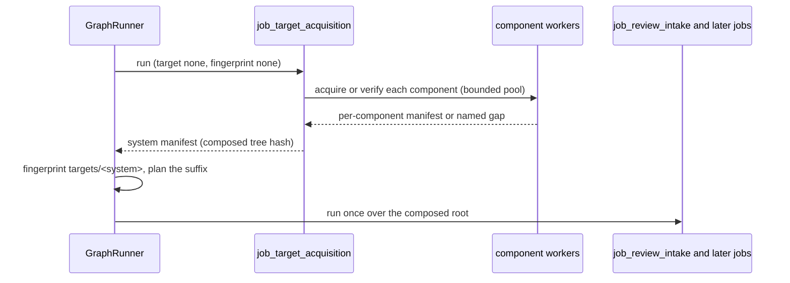

# Jobs and runtime

## Wave 1 resumability

An ordered application graph sits above the existing semantic `JobRunner`. Each successful attempt
publishes `handoff.json` inside its immutable attempt directory and updates the job's small
`latest.json` pointer only after output validation. The handoff binds result artifacts, upstream
handoff hashes, resolved and job-local configuration hashes, target fingerprint, implementation,
schema, validator, tool identity, timestamps, and resolving paths.

The shared [job interchange contract](job-interchange.md) upgrades this envelope to
`appsec-review/job-handoff/2` without replacing job-specific `outputs` or index manifests.
It separates admission from execution and coverage, binds evidence target identity independently
of the resume source fingerprint, and references detailed unit outcomes rather than inlining them.
Failed framework attempts are rejected diagnostics, never accepted/latest publications. Historical
`/1` handoffs require a rerun (`handoff_schema_changed`), not an in-place conversion. Runtime,
operational consumers, and the concrete scanner provenance slice use the upgraded contract.
Rejected diagnostics have separate immutable files and preserve accepted publication history.
Prepared and reused dispatch claims are verified against persisted identities in both assurance
modes, with managed authentication in addition. Repeated finalization reuses an already accepted
publication only after revalidating its immutable handoff bytes and binding.

The generic resume planner walks jobs in graph order. Once a job cannot be reused, it schedules that
job and invalidates the transitive downstream closure. It never treats time as proof of freshness.
The graph holds a kernel-backed per-run claim lock across planning and execution so two resume
processes cannot claim the same run concurrently.

The direct CLI runs the same enabled jobs as Dagster's `wave1_review`, in a topological order derived
from `orchestration.topology.wave1_dependencies`; Dagster executes independent branches concurrently
and the CLI executes them linearly. Standalone `job_third_party_data_sync` remains outside reviews.
Both refuse to start when the registered and configured jobs differ. Both place enabled PoC,
remediation and dossier jobs between inference review and the single final gate, followed by
report publication and default-on standalone OpenVEX generation/validation. The report consumes only
the gate; enabled export adds a separate terminal consumer, not report fan-in. Both surfaces use the same semantic
registry and accepted-handoff format. The operator-visible execution distinction is documented in
[`../operations/wave1-review.md`](../operations/wave1-review.md).

**Delivered completion source:** `b702eb7` registers the pre-gate graph, three new jobs, typed
settings/profiles and dataset/input-matrix wiring. PoC/planning/validation/dossiers default enabled
for new configurations; old frozen runs are unchanged. Validation without planning is rejected.
The [completion design](evidence-completion-and-remediation.md) preserves compile-only policy.
Checkpoint `18eae9f` aligns the shared review reader with writer `/3` and verifies nested chain
and package bindings. Integration `dd9c9ad` supplies immutable protected PoC `/2`,
gate/report `/2`, authenticated disabled-manual-PoC admission and chain/base completeness isolation.
Gate certification rehashes nested optional artifacts and freezes capability/attachment accounting;
the report never discovers later producers. The
[seeded PDF sample](../operations/dossier-publication.md#verified-seeded-sample) is owner-verified;
the historical owner `039b24e4` all-lane result uses offline model/compiler/renderer boundary
doubles. Its bounded pass is not live reproduction or a full-repository/current-main acceptance;
see the [acceptance ledger](../reviews/evidence-completion-documentation-inventory.md#acceptance-ledger).
Registration and unit coverage alone establish neither. The
[dossier inventory change map](dossier-data-inventory.md#8-completion-change-map-and-unresolved-integration)
lists the central config/schema/version, target-independent dispatch, CLI/Dagster, resume and
dataset/input-matrix surfaces that must change together.
Combined source `6975aef2` retains main's topology-derived CLI `_graph_order` rather than restoring
a separate hardcoded job list. Both required hunt/lead package-manifest hashes are checked by the
shared `/3` reader, and PoC briefs resolve entry/path entity identities rather than display labels.
Standalone OpenVEX is registered and enabled by default in both configuration and typed settings,
with truthful tool author, conservative action and an exact accepted-snapshot namespace requiring
no operator setup. Explicit disable opts out; old frozen disabled runs remain disabled and refuse
manual redispatch. Optional author/action/IRI overrides remain strict and pre-run only.
This brings the combined
inventory to 44 jobs. Its bounded review `/3` verifier and the report share accepted gate `/2`
snapshot authority without optional producer-head discovery. It never becomes a report input
or completion barrier; generation adds no model, external publication, signature or new topology;
see the [export contract](openvex-export.md) and [verification record](../reviews/openvex-export-implementation.md).
In both graphs, enabled prioritization and code-graph indexing feed security tagging,
then OWASP consumes accepted tag-cloud/classification context before review data indexing and
package/hunt/red-blue assembly. Tags are routing, not control proof. The OWASP job is enabled by
default in assessment mode across shipped profiles; it selects the same chain in direct
`start`/`resume`/`plan-resume` and Dagster. Direct `--force-from` accepts tagging/OWASP only when
enabled, and `jobs.job_owasp_control_assessment.settings.enabled = false` explicitly opts out.
Standalone metadata sync remains outside the review graph. The
[workbench design](owasp-control-workbench.md) describes the four supported
Python static procedures, separate blinded reviewer, provisional result boundary and named
unresolved coverage.

A boolean at `[jobs.<job_id>.settings].enabled` is the generic job dispatch gate. Missing means
enabled. `false` makes the job transparent: it is absent from direct and Dagster graphs, takes no
inputs, publishes no handoff or artifacts, and is excluded from the run inventory. Nested feature
flags such as `settings.model.enabled` or `settings.github.enabled` control only that feature and do
not suppress the containing job. An enabled job is dispatched normally and must satisfy its full
input, output, tool, and acceptance contracts.

## Registered jobs

`runtime/registry.py` registers 43 jobs. Each has a `[jobs.<job_id>]` table in
`appsec-review.toml`, and its Dagster job is named from that table's `name`.

| Job | Purpose | Operations |
| --- | --- | --- |
| `job_third_party_data_sync` | NVD (with `index/nvd.sqlite`), OSV, MITRE, CISA KEV, FIRST EPSS and cve-bin-tool feed snapshots (scheduled, outside reviews) | [third-party-data-sync](../operations/third-party-data-sync.md) |
| `job_model_connectivity` | Mandatory fresh provider/model connectivity gate | [below](#inference-entry-point-and-model-preflight) |
| `job_image_pin_verification` | Mandatory check that every enabled catalog image and configured image-ID pin resolves locally to exactly its pinned image; any mismatch fails the run. Builds nothing | [image-pin-verification](../operations/image-pin-verification.md) |
| `job_target_acquisition` | Acquires (or re-verifies) every component of the review system named by `start --system`, in parallel, into `targets/<system>/` before intake; a failed component is a named gap; a no-op without a requested system | [target-acquisition](../operations/target-acquisition.md) |
| `job_review_intake` | Configuration and target intake; copies a target-acquisition manifest to `target-acquisition.json` and resolves configured binary decompilation publications to `binary-evidence.json` | [below](#inference-entry-point-and-model-preflight) |
| `job_target_catalog` | Bounded target catalog and source index | [target-analysis-planning](../operations/target-analysis-planning.md) |
| `job_source_history_analysis` | Git/GitHub history instability signals | [source-history-analysis](../operations/source-history-analysis.md) |
| `job_ci_configuration_analysis` | CI/CD configuration analysis | [ci-configuration-analysis](../operations/ci-configuration-analysis.md) |
| `job_target_analysis_plan` | Scanner selection and build recipes | [target-analysis-planning](../operations/target-analysis-planning.md) |
| `job_tree_sitter_ast` | Concrete syntax trees and AST shards | [tree-sitter-ast](../operations/tree-sitter-ast.md) |
| `job_change_context_analysis` | Change-context signals | [change-context-analysis](../operations/change-context-analysis.md) |
| `job_project_build` | Project images, probes, and image repair | [project-build](../operations/project-build.md) |
| `job_language_build` | Generic language and WebAssembly builds | [language-build](../operations/language-build.md), [wasm-build](../operations/wasm-build.md) |
| `job_artifact_indexing` | Produced-artifact index | [artifact-indexing](../operations/artifact-indexing.md) |
| `job_debug_symbol_indexing` | Run-selected Clang/DWARF or MSVC/PDB evidence, bounded normalized symbol queries and explicit coverage | [debug-symbol-indexing](debug-symbol-indexing.md) |
| `job_test_coverage` | Hash-verified import of retained LCOV, Cobertura, JaCoCo and LLVM coverage | [test-coverage-ingestion](../operations/test-coverage-ingestion.md) |
| `job_profile_data` | Hash-verified import of retained folded-stack, perf-script, Callgrind and LLVM sample profiles | [profile-data](../operations/profile-data.md) |
| `job_artifact_security_analysis` | Produced-artifact security analysis | [artifact-security-analysis](../operations/artifact-security-analysis.md) |
| `job_cpp_compiled_analysis` | C/C++ compiled analysis | [cpp-compiled-analysis](../operations/cpp-compiled-analysis.md) |
| `job_clang_static_analysis` | Clang-Tidy and Clang Static Analyzer over accepted compile scopes | [clang-static-analysis](../operations/clang-static-analysis.md) |
| `job_svf_alias_analysis` | Opt-in SVF points-to cross-check producer over linked `-O0` bitcode | [svf-alias-analysis](../operations/svf-alias-analysis.md) |
| `job_sanitizer_build` | ASan/UBSan rebuild of accepted native units in a separate workspace; catalogues instrumented outputs and proves instrumentation from the ELF, never executes them | [sanitizer-build](../operations/sanitizer-build.md) |
| `job_cpp_symbol_index` | clangd symbol index | [cpp-index-jobs](../operations/cpp-index-jobs.md) |
| `job_cpg_analysis` | Joern code property graph (deprecated; shipped `settings.enabled = false`) | [cpp-index-jobs](../operations/cpp-index-jobs.md) |
| `job_binary_evidence_indexing` | Bounded `binary` retrieval shards over the Ghidra publications that review intake froze; not applicable when no binary is configured | [binary-decompilation](../operations/binary-decompilation.md) |
| `job_post_build_security_assessment` | Build-hardening assessment | [post-build-security-assessment](../operations/post-build-security-assessment.md) |
| `job_evidence_collection` | Deterministic static evidence | [static-analysis](../operations/static-analysis.md) |
| `job_dependency_intelligence` | Declared, SBOM, linker and loader dependency identity with OpenSSF Scorecard context | [dependency-intelligence](../operations/dependency-intelligence.md) |
| `job_codeql_analysis` | Cross-language CodeQL | [codeql-analysis](../operations/codeql-analysis.md) |
| `job_code_graph_index` | Normalized, cross-checked `graph` index from CodeQL and C/C++ producers | [code-graph-index](../operations/code-graph-index.md) |
| `job_owasp_control_assessment` | OWASP control assessment | [owasp-control-assessment](../operations/owasp-control-assessment.md) |
| `job_review_prioritization` | Function-level review prioritization | [review-prioritization](../operations/review-prioritization.md) |
| `job_security_tagging` | Basis-qualified security tags | [security-tagging](../operations/security-tagging.md) |
| `job_review_data_indexing` | Dataset inventory and publication audit | [review-data-indexing](../operations/review-data-indexing.md) |
| `job_review_package_assembly` | Deterministic pre-adjudication lead and hunt packages | [review-package-contract](review-package-contract.md) |
| `job_document_issue_analysis` | Private document candidate ledger with verified source mappings | [document-issue-analysis](../operations/document-issue-analysis.md) |
| `job_inference_security_review` | Two-lane evidence-bound inference review (slice 1: claim ledger, adjudication, one scorer, accepted handoff) | [inference-security-review](inference-security-review.md) |
| `job_final_publication_gate` | Deterministic, model-free gate: re-verifies the accepted review handoff from bytes and classifies every finding package as publishable, verification backlog or withheld, with named limitations | [final-report](../operations/final-report.md) |
| `job_poc_generation` | Default enabled for new configurations; reads accepted review directly, writes immutable protected compile-only test/control functions and `/2` outcome/provenance before the gate | [poc-generation](../operations/poc-generation.md) |
| `job_remediation_planning` | Confirmed-only inert exact patches, separate regression specifications and accounted manual/insufficient/capped outcomes | [remediation](../operations/remediation.md) |
| `job_remediation_validation` | Exact scratch applicability, independent semantic assessment, selected static/native syntax checks and cleanup; never runtime verification | [remediation](../operations/remediation.md) |
| `job_dossier_publication` | Protected per-confirmed-finding and per-PoC-outcome JSON/LaTeX/PDF/receipts before the final gate; real PDF only when rendered | [dossier-publication](../operations/dossier-publication.md) |
| `job_final_report_publication` | Deterministic, model-free terminal job: `final-report.json` and a byte-reproducible `final-report.md` from the accepted gate (PDF is a later step) | [final-report](../operations/final-report.md) |

Each orchestrated graph launch also publishes an immutable run-level orchestration receipt. This
keeps the current Dagster run linked to the application run even when every job is reused and the
accepted job receipts correctly remain linked to their original launch.

A job may also declare a cheap, deterministic `input_identity` probe for inputs the target
fingerprint deliberately excludes. The runner records the probe value in the claim and handoff, and
the resume planner re-probes it against the graph target; a mismatch reruns the job and invalidates
its downstream closure. `job_source_history_analysis` uses it for the mainline commit, object
format, and shallow boundary, because `.git` is outside the source fingerprint.

## Global events

Every job and unit event is mirrored through one process-safe writer to
`runs/<run-id>/data/logs/pipeline.jsonl`, while attempt-local event logs remain available. Sequence
allocation and append occur under the same kernel lock. Records have bounded/redacted details, and a
torn final line is truncated under that lock before the next append, preserving a readable total
order after a writer crash.

The runtime composes each job from one handler and explicit input/output validator lists. Specific
jobs do not subclass the runtime and cannot replace its attempt, status, logging, or publication
lifecycle.

```text
src/appsec_review/
  runtime/       composed Job, registry, runner and context
  config/        typed TOML loading
  observability/ structured execution events
  storage/       atomic writes, run allocation and locks
  jobs/
    job_third_party_data_sync/
      steps/
        nvd_sync/        fetch -> process -> publish
        osv_sync/        fetch -> index -> publish
        mitre_sync/      fetch -> normalize -> publish
        kev_sync/        fetch -> normalize -> publish
        epss_sync/       fetch -> normalize -> publish
        cve_bin_tool_db_build/
```

Stable hierarchy is `job -> step -> task`. Every identifier is a descriptive lowercase snake-case
name. Add step or task modules only when the work actually has independently validated or
dispatchable units; do not make empty structural classes.

Configuration uses nested stable ids:

```toml
[jobs.job_third_party_data_sync]
name = "third_party_data_sync"

[jobs.job_third_party_data_sync.schedule]
enabled = true
cron = "0 0 * * *"
timezone = "UTC"

[jobs.job_third_party_data_sync.steps.nvd_sync.tasks.fetch]
workers = 1
```

Step/task overrides use
`[jobs.<job_name>.steps.<step_name>.tasks.<task_name>]`; for example, the NVD step declares
`fetch`, `process`, and `publish` tasks.

## Processing-mode configuration reference

Three independently typed controls are resolved by the central TOML loader:

```toml
[build_capture]
mode = "required" # required | auto | disabled

[jobs.job_language_build.settings]
compiler_artifact_collection_mode = "required" # required | auto | disabled

[jobs.job_language_build.settings.compiler_artifact_collection_overrides]
native = "required"
go = "required"
dotnet = "required"
rust = "required"

[jobs.job_codeql_analysis.settings]
enabled = true
execution_mode = "auto" # build | source | auto | disabled

[jobs.job_codeql_analysis.settings.languages.cpp]
enabled = true
mode = "build" # build | source | auto | disabled
```

`build_capture.mode` defaults to `required`. Only `job_project_build` and
`job_language_build` may override it through their existing `settings.build_capture` table; all
other job targets are rejected. `compiler_artifact_collection_mode` defaults to `required`, and
its override table accepts only the configured language-build families: `native`, `go`, `dotnet`,
`node`, `python`, `rust`, `php`, `java`, and `wasm`. An omitted family inherits the default.

CodeQL `execution_mode` defaults to `auto`; each of the fixed CodeQL language entries can override
it with `build`, `source`, `auto`, or `disabled`. The checked-in configuration preserves verified
behavior explicitly: C/C++, Go, Java/Kotlin, and C# use `build`, while JavaScript/TypeScript,
Python, Rust, and Actions use `source`. The old per-language spellings normalize only at load time:
`manual` becomes `build` and `none` becomes `source`. The typed object and resolved configuration
never retain the legacy spelling. A legacy `enabled` Boolean that conflicts with `disabled` is
rejected rather than guessed.

Every run retains both the exact source TOML and canonical `resolved.json` under
`runs/<run-id>/data/configuration/`. The version 2 configuration manifest hashes both. Canonical
JSON and its SHA-256 include defaults, overrides, and normalized CodeQL values; accepted handoffs,
job configuration hashes, and resume planning use the resolved hash. Changing any processing mode
therefore invalidates reuse deterministically.

The generic deterministic evaluator makes these controls operational. Its immutable decision binds
resolved policy and configuration hash to the accepted project/language identity, bounded facts,
selected capability, descriptor source path/hash identities, reason code, and one of `SUCCEEDED`,
`SKIPPED_NA`, `SKIPPED_POLICY`, or `GAP`. Decisions are retained in project-build,
language-build, and CodeQL artifacts and handoffs. They are checkpoint inputs, participate in
resume invalidation, and feed completeness accounting; `GAP` is retriable and blocks clean claims,
while either skip remains explicit without becoming a gap or evidence of security.

### Per-input tool support

The same dispositions apply to each input a job hands to an external tool. The inputs every
tool consumer can process are declared once, typed, in `src/appsec_review/tool_inputs.py`
(`TOOL_INPUT_SUPPORT`): file suffixes, names, or path shapes for source/configuration scanners,
bounded-magic artifact formats for produced-artifact scanners (with media/asset formats from
`src/appsec_review/media_assets.py` excluded from the Syft and Grype package catalogers), and
translation-unit suffixes for
Clang-family compile databases. Target-analysis planning, evidence collection, CI configuration
analysis, artifact security analysis, and the C/C++ scope jobs partition their candidates through
that table **before launch**:

- an input outside a tool's declared support is never launched; it is recorded as `SKIPPED_NA`
  with reason code `INPUT_FORMAT_UNSUPPORTED` and a reason, in a separately counted
  `not_applicable_inputs` summary that is neither a gap nor a failure;
- a tool whose every planned input is unsupported publishes `NOT_APPLICABLE` with
  `coverage_disposition: SKIPPED_NA` and no gap;
- artifact security analysis also records a verified installed npm package as `SKIPPED_NA` before
  launch, with reason code `INSTALLER_RECORD_COVERED`, for Syft and Grype when the same unit scans
  that package's npm installer record once instead. The disposition names the covering record
  (`input_covered_by`, `input_evidence_ref`). If no such record is scanned, the package is
  launched as before (see
  [installed npm packages](../operations/artifact-security-analysis.md#installed-npm-packages-one-scan-per-installer-record));
- only where support cannot be decided exactly before launch is a tool's own documented
  "unsupported input" report accepted after the run (`TOOL_REPORTED_UNSUPPORTED_INPUT`): ShellCheck
  SC1071, Semgrep/OpenGrep skip reasons that mean no rule or language applies, and osv-scanner's
  exit-128 "No package sources found" for one produced artifact. Every other error stays a gap;
- a supported input on which the tool fails, times out, is OOM-killed, truncates, or whose image
  or database is unavailable remains a `GAP`/`FAILED` exactly as before;
- a cataloged source file that no declared source analyzer supports is never treated as clean:
  evidence collection publishes it as `unsupported_coverage` (kind `unsupported-language`) and a
  named `unsupported-language coverage` gap.

### Configured path exclusions

A review can deliberately leave target paths out of analysis (`src/appsec_review/config/exclusions.py`).

```toml
[exclusions]                                  # every job
patterns = [".gitignore"]

[jobs.job_source_history_analysis.exclusions] # this job only, after the global patterns
patterns = ["docs/"]
```

The patterns match the target-relative path:

- A pattern without `/` matches any path component. `.gitignore` or `*.md` match that file
  anywhere, and `fixtures` matches every folder of that name.
- A pattern ending in `/` is a folder. With no other `/`, it matches the folder anywhere;
  otherwise it is anchored at the target root (`docs/api/`). Everything beneath the folder is
  excluded.
- Any other pattern containing `/` is anchored at the target root and globbed against the whole
  path.

**Where they apply.** Intake and catalog apply the exclusions to their inventory. Every job that
reads the accepted catalog therefore inherits the global and catalog-level patterns. Source
history also applies its own job-level patterns to the catalog's file list.

**Job-level tables.** Only `job_review_intake`, `job_target_catalog` and
`job_source_history_analysis` accept a job-level table. Naming one on any other job fails at
load, so a pattern is never silently ignored.

**Recording.** Each excluded path is listed once under `configured_exclusions`, with the
pattern and scope that excluded it. This is a declared scope decision, not a coverage gap.

**What exclusions don't change.** They don't change what is built, and the target's source
fingerprint still covers every byte. Both tables are frozen into the run's resolved
configuration, so changing an exclusion changes the run's configuration identity.

### Named build-output exclusions

`[exclusions]` acts on the target's source tree. Build outputs have their own top-level table,
`[build_outputs]` (`src/appsec_review/config/build_outputs.py`), read only by
`job_project_build`, `job_language_build` and `job_sanitizer_build`:

```toml
[build_outputs]                               # the three build jobs
heuristic_min_confidence = "medium"

[[build_outputs.exclusions]]
name = "cmake-fetchcontent-subbuild"
reason = "FetchContent download sub-builds are CMake bookkeeping, not dependency or target output"
patterns = ["*-subbuild/"]
families = ["native"]
```

Each rule is named and has a reason. Its patterns use the `[exclusions]` semantics above, matched
against the workspace-relative path, and `families` limits the build families it applies to. A
`jobs.<id>.build_outputs` table fails at load. Each excluded path is recorded once under the
receipt's `build_output_dispositions.configured_exclusions` with its name, pattern and scope
`build_outputs`, as a declared scope decision rather than a gap. The table also bounds native
build-layout discovery, which routes created dependency trees to the `supply_chain` lane. It is
frozen into the resolved configuration, and its policy identity is part of the language-build and
probe checkpoint identities and is recorded in the sanitizer summary. See
[`native-build-output-discovery.md`](native-build-output-discovery.md) and the
[language-build settings](../operations/language-build.md#build_outputs).

## NVD synchronization

`job_third_party_data_sync.nvd_sync` is a standalone, network-enabled reference publisher. It bootstraps from the official
NVD CVE 2.0 yearly feeds and then consumes bounded CVE API last-modified windows. Raw source bytes
and a compact CVE metadata JSONL projection are stored as content-addressed gzip blobs. Each snapshot
also publishes `index/nvd.sqlite`, a compact CVE-id lookup built deterministically from the parent
index plus the new layers (a later `last_modified` overrides), hashed in the manifest's `files`. An
immutable manifest links each snapshot to its parent; `current.json` advances only after complete
validation.

The schedule declaration is midnight UTC. Direct CLI invocations enter `JobRunner` with an explicit
trigger:

```powershell
python -m appsec_review run job_third_party_data_sync --trigger manual
python -m appsec_review run job_third_party_data_sync --trigger schedule
```

The application runtime exposes a typed `ExecutionPlan` and safe lifecycle methods to begin an
attempt, execute or reuse one unit, and finalize its validated handoff. Dagster consumes that plan
and displays the actual dependency graph. Intake and catalog tasks are visible nodes; every evidence
producer is a `scan -> normalize -> index` branch; Syft is a real prerequisite of Grype; final
manifest assembly depends on every producer-owned index shard; handoff publication depends on the
verified manifest. There is no whole-job dispatch op.

Dagster owns dependency scheduling, multiprocess concurrency, pools, node visibility, and selected
re-execution. The application remains authoritative for run/attempt allocation, immutable
configuration binding, handlers and validator lists, checkpoints, receipts, hashes, source identity,
coverage gaps, shard validation, the accepted manifest pointer, the central log, and accepted
handoffs. TOML controls the multiprocess executor and concurrency bounds.

Graph completion is a separate lifecycle node that waits for every terminal application's
accepted finalization. With default-enabled OpenVEX, both the independent export and gate-only
report must finish before the adapter emits graph/run completion, publishes the orchestration
receipt, or refreshes final metrics. Their handoff maps and resume decisions are merged once,
with shared ancestors deduplicated and gaps retained from either branch. A failed terminal
prevents successful graph completion. Explicitly disabling export leaves the report as the
sole required terminal; it does not add export fan-in to the report's data contract.

Dagster run UUIDs and application run ids are separate identities. The adapter passes the Dagster
UUID into `JobRunner` as orchestration correlation, and the runner records it in terminal
`status.json`. The adapter tags the Dagster run with `appsec/application_run_id` and
`appsec/trigger` when it claims each attempt, and with `appsec/<job_id>/attempt` and
`appsec/<job_id>/status` when each job finalizes. This creates a checked bidirectional trace without allowing Dagster to write
application receipts or allocate application ids.

Deployment layout and exact operator commands are documented in
[`deploy/dagster/README.md`](../../deploy/dagster/README.md). The process-safe central log and
immutable publication checks remain coherent across Dagster worker processes. Direct
`JobRunner.run` remains available for fast runtime tests and controlled application execution;
integration and acceptance tests use the Dagster DAG.

## Inference entry point and model preflight

`appsec_review.inference.infer` is the only path from the application to a language model. A job
builds a `ModelRequest` naming its configured provider and model and calls `infer`; the inference
package resolves the provider to one transport function (`anthropic-api` or `claude-cli`). Jobs
receive `infer` as a parameter from the registry and never import a provider module, an SDK, or a
provider endpoint. A test fails if any module outside the inference package does.

The two transports grant the model no tools:

- `claude-cli` runs the operator-authenticated `claude` binary as `claude -p --output-format json
  --no-session-persistence --permission-mode bypassPermissions --model <model> --effort <reasoning>
  --allowedTools ""`, sending the bounded JSON request on stdin. It removes `ANTHROPIC_API_KEY` and
  `ANTHROPIC_AUTH_TOKEN` from the child environment so the CLI uses its subscription login.
- `anthropic-api` posts to the Messages API with `ANTHROPIC_API_KEY` (missing key is an error) and
  enables extended thinking. The configured `reasoning` maps to a thinking budget of 1024 (`low`),
  2048 (`medium`, also the fallback), 4096 (`high`), or 6144 (`xhigh`) tokens, capped at
  `max_output_tokens - 1024` and never below 1024.

Every review graph starts with `job_model_connectivity`. Unlike semantic review jobs, the gate is
always executed for each graph dispatch: an accepted handoff from an earlier attempt cannot satisfy
it. Its handoff enforces ordering but does not enter downstream semantic identities, so a successful
fresh probe does not invalidate otherwise reusable review work.

- `resolve_models` reads the run's frozen configuration and collects every provider/model pair any
  job's settings name, including jobs whose model is disabled and nested model tables.
- `verify_models` asks each named provider once, through `inference.check_models`, whether it serves
  each model. API providers return their model listing and resolve aliases by lookup; the Claude CLI
  has no listing, so each model is confirmed by one minimal call that the model itself must answer.

The provider listings, per-model results, and provider errors are written to
`model-connectivity.json` before any decision. If one configured model is unavailable, its provider
cannot be reached or authenticated, or its provider has no inference transport, `verify_models`
fails, the gate handoff is not published, and no later job in the review can start. A job instance
built outside the registry has no check wired and reports `NOT_APPLICABLE` rather than claiming the
models were confirmed. `jobs.job_model_connectivity.settings.timeout_seconds` bounds each provider
request or probe. Review intake retains its bound preflight receipt when intake itself executes, but
the dedicated first job is the authoritative fresh check when a run is resumed.

`job_image_pin_verification` follows the model gate and precedes intake in every review graph. It
is also always executed and non-propagating. It builds nothing: it reads `containers/catalog.toml`
and the run's frozen configuration, runs `docker image inspect` for every enabled catalog image, every
enabled job's `tag`/`image_id` pin (the project-build profiles) and `source_image_tag`/
`source_image_id` pin (CodeQL), records each pin's pinned and resolved image ID, and fails the run,
never recording a gap, naming every missing image and moved tag. Images are rebuilt and re-pinned on
the host by the operator. Setting `jobs.job_image_pin_verification.settings.enabled = false` makes
the next gate follow the model gate directly. See
[`../operations/image-pin-verification.md`](../operations/image-pin-verification.md).

`job_target_acquisition` is the last pre-intake gate, also always executed and non-propagating.
A review **system** is composed of one or more components (Git by default, Perforce, or a GitLab,
Gerrit or Azure DevOps review export), so the target may not exist when the run starts. With
`start --system <id>` (or `APPSEC_REVIEW_SYSTEM`), `GraphRunner` runs the leading gates with no
target and source fingerprint `none`, the acquisition gate acquires every component concurrently
(a worker pool bounded by `target_acquisition.max_parallel_components`) into
`targets/<system>/<component>/`, or re-verifies those already acquired, and only then fingerprints
the composed `targets/<system>/` root and plans the remaining jobs against it. Intake, cataloging
and every discovery branch therefore run once over all components. Because the gate does not
propagate its handoff, a resume re-verifies the components but reuses downstream work while the
composed tree is unchanged. Intake binds the acquisition through the system manifest whose
`target_path` is the reviewed root. Under Dagster, the gate reads the same environment variable and
`launch_inputs` fingerprints the target lazily for intake. Without a requested system the gate
records `NOT_REQUESTED`. See [`../operations/target-acquisition.md`](../operations/target-acquisition.md).



## Target analysis planning

`job_target_analysis_plan` is the semantic boundary between the accepted target catalog and costly
producer branches. It consumes only hash-verified catalog artifacts and accepted index identities;
it never walks the target during inference and never builds or executes target code. Its bounded
summary groups large trees by prefix and component while preserving exact target-relative path and
hash identities for every accepted scope.

Deterministic rules select mandatory baseline coverage, language-specific scanners, dependency
managers, and generic build units first. Units come from accepted project descriptors or a bounded
source-only fallback for directly compiled languages; their stable identities never include fixture
names or fixed repository layouts. A centrally configured model resolves how each unit should be
built from a bounded descriptor package. It returns one typed recipe per unit, including the
throwaway-image profile, declared dependencies, environment, argv arrays, and expected outputs.

Model proposals are untrusted, versioned data. Every identity and path must resolve against the
accepted catalog. Validators reject unknown executables, shell syntax, secret environment keys,
absolute or escaping paths, package/tool installers, tests, and target execution. The model cannot
invent a build unit or authorize execution; a later build job may execute only an accepted recipe
inside its matching image profile. Disabled, unavailable, failed, invalid, or contradictory model
assistance publishes an explicit build-planning gap and leaves recipes absent.

`job_project_build` resolves native CMake recipes deterministically from an accepted
`CMakeLists.txt` marker. That narrow policy takes precedence over model-proposed CMake commands,
is validated by the same recipe allowlist, and is marked `deterministic-cmake-marker`; it does not
generalize to ambiguous build systems. Project-build execution first probes the default pinned
family image. A failed probe may trigger at least three centrally bounded inference-guided image
repairs. The repair schema permits only typed, bounded data: a complete apt package set, a
complete environment drawn from a per-family allowlist, a package manager the family image already
pins, and restores of accepted dependency manifests by the family's own package manager. Commands,
paths, dependency files, and outputs remain immutable; see
[`../operations/project-build.md`](../operations/project-build.md). A successful repair promotes the exact Dockerfile, derived
image digest, and repaired operational recipe into a cache keyed by the original recipe identity,
so unchanged recipes reuse the accepted image while changed recipes return to the default probe.

The accepted plan is an immutable run artifact and an `analysis/target-analysis-plan` retrieval
shard. Its manifest composes the catalog shards rather than replacing them. Evidence producers read
the accepted plan, execute only selected scanner scopes, and publish explicit `NOT_APPLICABLE`
dispositions for unselected families. Because the planner is a real job in the Dagster graph,
catalog changes invalidate the plan and downstream producers while unrelated upstream work can be
reused.

## Generic language-build execution

`job_language_build` is the execution boundary after project-build probing. It hash-verifies the
accepted dispatch, probe receipt, recipe, dependency files, source snapshot, and exact derived
image before executing accepted argv in a fresh run-owned workspace. Native builds, Rust/Cargo, JVM Java/Kotlin
projects, Go modules and
workspaces, manifest-declared Node/JavaScript/TypeScript projects, and Linux-capable .NET SDK projects
are implemented; Windows-only and .NET Framework units publish
explicit platform gaps. Families without an executor publish a named unsupported gap. Build dependencies form topological layers, while unrelated units share the configured
worker pool. Receipts bind command, compile-database, link, artifact, workspace-manifest, image,
and checkpoint identities. The Go capture derives actual compiler/assembler/linker/cgo/package
invocations from the toolchain trace and catalogs package relationships and build IDs.
The Rust capture binds Cargo metadata and accepted workspace/package/target/profile/feature choices
to protected rustc/linker/archiver/build-script provenance, Rust artifact identities, and exact
package dependency relationships without executing examples, benchmarks, tests, or binaries.
The Node capture binds npm, pnpm, or Yarn to its accepted dependency identity, executes lifecycle
scripts as untrusted build code with dependency egress available, catalogs generated/bundled/package/native outputs and
source maps, and records only actually observed or successful package-script tool provenance.
Exact argv remains in protected run-owned artifacts; central logs and
retrieval-visible records contain hashes and sanitized facts only. See
[`../operations/language-build.md`](../operations/language-build.md).

The JVM family is an independent DAG branch. Maven and Gradle wrapper recipe names resolve to the
pinned system tools without trusting target wrapper payloads. Mixed Java/Kotlin units share their
accepted topology and dependency layers. The adapter catalogs generated sources/resources,
classes, JVM metadata, and JAR/WAR/EAR packages, and publishes sanitized command/artifact entities
to the composable `build` index while exact argv and streams remain protected.

Python is a first-class parallel family node rather than a repository-specific lane. It consumes
the same accepted dispatch/probe contract, binds checkpoints to declared dependency inputs and typed
network policy, executes packaging hooks only inside the generic sandbox, and publishes wheel,
sdist, metadata, generated-source, bytecode, native-extension, invocation, and package-relationship
evidence through the shared receipt and retrieval contracts.

## WebAssembly output-family execution

The `job_language_build` WebAssembly lane is an output-family adapter alongside its generic
source-family lanes. It selects accepted source-family recipes by typed producer rules rather than treating WebAssembly as
one source language. Rust wasm targets, Emscripten, WASI SDK/Clang, AssemblyScript, WAT tooling, and
additional explicit producers therefore reuse catalog discovery, recipe validation, derived images,
probe receipts, dependency topology, execution isolation, and immutable handoffs.

The adapter adds bounded diagnostic verbosity where supported, retains protected command streams
and argv, catalogs WebAssembly modules/components plus bindings and interface/debug/package
artifacts, and publishes sanitized command/artifact entities into the shared composable `build` shard. It
never instantiates produced modules. Producer failures are receipt gaps; accepted-input, path,
configuration, hash, checkpoint, and manifest failures stop publication. See
[`../operations/wasm-build.md`](../operations/wasm-build.md).

## C/C++ compiled-analysis lane

`job_cpp_compiled_analysis` consumes successful native receipts from the accepted generic
language-build handoff. It does not configure or compile projects. Its graph is repository-independent:
one task per stage batches an arbitrary project
set while retaining per-project checkpoints, terminal states, and shard identities. Once a project
catalog is terminal, compiled indexing, Clang AST, LLVM IR, Infer, and binary/symbol branches
can be produced without encoding project names or counts in the graph.

`job_cpp_symbol_index` (clangd) and `job_cpg_analysis` (Joern) are independent consumers of the
accepted C++ handoff. Each derives the same generic index scopes (accepted, hash-verified files plus
their exact compile commands) from that handoff, runs one pinned tool per scope, and publishes its
own shards. Neither depends on the other; both compose the accepted manifest without dropping
sibling producers' shards, and CodeQL composes both.

`job_codeql_analysis` is a separate cross-language consumer of the accepted catalog, language-build,
artifact-index, and C++ handoffs. It owns C/C++, Go, Java/Kotlin, C#, JavaScript/TypeScript, Python,
Rust, and GitHub Actions database/query/SARIF production and publishes one composed accepted view.

The generic native build container executes untrusted build logic but never target binaries or tests.
`job_sanitizer_build` replays the accepted native build commands with sanitizer flags in a separate
workspace under the same rule and publishes an instrumented-output catalog that no existing job
consumes ([`../operations/sanitizer-build.md`](../operations/sanitizer-build.md)).

`job_poc_generation` is now ordered before the single gate alongside the remediation/dossier
producers, and remains transparent when disabled. It reads no target tree (the source copy is the run's accepted native build
workspace, so it is not in `launch.TARGET_JOBS`), calls one model under the no-tools in-process loop, and compiles
but never links or runs what the model wrote. A direct dispatch of this one job is allowed while it is disabled
(`cli.MANUAL_JOB_IDS`) ([`../operations/poc-generation.md`](../operations/poc-generation.md)).

`job_final_publication_gate` and `job_final_report_publication` call no model. The gate reads the
accepted inference review and completion handoffs and re-hashes every artifact it binds; the report
reads only the accepted gate snapshot, never discovering later producer pointers. Neither may
reinterpret a claim state or ship-block status, and integrity failure fails the job.
[Final-report operations](../operations/final-report.md) describes the certified capability and
attachment boundary.
The C++ analysis container only replays bounded compile units for analysis. Application code validates
workspace manifests, compile commands, and artifacts; converts tool failures to explicit gaps; and
retains framework integrity failures as hard failures. See
[`../operations/cpp-compiled-analysis.md`](../operations/cpp-compiled-analysis.md).

## Post-build security assessment

`job_post_build_security_assessment` runs after the accepted C/C++ compiled-analysis handoff and
before the CodeQL and OWASP joins. Static evidence collection is a sibling branch and does not wait
for this job. The assessment reads the accepted handoff and manifest rather than walking the target.
A dynamic project set reuses the generic build's protected exact argv artifacts plus redacted
indexed command summaries, inspects produced files as bytes without executing them, applies
platform-aware deterministic hardening rules, validates bounded model observations against exact
command or artifact identities, and publishes independently fingerprinted `build_security` shards.

The fingerprint for each shard binds its protected command artifacts, produced-binary hashes,
tool/image identity, rule version, parser and normalizer versions, model/guidance identity, and
upstream manifest. A changed translation unit therefore invalidates its case and dependent linked
artifacts without invalidating unrelated case shards. Missing action timing, link maps, loader
metadata, unsupported formats, unavailable model/tooling, truncation, and parser limitations are
coverage gaps rather than clean results. Exact command text is never written to the central log or
retrieval databases. Operational details are in
[`../operations/post-build-security-assessment.md`](../operations/post-build-security-assessment.md).
