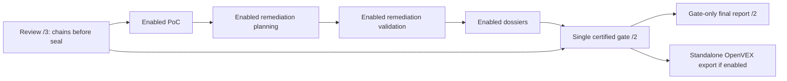

# OpenVEX findings export

Status: **certified-gate adaptation in progress**, reconciled against
`ede3c107b16aedebc97c2659372ac9ae80fde348` (including strict contracts at `f4f746bf`).
The user selected **standalone post-gate export; preserve gate-only reporting**.
This document supersedes the earlier OpenVEX report-link/fan-in proposal throughout:
enabled PoC/remediation/dossiers precede one final gate, and export/report are independent
post-gate peers. The report never discovers or consumes OpenVEX output.

At this source boundary, frozen settings, strict gate `/2` capability/attachment contracts,
review `/3` identities and standalone topology are reconciled. The real input verifier and
projector are still being adapted; this is not final `/2` execution validation. Exact
focused-unit, packaging and manual-validation results belong in
[the implementation record](../reviews/openvex-export-implementation.md), not inferred from
schema-valid synthetic fixtures.

The coordinator selected a small v1: explicit immutable pre-run TOML issuer/action inputs,
reviewed-source-snapshot products, and the existing accepted-handoff lifecycle. There is no
new approval intake, per-finding consent workflow, generic runtime identity hook, or mutable
post-run configuration. This document does not authorize public disclosure.

## 1. Goal and non-goals

Add a deterministic, model-free `job_openvex_export`, downstream of the accepted final
publication gate, producing OpenVEX v0.2.0 `affected` statements for **all and only the
gate's publishable confirmed findings**. An operator explicitly supplies the person or
organization issuing those assertions and a common action statement applicable to all
exported findings. Missing required enabled-job inputs are configuration errors, not an
empty export or an excuse to invent advice.

OpenVEX is a compact vulnerability/product/impact-status exchange, not a lossless review
report. Retain scores, independence, ship-block policy, coverage, limitations, and resolving
statement-to-evidence mappings in a hash-bound companion manifest. A dossier, attack chain,
PoC, successful compilation, or exploit execution is not required for `affected`.

V1 does not add remediation generation/planning/validation, SBOM generation, signing/key
infrastructure, automatic uploading/publication, release ranges, exploit execution, chain
composition, external vulnerability-ID inference, or `not_affected`, `fixed`, and
`under_investigation` workflows. Export success is not a clean verdict or shipping approval.

## 2. Current source evidence

The [completion architecture](evidence-completion-and-remediation.md) supplies the frozen
upstream contract. Observed boundaries at the reconciliation base:

| Surface | Observed behavior and consequence |
| --- | --- |
| `jobs/job_final_publication_gate/verify.py`, `attachments.py`, `classify.py`, `job.py` | Gate `/2` certifies review `/3`, package/ledger/score/policy identities, five capabilities and closed sanitized attachments after enabled producers. Every package belongs to `publishable`, `verification_backlog` or `withheld`. Export cannot bypass withholding. |
| `docs/schemas/inference-security-review/finding-package.schema.json` | `finding-package/2` holds confirmed/supported state, resolving evidence IDs, scoring references, independence, ship-block information, and only `safe_regression_artifact` under remediation inputs. It has no accepted action advice or approved release-product mapping. |
| `jobs/job_inference_security_review/job.py` | `scope.accept_manifest` publishes `accepted-scope.json` with `target_snapshot`, `manifest_sha256`, and `manifest_path`. Bind that artifact explicitly; do not assume the gate already binds every scope artifact. |
| `jobs/job_final_report_publication/job.py`, `report.py`, `datasets.py` | Report `/2` is a deterministic certified-gate projection. Its `CONSUMES` is exactly the gate; it reads neither producer latest pointers nor export status/files. |
| `jobs/accepted_review.py`, `jobs/job_poc_generation/inputs.py` | Pre-gate consumers use accepted review `/3` and scope; they do not depend on a post-completion gate. No exporter cycle is introduced. |
| `jobs/job_poc_generation/` | Writes developer test functions and validates/compiles them. It never links or executes them. `compile_verified` is not exploitation; `compile_failed` does not refute a finding. |
| Completion producers | Chains are review-owned before seal; enabled PoC, planning, validation and dossier jobs precede the single gate. Capability/status/artifact certification is not execution proof or finding reassessment. |
| `job_openvex_export/contracts.py`, `projection.py`, `inputs.py` | Strict records require gate `/2` capabilities/attachments and certified membership. At the pinned base the real verifier/projector adaptation is unfinished; contracts alone do not prove execution readiness. |
| `jobs/job_review_intake/job.py`, `jobs/job_target_acquisition/job.py` | Intake may copy acquisition provenance into the run; direct local targets can lack repository/commit provenance. Accepted snapshot identity is always the fallback, not a guessed Git commit. |
| `runtime/runner.py`, `resume.py`, `job.py` | Full resolved configuration is immutable per run. Resume already checks settings, upstream handoff hashes, declared component releases, artifacts, and validation identities. No new runtime cache framework is needed. |
| `jobs/bound_artifacts.py`, `indexing/store.py` | Reuse accepted-handoff and run-relative hash-bound artifact readers. A corrupt/unsafe existing pointer must not masquerade as an absent job. |
| `observability/events.py`, `spans.py`, `telemetry.py` | Run-owned JSONL, operation spans, deterministic metrics; latest base also adds correlated OWASP/review-flow metrics. No Prometheus/OTel service is required. |

Paths in the table are relative to `src/appsec_review/` except explicitly named `docs/` paths.
Gate `review.configuration_sha256` is the semantic inference-review-settings hash from
`semantic_settings_sha256`, **not** the entire frozen `resolved.json` hash. Store them as
`review_settings_sha256` and `resolved_config_sha256` respectively in new export provenance.

## 3. Verified upstream specification and validation pin

On 2026-10-28, read the official
[OpenVEX specification](https://raw.githubusercontent.com/openvex/spec/main/OPENVEX-SPEC.md)
and [JSON schema](https://raw.githubusercontent.com/openvex/spec/main/openvex_json_schema.json).
Upstream `main` resolved to `61b5f885d0f481f48683c93345e49ef1a6e9fdff`; pin these exact raw bytes:

| Upstream file | Bytes | SHA-256 |
| --- | --- | --- |
| `OPENVEX-SPEC.md` | 30580 | `9375415ccb351260a998864cbeebbaff1808d1b09a306919b79cc75e5519f884` |
| `openvex_json_schema.json` | 12659 | `9373597734ed1d3ea5161a8b46d3866c4a8cfe76fd632fdd16aef01fb34b3238` |

Immutable sources:
[specification at the pin](https://raw.githubusercontent.com/openvex/spec/61b5f885d0f481f48683c93345e49ef1a6e9fdff/OPENVEX-SPEC.md),
[schema at the pin](https://raw.githubusercontent.com/openvex/spec/61b5f885d0f481f48683c93345e49ef1a6e9fdff/openvex_json_schema.json).
Vendor the schema unchanged at
`docs/schemas/openvex-export/upstream/openvex-v0.2.0.schema.json`; an adjacent
`upstream.lock.json` records upstream repository, commit, URLs, source hashes and license
attribution. Check licensing before redistribution. Pin updates are reviewed changes, not
runtime downloads. The unchanged upstream license is CC0-1.0. The strict offline closure is
**seven schemas plus license and lock = nine run-owned snapshots**: local
common/manifest/result, upstream OpenVEX, and final-report common/gate/report schemas.
`final-report.schema.json` is needed only for PoC-item definitions referenced by gate `/2`,
not for report data discovery. Preserve exact pinned bytes.

Local OpenVEX manifest/result/handoff identities remain `/1` on the pre-issued contract;
the validation-profile digest changes to bind gate `/2` and its closure. No old runtime
export is migrated or made compatible by relaxing schema validation. The companion records
schema and validation-profile hashes. Installed-resource fallback supports pure projection/
offline validation, not a self-contained application: configured checkout/guidance resources
remain required for full job imports/execution, including `pipeline/guidance/registry.json`.

Requirements relevant to v1:

1. Emit UTF-8 JSON with exact `@context: "https://openvex.dev/ns/v0.2.0"`.
2. Document `@id`, `author`, `timestamp`, `version`, and `statements` are required.
   `author` MUST identify an individual or organization; automation belongs in `tooling`.
3. An `affected` statement MUST have `action_statement`. The upstream schema accepts blank
   strings; v1 semantics do not.
4. A complete standalone statement needs vulnerability identity, at least one product, status,
   and time. The schema alone permits missing/empty `products`; v1 does not.
5. `statements` has `minItems: 1`: zero eligible findings produce `no_statements`, not an
   invalid OpenVEX document containing an empty array.
6. Document/statement/vulnerability/product objects prohibit unknown properties. Do not add a
   local `schema` tag, scores, evidence objects, policy or disclosure fields to OpenVEX.
7. CVEs are optional. An understood stable internal vulnerability ID is valid; CWE is a
   weakness class, not vulnerability identity.
8. Modified documents require version increments. V1 uses new content-addressed document IDs
   for new content and never modifies a previously issued ID.
9. `not_affected` needs an allowed justification or impact statement. `fixed` must concern
   specifically fixed product versions. Neither is emitted in v1.

Use the already declared `jsonschema` dependency with `Draft202012Validator` and a closed
local `referencing.Registry`. Explicitly reject remote `$ref` resolution and never retrieve
the JSON-LD context. Do not use the review `SchemaSet` for the upstream schema: it lacks
`anyOf`, treats `format` as annotation, and expects a different schema layout.
In addition to schema validation, explicitly validate RFC3339 timestamps and emitted
restricted ASCII URI/IRI forms; do not assume optional format-checker packages are installed.

## 4. Numbered implementation decisions

1. **Eligibility:** the accepted gate is authoritative. Export every package in `publishable`
   only when its accepted state is `confirmed`; disagreement is integrity failure.
2. **Statuses:** only `affected`. Supported findings, refuted/contradicted claims, unreachable
   observations, missing coverage, absent/failed PoCs and compile results imply no other
   OpenVEX status. Do not create statements for ledger claims lacking gate packages.
3. **Issuer/action:** explicit typed TOML fields, frozen before the run. The operator owns the
   issuer assertion and exact common action text. There is no synthesized mitigation,
   automatic target-guidance discovery, title-to-advice conversion, or silent fallback.
4. **Product:** one reviewed source-snapshot/configuration product for the reviewed system.
   An accepted source snapshot is not a shipped artifact, release range, or artifact digest.
5. **Evidence:** scores, independent verification, ship-block status and limitations remain
   separate dimensions in the companion. Missing values never become zero or low risk.
6. **Optional proof:** PoCs/chains/dossiers are optional linked evidence, never conditions for
   affected. Existing gate withholding remains unchanged; do not "repair" it in this feature.
7. **Privacy:** generate protected local artifacts only. Enabling export is a deliberate
   issuer/operator action, not approval to publish files externally.
8. **Empty/error:** genuinely zero eligible findings produce accepted `no_statements` with a
   named gap. Missing enabled settings, invalid input, stale state, tamper or bounds failure
   fail closed, not as empty success or row-level skip.
9. **Replay:** canonical bytes depend on accepted pins, frozen policy, schema and exporter
   release. No wall clock, attempt serial, PID or runtime timing enters artifact identity.
10. **Integration:** export consumes certified gate/review identities; report remains gate-only.
    No export-to-report dependency, live optional attachment discovery, mutable approval store,
    runtime identity hook or new acceptance job.
11. **Dispatch:** disabled by default; disabled means no automatic or manual dispatch in v1.
    Configure and enable before run creation. No new exception in `MANUAL_JOB_IDS`.
12. **Publication:** only the existing runner accepts the handoff after final byte/schema/
    semantic/accounting checks. A file or telemetry event is not proof of acceptance.

## 5. Safe immutable issuer/action inputs

The following operator-owned fields are required when enabled:

| Field | Typed contract |
| --- | --- |
| `author_kind` | Exactly `individual` or `organization`; never `tool`, model or bot. |
| `author` | Nonblank bounded person/organization name or identifier; the operator asserts issuance authority. Do not infer the repository owner or claim supplier endorsement. |
| `role` | Optional nonblank role, omitted from OpenVEX when empty. No automatic "supplier" role. |
| `action_statement` | Exact operator-authored plain text applying accurately to **all** exported findings for the reviewed product. Nonblank, bounded, no template placeholders or executable markup. |
| `repository_iri` | Explicit stable absolute `https:` or `urn:` identity for the reviewed repository/system, not a local path, branch, credential-bearing URL, or product release. |

Selecting a kind cannot mechanically prove a named author is a real organization/person.
Document the trust boundary: the operator owns this assertion; v1 adds no identity
verification or signature infrastructure. Reject obvious tool-only identities, empty/unsafe
values and unsupported kind, but do not claim a heuristic proves organizational authority.

Never manufacture "upgrade", "investigate", or "no fix available" advice. An issuer may write
an accurate statement that no remediation is yet available, but the exporter must not choose
that fallback. If no accurate common action statement can be approved for all publishable
findings, the operator cannot enable this v1 export for that run; per-finding advice is a
future schema/workflow, not an implicit partial-export switch.

Reject NUL, unsafe controls, detected embedded credentials, unresolved template markers,
and text exceeding UTF-8 byte bounds. Preserve accepted text exactly; do not silently redact,
truncate or normalize it into different advice. Detection cannot prove text contains no
secrets: explicit operator review remains necessary. Read no target-owned settings or advice.

The full configuration and its hash are already frozen under `data/configuration/`.
Do not edit them after review, add runtime overrides, or accept an unpinned advice file.
Changing author/action/repository policy requires a new run. Existing pre-feature runs
cannot acquire new settings by modifying their stored configuration.

## 6. Product and vulnerability identities

V1 deliberately uses the same reviewed-source product for all eligible findings. This asserts
impact in the accepted reviewed system snapshot/configuration, not that every released build
contains exploitable code. Store a human-readable scope qualification in both OpenVEX's fixed
status note and the companion.

Resolve `target_snapshot` through accepted scope and its verified manifest. Never run Git,
scan a target, or fingerprint the current checkout during export. `repository_iri` is an
explicit operator assertion; when accepted acquisition provenance supplies repository identity,
require agreement rather than silently overriding it. Record whether repository identity is
`operator_declared` or `accepted_acquisition`. If acquisition provenance does not exist, do not
invent a commit: the accepted snapshot digest is the exact identity.

Use one source-product IRI:

```text
urn:appsec-review:source-snapshot:<H(repository_iri)>:<target_snapshot>:<resolved_config_sha256>
```

`H` is full lowercase SHA-256 over existing `storage.canonical_json` bytes. Validate snapshot
and configuration values against their existing contracts before embedding them. Using the
full frozen configuration identity conservatively distinguishes build/profile differences,
not merely inference settings. Include
`repository_iri`, snapshot, accepted manifest, both package-manifest hashes, observed build/
configuration qualifications and full resolved configuration reference in the companion.
Do not use the whole frozen config hash as a product artifact hash; it is provenance.

A version-specific purl from a verified SBOM is preferable **when there is an accepted
mapping of that exact product/artifact to this reviewed snapshot/configuration**. Current
code does not establish a general SBOM-to-reviewed-system mapping, so the minimum v1 emits
the source-snapshot IRI only. Do not promote dependency purls or scanner package names to
top-level products. Verified SBOM product mapping can be added later without inventing
release ranges; it is not required to complete this slice.

V1 emits no product `hashes`, `identifiers` or `subcomponents`. A snapshot/Git/configuration/
review-package/SBOM file hash is not a hash of a shipped product. Future `hashes.sha-256`
must be measured from the exact named artifact, not copied from an unrelated identity.

Vulnerability `name` and `@id` are the same internal URI:

```text
urn:appsec-review:vulnerability:<H(["openvex-vulnerability/1", repository_iri, target_snapshot, claim_id])>
```

This is stable for the same accepted claim/snapshot/repository identity, not a promise of
global cross-run deduplication after claim/evidence identities change. V1 does not infer a
CVE or emit aliases/descriptions from titles, CWE tags or dependency observations.
CVE mappings are optional future explicit accepted input, not a prerequisite for export.

## 7. Timestamp, version and canonical serialization

Use existing `storage.canonical_json`: sorted object keys, compact separators, UTF-8
(`ensure_ascii=False`), and one trailing LF. Reject non-finite numeric values before
serialization. Domain-separate identity hashes with the literal versioned tags below.

The issuer's pre-run enablement delegates issuance of the impact assertions to gate
acceptance. Use the accepted gate job handoff's `completed_at` as the document and statement
timestamp, normalized to UTC with six fractional digits and `Z`. This is the time of the
accepted assertion being serialized, not the current export file-write time or a claimed
exploit execution time. Record `timestamp_source: gate_handoff.completed_at` in the companion.
Require a valid aware timestamp; never fall back to `datetime.now()`.
Omit optional `action_statement_timestamp` because no independent action-issuance time is
established by current configuration. Runtime job/log times remain operational metadata.

Emit one statement per publishable finding, sorted by `finding_package_id`, with exactly
one product, `status: affected`, `version: 1`, explicit normalized timestamp, internal
vulnerability, exact common action, and fixed status note:

```text
Applies only to the reviewed source snapshot and observed configuration, not an inferred
released artifact or version range. Review confirmation is not proof of exploit execution.
Review limitations and resolving evidence are retained in the companion manifest.
```

The actual fixed note is a single string with ordinary spaces, not inserted line breaks.
No finding titles, advice source, evidence IDs, scores, source snippets or PoC outcomes are
interpolated. Duplicate package/claim identities or conflicting logical pairs fail; do not
silently coalesce findings or discard evidence.

Statement ID:

```text
urn:appsec-review:statement:<H(["openvex-statement/1", author, statement_without_id])>
```

Document body: exact context, author, optional role, normalized timestamp, `version: 1`,
declared exporter release in `tooling`, and sorted statements. Omit `last_updated`.
Document ID:

```text
urn:appsec-review:openvex:<H(["openvex-document/1", document_without_id])>
```

There is no self-reference or manifest hash inside the hashed OpenVEX body. Identical accepted
pins/settings/schema/release produce byte-identical OpenVEX across scheduling orders/retries.
Changes to timestamp, advice, product, author, findings or tooling create a new content-addressed
document ID, still version 1. Never overwrite an ID's bytes or reissue changed content under
it. V1 has no mutable document series, automatic retraction, or cross-run supersession registry.

Companion provenance includes run-relative upstream artifact paths; it may differ after new
upstream attempts even if the OpenVEX semantic content does not. Test document-byte equality
separately from changed runtime handoff/manifest provenance.

## 8. Job algorithm and handoff contract

New package: `src/appsec_review/jobs/job_openvex_export/`.
No model/provider/skill/executor parameter, subprocess, container or target access.
`CONSUMES = ("job_final_publication_gate", "job_inference_security_review")`;
additional gate-bound references remain transitive evidence, not a PoC dependency.

| Unit | Contract |
| --- | --- |
| `load.verify_inputs` | Pin and re-verify accepted gate/review/scope/configuration and bounds; write `verified-inputs.json`. |
| `export.assemble` | Depends on load; assemble canonical `openvex.json` if nonempty, `openvex-manifest.json`, and `openvex-result.json`. |
| `acceptance.publish_handoff` | Depends on both; re-prove input pins, all output bytes, schemas, semantics and exact accounting; return the repository handoff result. |

Algorithm:

1. Read accepted gate with `accepted_handoff`; require correct job/schema/run and published
   item count. Missing required gate fails. Inspect existing pointer safety so symlink/corrupt
   pointers do not become "not run." Re-hash every gate binding using existing bound readers.
2. Verify the exact certified `/2` gate snapshot and its accepted review `/3` identity through
   the shared certification boundary. Re-prove nested capability/attachment membership and
   immutable bindings, accepted review/package/ledger/scores/policy identities, exact accounting
   and both lead/hunt package-manifest pins. Do not reconstruct a review-only gate or reread
   live optional producer latest pointers as a substitute for the certified snapshot.
3. Resolve `scope.accept_manifest` via the bound accepted review job handoff. Validate its
   run/schema/manifest identity, bind its artifact, and verify the referenced accepted manifest
   through existing manifest verification. Read only bounded metadata, never target files.
4. Verify `resolved_configuration_identity` and bind frozen configuration manifest/resolved
   bytes. Read typed exporter settings from that run, validate enabled issuer/action inputs
   even when zero packages exist, and keep full configuration versus review settings distinct.
5. Account every gate package. Only publishable confirmed packages become affected.
   Unrated severity, pending distinct verification, incomplete review or judge disagreement do
   not override gate eligibility; preserve their accepted limitations and policy separately.
6. Preserve exact gate `/2` `capabilities`, `attachments`, limitations and certified bindings.
   Every nested input/capability/attachment reference must already be in the gate binding set;
   adding a reference to export inventory is not certification. PoC/chain/dossier availability
   is not an eligibility filter. Never probe live optional producer output to complete a snapshot.
7. Validate and write outputs under the existing attempt layout. Zero eligible findings
   means no `openvex.json` file/reference, only explicit result/companion accounting.
8. Before acceptance, re-read accepted gate/review pointers and require original pins, re-hash
   inputs and outputs, reassemble and compare canonical bytes. A concurrent change fails the
   attempt. The runner alone publishes its accepted handoff/latest pointer.

Gate certification must be reverified through the gate's exact certified-snapshot boundary,
including the accepted completion context; reconstructing the earlier review-only gate is
insufficient. The input owner is adapting this reader against the unchanged report snapshot
proof. Reuse accepted-handoff/bound-artifact helpers, typed settings and protected storage;
do not invent a second optional-producer discovery policy.
Do not mutate finding-package/2, adjudication, claim ledger, or gate buckets.

Mutable job `latest.json` and the exact `data/indices/accepted.json` admission pointers
are measured, bounded and reproved internally, not durable export evidence bindings.
Immutable accepted handoffs and their certified artifacts stay bound. This distinction
allows a legitimate newer pointer to make the current operator view stale without
corrupting an old export's historical evidence.

## 9. Exact accounting, output schemas and integrity

Each gate package appears exactly once in sorted companion rows, with gate bucket/state,
disposition `included` or `excluded`, and exactly one reason:

```text
included
gate_verification_backlog
gate_withheld
```

The two exclusion reasons correspond only to the gate buckets; preserve gate withheld
reasons as additional context. There are no missing-advice/product/issuer exclusions:
those are enabled configuration/verification failures. Non-package ledger states remain
in review accounting, not fictitious VEX statements.

Validate sets and counts, not counts alone:

```text
gate_total = gate_publishable + gate_verification_backlog + gate_withheld
gate_total = included_findings + excluded_findings
included_findings = gate_publishable = statement_count
excluded_findings = backlog_exclusions + withheld_exclusions
statement_count = number of unique statement IDs = number of statement mappings
```

Each included package maps to exactly one statement, each statement to exactly one package
and the one reviewed-source product. Confirmed withheld findings remain excluded.

Result `outcome`:

| Value | Meaning / runtime disposition |
| --- | --- |
| `exported` | Nonempty valid document, no gate `kind: gap` limitations; `SUCCEEDED`. Policy-not-run and notice limitations remain visible. |
| `exported_with_gaps` | Nonempty valid document with gate gap limitations; `COMPLETED_WITH_GAPS`. |
| `no_statements` | No publishable confirmed gate packages, including empty gate/all backlog/all withheld; no VEX file, null reference, named non-clean gap, `COMPLETED_WITH_GAPS`. |

`disabled`, `not_run`, `failed`, `stale` are dispatch/consumer states, not accepted export
outcomes or vulnerability statuses. Invalid settings/schema/evidence, tamper, stale gate,
timeout and bound exceedance fail the whole attempt with no new accepted handoff; never
skip an invalid row, truncate to a plausible subset or convert failure into `no_statements`.

New schemas under `docs/schemas/openvex-export/`:
`common.schema.json`, `manifest.schema.json` (`appsec-review/openvex-export-manifest/1`),
and `result.schema.json` (`appsec-review/openvex-export-result/1`).
Register those identities plus `appsec-review/openvex-export-handoff/1` in
`jobs/engineering_contracts.py`. All local objects are closed and bounded.

Companion required sections:

| Section | Contents |
| --- | --- |
| Provenance | Run, exporter release/validation profile, schema pin, gate/review job+document refs, accepted scope/manifest refs, snapshot/repository source, both package-manifest identities, ledger/projection/ship-block policy hashes, separately named review settings/full configuration hashes. |
| Review context | Verbatim accepted review status/accounting, coverage, limitations/gap IDs, ship-block summary, verification warning and exact gate `/2` capabilities/attachments. Never blend score dimensions or reinterpret missing values. |
| Products | Source snapshot IRI, repository identity basis, observed configuration/build qualifications and explicit source-not-release statement. |
| Packages | Sorted package ref/hash, claim/adjudication/verification IDs, bucket/disposition/reason, statement ID or null, accepted score projections+refs, independence, ship-block projection, direct/analyst-assessed evidence relation IDs and gaps. |
| Statement mapping | Statement ID, canonical array index, vulnerability/product identities, source package/claim ref, action settings identity, resolving evidence refs. |
| Outputs/accounting | OpenVEX `{path, sha256, size_bytes}` or null, exact count identities, zero-filled exclusion counts, outcome and internal disclosure classification. |
| Bindings | Sorted deduplicated run-relative references sufficient to resolve everything above, including the gate/review evidence artifacts, scope, frozen config and schema pin. |

Evidence IDs resolve through the bound ledger projection and its referenced evidence; they
are not free-floating URLs. The companion contains no source snippets, secrets, prompts,
model output, PoC code, binaries, or full dossiers. Optional proof links are hash-bound
references, never execution claims.

Avoid hash cycles: serialize OpenVEX first; manifest hashes it but not itself; result hashes
manifest/document; runtime handoff hashes result and transitively binds artifacts.
Hash binding is integrity, not a signature or proof of issuer identity.

`capabilities` accounts for PoC, attack chains, remediation planning, remediation validation
and dossiers, with `enabled`, disposition, bounded reason, handoff/summary references,
item/omitted/gap counts and nonexecution assurance. Dispositions are `SKIPPED_POLICY`,
`SKIPPED_NA`, `GAP`, `SUCCEEDED`. `attachments` contains the closed sanitized reference/status
projections, not protected payloads. Only limitation `kind = gap` changes a nonempty export
to `exported_with_gaps`; policy `not_run` and `compile_only_nonexecution` `notice` remain
distinct. The legacy `unavailable_inputs` field is rejected, not filled with plausible defaults.

| Certified capability disposition | Meaning, not a vulnerability verdict |
| --- | --- |
| `SKIPPED_POLICY` | Disabled/not admitted in the frozen policy; discovered output is ignored. |
| `SKIPPED_NA` | Accepted exact empty eligible scope without gaps; not clean target coverage. |
| `GAP` | Enabled expected work absent, failed, capped or otherwise gap-accounted. |
| `SUCCEEDED` | Accepted status/nested bindings verified; not exploit execution or proof of a fix. |

Gate classification remains authoritative: missing asserted PoC reference matches produce
`poc_outcome_unavailable`; asserted finding chain IDs absent from certified chain attachments
produce `attack_chain_unavailable`. Mere absence of optional enrichment does not withhold an
otherwise eligible base finding. Export preserves the gate's chosen bucket/reasons, not a
second reassessment.

`openvex-result.json` contains exactly local schema/run/outcome, gate identity, manifest
reference, OpenVEX reference/null, statement/included/excluded counts, and named gaps.
The acceptance unit returns `schema`, `artifact` pointing to result, `item_count` equal to
statement count, `gaps`, and `terminal_status`. This respects the runner's handoff-output
allowlist: consumers read the result, not invented top-level handoff fields.

Dataset declarations use family `inference_review`, disposition `protected`, sensitivity
`sensitive`, sanitized-metadata query route and named exception reason:

| `output_kind` | Claimed files |
| --- | --- |
| `openvex_verified_inputs` | Load-unit artifacts and nine run-local pinned schema/license/lock snapshots. |
| `openvex_documents` | Only assembled `openvex.json`. |
| `openvex_export_accounting` | Manifest/result and acceptance artifacts. |

Use nonoverlapping exact attempt patterns. Runtime receipt/log files retain existing claims.
Absent document inventory is `unavailable` with `no_statements`/disabled/failure reason, not
empty indexed success. No new finding index, content-retrieval route or public download path.

## 10. Central typed configuration and bounds

Checked-in defaults:

```toml
[jobs.job_openvex_export]
name = "openvex_export"
workers = 1

[jobs.job_openvex_export.settings]
enabled = false
author_kind = "organization"
author = ""
role = ""
action_statement = ""
repository_iri = ""
max_packages = 10000
max_bindings = 30000
max_artifact_bytes = 67108864
max_total_input_bytes = 536870912
max_document_bytes = 33554432
max_manifest_bytes = 134217728
max_action_bytes = 8192
max_identifier_bytes = 2048
timeout_seconds = 120

[jobs.job_openvex_export.steps.load]
workers = 1
[jobs.job_openvex_export.steps.load.tasks.verify_inputs]

[jobs.job_openvex_export.steps.export]
workers = 1
[jobs.job_openvex_export.steps.export.tasks.assemble]

[jobs.job_openvex_export.steps.acceptance]
workers = 1
[jobs.job_openvex_export.steps.acceptance.tasks.publish_handoff]
```

Implement frozen `OpenVexExportSettings` in the job's `settings.py`, parsed at config load
and revalidated at admission. All displayed keys are required; unknown keys, bool-as-int,
unsupported kinds and invalid nonempty inputs are errors even when disabled. Empty issuer/
action/repository values are allowed only while disabled. Require gate and review enabled
when automatic export is enabled; fail configuration explicitly if prerequisites are absent.

Displayed numeric defaults are schema hard maxima; operators may lower positive bounds.
Require `max_packages <= 10000`, individual input bound <= total input bound, and validate
actual UTF-8 byte sizes, unique reference count and aggregate unique input bytes.
No silent truncation. Enforce fixed local JSON depth <= 32 and bounded parsing before
unrestricted recursive schema work; reject duplicate keys/non-finite values in new documents.
Existing upstream readers remain the authority for their established schemas.

Use monotonic deadlines checked between bounded reads/validation/assembly phases and existing
resource admission where applicable. No retry loop for bad evidence. Use the central declared
exporter component release (or established platform release convention), schema and validation
identity in existing resume contracts; missing declarations must not silently allow reuse.
Do not configure arbitrary schema/context URLs, statuses, model settings, public destinations
or general remediation tools.

## 11. Standalone orchestration and gate-only reporting

The shared registry/CLI/Dagster topology registers export as target independent and places it
after certification. Enabled completion producers precede the single gate. Chains are part
of accepted review `/3`; the following diagram compresses completion dependencies, not an
instruction to invent handoffs for disabled jobs:



Report source, schema and `CONSUMES` stay **exactly gate-only**. Export consumes gate/review
identity and uses only the gate's already certified enhancement context; it cannot search
current producer latest pointers for missing attachments. There are no OpenVEX report fields,
file links, export publication limitations or exporter-to-report wait edge.
This replaces, rather than coexists with, the original report-link/fan-in proposal.

The direct CLI dispatches export before report serially, so a failed export can stop that
driver before report dispatch. This is not a report-input dependency or a promise to continue
after failure. Dagster exposes independent gate-dependent peers; standalone report publication
requires only the certified gate. No gate/PoC/export/report dependency cycle is introduced.

Standalone invocation after enabling in original run configuration:

```text
appsec-review run job_openvex_export --run-id <id> --upstream-from-run
```

Disabled export stays outside automatic dispatch and is refused manually; no new
`MANUAL_JOB_IDS` exception. Original frozen settings apply. Existing accepted-handoff
dependencies and job settings/release identities provide cache invalidation; change no
generic runtime claim/hook machinery.

No report rerun is required by export. Recertify completion changes through the gate, not a
later optional lookup. Review claims, score dimensions and ship-block semantics stay unchanged.

Protected export status and metrics expose the following **operator-only** states.
The historical class names `ExportReportView` and `ExportReportState` are retained APIs,
not authority to add report fields:

| Consumer state | Required behavior |
| --- | --- |
| `disabled` | Frozen export setting false; no new review gap merely for disabling. No OpenVEX file lookup or link. |
| `not_run` | Enabled but no accepted export; explicit non-clean export gap, no file link or invented counts. |
| `available` | Current nonempty accepted export; verify its handoff/result/manifest/document, schemas, bytes and exact gate/review/config identity; show counts and local hashes/refs. |
| `no_statements` | Current accepted empty export; explicit zero/reasons, companion link, no document link, not a clean verdict. |
| `stale` | Valid export belongs to another gate/review/config/release; do not link document, explain rerun is needed. |
| Export failure | No new accepted status. Existing runtime failure receipts/events expose the failed attempt; never turn it into `no_statements`. |

Unavailable states have null output references/counts; only a verified accepted empty export
has exact zeros and a companion/result with no document. Corruption is an export-reader
integrity failure, not a missing/stale success. `read_accepted_export` rehashes immutable inputs,
all runtime-declared artifacts and canonical reassembly for historical accepted bundles.
`load_export` additionally re-proves current authority before exposing current output.
Valid new gate/review pointers make old output stale, not corrupted historical bytes.
A previous accepted output is never claimed to be a failed attempt's output.
The report does not inspect any of these states; missing/empty/stale export changes neither
report publication limitations nor gate/claim/ship-block accounting.

## 12. First-class telemetry and metrics

Reuse `unit.job.events`/`PipelineLog`, `operation_span` and run-owned metrics aggregation.
Do not add an exporter SDK/network endpoint. Preserve existing correlated OWASP/review-flow
sections. Add `openvex` with semantics `appsec-review/openvex-metrics/1` as an additive metric
section; it is not proof that the target is safe or a handoff was accepted.

### Events

| Exact event | Emission and bounded details |
| --- | --- |
| `OPENVEX_EXPORT_STARTED` | Fresh attempt only: invocation/input-identity correlation, no sensitive content. |
| `OPENVEX_INPUTS_VERIFIED` | Package/bucket/binding counts, logical bound bytes and input hashes. |
| `OPENVEX_EXPORT_ACCOUNTED` | Included/excluded findings, statements/products, zero-filled exclusion counts and gate gap count. |
| `OPENVEX_EXPORT_COMPLETED` | Output validation completed: outcome, document-present flag, byte counts/hashes, result reference and measured duration. Runtime acceptance still must succeed. |
| `OPENVEX_EXPORT_FAILED` | Closed reason/phase and measured duration if available; re-raise the typed failure. |

Closed failure reasons: `configuration_invalid`, `input_missing`, `input_stale`,
`input_tampered`, `identity_conflict`, `schema_invalid`, `semantic_invalid`, `bound_exceeded`,
`timed_out`, `io_error`, `internal_error`.
Phases: `load`, `assemble`, `validate`, `accept`.
Known exceptions map deliberately; unexpected errors become `internal_error` and propagate,
not swallowed success. Reuse normal protected/sanitized diagnostics, never raw exception text
as a metric label. Admission failures before domain start are counted from runtime `JOB_FAILED`.

Use operation stages `openvex.verify_inputs`, `openvex.assemble`, `openvex.validate`,
`openvex.accept`. Runtime timing/resource samples belong only in logs/receipts/metric summary,
never deterministic document/manifest/result. Inclusive resources are not additive exclusive
work. Use existing `invocation_id` lifecycle deduplication; one terminal per fresh attempt.
An interrupted attempt has missing-terminal accounting, not fabricated duration/success.

### Exact metric contract

Named counters/histograms are fields in run-owned summary JSON, not a new service:

| Name | Type and allowed labels | Meaning |
| --- | --- | --- |
| `openvex_export_attempts_total` | Counter; `outcome = exported/exported_with_gaps/no_statements/failed` | One terminal fresh attempt, reconciled with runtime terminals. |
| `openvex_export_reuses_total` | Counter; no labels | Runtime `JOB_REUSED`, no fresh duration sample. |
| `openvex_export_failures_total` | Counter; closed `phase`, closed `reason` | Failures including pre-domain admission failure. |
| `openvex_export_statements_total` | Counter; `status = affected` | Accepted fresh statements only; explicit zero for accepted empty result. |
| `openvex_export_findings_total` | Counter; `disposition = included/excluded`, `reason = included/gate_verification_backlog/gate_withheld` | Every gate package once per accepted fresh result. |
| `openvex_export_document_bytes_total` | Counter; no labels | Actual canonical document bytes from accepted fresh nonempty results. |
| `openvex_export_duration_seconds` | Histogram; terminal `outcome` | Measured fresh wall duration; failures included when measurable. |
| `openvex_export_phase_duration_seconds` | Histogram; closed `phase` | Fresh operation measurements, not assumed exclusive total. |
| `openvex_export_document_bytes` | Histogram; no labels | Fresh accepted nonempty document sizes. |

Duration buckets (seconds): `0.01, 0.05, 0.1, 0.5, 1, 5, 15, 30, 60, 120, +Inf`.
Size buckets (bytes):
`1024, 4096, 16384, 65536, 262144, 1048576, 4194304, 16777216, 33554432, +Inf`.
Histogram JSON contains cumulative fixed buckets, `count`, `sum`, and measured/unmeasured
counts. Missing measurements produce null `sum`, distinct from measured zero.
Reuse/unmeasured crash produces no fake zero-duration sample. No document-size sample exists
for an accepted empty export.

Also expose `configured_enabled`, `latest_state`, latest accepted counts, zero-filled
exclusions and telemetry gaps/conflicts. `disabled`/`not_run` are explicit states, not successful
attempts. Failed/unreadable artifacts have null accepted counts with a named gap, not zeros.
Semantic counts come from full bounded/hash-verified accepted outputs and exact reassembly,
not only events. The metric wrapper can record current-reader failure as `latest_state = stale`
with `latest_accepted_output_unavailable`; this is an explicit accounting gap, not integrity
success or a report field.

Deduplicate lifecycle by `(run_id, job_id, attempt_id, invocation_id)` and accepted semantic
counts by accepted handoff digest. Real separate attempts count separately; distinguish
cumulative work from latest accepted output. A completed domain event followed by failed
runtime finalization does not increment accepted statements/bytes. Conflicting duplicate
terminals or a missing terminal produce telemetry gaps rather than double counts. Reuse
correlation prefers `invocation_id`, then `dagster_run_id`, then stable `event_id`.

Only latest state/`latest_accepted` require current authority through `load_export`.
Cumulative semantics independently reverify each historical accepted bundle through
`read_accepted_export`, deduplicated by accepted handoff digest. Valid pointer advancement
may stale latest without discarding historical semantic work. Tampered/unreadable historical
bytes retain known execution counts, but make their semantic contribution unknown with a
named gap; without a verifiable accepted output semantic totals are null.

Runtime's ordinary snapshot occurs before `HANDOFF_ACCEPTED`; a later job snapshot or
`appsec-review metrics --run-id <id>` refreshes acceptance-backed semantics. No runtime
sequencing rewrite is needed. A pre-acceptance snapshot is not an accepted-empty verdict.

No finding/claim/product/run IDs, hashes, filesystem paths, repository/issuer/advice text,
source, credentials, or unbounded error/model strings as metric labels. Run/job/attempt/span
IDs are structured log correlation only. Avoid per-finding events and text-bearing labels.
Explicit zero differs from missing data. Surface telemetry write/aggregation failure under
existing runtime behavior; do not silently drop it.

## 13. Disclosure, bounds and trust controls

Target guidance, comments, scanner/model narratives, logs and retrieved records are data,
never instructions to choose an issuer, synthesize advice, enable export, retrieve a URL,
execute code or expand product scope.

All emitted files stay under `runs/<run-id>/` in attempt-owned paths. Use existing protected
writers/custody and protected dataset classification. POSIX files must not become
world-readable; Windows relies on the application's private run-root ACL boundary.
The exporter adds no broad catch silently accepting permission failures. Inspect regular-file,
symlink/parent escape, hash and exact run/snapshot/config bindings. Re-read accepted pointers
at final acceptance to detect concurrent replacement.

Both files can disclose vulnerabilities. Do not copy to public assets, releases, GitHub
attachments, repository instructions or outbound storage. No public-audience setting is
added. Local issuer enablement does not authorize external distribution.
Common advice is operator-reviewed public-safe plain text, but the companion stays internal:
paths, evidence, scores/policies are not appended to the small OpenVEX file.

Reject oversized inputs/outputs before acceptance. Count unique references and aggregate
bytes; do not repeatedly scan a target or unbounded run tree during inference/export.
Missing/skipped/failed review coverage is a named limitation, not evidence that a target is
unaffected. A hash authenticates bytes, not scope correctness or issuer authority.

## 14. Executable verification contract

Focused units use synthetic accepted fixtures and spies, without live
model/network/container/target scans. The required guarantees below are not claims that
all `/2` execution paths have passed at this pinned base. Shared fixtures explicitly distinguish
in-memory strict contracts from a real accepted run/certificate boundary.

| Suite | Required assertions |
| --- | --- |
| Contracts/schema | Raw upstream schema/lock hash, draft and installed-resource availability; valid document passes offline Draft202012Validator; missing action/author/time/version and unknown properties fail; empty statements fail upstream; schema-valid empty action/products, tool author, wrong context and invalid IRI/date fail semantics. |
| Settings | Exact keys; enabled missing issuer/action/repository rejected even with zero findings; disabled defaults valid; invalid nonempty values rejected; bool-as-int, all bound edges and one past; byte-vs-character limits; no provider/model/reasoning keys; task topology and prerequisites exact. |
| Inputs/products | Re-prove the certified `/2` snapshot, capabilities/attachments and all nested certified references, with no live optional discovery; both package-manifest hashes, ledger/scores/policy/scope/config pins; operator-declared repo versus accepted acquisition; no guessed release/artifact/purl identity or target access. |
| Selection/accounting | Mixed publishable confirmed, supported backlog, confirmed withheld: each counted once, only publishable affected; state/bucket contradiction fails; missing severity/distinct verification and incomplete review retain original limitations without altering eligibility. |
| Unsupported statuses | Refuted/contradicted/unreachable observations, PoC absence/failure/compile success or failed/skipped coverage never create not_affected/fixed/under_investigation; supported does not become affected. No PoC/chain/dossier prerequisite. |
| Empty/limits | Zero packages/all backlog/all withheld yield accepted no_statements, null ref, absent VEX file, explicit gap and exact zeros/reasons. Invalid config is not no_statements. Output/input/ref/timeout boundary failures create no accepted subset or empty success. |
| Identity/replay | Permute input list/map/binding order and runtime scheduling; same pins produce identical bytes/IDs; valid UTC normalization, trailing LF/UTF-8; changed advice/author/product/gate timestamp/release changes identity; old ID not overwritten; no self-hash cycle or duplicate statements. |
| Integrity | Tamper gate pointer/doc, review handoff, lead/hunt manifests, scope, accepted manifest, ledger/projection, package/score/policy, frozen configuration, schema pin and each output separately. Cross-run/symlink/escape, changed pointer between load/accept and stale gate after review rerun fail closed; no broad skip or stale fallback. |
| Export-reader/CLI/topology units | Disabled excluded/refused manually; enabled completion producers precede one gate; report depends on gate only, independent of export; standalone upstream sets exact; current available/empty/not-run/stale views and historical immutable readers verified separately; corrupt export fails its reader, not gate-only report; no changed-input fallback or review/ship-block changes. |
| Inventory/privacy | All emitted datasets claimed once/protected; absent doc reason correct; no source/advice/secrets/PoC code in events/metric labels; only metadata route; no automatic upload or external schema/context fetch. |
| Metrics | Fresh/reused/failed/empty exact counts; historical accepted-only bytes/statements distinct from current latest; tampered historical bytes preserve execution counts but invalidate semantic contribution with gap; exclusion sum; zero vs unavailable; histogram boundaries, no fake empty-size sample; duplicate/conflicting/missing terminals and acceptance-refresh accounting. |

Use doubles that fail on inference, source traversal, Git/subprocess/container calls and URL
retrieval. Assert required output shape and exact byte-size thresholds, not merely a validator
returning true.

### Focused unit-test commands

Follow current `AGENTS.md` and multi-session coordination before testing. Prefer a Linux/WSL
Linux-filesystem worktree and its own editable virtual environment; native Windows requires
the user's explicit session permission. Confirm `appsec_review.__file__` is inside the tested
worktree. Install dependencies only after a selected command reports missing dependencies or
a dependency manifest changes. Keep all disposable state under the unique listed basetemp.

The concrete contract/settings/wiring/documentation selectors below are supported at the pinned
base. They do not execute the unfinished real input/projection adaptation. Explicitly authorized
Windows sessions substitute `.\.venv\Scripts\python.exe` and Windows filesystem separators:

```text
.venv/bin/python -m pytest -q tests/test_openvex_contracts.py tests/test_openvex_settings.py tests/test_openvex_wiring.py --basetemp=test/tmp/openvex-contract-wiring
.venv/bin/python -m pytest -q tests/test_documentation.py tests/test_skill_separation.py tests/test_docs_sync.py --basetemp=test/tmp/openvex-docs
```

After adaptation, implementation owners also select focused input, projection, job-handler,
metrics and actual gate/report units, recording exact commands and commits. The old
OpenVEX-report unit selectors were removed with the unsupported report API; do not restore
them. Do not call a scripted whole review chain a unit test simply because it uses no network.
The repository-wide documentation check has known missing target-document links outside
this feature; Windows runtime-skill symlink tests can fail without privilege. Record such
gaps without weakening tests or claiming their assertions passed.

### Manual integration/acceptance still required

Current repository guidance reserves integration, acceptance and live Dagster validation to
the user unless explicitly requested. After completed adaptation, a real accepted
review/completion -> certified gate -> standalone export path must exercise accepted hashes,
replays, tamper rejection and nonexecution assurance; independent gate-only report publication
must remain unchanged. Live/in-process/multiprocess orchestration must verify pre-gate completion,
no cycles, and independent post-gate peers rather than the removed report fan-in.
These are remaining validation objectives, not claims that executable acceptance selectors
or completed runs exist at this base.
Report exact tested commit, commands, results, environment gaps and outstanding manual checks;
unit success is not a claim that integration/acceptance ran. No full-suite default.

Definition of done: correct affected-only scope/advice; offline schema+semantic validity;
exact non-clean empty/error accounting; tamper/stale/replay guarantees using existing
lifecycle; CLI/graph/gate-only-report/inventory parity; protected disclosure; measured/tested telemetry;
all focused units pass; docs truthful about what is implemented and manually unverified.

## 15. Public implementation boundaries

The [shared-contract reference](../schemas/openvex-export/README.md) defines exact frozen
records, enums, schema pins and identity helpers. The public function boundaries are:

```text
verify_inputs(run_root, settings, repository_root) -> VerifiedInputs
assemble_export(verified_inputs, settings, exporter_release, *, output_prefix) -> ExportBundle
validate_export(bundle, verified_inputs, settings) -> None
read_accepted_export(run_root, handoff, settings, repository_root) -> ExportBundle
load_export(run_root, settings, repository_root, *, exporter_release, gate_handoff=None) -> ExportReportView
aggregate_openvex_metrics(run_root, records, *, repository_root=None) -> dict
build_job(*, repository_root=None) -> Job
```

`VerifiedInputs` is immutable verified state, not unvalidated free-form dictionaries.
`ExportBundle` holds document/null, companion/result bodies and canonical bytes; pure assembly
does not write or emit events. `output_prefix` is explicit, never inferred.
Filesystem access uses platform `Path`; wire paths remain run-relative POSIX strings.
Current-state and historical accepted readers are intentionally distinct. None adds
final-report consumption or a publication route.

### Remaining product scope

No open product choice blocks the narrowed v1. Operators must supply the actual issuer,
accurate common action statement and stable repository/system IRI for each enabled run;
the design deliberately supplies no fake defaults. Per-finding actions, verified released
artifact/purl mapping, stronger issuer authentication/signing and external publication are
future product decisions, not implementation assumptions.

## 16. Reconciliation and remaining validation

This revision reconciles the nine assigned documentation surfaces with the frozen completion
boundary and strict OpenVEX contracts at `ede3c107`. It removes the former report-link/fan-in
proposal, not the pre-gate completion path. Contract fixtures with certified attachments
prove strict shapes/reference membership; they do not prove real filesystem acceptance.

The real `/2` input/certificate reader and projector adaptation remain in progress at the
named base. Later implementation commits and their precise focused results are recorded by
the coordinator in [the implementation record](../reviews/openvex-export-implementation.md).
Do not treat this document or its commands as evidence that those later changes were exercised.

Earlier installed-wheel pure projection/offline fallback passed against the earlier schema
closure. It did not establish a self-contained application; the isolated standalone job import
without configured guidance failed on missing `pipeline/guidance/registry.json`.
The new nine-resource `/2` closure needs its own exact-commit installed-wheel check.
Full installed-job execution, integration, acceptance, live Dagster and full-suite validation
are not claimed. Keep known unrelated missing target-document links and Windows symlink
privilege gaps explicit rather than weakening checks.
