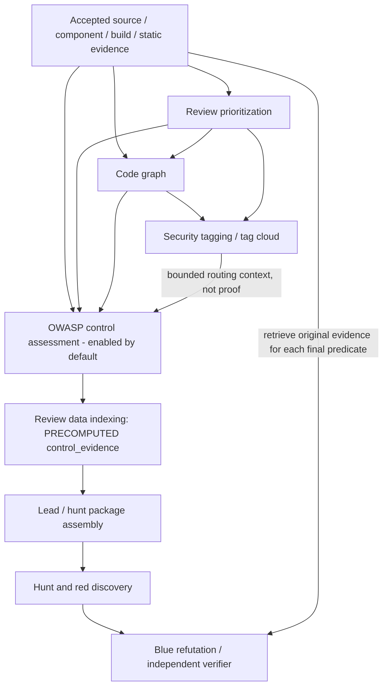

# OWASP control-assessment workbench

The workbench is a bounded, evidence-backed stage **before hunt/package assembly and red/blue
review**. It assesses named control subjects, not application compliance or customer safety.
The job is enabled by default (`settings.enabled = true`) in `assessment` mode across all shipped
profiles. Set `settings.enabled = false` to opt out before freezing a run. Assessment does not
authorize target execution.

## Placement and authority

In direct and Dagster graphs, accepted source, component, build and static-analysis producers feed
prioritization, code-graph indexing and security tagging before OWASP. The workbench uses the tag
cloud, classifications and graph context to route bounded work. They are **not control proof**.
There is no dependency from prioritization or tagging back to OWASP.

Direct `start`/`resume`/`plan-resume` and Dagster select this chain when the jobs are enabled.
Direct `--force-from` accepts tagging or OWASP only when enabled; OWASP is enabled by
default but can be explicitly disabled. This is shared OWASP ordering, not full graph parity: the direct graph still omits
CI/post-build branches, and third-party sync remains standalone. See
[wave 1 operations](../operations/wave1-review.md).

## Catalog authority, completeness and licensing

`appsec-review.toml` pins each complete English catalog under `data/reference/owasp/catalogs/`:
canonical SHA-256, immutable upstream commit, version/ref and license. Independent reviewed
inventory and normalized-content pins in `owasp_workbench/acquisition.py` prevent an outer
configuration re-pin from blessing missing IDs, altered text or fabricated profile metadata.

| Catalog | Pinned version | Records | Role |
|---|---|---:|---|
| ASVS | 5.0.0 | 345 | Normative control authority |
| MASVS | 2.1.0 | 24 | Normative control authority |
| MASTG | 2.0.0 | 292 | Supporting test documents, including `tests-beta`; not controls |
| API Security Top 10 | 2023 | 10 | Risk/routing context only |
| Top 10 | 2025 | 10 | Risk/routing context only |

Acquisition records Git tree/blob membership, source hashes and complete ID inventories, plus
attribution, upstream license text and normalization/change notices (CC-BY-SA-4.0 as declared).
Preserve these when redistributing; the normalizer never replaces control text with model memory.
Acquisition is reproducible from the pinned upstream, not a claim that acceptance tests performed
a new live refresh. Qualification fixtures remain separate from the complete configured catalogs.

MASVS 2 removed upstream L1/L2 levels. The local `L1`/`L2` aliases both select all 24 controls;
they are not upstream profiles. ASVS uses its actual level selection. **Full catalog inventory
does not imply full assessment coverage.**

## Proof obligations and actual supported scope

`owasp-proof-obligations/2` implements exactly four reviewed Python static subject procedures:

| ASVS control | Recognized subject |
|---|---|
| `V1.2.4` | SQL call with a visible SQL template, direct or through one local assignment |
| `V6.2.1` | Password `len` comparison in bounded validation/registration functions |
| `V8.2.1` | Explicit function-level authorization over a literal implemented HTTP route |
| `V8.3.1` | Trusted-service authorization enforcement over a literal implemented HTTP route |

These are narrow site recognizers and analyst questions, not general SQL/password/authorization
analyzers. Python excerpts must be parseable, unredacted and materially complete for the named
site. A complete narrowed site can retain its identity while omitted material remains explicit
unresolved coverage. Unsupported languages, unrecognized constructs and other controls stay named
`not_assessed`/unresolved work; a lexical match or documentation declaration cannot satisfy them.

The `MASVS-NETWORK-1` obligation records what runtime evidence would require, but **has no accepted
runtime adapter**. It remains unsupported even with `dynamic_authorized = true`. Static TLS/HTTPS
strings and MASTG mappings are not runtime transport proof.

## Evidence custody, routing and worker trust

Input discovery walks bounded **accepted indices**, not the target tree during inference.
Component tag-cloud counts are distinct-subject lower bounds; missing tags are unknown, never
proof of absence. Classification retains confidence, ambiguity, citations and coverage limitations.
Technical `not_applicable` requires positive classification evidence and a reason; absence is
`cannot_determine`, not N/A.

Typed references bind run, target, component, build/environment, accepted producer/index membership,
content/file hashes, span and custody. The application re-resolves citations and binds them to the
named AST site. An authentic but unrelated reference fails subject binding. Semantic predicate
entailment remains **analyst-assessed**, not an extractor-proven fact. Documents, declarations and
tags are context, not proof; downstream/self publications cannot serve as original upstream proof.
Secret literals are redacted without erasing security-relevant identifiers. Redaction, clipping,
ambiguity and omissions remain metadata and coverage gaps.

Assessment dispatches actual configured `Infer` requests over bounded packages. A separate fresh
**blinded reviewer** receives the original evidence, never the worker's answer or transcript.
Models propose; application validation and deterministic joins derive states. Assumptions,
evidence requests, dissent, counterevidence, hypotheses and limitations remain in the publication.

- `not_satisfied` is a scoped adverse assessment, **not an exploitable vulnerability**.
- `satisfied` is scoped counterevidence, **not component safety**.
- Unsupported/`not_assessed`, failed work and `cannot_verify` are unresolved coverage, not control
  failures or clean results.
- Even High/Critical or ship-blocking hypotheses remain provisional or awaiting independent
  verification; OWASP does not promote final claims.

Qualification is an explicit synthetic mode with both worker and reviewer inference disabled.
Its results are visibly qualification-only and never production-eligible. Merely placing
`data/inputs/owasp-workbench.json` in a run does not select qualification; assessment rejects it.

## Publication, downstream use and resumability

Four deterministic validator cells partition batches across the `owasp_validator` pool, followed
by independent review, exactly-once join and immutable publication. Every selected control ×
component row must occur exactly once; a missing, duplicate or unexpected row blocks the join.
A failed cell retains named gaps without erasing successful siblings.

The accepted manifest joins `standards`, `component-classification`, `applicability`,
`validation-work`, `finding-package` and `control-result` shards. It records assessment mode,
accepted upstream manifest, immutable configuration identity and `assessment_bounds`, including
the resolved `max_source_lines` used when later projections re-resolve citations.

Accepted results become PRECOMPUTED `control_evidence`, then provisional `owasp_control` leads and
lead/hunt packages. Deep custody and obligations stay lossless in the hash-pinned workbench
authority rather than being corrupted by depth-limited index summaries. Consumers re-open that
authority and re-resolve original refs, preserving proof scope, counterevidence, dissent and gaps.
Component-level leads do not invent an exact source line. Every PRECOMPUTED interpretation is
**indirect for every final predicate**; a naked source-file identity alone is also not a direct
predicate fact. Red/blue/verifier claims must retrieve underlying evidence and establish their own
predicates. Duplicate underlying sources do not multiply rank or corroboration.

Model receipts live at `data/indexes/owasp/receipts/<semantic-key>.json` in the registered shared
namespace. Their key binds assessment mode, local evidence/routing, catalogs/proof/rules, guidance,
model policy, limits and scope. Verified reuse rechecks provenance and rebinds current accepted
references, making no new model calls. An unrelated manifest re-pin can reuse local work; relevant
source/context, model or guidance changes invalidate it. Frozen global configuration identity is
verified from `data/configuration/resolved.json` and its manifest, not from the target fingerprint.

Downstream expansion reuses successfully verified publication/row/citation identities only within
one collection or assembly operation. This is not a persistent trust cache: run/snapshot/pins,
membership, binding and duplicate-row ambiguity checks remain enforced.

## Guidance, settings and validation limits

- Shared worker authority: `pipeline/prompt-fragments/governing-rules.md`.
- Roles, viewpoints and registered runtime procedures: `pipeline/guidance/registry.json`.
- Bounded tasks: generated finding packages; no repository/target guidance is copied to workers.
- Models, budgets, timeouts, retries and all bounds: central TOML, documented in
  [OWASP operations](../operations/owasp-control-assessment.md#settings).
- Exact composed bundles: `runs/<run-id>/data/guidance/<bundle-sha256>/`.

### Control-area persona, role and runtime-skill assignment

`owasp_workbench.guidance.assign` selects the registered persona from each applicability row's
control domain. `partition_work` batches only compatible domains, personas, evidence modes and
tool requirements, within the configured limits. It does not send every control to a generic
reviewer or create a separate framework per control.

| Control domain | Assigned persona | Loaded specialist fragment |
|---|---|---|
| Authentication, session and identity | `authentication_session` | `authentication_session` |
| Authorization and access control | `authorization_access_control` | `authorization_access_control` |
| Cryptography and data protection | `cryptography_data_protection` | `cryptography_data_protection` |
| Web and API surface | `api_web` | `network_api_surface` |
| Mobile platform | `mobile_platform` | `mobile_platform` |
| Build and supply chain | `build_supply_chain` | `build_supply_chain` |
| Deployment and operations | `deployment_operations` | `cloud_container_deployment` |

The two migrated fragment names are explicit aliases in `pipeline/guidance/registry.json`.
Personas supply viewpoint, effective controls, false-positive cautions, predicate evidence and
hand-offs; they do not replace the concrete proof procedure or expand authority.

| Inference role | Registered runtime skill | Responsibility |
|---|---|---|
| `control_assessor` | `effective-control-verification` | Investigate named obligations against accepted evidence and propose scoped outcomes |
| `independent_reviewer` | `predicate-verification` | Independently assess the same original obligations/evidence in a fresh blinded context, without the worker answer or transcript |

Both calls retain the batch's domain persona. Skills are shared role-specific procedures, not
bespoke skills for every catalog entry. They are loaded only through
`appsec_review.guidance.skills.load_runtime_skill` for this allowed job. Each request's exact
role/persona/skill/task bundle is hash-pinned; guidance changes invalidate dependent reuse.
Citation resolution and final disposition are application checks, not extra model agreement.
Registered classifier/router/verifier/adjudicator responsibilities do not imply that separate
model calls occur at every deterministic stage. A specialist persona never makes an unsupported
language, control or runtime/manual obligation assessable.

Offline acceptance exercises full-catalog publications, adverse/benign/dissent outcomes,
configured source caps, qualification isolation, projection, packages, actual scripted
red/blue/verifier requests and original-source retrieval. It does **not** establish live-model
efficacy, runtime-adapter behavior, exploit confirmation or customer safety certification.
