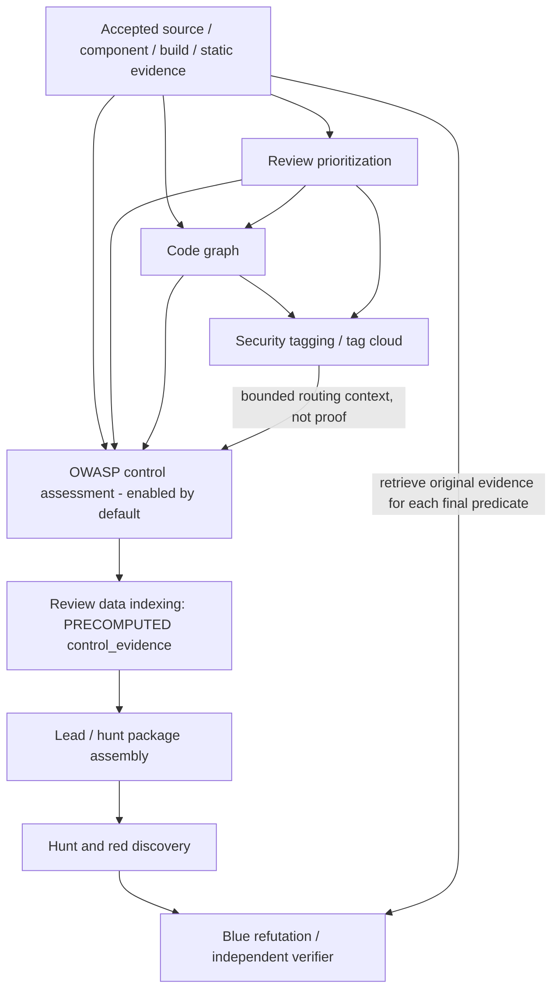

# OWASP control-assessment workbench

The workbench is a bounded, evidence-backed stage **before hunt/package assembly and red/blue
review**. It assesses named control subjects, not application compliance or customer safety.
The job is enabled by default (`settings.enabled = true`) in `assessment` mode across all shipped
profiles. Set `settings.enabled = false` to opt out before freezing a run. Assessment does not
authorize target execution.

## Placement and authority

In direct and Dagster graphs, accepted source, component, build and static-analysis producers feed
prioritization, code-graph indexing and security tagging before OWASP. The workbench uses the tag
cloud, classifications and graph context to route bounded work. They are **not control proof**.
There is no dependency from prioritization or tagging back to OWASP.

Direct `start`/`resume`/`plan-resume` and Dagster select this chain when the jobs are enabled.
Direct `--force-from` accepts tagging or OWASP only when enabled; OWASP is enabled by
default but can be explicitly disabled. Both drivers derive review-job membership and ordering from
the typed contracts, including enabled CI/post-build producers; third-party sync remains standalone. See
[wave 1 operations](../operations/wave1-review.md).

## Catalog authority, completeness and licensing

`appsec-review.toml` pins each complete English catalog under `data/reference/owasp/catalogs/`:
canonical SHA-256, immutable upstream commit, version/ref and license. Independent reviewed
inventory and normalized-content pins in `owasp_workbench/acquisition.py` prevent an outer
configuration re-pin from blessing missing IDs, altered text or fabricated profile metadata.

| Catalog | Pinned version | Records | Role |
|---|---|---:|---|
| ASVS | 5.0.0 | 345 | Normative control authority |
| MASVS | 2.1.0 | 24 | Normative control authority |
| MASTG | 2.0.0 | 292 | Supporting test documents, including `tests-beta`; not controls |
| API Security Top 10 | 2023 | 10 | Risk/routing context only |
| Top 10 | 2025 | 10 | Risk/routing context only |

Acquisition records Git tree/blob membership, source hashes and complete ID inventories, plus
attribution, upstream license text and normalization/change notices (CC-BY-SA-4.0 as declared).
Preserve these when redistributing; the normalizer never replaces control text with model memory.
Acquisition is reproducible from the pinned upstream, not a claim that acceptance tests performed
a new live refresh. Qualification fixtures remain separate from the complete configured catalogs.

MASVS 2 removed upstream L1/L2 levels. The local `L1`/`L2` aliases both select all 24 controls;
they are not upstream profiles. ASVS uses its actual level selection. **Full catalog inventory
does not imply full assessment coverage.**

## Proof obligations and actual supported scope

`owasp-proof-obligations/3` implements reviewed static subject procedures for two source languages.
Each procedure names one control, one recogniser and the language it reads (`Procedure.language`);
`procedure_for(control, languages=...)` admits only the procedures whose language is among the
component's accepted source languages (`source_support.languages`), so a Python component is never
dispatched a C/C++ control and vice versa. Runtime procedures are language-independent.

Python (`subject_selection.py`, AST sites):

| ASVS control | Recognized subject |
|---|---|
| `V1.2.4` | SQL call with a visible SQL template, direct or through one local assignment |
| `V6.2.1` | Password `len` comparison in bounded validation/registration functions |
| `V8.2.1` | Explicit function-level authorization over a literal implemented HTTP route |
| `V8.3.1` | Trusted-service authorization enforcement over a literal implemented HTTP route |

C and C++ (`c_subjects.py` recogniser families, `c_procedures.py` procedures; T-5013). The subject is
one complete function definition (or one named `*session*`/`*token*`/`*cookie*` type) with the
recognised call lines and the input-entry lines inside it (`subject.sites`), so the worker sees the
entry and the sink of the same function. The scanner blanks comments, literals and preprocessor
lines, matches brace blocks and takes a block whose head ends in a parameter list as a function; it
needs no compiler at inference time, and accepted tree-sitter `function_definition` spans prioritise
the same subjects during discovery. Recognition is lexical (a call is a name followed by a
parenthesis); macro bodies, K&R definitions and unbalanced braces are named scanner gaps.

| Family | Recognised in a function | Controls |
|---|---|---|
| `c_input_entry/1` | `recv`/`read`/`fgets`/`fread`/`getenv`/`argv[...]` and the other input calls | `V1.3.3`, `V2.2.1` |
| `c_command_sink/1` | `popen`/`system`/`exec*`/`posix_spawn` | `V1.2.5` |
| `c_format_sink/1` | printf-family call whose format argument is not a literal | `V1.3.10` |
| `c_copy_sink/1` | `strcpy`/`strcat`/`sprintf`/`memcpy`/`memmove`-family copies | `V1.4.1` |
| `c_allocation_size/1` | `malloc`/`calloc`/`realloc`/`alloca`/`new[]` with a computed size | `V1.4.2` |
| `c_memory_release/1` | `free`/`delete` | `V1.4.3` |
| `c_file_path/1` | `fopen`/`open`/`realpath`/`stat`/`unlink`-family and `fstream` on a non-literal path | `V5.3.2` |
| `c_session_state/1` | functions and types named `*session*`/`*token*`/`*cookie*`, their callers and users | `V7.2.2`, `V7.2.3`, `V7.3.1`, `V7.3.2`, `V7.4.1` |
| `c_log_sink/1` | `syslog`, `fprintf(stderr, ...)`, `std::cerr`, output calls in `log*`/`audit*` functions and calls to them | `V16.2.1`, `V16.2.5`, `V16.4.1` |
| `c_error_path/1` | error returns (`-1`, `NULL`, `false`, `EXIT_FAILURE`), `exit`/`abort`, `throw`, `errno`/`perror` | `V16.3.4`, `V16.5.1`, `V16.5.3` |

An admitted control with no procedure for the component's languages is
`unsupported_missing_evidence` with the reason "no reviewed versioned proof procedure for this
selected control: no C/C++ recogniser for this control" (or "no Python recogniser"); the other
controls of the admitted chapters (documentation, business-logic, upload and federated-session
controls) stay named that way rather than silent. These are narrow site recognizers and analyst
questions, not general injection/memory/session analyzers. Excerpts must be parseable (Python) or
scannable (C/C++), unredacted and materially complete for the named definition. A complete narrowed
site can retain its identity while omitted material remains explicit unresolved coverage.
Unsupported languages, unrecognized constructs and other controls stay named
`not_assessed`/unresolved work; a lexical match or documentation declaration cannot satisfy them.

T-146 selects complete original Python subjects rather than the first 120 lines of each file.
Supported sources precede unsupported files; accepted syntax/graph locations prioritize bounded
discovery. `max_discovery_files = 512` and `max_discovery_bytes = 8388608` bound discovery per
component. The existing source-line, evidence and subject limits still bound dispatched work.
Omitted files, subjects and outside lines remain explicit coverage limits, separate from a
clipped or redacted subject that cannot establish an obligation.

Complete short HTTP modules retain their policy context; a route function extracted from an
oversized module cannot establish external middleware/authorization prerequisites. Evidence
projection and obligation construction use the same configured evidence set, including settings
above the former hard-coded 100-reference cut. The binding and acceptance identities are
`owasp-evidence-binding/4` and `owasp-assessment-acceptance/4` (subject selection
`owasp-complete-source-subjects/2` carries the subject `language`); no runtime adapter is implied. See the [design and unit record](../tasks/2026-11-13-behavior-oriented-review.md).

The `MASVS-NETWORK-1` obligation records what runtime evidence would require, but **has no accepted
runtime adapter**. It remains unsupported even with `dynamic_authorized = true`. Static TLS/HTTPS
strings and MASTG mappings are not runtime transport proof.

## Evidence custody, routing and worker trust

Input discovery walks bounded **accepted indices**, not the target tree during inference.
Component tag-cloud counts are distinct-subject lower bounds; missing tags are unknown, never
proof of absence. Classification (`component-classification/2`) reads the component's `target:*`
class and facet tags from the accepted `tags` index ([collation pass](collation-pass.md), T-5008);
the workbench has no classifier of its own. It retains confidence, citations (tag identities and
assignment ids) and coverage limitations. Tag discovery reads `tag_assignment` rows of the `tags`
index alone under `max_tag_records` (`routing_context`); priority and graph rows are a second,
separately capped context list (`graph_context`), so a large graph shard cannot hide the class
(run `2026-11-16-0005` lost `target:cli` that way). A component-level target or facet record the
cap drops is a **gap** ("target class not read: routing cap omitted tag records"), never a
limitation. A control family applies only to a component whose class admits it
(`applicability-rules/4`): ASVS fully for `target:web-api`, and for `target:network-service` (a
non-HTTP listener) only the transport-agnostic ASVS 5.0 chapters V1, V2, V5, V7 and V16 (V1.4 holds
the memory-safety controls); the web-only chapters stay `not_applicable` citing the class, and the
ledger verdict is `partially_applicable` with `admitted_chapters`. MASVS needs `target:mobile`; any
other class is a not-applicable ledger line, not a gap. A component whose accepted sources no
recogniser reads (Python and C/C++ are read; T-5013) gets `unsupported_missing_evidence` with the
reason "no supported source language for this component" on every admitted row. A component with
no class is `cannot_determine`, not N/A, and is not dispatched.

Control roles are derived, not ingested: the upstream ASVS 5.0 JSON and MASVS Markdown carry no
component-role metadata, so the normalizer stores `component_roles: []` and the pinned
normalized-records hash forbids editing the catalogs. `standards.control_records` fills empty roles
from `ASVS_CHAPTER_ROLES` (`asvs-chapter-roles/1`, the `engine.COMPONENT_ROLES` vocabulary; `network`
is on every chapter a non-HTTP listener is admitted to) and the two mobile roles for MASVS, recording
`component_roles_basis` on each record. Roles route; they never decide an assessment. A control
whose chapter no map covers is `unsupported_missing_evidence` ("no control role is derivable for this
control"), never hidden as `not_applicable`. A failed or unlaunched validation cell leaves its rows
`cannot_verify` with the named gap, never a silent `not_assessed`.

Each package carries the evidence its obligations cite first, then other accepted records of the
component until a per-request byte budget (half the worker's `max_input_tokens`, four bytes per
token, shared by the batch's packages); every accepted record of the component stays reachable
through bounded expansion by identity (`expansion_identities`), and the omitted count is a package
limitation. Before this a package repeated the whole component evidence set, so a 12-row C/C++ batch
never fitted the input budget. The pinned guidance task names the obligation rule version while
the bounded request carries the actual rows and subjects, keeping the composed prompt under its
48 KiB bound. Packages pin both role bundles once; investigation verifies and loads those exact
pins. Published fingerprints include actual dispatched/reused role identities, not unused
package-time bundles. Applicable rows with no supported subject retain explicit non-dispatch
dispositions and unresolved results, without a worker-start event or a failed model batch. A row's
verification status is decided on its supported obligations: an unsupported coverage obligation is a
gap on the row, not a missing independent review. `select_profiles` records a
`reasons` list per family, and `deterministic_join` and the handoff publish a typed
`coverage_disposition` (`partial` while any row is unresolved) beside `terminal_status`. The TOML
`parser_versions` must equal the versions the code implements (`owasp_workbench/versions.py`); the
job refuses to start otherwise.

`owasp-request-assembly/1` applies a second bound to the fully assembled request, including
actual guidance, contracts and limits. It hoists shared evidence/component context per request
and common procedure fields across each row's obligations, not all procedure text across rows.
Oversized multi-row batches bisect recursively. An oversized singleton trims graph context,
nonclassifying routing context, shared limitations, uncited evidence and excerpts, in that order.
Typed subjects/references remain; every trim or undispatched row records estimates, its limit
and a gap. Recovery of omitted evidence uses only that part's admitted bounded expansion.
Each part has its own turn/query budget and receipt; row completion and attempt counts do not
inherit an oversized sibling's result.

Typed references bind run, target, component, build/environment, accepted producer/index membership,
content/file hashes, span and custody. The application re-resolves citations and binds them to the
named AST site. A decisive outcome still requires primary subject evidence in its supporting or
contradictory citation set. Additional C/C++ caller/callee references can supply prerequisite context
only when their identities are admitted by that package's evidence or bounded expansion set, their
scope matches the primary, and re-resolved complete source functions exhibit the direct named call.
Citation checks distinguish `subject_binding` from `prerequisite_binding`, retaining both original
references and the call line. This is source-call context, not a resolved executable call graph:
indirect/member dispatch, shadowed names, incompatible static linkage and unresolved definitions are
not admitted by this adapter. Member/qualification operators remain disqualifying across whitespace
or comments, and the original re-resolved qualified subject name cannot be replaced with a bare name
obtained by rescanning an inline excerpt outside its class.
Assumed semantics and requested prerequisites still prevent a decisive
outcome; Python authorization retains its complete-module prerequisite gate.
An authentic but unrelated reference fails binding. Semantic predicate
entailment remains **analyst-assessed**, not an extractor-proven fact. Documents, declarations and
tags are context, not proof; downstream/self publications cannot serve as original upstream proof.
Secret literals are redacted without erasing security-relevant identifiers. Redaction, clipping,
ambiguity and omissions remain metadata and coverage gaps.

Assessment dispatches actual configured `Infer` requests over bounded packages. A separate fresh
**blinded reviewer** receives the original evidence, never the worker's answer or transcript.
Models propose; application validation and deterministic joins derive states. Assumptions,
evidence requests, dissent, counterevidence, hypotheses and limitations remain in the publication.
Malformed scalar identifiers, outcomes, hypothesis fields, citations and retrieval locators are
validated inside the existing model-output retry boundary. Exhausted retries preserve the original
validation reason as a row gap rather than throwing away earlier batches in the cell.

- `not_satisfied` is a scoped adverse assessment, **not an exploitable vulnerability**.
- `satisfied` is scoped counterevidence, **not component safety**.
- Unsupported/`not_assessed`, failed work and `cannot_verify` are unresolved coverage, not control
  failures or clean results.
- Even High/Critical or ship-blocking hypotheses remain provisional or awaiting independent
  verification; OWASP does not promote final claims.

Qualification is an explicit synthetic mode with both worker and reviewer inference disabled.
Its results are visibly qualification-only and never production-eligible. Merely placing
`data/inputs/owasp-workbench.json` in a run does not select qualification; assessment rejects it.
Synthetic adverse qualification rows need no accepted target manifest: they publish their fixture
result with zero assessed target controls and an empty production control-gap projection.

## Publication, downstream use and resumability

Four configured worker cells receive deterministic batch partitions across the `owasp_validator` pool, followed
by independent review, exactly-once join and immutable publication. Every selected control ×
component row must occur exactly once; a missing, duplicate or unexpected row blocks the join.
A failed cell retains named gaps without erasing successful siblings.
After request splitting, each model attempt records its part and row membership. Row dispatch and
review-attempt counts include only newly dispatched calls for that row, never an oversized sibling,
pre-dispatch rejection or cached reuse. Partial adverse obligation coverage counts as unresolved,
even when the scoped adverse verdict remains useful. Input and classification gaps survive the join
and final coverage/status publication, including first-party exclusions and omitted classification
tags when every retained class produces only N/A rows. Deliberate N/A without such gaps stays complete.

The accepted manifest joins `standards`, `component-classification`, `applicability`,
`validation-work`, `finding-package` and `control-result` shards. It records assessment mode,
accepted upstream manifest, immutable configuration identity and `assessment_bounds`, including
the resolved `max_source_lines` used when later projections re-resolve citations.
The OWASP source view is an application-owned `IndexSelection`, derived alongside explicit input
requirements in the job's dataset module. It narrows producer/index identities without granting
access. The original manifest hash is preserved separately from the view identity; ancestry
envelopes/descriptors are authenticated without opening obsolete payloads. Selected payloads and
generated/binary backing dependencies retain exact admitted-owner and byte checks, and relations
must close over selected, admitted endpoints. Selected verification, query and retained `AcceptedScope.store` opens isolate their
digest/admission state from full or other-view caches; cursor identities also bind the view.
Entity, relation, coverage and entity-ID iteration rechecks the current claim and backing bytes
when opening a selected shard. A retained store carries the view, not its creator's permissions.
Unselected stores retain their existing behavior.
Selected payload validation is shared by ROOT verification and every later open. Named index
publications and receipt-backed shared shards revalidate their exact publication and recursive
producer receipts. `storage.shared.receipt_read_scope` admits dependencies before payload I/O
and before receipt memo/admission shortcuts; it never turns availability into permission.
The common selected verifier also checks declared row counts, so scope construction does not
repeat that same verification through a second opener.
Derived checkpoint objects are recognized through the authenticated producer's declaration and
validated against the exact selected shard, not through a file suffix or a payload's claimed label.
Indexed-payload paths and content hashes are both excluded from control metadata, including
alternate-path aliases. Selected metadata reads require an exact nonnegative integer size matching
the safe regular file before allocation, stream in the existing storage hashing block size, and
reject growth, replacement or custody changes rather than returning truncated bytes.
Named control discovery authenticates identity before hashing or opening the lookup path:
bindings use the existing canonical binding document and admitted object identity; request
identities are reconstructed with the publication serializer from an accepted producer receipt
reference. Looking up those producer references is a declared handoff read, never a citation.
Control references returned by verified publication may also be retained; subsequent opens still
revalidate bytes, provenance and current grants. A fresh unit's consumer receipt can be reconstructed
using the same receipt builder as publication when one authenticated producing request identifies
its origin. Unknown or ambiguous identities are refused before opening the consumer slot, not
recovered by hashing it. No publication fields change, and unfiltered verification retains its
existing discovery behavior.
Explicitly selected/admitted custody-only index dependencies contribute to integrity checks and
read receipts without entering the query surface. Unknown or excluded dependencies fail closed.

Bounded application lookups retain the existing authoritative-index preference and fall back only
when that index supplies no admissible original record. Retained record data is byte-pinned:
reuse reopens every searched shard through the current grant/receipt/custody checks. Parsed paths
and named receipt identities may be retained, but filesystem state and read permissions are not.
Unsupported, undispatched batches do not construct an unused resolver. Supported work still
requires accepted evidence resolution before inference; independent reviews share only the
unit's accepted-source resolver, never an assessor's conclusions or transcript.

Attempted or reused, subject-bound results become PRECOMPUTED `control_evidence`, then provisional `owasp_control` leads and
lead/hunt packages. Deep custody and obligations stay lossless in the hash-pinned workbench
authority rather than being corrupted by depth-limited index summaries. Consumers re-open that
authority and re-resolve original refs, preserving proof scope, counterevidence, dissent and gaps.
Component-level leads do not invent an exact source line. Every PRECOMPUTED interpretation is
**indirect for every final predicate**; a naked source-file identity alone is also not a direct
predicate fact. Red/blue/verifier claims must retrieve underlying evidence and establish their own
predicates. Duplicate underlying sources do not multiply rank or corroboration.
Unassessed, unsupported and subjectless rows remain in the workbench coverage ledger; omitted
unresolved rows are counted as coverage gaps, never promoted to context evidence. Package control
context matches both component and the resolved primary subject's source file. Worker references
use `query_precomputed query_set=control_evidence`; `query_owasp_workbench` remains
application-side and its finding-package filters read nested component/project/control identities.

Model receipts live at `data/indexes/owasp/receipts/<semantic-key>.json` in the registered shared
namespace. Their key binds assessment mode, local evidence/routing, catalogs/proof/rules, guidance,
model policy, limits and scope. Verified reuse rechecks provenance and rebinds current accepted
references, making no new model calls. An unrelated manifest re-pin can reuse local work; relevant
source/context, model or guidance changes invalidate it. Frozen global configuration identity is
verified from `data/configuration/resolved.json` and its manifest, not from the target fingerprint.

Downstream expansion reuses successfully verified publication/row/citation identities only within
one collection or assembly operation. This is not a persistent trust cache: run/snapshot/pins,
membership, binding and duplicate-row ambiguity checks remain enforced.

## Guidance, settings and validation limits

- Shared worker authority: `pipeline/prompt-fragments/governing-rules.md`.
- Roles, viewpoints and registered runtime procedures: `pipeline/guidance/registry.json`.
- Bounded tasks: generated finding packages; no repository/target guidance is copied to workers.
- Models, budgets, timeouts, retries and all bounds: central TOML, documented in
  [OWASP operations](../operations/owasp-control-assessment.md#settings).
- Exact composed bundles: `runs/<run-id>/data/guidance/<bundle-sha256>/`.

### Control-area persona, role and runtime-skill assignment

`owasp_workbench.guidance.assign` selects the registered persona from each applicability row's
control domain. `partition_work` batches only compatible domains, personas, evidence modes and
tool requirements, within the configured limits. It does not send every control to a generic
reviewer or create a separate framework per control.

| Control domain | Assigned persona | Loaded specialist fragment |
|---|---|---|
| Authentication, session and identity | `authentication_session` | `authentication_session` |
| Authorization and access control | `authorization_access_control` | `authorization_access_control` |
| Cryptography and data protection | `cryptography_data_protection` | `cryptography_data_protection` |
| Web and API surface | `api_web` | `network_api_surface` |
| Mobile platform | `mobile_platform` | `mobile_platform` |
| Build and supply chain | `build_supply_chain` | `build_supply_chain` |
| Deployment and operations | `deployment_operations` | `cloud_container_deployment` |

The two migrated fragment names are explicit aliases in `pipeline/guidance/registry.json`.
Personas supply viewpoint, effective controls, false-positive cautions, predicate evidence and
hand-offs; they do not replace the concrete proof procedure or expand authority.

| Inference role | Registered runtime skill | Responsibility |
|---|---|---|
| `control_assessor` | `effective-control-verification` | Investigate named obligations against accepted evidence and propose scoped outcomes |
| `independent_reviewer` | `predicate-verification` | Independently assess the same original obligations/evidence in a fresh blinded context, without the worker answer or transcript |

Both calls retain the batch's domain persona. Skills are shared role-specific procedures, not
bespoke skills for every catalog entry. They are loaded only through
`appsec_review.guidance.skills.load_runtime_skill` for this allowed job. Each request's exact
role/persona/skill/task bundle is hash-pinned; guidance changes invalidate dependent reuse.
Citation resolution and final disposition are application checks, not extra model agreement.
Registered classifier/router/verifier/adjudicator responsibilities do not imply that separate
model calls occur at every deterministic stage. A specialist persona never makes an unsupported
language, control or runtime/manual obligation assessable.

Offline acceptance exercises full-catalog publications, adverse/benign/dissent outcomes,
configured source caps, qualification isolation, projection, packages, actual scripted
red/blue/verifier requests and original-source retrieval. It does **not** establish live-model
efficacy, runtime-adapter behavior, exploit confirmation or customer safety certification.
