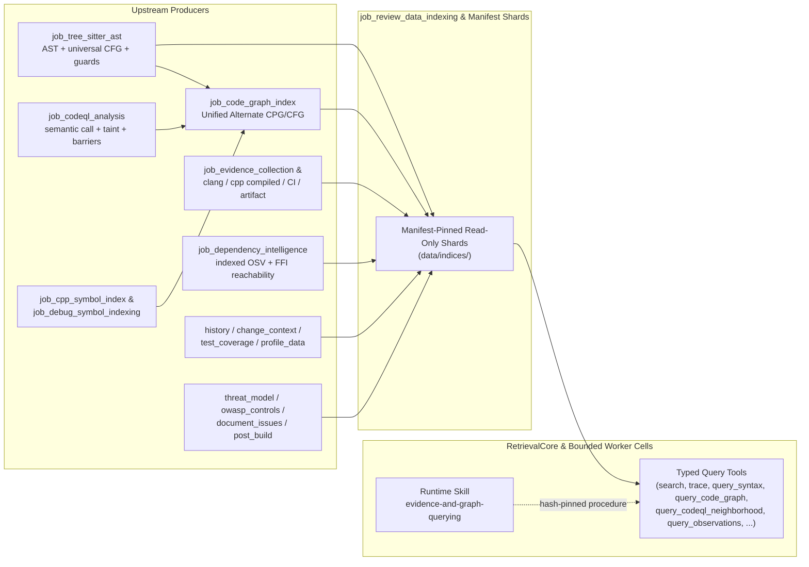

# Hosted querying and indexing skills architecture

This document defines the unified set of **indexed evidence shards**, **application-mediated
querying tools**, and **hash-pinned runtime worker skills** hosted by `appsec-review` so every
coherent producer feeds downstream prioritization, inference review, OWASP control verification,
compile-only PoC generation, and remediation validation without raw filesystem or shell access.

See [`retrieval-surfaces.md`](retrieval-surfaces.md) for the transport boundary separating
in-process review-cell retrieval from the external stdio MCP adapter (`appsec-review-mcp`).

## Architectural invariants

1. **Zero raw target scanning during inference.** Model workers never receive shell, filesystem,
   glob, regular-expression, SQL, or network access. Every query executes against immutable,
   hash-pinned shards registered in `data/indices/` and opened read-only by `RetrievalCore`.
2. **Universal alternate CPG and CFG availability (`T-168`, `T-169`).** Joern (`job_cpg_analysis`)
   and SVF (`job_svf_alias_analysis`) are retired from default runs due to JVM/bitcode OOMs at
   scale. Instead, `job_tree_sitter_ast` provides universal intra-procedural CFGs, branch guard
   polarities, and syntactic call edges across all supported languages, while `job_codeql_analysis`,
   `job_cpp_symbol_index` (clangd), and `job_debug_symbol_indexing` (DWARF/PDB) provide semantic
   taint, call-target, override, and memory-layout overlays synthesized by `job_code_graph_index`.
3. **Every coherent producer is indexed (`T-170`, `T-171`, `T-172`).** All upstream analytical
   signals—scanner observations with `codeFlows`, SCA + FFI reachability, git history hotspots,
   PR/commit guard-removal deltas, test coverage gaps, runtime execution profiles, CI/CD workflow
   risks, post-build binary mitigations, threat-model trust boundaries, API/spec drift, and
   verified OWASP control gaps—are materialized into `RetrievalCore` shards so both Lane A
   (lead verification) and Lane B (autonomous vulnerability hunting) reason over complete evidence.
4. **Provenance-graded evidence.** Every retrieved row retains its `source_id` / `artifact_id`,
   line span, producing job identity, and confidence tier (`semantic_codeql`, `symbol_clangd`,
   `debug_dwarf_pdb`, `syntactic_treesitter`, `static_scanner`, or `derived_precomputed`).
   Syntactic edges narrow search and nominate paths; semantic or source-line verification closes
   reachability predicates.

## Hosted index shard families

| Shard / Domain | Producing Job(s) | Primary Entities Indexed | Primary Query Tools |
|---|---|---|---|
| **Source & Structure** | `job_target_catalog`, `job_review_data_indexing` | First-party/vendored/test dispositions, file digests, bounded line excerpts | `find`, `search`, `read_excerpt`, `resolve_evidence` |
| **Universal Syntax & Intra-CFG** | `job_tree_sitter_ast` | Symbols, imports, written calls, basic-block CFG nodes/edges, branch guard polarity (`null_check`, `bounds_check`, `auth_check`) | `query_syntax`, `find`, `read_excerpt` |
| **Unified Alternate CPG/CFG** | `job_code_graph_index`, `job_codeql_analysis`, `job_cpp_symbol_index` | Dual-seeded inter-procedural call edges (`CALLS`), `entry_point`, `sink_site`, `dataflow_path`, `flow_summary`, `guard_fact`, `range_fact`, backward/forward variable slices | `query_code_graph`, `query_codeql_neighborhood`, `query_codeql`, `trace` |
| **Native & Binary Evidence** | `job_debug_symbol_indexing`, `job_binary_evidence_indexing`, `job_artifact_indexing`, `job_post_build_security_assessment` | DWARF/PDB struct field offsets, stack buffer sizes, ELF/PE/Mach-O hardening (`NX`, `PIE`, `RELRO`, `Canary`, `CFI`), decompiled functions/imports | `query_debug_symbols`, `query_artifacts`, `query_build_security`, `search`, `trace` |
| **Scanner & Supply-Chain Evidence** | `job_evidence_collection`, `job_clang_static_analysis`, `job_cpp_compiled_analysis`, `job_dependency_intelligence`, `job_ci_configuration_analysis`, `job_artifact_security_analysis` | Deduplicated multi-scanner observations, SARIF `codeFlows` taint steps, indexed OSV/NVD advisories, FFI/import vulnerable-symbol reachability, CI workflow hazards | `query_observations`, `query_ci_configuration`, `query_precomputed` |
| **Engineering & Behavioural Context** | `job_source_history_analysis`, `job_change_context_analysis`, `job_test_coverage`, `job_profile_data`, `job_review_prioritization` | Proportional bug-fix hotspots, guard-removal diffs, uncovered high-exposure lines, hot runtime execution paths, SAST-silence hunt priorities | `query_hotspots`, `coverage`, `query_precomputed` |
| **Architecture, Controls & Spec Drift** | `job_threat_model_generation`, `job_owasp_control_assessment`, `job_document_issue_analysis` | Trust boundaries, untrusted entry surfaces, verified `absent`/`weak` OWASP ASVS controls, OpenAPI/GraphQL/doc vs handler auth/schema drift | `query_precomputed`, `query_dataset_inventory`, `resolve_evidence` |

## Coherent tool catalog and role grants

All worker queries pass through `review/capability.py` (in-process cells) or `mcp/capability.py`
(scoped external operator sessions), enforcing entity-grant boundaries, deterministic pagination,
and hard byte/row ceilings:

| Tool | Bounded Responsibility | Granted Worker Roles |
|---|---|---|
| `query_dataset_inventory` | Inspect which shards and coverage tiers exist for the current unit/run before assuming absence of findings means clean code. | `red`, `blue`, `independent_verifier`, `hunter`, `judge`, `attack_chain_analyst` |
| `find` / `search` | Locate symbol definitions, references, call sites, and exact token occurrences within granted first-party or linked dependency scopes. | `red`, `blue`, `independent_verifier`, `hunter`, `poc_writer`, `remediation_planner` |
| `read_excerpt` | Read exact line-numbered source or decompiled excerpts (`start_line`..`end_line`) to ground source citations and verify surrounding guards. | All model worker roles |
| `query_syntax` | Traverse Tree-sitter AST definitions, written call sites, imports, intra-procedural basic-block CFG edges, and branch guard polarity—always available even when compiled builds fail. | `red`, `blue`, `independent_verifier`, `hunter`, `owasp_assessor`, `remediation_validator` |
| `query_code_graph` / `trace` | Query the unified alternate CPG/CFG (`job_code_graph_index`): 8–12 hop entry-to-sink paths, callers/callees, backward/forward variable slices, dominating guards, and provenance tiers. | `red`, `blue`, `independent_verifier`, `hunter`, `attack_chain_analyst` |
| `query_codeql_neighborhood` / `query_codeql` | Inspect semantic CodeQL taint paths, `flow_summary` hops, `sink_site` models, and `guard_fact` barriers within the package's graph scope. | `red`, `blue`, `independent_verifier`, `hunter` |
| `query_observations` | Retrieve deduplicated multi-scanner findings, preserved Semgrep/CodeQL `codeFlows` taint steps, and cross-tool corroboration clusters. | `red`, `blue`, `independent_verifier`, `hunter`, `judge` |
| `query_debug_symbols` / `query_build_security` / `query_artifacts` | Verify C/C++/Rust struct layouts, stack buffer sizes, integer widths, FFI exports, and binary mitigations (`PIE`, `NX`, `RELRO`, `Canary`, `CFI`). | `red`, `blue`, `independent_verifier`, `hunter`, `poc_writer` |
| `query_hotspots` / `coverage` / `query_ci_configuration` | Inspect churn/revert hotspots, recent guard-removal deltas, line/branch test coverage around candidate sinks, and CI/CD workflow permissions. | `red`, `hunter`, `independent_verifier`, `remediation_planner` |
| `query_precomputed` / `resolve_evidence` | Read precomputed threat-model trust boundaries, verified OWASP `absent`/`weak` control gaps, API/doc drift signals, and resolve opaque evidence IDs to exact source spans. | All review, OWASP, PoC, and remediation roles |

## Runtime worker skill registration (`pipeline/skills/`)

Runtime skills live exclusively under `pipeline/skills/<name>/SKILL.md` with
`metadata.audience: runtime-worker`, are registered in `pipeline/guidance/registry.json` under
`runtime_skills`, and are loaded solely via `appsec_review.guidance.skills.load_runtime_skill`
(enforced by `tests/test_skill_separation.py`).

| Runtime Skill | Registered Jobs | Purpose & Frontier Prompting Pattern |
|---|---|---|
| `evidence-and-graph-querying` | `job_inference_security_review`, `job_owasp_control_assessment`, `job_poc_generation`, `job_remediation_planning`, `job_remediation_validation` | Canonical multi-hop retrieval playbook: (1) check `query_dataset_inventory` for shard availability; (2) query `query_code_graph` / `query_codeql_neighborhood` for semantic paths; (3) fall back to `query_syntax` CFG/guards when semantic DBs are partial; (4) confirm exact source lines and dominating guards via `read_excerpt` before affirming or refuting. |
| `review-evidence-checking` (and task-specific review procedures) | `job_inference_security_review` | Hypothesis-driven verification discipline: distinguish proven sanitizers/barriers at exact source lines from unverified caller assumptions; preserve numeric buffer/integer arithmetic checks (`numeric-reasoning-guardrail/1`). |
| `binary-evidence` | `job_inference_security_review` (attached when `binary` shard is present) | Correlate Ghidra decompiled functions/imports and `debug_symbols` DWARF/PDB layouts with source or FFI boundaries. |

## Frontier-model querying protocol

To prevent both **premature refutation** (dismissing real multi-hop bugs because a 1-hop snippet
looks benign) and **speculative hallucination** (claiming reachability without resolving callers),
every hosted prompt and runtime skill follows a four-step retrieval contract:

1. **Orient on precomputed graph & context first:** Read the package's dual-seeded CPG/CFG summary,
   `codeFlows` steps, threat-model trust boundary, OWASP control gaps, and SAST-silence signals
   before issuing broad searches.
2. **Batch independent retrieval calls in one turn:** Request caller chains (`query_code_graph` /
   `query_syntax`), dominating guards, and exact `read_excerpt` windows together in a single
   `retrieve` turn to minimize round-trip latency and preserve output token budget for reasoning.
3. **Separate syntactic nomination from semantic proof:** When an edge carries
   `syntactic_treesitter` provenance (for example dynamic dispatch, callback tables, or buildless
   targets), verify the concrete receiver, import, or call signature with `read_excerpt` or
   `query_debug_symbols` before marking a path `confirmed`.
4. **Treat missing shards as named uncertainty, never safety:** If `query_dataset_inventory`
   reports a degraded build or missing shard, record the exact scope limitation rather than
   concluding that an unverified sink is unreachable.
