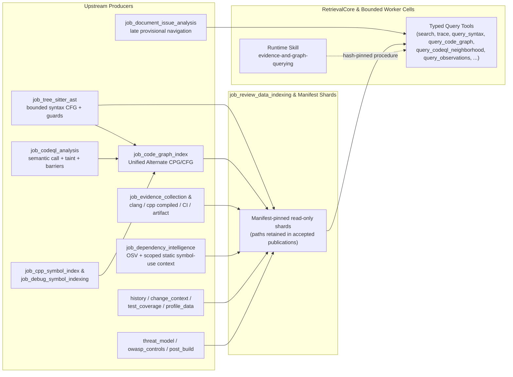

# Hosted querying and indexing skills architecture

This document defines the unified set of **indexed evidence shards**, **application-mediated
querying tools**, and **hash-pinned runtime worker skills** hosted by `appsec-review` so every
coherent producer feeds downstream prioritization, inference review, OWASP control verification,
compile-only PoC generation, and remediation validation without raw filesystem or shell access.

See [`retrieval-surfaces.md`](retrieval-surfaces.md) for the transport boundary separating
in-process review-cell retrieval from the external stdio MCP adapter (`appsec-review-mcp`).

## Architectural invariants

1. **Application-mediated reads.** Model workers never receive shell, filesystem,
   glob, regular-expression, SQL, or network access. `RetrievalCore` opens manifest-pinned shards
   read-only and verifies source/artifact custody when reading excerpts. A manifest is not a
   grant to read every producer; typed admitted inputs and cell capabilities remain authoritative.
2. **Build-independent syntax, conditional graph coverage (`T-168`, `T-169`).** Joern
   (`job_cpg_analysis`) and SVF (`job_svf_alias_analysis`) remain registered but disabled by
   default. `job_tree_sitter_ast` publishes bounded intra-procedural CFGs and syntactic calls;
   missing parses, unsupported constructs and incomplete CFGs remain gaps, not universal coverage.
   `job_code_graph_index` combines available syntax and semantic inputs into `analysis/alternate-cpg`
   with provenance tiers. Its slices and candidate paths are distinct from the CodeQL `graph`
   facts and do not establish executable reachability by themselves.
3. **Declared evidence routes, not universal completeness (`T-170`, `T-171`, `T-172`).** Upstream analytical
   signals—scanner observations with `codeFlows`, SCA + FFI reachability, git history hotspots,
   PR/commit guard-removal deltas, test coverage gaps, runtime execution profiles, CI/CD workflow
   risks, post-build binary mitigations, threat-model trust boundaries, API/spec drift, and
   verified OWASP control-gap candidates—have declared artifact or indexed routes. Consumers
   distinguish availability, actual admitted reads and citations; absent, bounded or provisional
   inputs cannot be described as complete evidence. Document navigation is a late input to
   inference, not an upstream input to review-data indexing.
4. **Provenance-graded evidence.** Rows retain their producer-specific resolving identities and
   qualification contracts, not one universal source/artifact field or confidence vocabulary.
   Alternate CPG `resolution_tier` values are `codeql_semantic`, `clangd_semantic`, `hybrid_fused`
   and `syntactic_fallback`. Syntactic edges nominate paths; existing evidence and adjudication
   rules determine whether supporting source/semantic facts establish a predicate.

## Hosted index shard families

| Shard / Domain | Producing Job(s) | Primary Entities Indexed | Primary Query Tools |
|---|---|---|---|
| **Source & Structure** | `job_target_catalog`, `job_review_data_indexing` | First-party/vendored/test dispositions, file digests, bounded line excerpts | `find`, `search`, `read_excerpt`, `resolve_evidence` |
| **Syntax & Intra-CFG** | `job_tree_sitter_ast` | Definitions, imports, written calls, bounded CFG nodes/edges, branch guards such as `null_check`, `bounds_check`, `auth_or_role_check`; incomplete CFGs withhold dominance conclusions | `query_syntax`, `query_cfg_function`, `query_guard_dominators` |
| **Alternate CPG and semantic graph** | `job_code_graph_index`, `job_codeql_analysis`, `job_cpp_symbol_index` | Alternate CPG candidate paths/slices in `analysis`; separately scoped CodeQL `CALLS`, `entry_point`, `sink_site`, `dataflow_path`, `flow_summary`, `guard_fact`, `range_fact` facts | `query_cpg_slice`, `query_call_paths`; `query_code_graph`, `query_codeql_neighborhood`, `query_codeql`, `trace` for the semantic graph |
| **Native & Binary Evidence** | `job_debug_symbol_indexing`, `job_binary_evidence_indexing`, `job_artifact_indexing`, `job_post_build_security_assessment` | DWARF/PDB struct field offsets, stack buffer sizes, ELF/PE/Mach-O hardening (`NX`, `PIE`, `RELRO`, `Canary`, `CFI`), decompiled functions/imports | `query_debug_symbols`, `query_artifacts`, `query_build_security`, `search`, `trace` |
| **Scanner & Supply-Chain Evidence** | `job_evidence_collection`, `job_clang_static_analysis`, `job_cpp_compiled_analysis`, `job_dependency_intelligence`, `job_ci_configuration_analysis`, `job_artifact_security_analysis` | Scanner observations and reported `codeFlows`, OSV/NVD advisory context and scoped static symbol-use records; imports/FFI declarations alone are not vulnerable-symbol calls | `query_observations`, `query_ci_configuration`, `query_precomputed`, `query_sca_reachability` |
| **Engineering & Behavioural Context** | `job_source_history_analysis`, `job_change_context_analysis`, `job_test_coverage`, `job_profile_data`, `job_review_prioritization` | Proportional bug-fix hotspots, guard-removal diffs, uncovered high-exposure lines, hot runtime execution paths, SAST-silence hunt priorities | `query_hotspots`, `coverage`, `query_precomputed` |
| **Architecture, Controls & Spec Drift** | `job_threat_model_generation`, `job_owasp_control_assessment`, `job_document_issue_analysis` | Routing-only boundaries, scoped independently assessed `not_satisfied` controls, provisional literal API registration/auth drift; unsupported mappings remain gaps | `query_threat_boundaries`, `query_owasp_gaps`, `query_doc_drift` |
| **Bounded native analysis and readiness** | `job_cbmc_analysis`, `job_sanitizer_build` via indexing | Conditional exact-seed CBMC results; per-unit sanitizer build/catalog/runtime-reference evidence, never runtime verification | `find` for admitted CBMC context; `query_sanitizer_readiness` |

## Coherent tool catalog and role grants

Review-cell queries pass through `review/capability.py`; the external scoped MCP adapter has its
own narrower `_ROLE_TOOLS` catalog in `mcp/capability.py`. They are not interchangeable role
inventories. OWASP, PoC and remediation workers use their owning job's bounded readers, not an
automatic grant to all review tools. In particular, PoC uses `read_source`/`find_declaration` and
the remediation reviewer is final-only. The table describes retrieval responsibilities, not grants:

| Tool | Bounded responsibility |
|---|---|
| `query_dataset_inventory` | Inspect declared datasets and coverage; indexed does not mean consumed or cited. |
| `find` / `search` / `read_excerpt` | Locate admitted entities and read custody-checked excerpts under the issued scope. |
| `query_syntax` | Definitions, written calls, imports and identifier occurrences, not CFG traversal. |
| `query_cfg_function` / `query_guard_dominators` | Page accepted syntax CFGs and common guards for an occurrence. Incomplete/unmodeled CFGs do not expose positive dominance conclusions. |
| `query_cpg_slice` / `query_call_paths` | Query `analysis/alternate-cpg`; depth/hop bounds are configurable up to 16, further constrained by stored coverage and the cell grant. Empty results do not exclude longer or unresolved paths. |
| `query_code_graph` / `query_codeql_neighborhood` / `query_codeql` / `trace` | Inspect accepted semantic facts and relations within exact graph scopes. |
| `query_observations` | Read scanner reports and retained reported paths; corroboration is not independent proof. |
| `query_debug_symbols` / `query_build_security` / `query_artifacts` | Inspect accepted layout, mapping and binary-mitigation facts; unresolved mappings remain explicit. |
| `query_engineering_signals` / `query_hotspots` / `coverage` / `query_ci_configuration` | Read available history, change, test, profile, priority and CI context without inventing missing measurements. |
| `query_threat_boundaries` / `query_owasp_gaps` / `query_doc_drift` | Separate routing hypotheses, independently assessed scoped gap candidates and provisional document drift. |
| `query_sca_reachability` / `query_sanitizer_readiness` | Read static dependency context and build-readiness evidence; neither provides whole-program absence or runtime proof. |
| `query_precomputed` / `resolve_evidence` | Retrieve bounded derived context and re-resolve evidence; derived interpretations do not inherit direct authority. |

## Runtime worker skill registration (`pipeline/skills/`)

Runtime skills live exclusively under `pipeline/skills/<name>/SKILL.md` with
`metadata.audience: runtime-worker`, are registered in `pipeline/guidance/registry.json` under
`runtime_skills`, and are loaded solely via `appsec_review.guidance.skills.load_runtime_skill`
(enforced by `tests/test_skill_separation.py`).

| Runtime Skill | Registered Jobs | Purpose & Frontier Prompting Pattern |
|---|---|---|
| `evidence-and-graph-querying` | `job_inference_security_review`, `job_poc_generation`, `job_remediation_planning`, `job_threat_model_generation` | Registered allowlist, not proof of dispatch by all four jobs. Inference's bundle attachment is implemented in `evidence_fulfillment.py`; procedures guide use of actually granted evidence tools and cannot add capabilities. |
| `review-evidence-checking` (and task-specific review procedures) | `job_inference_security_review` | Hypothesis-driven verification discipline: distinguish proven sanitizers/barriers at exact source lines from unverified caller assumptions; preserve numeric buffer/integer arithmetic checks (`numeric-reasoning-guardrail/1`). |
| `binary-evidence` | `job_inference_security_review` (attached when `binary` shard is present) | Correlate Ghidra decompiled functions/imports and `debug_symbols` DWARF/PDB layouts with source or FFI boundaries. |

## Frontier-model querying protocol

To prevent both **premature refutation** (dismissing real multi-hop bugs because a 1-hop snippet
looks benign) and **speculative hallucination** (claiming reachability without resolving callers),
the querying guidance describes this investigation pattern, subject to each worker's actual grant:

1. **Orient on precomputed graph & context first:** Read the package's dual-seeded CPG/CFG summary,
   `codeFlows` steps, threat-model trust boundary, OWASP control gaps, and SAST-silence signals
   before issuing broad searches.
2. **Batch independent retrieval calls in one turn:** Request caller facts (`query_code_graph`),
   syntax calls (`query_syntax`), `query_guard_dominators`, and exact `read_excerpt` windows together in a single
   `retrieve` turn to minimize round-trip latency and preserve output token budget for reasoning.
3. **Separate syntactic nomination from semantic proof:** When an edge carries
   `syntactic_fallback` provenance (for example dynamic dispatch, callback tables, or buildless
   targets), verify the concrete receiver, import, or call signature with `read_excerpt` or
   `query_debug_symbols`. Such checks supply evidence to adjudication, not a new worker-held
   authority to mark a path confirmed.
4. **Treat missing shards as named uncertainty, never safety:** If `query_dataset_inventory`
   reports a degraded build or missing shard, record the exact scope limitation rather than
   concluding that an unverified sink is unreachable.

`query_cpg_slice` currently accepts only `backward` and `forward` in the core, although the
transport schema also lists `both`; do not describe that advertised value as usable. Transport
bounds can also be lower than core bounds. [T-5271](../TODO.md) tracks this contract mismatch.
