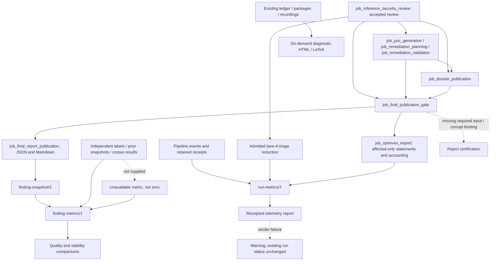

# Reporting and metrics

## As built today

This view is grounded in runtime source at `80e04db89504a4b9f276aa1e336ad703235dd10c`
and the subsequent documentation-only job pages. It does not claim later main changes or
unlanded T-150 decision products. The existing reconciliation watermark is unchanged.

### Certification precedes presentation

The reporting chain consumes accepted evidence, not newly discovered target files.
[Accepted-review verification](../../src/appsec_review/jobs/accepted_review.py) rechecks review
handoff, ledger/projection, package manifests, findings, scores, coverage and referenced artifacts.
The [final gate](../../src/appsec_review/jobs/job_final_publication_gate/job.py) additionally
certifies commissioned PoC, chain, remediation and dossier attachments and frozen configuration.
Missing required admission or corrupt bindings block publication; they are not success-shaped
coverage gaps.

The [classifier](../../src/appsec_review/jobs/job_final_publication_gate/classify.py) preserves
adjudication and shipment decisions. It partitions packages exactly once into publishable
confirmed findings, supported verification backlog or withheld packages whose referenced outcome
class is unavailable. `gap`, `not_run` and `notice` limitations remain distinct. A gate that allows
publication with limitations is not a clean-target or ship-approval verdict.

The [terminal report](../../src/appsec_review/jobs/job_final_report_publication/report.py) projects
only that certified gate into JSON and deterministic Markdown. Before acceptance, the producer
revalidates gate bindings and requires Markdown to equal a fresh rendering of JSON. It does not
discover post-gate attachments, mutate findings or invoke a consolidated public-report PDF renderer.
See [input admission](job-input-contracts.md#admission-and-read-receipts) and
[interchange outcomes](job-interchange.md#the-control-layer-beneath-the-envelope) for the shared
authority and gap mechanisms.

### Protected payloads and public summaries stay separate

[Dossier publication](../../src/appsec_review/jobs/job_dossier_publication/job.py) produces
protected developer projections for confirmed findings and separately for every accepted PoC
outcome, including failed/unavailable outcomes. It reads only cited accepted source identities
through bounded retrieval, attaches matching engineering/chain context and records omissions.
Bounded JSON and escaped LaTeX survive ordinary PDF-render failure; a successful PDF requires
real output bytes and a hash-bound rendering receipt. Pin, template or input-integrity failure is
not a successful degraded rendering.

PoC source, source-derived engineering diagnostics, model receipts and dossier content remain
protected. The public final report contains certified references and summaries, not generated
exploit source, prompts or raw evidence dumps. Hash binding is byte integrity, not a new reader
grant or an assertion of issuer authority. Image-backed rendering follows
[host/image pins](../operations/image-pin-verification.md#the-gate) and
[signing policy](../operations/signing.md#container-images).

The deterministic [OpenVEX projector](../../src/appsec_review/jobs/job_openvex_export/projection.py)
exports one `affected` statement per gate-publishable confirmed package. Backlog and withheld
packages remain exclusions in its protected companion. Zero eligible packages produce no OpenVEX
document and an explicit no-statements outcome. It derives no `fixed` or `not_affected` status
from absence, remediation or failed PoCs. Tool authorship is not vendor attestation; the existing
[specification qualification](openvex-export.md#3-verified-upstream-specification-and-validation-pin)
remains relevant.

All these consumers retain compile-only assurance. `compile_verified` PoCs were not linked or
run; `build_checked` remediation is a bounded before/after syntax check, not a runtime fix.
Supported findings do not become confirmed through a rendered dossier, export, score or patch.

### Three measurement domains answer different questions

| Domain | Source and calculation | What it cannot establish |
| --- | --- | --- |
| Execution/process metrics | Pipeline events, measured spans, model/tool usage and accepted receipts | Finding correctness, complete target coverage or runtime proof |
| Accepted publication counts | Verified gate/review/export identities and exact candidate/package partitions | That an attempted, reused or omitted item was independently successful |
| Finding/quality metrics | Accepted finding snapshots plus optional independent labels, prior runs and corpus results | Truth from model self-agreement, dismissal, absence or unavailable labels |

[Run telemetry](../../src/appsec_review/observability/telemetry.py) writes a derivable
`run-metrics/7` summary beside the authoritative pipeline event stream. It validates events,
deduplicates invocation lifecycle records, reports conflicts, and distinguishes wall time from
summed concurrent work. Inclusive resource spans are not summed into a fictitious run total.
Unknown token/cost measurements remain unavailable rather than zero. Completion metrics count
event-scoped attempted work: retries are work, not additional accepted findings.

The [completion aggregator](../../src/appsec_review/observability/completion.py) retains finite
status/capability counters and measurement gaps without interpreting them as security evidence.
OpenVEX metrics distinguish invocation attempts from the verified current accepted export;
historical immutable exports can remain valid artifacts while being stale for current status.
Operational definitions and diagnostics belong in the [metrics guide](../operations/metrics.md).

[Triage reduction](../../src/appsec_review/observability/triage_reduction.py) is limited to
admitted lane-A scanner leads. It reconciles survived, dismissed, no-claim and unresolved
outcomes against accepted package/lane/projection artifacts. Unadmitted leads are reported
unreviewed and excluded from reduction ratios; unresolved leads do not count as reduced.
Dismissed and no-claim are not independently labelled false positives. Ratios retain their
denominators; unavailable inputs produce null counts and integrity-gap reasons.

### Finding snapshots are an operator domain

The [run adapter](../../src/appsec_review/observability/findings/run_adapter.py) loads the accepted
final report and its bound projection/evidence into a separate `finding-snapshot/1`.
Unlocated findings are counted as gaps rather than assigned guessed identities. The adapter
preserves publishable/backlog/withheld membership, unknown severity, source locations and
certified remediation presence. Static/compile validation never sets runtime remediation success.

[Coverage derivation](../../src/appsec_review/observability/findings/coverage_adapter.py) joins
accepted source, packages, units and terminal cell records. An operation-only package does not
mark its whole file reviewed. Hunt scanner backing is a location-overlap measurement, not causal
proof of scanner independence; without observations it is unknown.

The [scorecard](../../src/appsec_review/observability/findings/scorecard.py) is built on request,
not injected into the run telemetry lifecycle. Independent answer keys, developer outcomes,
audit labels, prior runs and repeated-run series are optional inputs. Missing families are
unavailable with reasons and appear in the blind-spot list. Reduction needs retention context;
precision, recall/yield and stability are distinct quantities. Evaluator labels are not fed back
to review workers or used to change their accepted findings.

[Revision-independent fingerprints](../../src/appsec_review/observability/findings/identity.py)
support exact and relocated matching with an explicit strength of identity basis. A path-only
finding cannot support relocation matching. [Lifecycle classification](../../src/appsec_review/observability/findings/lifecycle.py)
does not treat disappearance as a fix: it distinguishes not covered, not redetected and
fix candidate. The [re-check module](../../src/appsec_review/observability/findings/recheck.py)
builds/validates bounded requests but has only an injected transport, not a wired live verifier.
Its `fixed` admission requires a citation to changed reviewed content; it is not evidence that
such a real re-check has occurred.

One attribution limit is explicit in the current adapter: the field `verifier_overturned` projects
the judge verdict's disagreement with claim state. It is not a measured verifier error rate.
Unknown owner/attacker-position and other unsupported actionability fields are not inferred.
The [original finding-metrics decisions](finding-metrics.md#12-implementation-decisions)
and named T ids below retain these qualifications.

[Quality-trend comparison](../../src/appsec_review/observability/quality.py) requires a comparable
corpus, role, variant, case count and scorer, while recording implementation/configuration/
prompt/model changes as independent variables. Unknown identities prevent confident attribution.
Scripted protocol competence and case-resolution precision are labelled separately from live
provider efficacy and findings precision.

### Rendering a diagnostic view is not accepting a review

The [reporting CLI](../../src/appsec_review/reporting/__main__.py) can render existing report,
ledger, package and recording material as HTML/LaTeX into an explicit output directory.
[Its reader](../../src/appsec_review/reporting/sources.py) records missing/unreadable artifacts
as presentation gaps and can select matching attempt files rather than an accepted snapshot.
Treat diagnostic renderings of model recordings as private, not as the sanitized public report.
That tolerant diagnostic view is not the final gate's fail-closed certification, nor the complete
protected decision-audit product reserved by T-150.

The separate [telemetry renderer](../../src/appsec_review/reporting/telemetry_render.py) writes
a receipted operational report. Its [input loader](../../src/appsec_review/reporting/telemetry/inputs.py)
can recompute a missing/incompatible summary in memory without rewriting it, and names torn-log
or unavailable-input gaps. The [end-of-run finalizer](../../src/appsec_review/reporting/telemetry_finalize.py)
is best-effort: a renderer exception warns without changing the existing run completion status.
None of these presentation paths establishes new finding, coverage or runtime-proof authority.

## Decisions

- **2026-10-28 — Evidence completion:** the
  [original reconciliation record](../reviews/evidence-completion-documentation-inventory.md#rollout-decisions-and-implementation-boundary)
  preserves compile-only PoCs, confirmed-only remediation, protected dossiers and one pre-report
  certification gate. Historical fixture/sample passes remain distinct from current live validation.
- **2026-10-28 — OpenVEX qualification:** the
  [upstream specification and pin record](openvex-export.md#3-verified-upstream-specification-and-validation-pin)
  separates schema validation from issuer authority and limits this projection's assertions.
- **2026-11-11 — Offline finding metrics:** the
  [implementation decisions](finding-metrics.md#12-implementation-decisions) place finding metrics
  in an on-request operator document, retain triage-reduction semantics and prohibit treating
  disappearance as a fixed finding.
- **2026-11-13 — Evidence-derived actionability:** the
  [behavior-oriented decisions](../tasks/2026-11-13-behavior-oriented-review.md#numbered-implementation-decisions)
  derive path/remediation facts from counted evidence and exact certified attachments, not missing
  fields or generated prose.
- **2026-11-13 — Attribution and stage loss:** the
  [triage/verifier review](../reviews/2026-11-13-triage-verifier-review.md#3-strengths-and-source-backed-gaps)
  records the incomplete decision trail and misleading judge/verifier attribution boundary.
  Proposed fixes are not assumed landed in this view.

## Named gaps

The [TODO registry](../TODO.md) owns scope, completion criteria and status; this table only locates
the limits relevant to interpreting reports.

| T id | Interpretation boundary |
| --- | --- |
| T-061, T-067, T-074 | Real fix-verification efficacy, fix-pair corpus/holdout and live re-check wiring. |
| T-071 | Remaining model-specific integrity measurements and honest attribution of verifier/judge outcomes. |
| T-076, T-077 | Complete developer-actionability fields and stage-attributed lead records. |
| T-150, T-154, T-156 | Complete protected decision products, labelled stage-loss audit and execution-bound coverage receipts. |

No new T-150 audit output, CLI surface, reader or grant is described as implemented at the pinned
source boundary. Later reconciliation must use the exact landing. Existing diagnostic renderers,
triage accounting and protected dossiers are not substitutes for that unfinished contract.
The implemented metric families recorded as done under T-062, T-064, T-065, T-066, T-068 and
T-069 are not reopened here; missing operator inputs make a measurement unavailable, not its
implementation absent.

## Jobs and pages

| Boundary | Current job or operator pages |
| --- | --- |
| Accepted claims and engineering inputs | [Inference review](../operations/job_inference_security_review.md), [PoC generation](../operations/job_poc_generation.md), [remediation planning](../operations/job_remediation_planning.md), [remediation validation](../operations/job_remediation_validation.md) |
| Protected developer publication | [Dossier publication](../operations/job_dossier_publication.md) |
| Certification and final presentation | [Final gate](../operations/job_final_publication_gate.md), [final report](../operations/job_final_report_publication.md) |
| Affected-only machine-readable export | [OpenVEX export](../operations/job_openvex_export.md) |
| Operational measurements | [Metrics](../operations/metrics.md), [finding metrics](../operations/finding-metrics.md), [manual guidance evaluation](../operations/guidance-evaluation.md) |

Exact contracts, failure branches and acceptance checks stay on the job pages.
[Review inference and guidance](review-inference-and-guidance.md) owns the model/evidence decision
boundary; this subsystem observes and projects it rather than widening it.

## Dataflow

The metric and diagnostic paths have no return edge into review decisions or worker grants.
Protected payloads remain behind their existing access boundaries; arrows do not authorize a new
consumer. No chart or export changes compile-only assurance into runtime proof.
