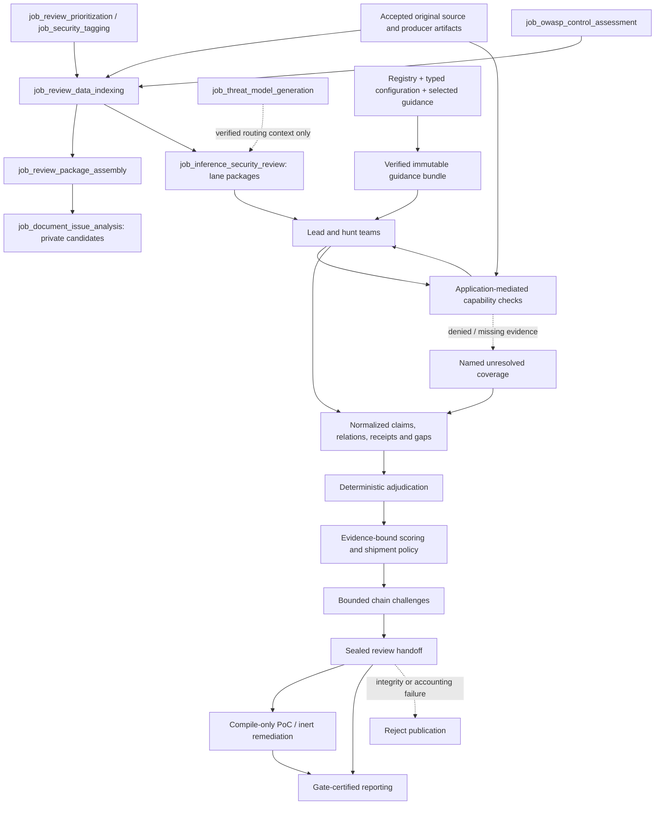

# Review inference and guidance

## As built today

This view is reconciled to `d622f50750ae0c1583d6dac5a0acb0643ea18bcc`, including T-150's
model-free protected audit producer and opted-in application readers. Later warrant, obligation,
allocation and efficacy proposals remain separate from this implemented traceability boundary.

### Context is not proof

The review starts from admitted producer evidence, not from a target-tree dump. The
[input contract](job-input-contracts.md#admission-and-read-receipts) separates scheduling,
available datasets, supplied handoffs, actual reads and citations.
[Accepted retrieval](python-and-retrieval.md#accepted-index-sets) keeps source/publication
identities and bounded query surfaces. A combined manifest does not authorize arbitrary readers.

Several producers help decide where to look without deciding what is vulnerable:

- Prioritization ranks files/functions from available metrics and signals. Missing dimensions
  lower feature coverage; high rank is not a finding.
- Security tags retain declared, invoked, reported and derived bases. An invoked graph-backed
  capability describes an operation; a derived crosswalk tag is applicability context.
- The deterministic generated DFD/threat model retains original citations and unknowns. The
  current [behavior loader](../../src/appsec_review/review/behavior.py) verifies an optional
  admitted model and attaches bounded context to matching operation packages. It does not turn
  generated boundary/threat identities into direct evidence. Older narratives saying this model
  has no consumer no longer describe this source.
- Upstream package assembly produces scanner-lead, hunt-menu and document-hunt routing material.
  The separate document-issue job maps bounded route subjects but publishes only private,
  unadjudicated candidates. The inference job builds its own lead/hunt package manifests; a
  scheduling edge after document analysis is not proof that its candidates became findings.
- OWASP assessment investigates supported, named source-subject obligations. Its deterministic
  citation checks and fresh independent reviewer can support scoped analyst assessments.
  Catalog completeness, routing tags and a satisfied subject do not establish whole-component
  control coverage or compliance. Qualification-mode results are not target assessments.

The [behavior-oriented package assembler](../../src/appsec_review/review/packages.py) prefers
accepted operation anchors while retaining bounded path fallback and below-cutoff accounting.
Operation-only investigation is not whole-file coverage. Generated questions and evidence requests
remain questions until original evidence is retrieved and admitted for the relevant predicate.

[Evidence admission](../../src/appsec_review/review/evidence.py) re-resolves each citation from
the accepted manifest. Tool observations count only for their producing rule's mapped predicates;
graph facts count only for mapped predicates after direct-eligibility and provenance conditions
recheck. Truncated/incomplete resolution cannot satisfy an obligation. Advisory/precomputed
reference context and tags remain indirect. The
[obligation policy](../../src/appsec_review/review/obligations.py) chooses required predicates by
claim family; it does not demand a source-to-sink path for every secret, configuration or
dependency claim.

### Guidance is selected data, not authority

[Registry validation and composition](../../src/appsec_review/guidance/compose.py) keep role,
persona, stack, task and selected procedures distinct. A role states responsibility; a persona
provides a viewpoint. [Routing](../../src/appsec_review/guidance/routing.py) chooses these from
accepted CWE, location/component tags, languages, build/interface facts and available strategies.
Fallbacks retain routing or coverage gaps rather than silently pretending specialist coverage.

The registered runtime-skill loader and job allowlists are the only procedure-loading boundary;
repository development skills and target-owned guidance never become review-worker guidance.
Conflicting authority, unknown tools and forbidden task-input policy fields fail assembly.
Only selected guidance participates in its content identity. The shared composer verifies and
pins immutable bundles and rendered prompts; old layouts remain verifiable without rewriting
their bytes. See [selection and provenance](guidance-procedures.md#selection-and-provenance) and
[worker publication compatibility](worker-prompt-contracts.md#publication-and-compatibility).

Model/provider, reasoning, budgets and execution settings remain in typed central configuration
and the frozen run, not free-form prompts. Registered worker contracts are not evidence of
dispatch. The [worker inventory](worker-prompt-contracts.md#dispatch-inventory) distinguishes
deterministic and dormant roles; notably, the project-build repair helper exists but is not
called by the current project-build unit path.

### Model turns cannot grant themselves tools

[ModelRequest and ReviewModelRequest](../../src/appsec_review/inference/request.py) carry the
application-selected guidance and bounded task input. Review transports grant the model no tools:
the application interprets retrieval requests between turns and checks the issued
[cell capability](../../src/appsec_review/review/capability.py).
Cells are not general MCP clients. An MCP-only workbench route does not become a cell operation
merely because it appears in the same repository.

The generated [Capability & Artifact Card](../../src/appsec_review/guidance/cards.py) summarizes
admitted availability, identities, citation shapes, operations and existing limits. It omits
protected bodies and counts omitted presentation items. It is not a second grant or a replacement
for source custody and output validation.

The [cell executor](../../src/appsec_review/review/cells.py) owns bounded turns, schema validation,
retrieval receipts and terminal outcomes. Ordinary unresolved work has explicit gaps, not
fabricated evidence. Integrity errors block publication. An active
[first-error controller](../../src/appsec_review/runtime/execution_safety.py) can stop execution
instead of continuing through an ordinary failure branch; cancellation is not successful coverage.

### Independent decisions have different owners

The [review team handler](../../src/appsec_review/jobs/job_inference_security_review/teams.py)
implements two lanes. Lead teams use red analyst lenses; hunt teams use selected strategy/persona
pairs. Normalized admitted claims receive control and reachability refutation, then a fresh blind
verifier context. Selected judges see anonymized red/blue positions. Their verdicts and cited
relations are retained, but judges do not set claim state.

[Deterministic adjudication](../../src/appsec_review/review/adjudication.py) counts only
predicate-qualified evidence, handles contradiction and scope, and distinguishes partial support
from confirmation with required evidence and independent verification. Blind context, distinct
model identity, resolving evidence and correctness are different properties. Model agreement is
not a vote that supplies a missing predicate.

The [post-lane stages](../../src/appsec_review/jobs/job_inference_security_review/stages.py)
then score supported/confirmed claims from evidence-bound factors. Missing factors remain
unrated or bounded; advisory reference scores are not target-specific proof. Shipment policy is
separate from adjudication. Judge/basis/technical-severity selection for PoC candidates is separate
again, and may include a supported claim without confirming it.

Attack-chain composition and challenges run before sealing the review ledger. Chain-cell
accounting is checked independently and excluded from base-review completeness calculation.
The review publishes supported packages as an unconfirmed verification backlog and confirmed
packages as remediation intake. `EMPTY` and `DEGRADED` are never clean-target outcomes.

### Engineering artifacts preserve the assurance boundary

PoC generation validates source/AST policy and performs syntax/object/symbol checks using the
accepted build workspace. It never links or executes generated functions. Remediation planning
is confirmed-only and publishes inert exact patches plus safe regression specifications;
validation uses isolated scratch copies, independent semantic assessment and a commissioned
before/after syntax adapter. Neither `compile_verified` nor `build_checked` means runtime proof
or a fixed finding. Publication and metrics preserve these dimensions separately in
[reporting and metrics](reporting-and-metrics.md).

### Reuse does not transfer authority

Package/cell fingerprints bind the evidence dependencies, selected guidance, semantic task,
role/persona/stack, capabilities, model, limits and validators that determine the result.
Reused cells still require valid evidence and receipts. Blue-cell memoization does not give a
blind verifier or judge another worker's hidden reasoning. OWASP reuse rebinds cited evidence
and refuses changed subject/content identities.

[Runtime resume](jobs-and-runtime.md#wave-1-resumability) additionally binds admitted handoffs,
configuration and measured implementation identities. Path-coupled ledger/artifact outputs are
not portable failed-attempt checkpoints. The job pages below describe their narrower reuse
boundaries; no cache hit licenses new scope or closes an unresolved gap.

### Protected decision traceability

After writing the original inner handoff, inference publication projects existing lead/proposal,
cell-execution, verification and decision-basis records into a separate protected sidecar.
The accepted outer publication pins its descriptor, payload and attempt-owned source closure.
The projection makes no new model calls and changes no claim, score, ship-block or PoC decision.
Its full frozen-config/policy identity is separate from model-semantic settings.

Gate and dossier readers explicitly verify the complete bundle and declared original source
permissions. Historical absent declarations can yield `legacy_unrecorded`; a present wrong
schema/authority or unbound metadata is an integrity failure. Operator queries use fixed bounded
templates. None of these surfaces grants a worker, blind verifier or MCP client raw audit access.
The [implemented audit contract](triage-verifier-enhancement.md#t-150-implementation-decisions-2026-11-13)
owns the detailed origin, budget, continuation and compatibility rules.

## Decisions

- **2026-10-28 — Completion reconciliation:** the
  [original completion record](../reviews/evidence-completion-documentation-inventory.md#rollout-decisions-and-implementation-boundary)
  records pre-seal chain work, immutable downstream attachments and one final publication gate.
  Its historical acceptance evidence is not current-run authorization or runtime reproduction.
- **2026-11-06 — Worker contracts:** the
  [original development package](../tasks/2026-11-06-worker-prompt-contracts.md#required-implementation)
  separates common governed bundles, generated cards and actual dispatch from registry inventory.
  This page preserves the contract, while current dispatch claims are checked against handlers.
- **2026-11-13 — Behavior-oriented review:** the
  [numbered decisions](../tasks/2026-11-13-behavior-oriented-review.md#numbered-implementation-decisions)
  retain subject-complete evidence, observed capabilities, operation-oriented units, path fallback,
  existing reviewer counts and original-evidence authority.
- **2026-11-13 — Decision-product review:** the
  [source-bounded triage/verifier review](../reviews/2026-11-13-triage-verifier-review.md#3-strengths-and-source-backed-gaps)
  distinguishes existing stage artifacts from complete decision products and semantic warrants.
  T-150 subsequently implements the bounded audit foundation; the
  [implementation decisions](triage-verifier-enhancement.md#t-150-implementation-decisions-2026-11-13)
  keep later semantic-policy proposals separate.

## Named gaps

These are pointers into the [single TODO registry](../TODO.md), not a second backlog.

| T id | Boundary this view does not claim closed |
| --- | --- |
| T-001 | OWASP language/control expansion, environment-bound runtime/manual evidence and live efficacy acceptance. |
| T-015, T-031 | Package-slice evaluation and prioritization approximations. |
| T-026, T-108 | Separately authorized dynamic evidence and the missing deployment-inventory producer. |
| T-074, T-076, T-077 | Live fix re-check wiring, complete actionability fields and lead-stage attribution. |
| T-149 | Scoped dependency-decision consumption beyond current inventory/context. |
| T-151, T-152, T-153 | Operation coverage obligations, scoped proposition/polarity binding and verified evidence-request resolution. |
| T-154, T-155, T-156 | Labelled stage-loss audit, fair bounded hunt allocation and execution-bound investigation/omission receipts. |

T-150's implemented audit preserves unavailable and incomplete populations; it is not live
efficacy proof or closure of the remaining evidence/coverage tasks. Raw recordings are still a
separate optional, bounded facility.

## Jobs and pages

| Responsibility | Current job pages |
| --- | --- |
| Routing and opportunity context | [Prioritization](../operations/job_review_prioritization.md), [security tagging](../operations/job_security_tagging.md), [generated threat model](../operations/job_threat_model_generation.md) |
| Indexed and packaged inputs | [Review-data indexing](../operations/job_review_data_indexing.md), [package assembly](../operations/job_review_package_assembly.md), [private document candidates](../operations/job_document_issue_analysis.md) |
| Subject-scoped control assessment | [OWASP assessment](../operations/job_owasp_control_assessment.md) |
| Investigation and deterministic decisions | [Inference review](../operations/job_inference_security_review.md) |
| Nonexecuted engineering artifacts | [PoC generation](../operations/job_poc_generation.md), [remediation planning](../operations/job_remediation_planning.md), [remediation validation](../operations/job_remediation_validation.md) |

Exact generated contracts and per-step acceptance checks live on those pages. Guidance identifiers
are indexed in [generated guidance](../generated/guidance.md); use the
[worker contracts](worker-prompt-contracts.md) for effective citation/dispatch boundaries.
Image-backed engineering follows [host pins](../operations/image-pin-verification.md) and
[configured signing enforcement](../operations/signing.md), not prompt authorization.

## Dataflow

Arrows show data responsibilities, not additional grants or every scheduling edge. Private document
candidates have no implied finding-promotion edge. Guidance and derived routing context never
replace the original evidence route.
