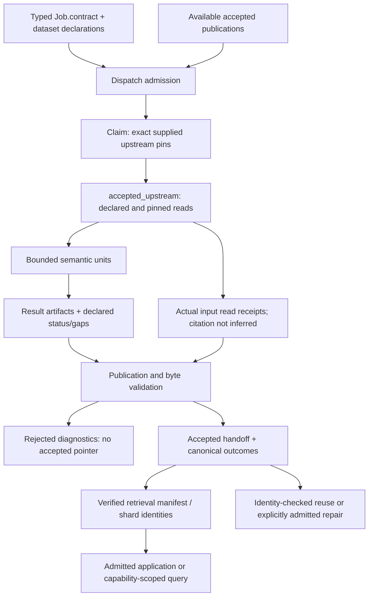

# Runtime interchange

## As built today

The semantic runtime gives jobs explicit contracts, attempt identities, unit execution receipts
and accepted publications. The direct driver and Dagster share the registry and
contract-derived topology; their scheduling differs, not the meaning of an accepted handoff.
[Jobs and runtime](jobs-and-runtime.md) owns that execution/resume mechanism.
[Generated inventory](../generated/inventory.json) lists registered jobs and declarations;
registration alone does not establish produced, supplied, read or cited evidence.

[`JobContract`](../../src/appsec_review/runtime/contracts.py) distinguishes input producer,
output kind, schema, authority, channel and missing-input policy from scheduling ancestry and
target access. Dispatch admits exact upstream identities into a claim. A producer can be
available without being supplied, and supplied without being read. The
[accepted-input contract](job-input-contracts.md) is the authority for those distinctions.
[`accepted_upstream`](../../src/appsec_review/runtime/consume.py) resolves only a declared,
admitted pin in runtime scope and retains actual reads. A later pointer move does not authorize
switching evidence: the prior pinned publication must still verify. Unscoped operator lookup is
verified but explicitly unpinned; it is not a worker grant.

An accepted [handoff](job-interchange.md) binds configuration, input/dataset identities,
implementation/schema/tool identities, artifacts and detailed canonical outcomes. Admission,
execution, producer status and coverage are distinct. A succeeded task can report unavailable
or partial analysis; a rejected publication cannot become accepted merely by having files.
The [outcome builder](../../src/appsec_review/runtime/handoff.py) consumes declared unit control
fields, not arbitrary nested scope objects or SQLite rows. Producer-local coverage must reach
that control boundary if the root coverage summary is to account for it.

The closed control vocabulary and `producer-gap/1` constructor live in
[`interchange.py`](../../src/appsec_review/interchange.py), not each job's prose. New strict-gap
jobs publish typed records; explicitly retained legacy jobs still have text reasons projected
to canonical records. A retry flag describes producer/runtime classification, not user approval
or an advisory finding category. Successful schema/hash validation proves structure and byte
binding, not that a tool observation is correct.

The [shared object store](../../src/appsec_review/storage/shared.py) publishes content by
no-replace identity. One hash proves equal bytes, not the same computation or originating
producer; when a later attempt reuses a content-fingerprinted shard under `data/indices`,
`IndexBuilder.attest_existing` / `build_or_reuse` re-attests custody (`index-shard`,
`computed=True`) under the reusing attempt so repair-admitted implementations carry a compatible
producer receipt. Accepted manifests compose verified immutable retrieval shards while preserving their
physical identities and upstream references. The
[retrieval identity/manifest contract](python-and-retrieval.md) and
[retrieval surfaces](retrieval-surfaces.md) own those details. Public routes expose their declared
normalized records or sanitized metadata; an inventory reference does not grant raw protected
payload access.

Resume re-verifies accepted publication identity and the applicable semantic dependency closure.
When an ancestor runs, consumers whose own identities, configuration, dataset contract and accepted
handoff still match are planned as `REVALIDATE` (`appsec-review/repair-plan/2`) and reused at
dispatch (`appsec-review/attempt-revalidation/1`, `REVALIDATED`) only if every pinned producer is
the identical handoff or carries equal `content_sha256` (`appsec-review/handoff-content/2`, T-161).
Generic [unit checkpoints](../../src/appsec_review/runtime/checkpoints.py) admit only bounded,
successful, portable values whose inputs/implementation and predecessor reuse remain valid.
Path-, workspace-, process-, budget- and side-effect-bound results are not generic portable
successes. [Repair admission](../operations/recovery-repair.md) handles an explicitly approved
implementation change — including strictly additive dataset or typed-input contract widenings that
force the widened job to `RUN` (`compatible_dataset_change`, T-162) — without rewriting earlier
attempts. Mutable pointers, workspaces and
controller state are not themselves immutable evidence.

T-150 now publishes a protected audit after the original inner review handoff, using the existing
control fields and explicit artifact/source pins rather than widening the control allowlist.
The gate/dossier opt into full verification with declared original source permissions.
`when_output_declared` permits historical declaration absence, never a mismatched present
declaration or an undeclared read. Fixed control bootstrap and configured payload budgets remain
separate; [the audit contract](triage-verifier-enhancement.md#t-150-implementation-decisions-2026-11-13)
records their exact scope. No worker/MCP authority is added.

## Decisions

| Date | Retained record | Current consequence |
|---|---|---|
| 2026-10-28 record | [Job interchange implementation record](../reviews/job-interchange-implementation.md) | Domain payloads remain domain-owned beneath shared validated control and admitted input boundaries. The record's original validation claims are not a fresh run. |
| 2026-11-13 | [Documentation program](../tasks/2026-11-13-docs-program-prompt.md) | Static availability, actual production, actual consumption and evidence authority are documented separately. |
| 2026-11-13 | [Content identity](job-interchange.md#evidence-header-evidence-body-and-the-content-identity) and [repair admission](../operations/recovery-repair.md) (T-161, T-162, T-163) | Equivalent-upstream `REVALIDATE` (`handoff-content/2`), strictly additive dataset/input widening, and per-job static `common` import closure narrow repair blast radius without rewriting accepted attempts or weakening byte-pinned provenance. |

## Named gaps

- [T-147](../TODO.md) owns incomplete declaration/task/publication bindings. Typed metadata must
  describe the payload and read boundary actually implemented.
- [T-157](../TODO.md) owns missing applicability/language declarations; matrix gaps are not
  runtime absence proofs.
- [T-159](../TODO.md) owns SVF module-level partial reasons that do not reach the root canonical
  outcome projection. The module rows remain present; this is an accounting boundary gap,
  not evidence that all SVF coverage was lost.
- [T-153 and T-156](../TODO.md) retain the paired warrant-policy evaluation, semantic-resolution
  and execution-coverage boundaries beyond T-150's implemented audit and T-152's opt-in warrant
  enforcement.
- [T-164](../TODO.md) owns construction-time validation of `IndexIdentity.producer["job"]` across
  synthetic test fixtures.
- [T-5001, T-5004 and T-5015](../TODO.md) own bounding `pipeline.jsonl` with streaming reporting
  consumers, narrowing OWASP declared inputs/reads, and revalidating unchanged descendants when a
  producer's dataset contract widens on repair.

## Jobs and pages

| Boundary | Current home |
|---|---|
| Every producer/consumer | [Canonical job pages](../operations/README.md), [inventory](../generated/inventory.json) |
| Input admission and read receipts | [Job input contracts](job-input-contracts.md) |
| Publication, outcomes and native result references | [Job interchange](job-interchange.md) |
| Immutable manifest/query boundary | [Python and retrieval](python-and-retrieval.md), [retrieval surfaces](retrieval-surfaces.md) |
| Consolidating declared review datasets | [Review data indexing](../operations/job_review_data_indexing.md) |
| Restart and repair | [Jobs and runtime](jobs-and-runtime.md), [recovery runbook](../operations/recovery-repair.md) |

## Dataflow

## Operational configuration compatibility and attempt ownership

`config/operational.py` is the single exact-leaf declaration and comparison mechanism.
It compares full resolved documents; unknown paths, missing values and mixed material
changes remain incompatible. Execution settings change how a new attempt runs;
coverage settings change how much it can inspect. Both preserve already accepted
results, including the limits and gaps under which those results were produced.
Increasing coverage requires an explicit whole-producer rerun and reconsideration of
its affected downstream jobs, never reuse of selected cells from a failed attempt.

Reviewed execution controls include CodeQL concurrency, threads, RAM, inventory wait,
and export compile threads/RAM/wait; the Clang, C++ symbol, CPG and code-graph worker
pools; project/language build command waits and project image-build waits. CodeQL
database/query/export analysis deadlines and Tree-sitter workers are **coverage**
controls: Tree-sitter workers also multiply generated-source caps. CodeQL step/task
workers remain fixed at one. Existing parser bounds and resource admission still apply.
The exact fields are listed in [job tuning](../operations/job-tuning.md).

Declarations have a numeric value kind, not a blanket table exemption. Positive
integers remain the default. Debug-symbol reader deadlines permit positive fractional
seconds; the two reviewed reservation IO-slot fields permit zero. Runtime progress
and sample intervals permit finite nonnegative numbers, including zero to disable
reporting. The existing Dagster maximum concurrency and named pool capacities permit
positive integers. Global declarations use `job_id: null` and an absolute path in the
same delta record. Booleans, strings, sequences, unreviewed global settings and
resource-authority policies are not implicitly operational. Model/provider/reasoning,
rules, sources, schemas, signing, authority and input-scope changes remain material.

The original full snapshot and its raw hash never change. Admission writes a full
immutable revision, its exact typed deltas and its original-snapshot binding. A new
attempt claims its effective revision hash; `context_configuration` resolves that
hash and snapshot artifacts include both revision and original references. Retained
producer settings must be read through the producer's own pinned hash, never through
a consumer's current limits. Build iteration transactions now carry the parent's
revision and reconstruct validated configuration from pinned source, embedded profile
and overlay documents, and pinned host bindings, not current source TOML. Reconstruction
must reproduce the exact admitted resolved hash. Historical workspace-resume meaning
is unchanged; this is configuration propagation, not permission to salvage build cells.

New CodeQL database/query/export trees live below `data/codeql/attempts/<attempt>/`;
predecessor imports write there and resolve old or new accepted source manifests by
verified references. Tree-sitter shards, indices, CFG outputs and generated-source
mounts are attempt-isolated. Code-graph stages, checkpoints and shards are likewise
attempt-isolated; Alternate CPG outputs live under its attempt's publication unit.
Artifact declarations retain historical paths and add the new paths. An explicit new
attempt cannot discover an older attempt's checkpoints. Invalid graph checkpoints do
not authorize deletion of their referenced shards. Content identities and accepted
artifact references remain intact; immutable tool compilation caches are not target
analysis-result reuse.

Unsupported boundaries remain explicit: changing review-policy resource budgets,
string/sequence controls or profile/overlay metadata is not covered by these exact
numeric declarations. Such differences are refused rather than silently exempted.
No configuration admission is proof of execution, new coverage or a successful review.
