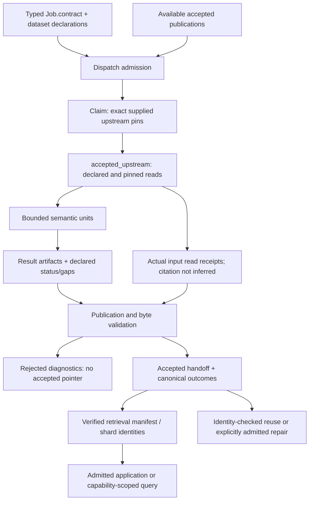

# Runtime interchange

## As built today

The semantic runtime gives jobs explicit contracts, attempt identities, unit execution receipts
and accepted publications. The direct driver and Dagster share the registry and
contract-derived topology; their scheduling differs, not the meaning of an accepted handoff.
[Jobs and runtime](jobs-and-runtime.md) owns that execution/resume mechanism.
[Generated inventory](../generated/inventory.json) lists registered jobs and declarations;
registration alone does not establish produced, supplied, read or cited evidence.

[`JobContract`](../../src/appsec_review/runtime/contracts.py) distinguishes input producer,
output kind, schema, authority, channel and missing-input policy from scheduling ancestry and
target access. Dispatch admits exact upstream identities into a claim. A producer can be
available without being supplied, and supplied without being read. The
[accepted-input contract](job-input-contracts.md) is the authority for those distinctions.
[`accepted_upstream`](../../src/appsec_review/runtime/consume.py) resolves only a declared,
admitted pin in runtime scope and retains actual reads. A later pointer move does not authorize
switching evidence: the prior pinned publication must still verify. Unscoped operator lookup is
verified but explicitly unpinned; it is not a worker grant.

An accepted [handoff](job-interchange.md) binds configuration, input/dataset identities,
implementation/schema/tool identities, artifacts and detailed canonical outcomes. Admission,
execution, producer status and coverage are distinct. A succeeded task can report unavailable
or partial analysis; a rejected publication cannot become accepted merely by having files.
The [outcome builder](../../src/appsec_review/runtime/handoff.py) consumes declared unit control
fields, not arbitrary nested scope objects or SQLite rows. Producer-local coverage must reach
that control boundary if the root coverage summary is to account for it.

The closed control vocabulary and `producer-gap/1` constructor live in
[`interchange.py`](../../src/appsec_review/interchange.py), not each job's prose. New strict-gap
jobs publish typed records; explicitly retained legacy jobs still have text reasons projected
to canonical records. A retry flag describes producer/runtime classification, not user approval
or an advisory finding category. Successful schema/hash validation proves structure and byte
binding, not that a tool observation is correct.

The [shared object store](../../src/appsec_review/storage/shared.py) publishes content by
no-replace identity. One hash proves equal bytes, not the same computation or originating
producer; when a later attempt reuses a content-fingerprinted shard under `data/indices`,
`IndexBuilder.attest_existing` / `build_or_reuse` re-attests custody (`index-shard`,
`computed=True`) under the reusing attempt so repair-admitted implementations carry a compatible
producer receipt. Accepted manifests compose verified immutable retrieval shards while preserving their
physical identities and upstream references. The
[retrieval identity/manifest contract](python-and-retrieval.md) and
[retrieval surfaces](retrieval-surfaces.md) own those details. Public routes expose their declared
normalized records or sanitized metadata; an inventory reference does not grant raw protected
payload access.

Resume re-verifies accepted publication identity and the applicable semantic dependency closure.
When an ancestor runs, consumers whose own identities, configuration, dataset contract and accepted
handoff still match are planned as `REVALIDATE` (`appsec-review/repair-plan/2`) and reused at
dispatch (`appsec-review/attempt-revalidation/1`, `REVALIDATED`) only if every pinned producer is
the identical handoff or carries equal `content_sha256` (`appsec-review/handoff-content/2`, T-161).
Generic [unit checkpoints](../../src/appsec_review/runtime/checkpoints.py) admit only bounded,
successful, portable values whose inputs/implementation and predecessor reuse remain valid.
Path-, workspace-, process-, budget- and side-effect-bound results are not generic portable
successes. [Repair admission](../operations/recovery-repair.md) handles an explicitly approved
implementation change — including strictly additive dataset or typed-input contract widenings that
force the widened job to `RUN` (`compatible_dataset_change`, T-162) — without rewriting earlier
attempts. Mutable pointers, workspaces and
controller state are not themselves immutable evidence.

T-150 now publishes a protected audit after the original inner review handoff, using the existing
control fields and explicit artifact/source pins rather than widening the control allowlist.
The gate/dossier opt into full verification with declared original source permissions.
`when_output_declared` permits historical declaration absence, never a mismatched present
declaration or an undeclared read. Fixed control bootstrap and configured payload budgets remain
separate; [the audit contract](triage-verifier-enhancement.md#t-150-implementation-decisions-2026-11-13)
records their exact scope. No worker/MCP authority is added.

## Decisions

| Date | Retained record | Current consequence |
|---|---|---|
| 2026-10-28 record | [Job interchange implementation record](../reviews/job-interchange-implementation.md) | Domain payloads remain domain-owned beneath shared validated control and admitted input boundaries. The record's original validation claims are not a fresh run. |
| 2026-11-13 | [Documentation program](../tasks/2026-11-13-docs-program-prompt.md) | Static availability, actual production, actual consumption and evidence authority are documented separately. |
| 2026-11-13 | [Content identity](job-interchange.md#evidence-header-evidence-body-and-the-content-identity) and [repair admission](../operations/recovery-repair.md) (T-161, T-162, T-163) | Equivalent-upstream `REVALIDATE` (`handoff-content/2`), strictly additive dataset/input widening, and per-job static `common` import closure narrow repair blast radius without rewriting accepted attempts or weakening byte-pinned provenance. |

## Named gaps

- [T-147](../TODO.md) owns incomplete declaration/task/publication bindings. Typed metadata must
  describe the payload and read boundary actually implemented.
- [T-157](../TODO.md) owns missing applicability/language declarations; matrix gaps are not
  runtime absence proofs.
- [T-159](../TODO.md) owns SVF module-level partial reasons that do not reach the root canonical
  outcome projection. The module rows remain present; this is an accounting boundary gap,
  not evidence that all SVF coverage was lost.
- [T-153 and T-156](../TODO.md) retain the paired warrant-policy evaluation, semantic-resolution
  and execution-coverage boundaries beyond T-150's implemented audit and T-152's opt-in warrant
  enforcement.
- [T-164](../TODO.md) owns construction-time validation of `IndexIdentity.producer["job"]` across
  synthetic test fixtures.
- [T-5001, T-5004 and T-5015](../TODO.md) own bounding `pipeline.jsonl` with streaming reporting
  consumers, narrowing OWASP declared inputs/reads, and revalidating unchanged descendants when a
  producer's dataset contract widens on repair.

## Jobs and pages

| Boundary | Current home |
|---|---|
| Every producer/consumer | [Canonical job pages](../operations/README.md), [inventory](../generated/inventory.json) |
| Input admission and read receipts | [Job input contracts](job-input-contracts.md) |
| Publication, outcomes and native result references | [Job interchange](job-interchange.md) |
| Immutable manifest/query boundary | [Python and retrieval](python-and-retrieval.md), [retrieval surfaces](retrieval-surfaces.md) |
| Consolidating declared review datasets | [Review data indexing](../operations/job_review_data_indexing.md) |
| Restart and repair | [Jobs and runtime](jobs-and-runtime.md), [recovery runbook](../operations/recovery-repair.md) |

## Dataflow

## Operational configuration compatibility and attempt ownership

`config/operational.py` is the single exact-path declaration/comparison mechanism.
All 48 configured jobs are accounted for in their canonical job pages, linked from
[job tuning](../operations/job-tuning.md). Forty-five jobs have declared local or
inherited controls; artifact indexing, image-pin verification and the internal build
transaction have no independent mutable job setting. Their input contracts and
inherited scheduling/build settings are documented, not silently omitted.

### Compatibility categories

* **Execution**: tool/transport/admission waits, actual worker pools, resource capacity
  and diagnostic intervals. Accepted prior results keep their original limits and gaps.
* **Coverage**: model time/retries/calls/tokens, analysis deadlines, parser/index/output
  ceilings and evidence batching. Neither increases nor decreases reinterpret accepted
  evidence. Expanded coverage requires an explicitly requested whole-producer rerun
  and reconsideration of affected downstream jobs.
* **Material/authority**: model/provider/reasoning, scoring and proof semantics, sources,
  query/seed selection, rules, schemas, signing/custody, required evidence and sandbox
  grants. The job pages name specifically excluded candidates and their technical reason.
* **Provenance**: profile/overlay selection, source digest and embedded document changes
  are recorded as full layer deltas only when every changed layer leaf is an exact
  declared operational control and the full effective document remains compatible.
  Layering is not an exemption for model or release changes.

Declarations carry explicit value kinds: positive/nonnegative integers or finite
numbers, reviewed booleans, memory strings (`<positive integer>m/g`) and review retry
backoff arrays (0..16 nondecreasing integer delays of 0..3600 seconds). Job parsers
remain authoritative for tighter ranges and cross-field constraints. No suffix,
name, table, profile or arbitrary numeric-field exemption exists.

### Immutable effective configuration

The original snapshot and hashes never change. Admission writes a full immutable
revision with exact deltas and original binding, and retains changed profile/overlay
TOML bytes alongside their verified hashes and embedded documents, for new run snapshots
as well as revisions. Older snapshots lacking raw layer files retain their original
embedded documents/hashes; missing historical bytes are not regenerated or claimed present. Host bindings stay
hash-pinned. A new attempt claims its effective hash. `context_configuration` resolves
that hash; artifacts include both the revision and original snapshots. A retained
attempt is reconstructed with its own typed configuration, including original output
validators, limits, resource policy and gaps, rather than the consumer's current bounds.
Build iteration workers reconstruct the admitted revision from pinned layers, not live
source TOML, and must reproduce the exact resolved hash.

The four `review_policy.resources` capacities are execution controls, not changes to
review authority. New attempts use the new budget; retained claims retain the old one.
Existing active/persistent/quarantined lease compatibility checks still reject unsafe
resizing. Resource admission, memory headroom, signing and sandbox grants are unchanged.

### Whole-job recovery boundary

`runtime.checkpoints.select_units` plans every unit as RUN for a new job attempt;
`admitted_output` rejects cross-attempt cell salvage, including old repair decisions.
Shared computation lookup also excludes previous attempts of the same job; cross-job
hits must belong to an explicitly admitted, accepted upstream attempt.
Whole accepted-job reuse remains available. Same-attempt idempotency is not a way to
import cells from another attempt. No second recovery store or registry was introduced.

CodeQL database/query/export outputs; C++ build scopes; Clang/CPG/symbol/SVF analysis;
Tree-sitter shards/CFGs; graph stages; artifact-security and evidence-tool checkpoints;
planning feedback; and index publication paths are attempt-owned. C++ downstream
readers resolve the source root from the accepted compile-database artifact instead
of a mutable run-wide directory. Existing dataset contracts retain historical paths
and declare new raw-artifact paths. Stable content identities do not authorize
reusing an earlier attempt's computation or overwriting its evidence.

Inference review starts each whole-job attempt with its own cell receipts, triage and
memo namespace and model budget. Historical spending/receipt ledgers remain unchanged;
new allowance does not erase or certify their missing usage reports. Dependency
scorecard caching is attempt-local. Build probes/image-repair caches include the
attempt identity. New language-build attempts invalidate old selected-node execution
receipts and rerun the selected graph, while preserving immutable products/ledger
snapshots and enforcing workspace/request admission. Historical workspace reconstruction
retains its original interpretation. Tool installation/compilation caches and pinned
feed/source inputs are not review-result salvage.

Feed maintenance remains separate from review execution. Tuning maintenance waits does
not refresh a review's immutable feed inputs. Pre-review binary-decompilation limits
apply only to explicitly requested new publications, never reinterpret old binary
outputs. No reload, restart or live action is authorized by configuration admission.

### Validation record

The all-job pass used source, syntax, metadata and Git checks only. Regression suites,
provider/tool invocations and live review/restart validation were not run, as requested.
This documents implemented boundaries, not proof that every job has completed a live
recovery. Exact fields, base defaults, parser-bound references, exceptions and downstream
impact are recorded in each canonical job page.
