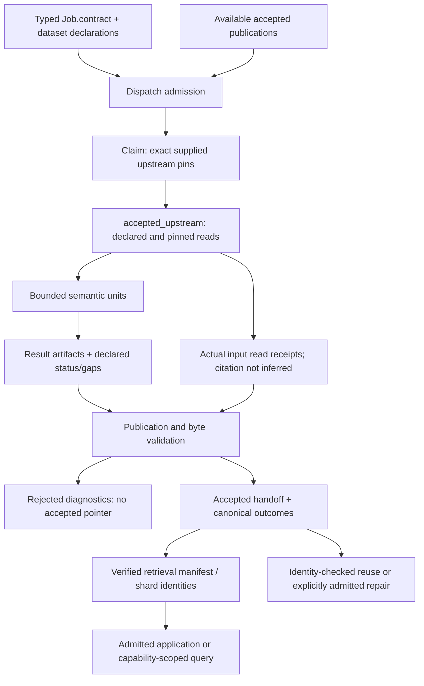

# Runtime interchange

## As built today

The semantic runtime gives jobs explicit contracts, attempt identities, unit execution receipts
and accepted publications. The direct driver and Dagster share the registry and
contract-derived topology; their scheduling differs, not the meaning of an accepted handoff.
[Jobs and runtime](jobs-and-runtime.md) owns that execution/resume mechanism.
[Generated inventory](../generated/inventory.json) lists registered jobs and declarations;
registration alone does not establish produced, supplied, read or cited evidence.

[`JobContract`](../../src/appsec_review/runtime/contracts.py) distinguishes input producer,
output kind, schema, authority, channel and missing-input policy from scheduling ancestry and
target access. Dispatch admits exact upstream identities into a claim. A producer can be
available without being supplied, and supplied without being read. The
[accepted-input contract](job-input-contracts.md) is the authority for those distinctions.
[`accepted_upstream`](../../src/appsec_review/runtime/consume.py) resolves only a declared,
admitted pin in runtime scope and retains actual reads. A later pointer move does not authorize
switching evidence: the prior pinned publication must still verify. Unscoped operator lookup is
verified but explicitly unpinned; it is not a worker grant.

An accepted [handoff](job-interchange.md) binds configuration, input/dataset identities,
implementation/schema/tool identities, artifacts and detailed canonical outcomes. Admission,
execution, producer status and coverage are distinct. A succeeded task can report unavailable
or partial analysis; a rejected publication cannot become accepted merely by having files.
The [outcome builder](../../src/appsec_review/runtime/handoff.py) consumes declared unit control
fields, not arbitrary nested scope objects or SQLite rows. Producer-local coverage must reach
that control boundary if the root coverage summary is to account for it.

The closed control vocabulary and `producer-gap/1` constructor live in
[`interchange.py`](../../src/appsec_review/interchange.py), not each job's prose. New strict-gap
jobs publish typed records; explicitly retained legacy jobs still have text reasons projected
to canonical records. A retry flag describes producer/runtime classification, not user approval
or an advisory finding category. Successful schema/hash validation proves structure and byte
binding, not that a tool observation is correct.

The [shared object store](../../src/appsec_review/storage/shared.py) publishes content by
no-replace identity. One hash proves equal bytes, not the same computation or originating
producer. Accepted manifests compose verified immutable retrieval shards while preserving their
physical identities and upstream references. The
[retrieval identity/manifest contract](python-and-retrieval.md) and
[retrieval surfaces](retrieval-surfaces.md) own those details. Public routes expose their declared
normalized records or sanitized metadata; an inventory reference does not grant raw protected
payload access.

Resume re-verifies accepted publication identity and the applicable semantic dependency closure.
Generic [unit checkpoints](../../src/appsec_review/runtime/checkpoints.py) admit only bounded,
successful, portable values whose inputs/implementation and predecessor reuse remain valid.
Path-, workspace-, process-, budget- and side-effect-bound results are not generic portable
successes. [Repair admission](../operations/recovery-repair.md) handles an explicitly approved
implementation change without rewriting earlier attempts. Mutable pointers, workspaces and
controller state are not themselves immutable evidence.

The pure review decision-audit contracts landed at the pinned source boundary, but that does not
establish production sidecars, consumers or a retrieval grant. [T-150](../TODO.md) remains the
implementation authority; review/reporting pages distinguish its proposal from accepted outputs.

## Decisions

| Date | Retained record | Current consequence |
|---|---|---|
| 2026-10-28 record | [Job interchange implementation record](../reviews/job-interchange-implementation.md) | Domain payloads remain domain-owned beneath shared validated control and admitted input boundaries. The record's original validation claims are not a fresh run. |
| 2026-11-13 | [Documentation program](../tasks/2026-11-13-docs-program-prompt.md) | Static availability, actual production, actual consumption and evidence authority are documented separately. |

## Named gaps

- [T-147](../TODO.md) owns incomplete declaration/task/publication bindings. Typed metadata must
  describe the payload and read boundary actually implemented.
- [T-157](../TODO.md) owns missing applicability/language declarations; matrix gaps are not
  runtime absence proofs.
- [T-159](../TODO.md) owns SVF module-level partial reasons that do not reach the root canonical
  outcome projection. The module rows remain present; this is an accounting boundary gap,
  not evidence that all SVF coverage was lost.
- [T-150](../TODO.md) tracks protected decision-audit production/consumption beyond the landed
  pure contracts. Its planned products do not widen control-key or worker authority.

## Jobs and pages

| Boundary | Current home |
|---|---|
| Every producer/consumer | [Canonical job pages](../operations/README.md), [inventory](../generated/inventory.json) |
| Input admission and read receipts | [Job input contracts](job-input-contracts.md) |
| Publication, outcomes and native result references | [Job interchange](job-interchange.md) |
| Immutable manifest/query boundary | [Python and retrieval](python-and-retrieval.md), [retrieval surfaces](retrieval-surfaces.md) |
| Consolidating declared review datasets | [Review data indexing](../operations/job_review_data_indexing.md) |
| Restart and repair | [Jobs and runtime](jobs-and-runtime.md), [recovery runbook](../operations/recovery-repair.md) |

## Dataflow

