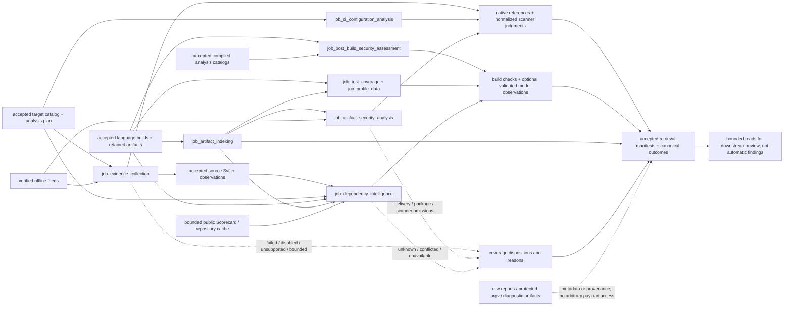

# Scanners and evidence collection

## As built today

These producers turn admitted catalog/build/artifact evidence into bounded scanner observations,
inventory and coverage context. They do not form one vulnerability verdict. A scanner result,
scan summary, correlated CI record, deterministic hardening judgment, dependency identity and
imported execution profile answer different review questions. This T-132 dive describes source
behavior, not new live acceptance; the detailed job pages provide executable-unit boundaries and
independent acceptance comparisons.

**Selection precedes execution**

[Evidence collection](../../src/appsec_review/jobs/job_evidence_collection/job.py) consumes the
accepted target catalog and analysis plan, applies tool support and Swift/Grype policy, and
checks rule/feed prerequisites before bounded scanner launch. Each adapter owns its argv,
expected output and accepted exit convention. Scanner choice is not inferred from a filename in
a generated inventory. The source lane includes worktree secrets, source diagnostics, directory
Syft inventory, offline advisory matching, configuration checks and catalog-binary hardening.
Grype consumes the accepted per-task Syft output; OSV partitions supported lockfiles and mounts only
the required available ecosystem snapshots. Missing prerequisites and unselected/unsupported work
retain distinct dispositions.

[Artifact indexing](../../src/appsec_review/jobs/job_artifact_indexing/job.py) first establishes
canonical retained-artifact identities, receipt-based archive membership and exact or explicitly
ambiguous producing/linking relations. It does not scan archive contents to rediscover members.
[Artifact security analysis](../../src/appsec_review/jobs/job_artifact_security_analysis/job.py)
then applies delivery/scope and format support to accepted produced or target-intake artifacts.
Platform content is not customer-artifact input. Unknown delivery is a coverage limitation, not
proof that a binary ships or can be ignored.

The artifact lane combines bounded built-in format facts with applicable SpotBugs, blint, Syft,
Grype and OSV adapters. Installed npm package coverage uses a verified installer record rather than
repeating equivalent package scans; package anchors, record presentation, dev-package omissions
and unreported anchors remain explicit. Built-in native/JVM headers and Wasm capabilities are not
substitutes for all scanner rules or policy validation.

[CI analysis](../../src/appsec_review/jobs/job_ci_configuration_analysis/job.py) has its own
accepted-catalog discovery, provider routing, external linters and structural rules. Its exact-only
correlator joins matching provider/path/range/category/message observations, adding mapping provenance
to the equality condition when locations are ambiguous. A structural preceding job/step label is
not runtime pipeline control-flow proof. A canonical CI “finding” is still a correlated judgment,
not adjudicated exploitability.

**The publication types retain their different meanings**

| Product | Producer evidence | Review meaning | Boundary that remains |
| --- | --- | --- | --- |
| Scanner observation | Native rule/result selector, reported severity and source/artifact identity | A tool's judgment for investigation | Not a confirmed security finding |
| Scan summary | One scan's outcome, capability, record count and completeness | Whether and how far a scan ran | Not an extra vulnerability record |
| Artifact catalog/relationship | Hash-bound receipt, workspace/member or invocation identity | Retained bytes and producing/containing/linking context | Presence is not delivery; heuristic attribution is not exact |
| Dependency/SPDX inventory | Declared, scanner and native evidence with claim/provenance state | Package/context candidates and corroborated inventory fields | Inferred version/upstream is not a verified advisory match |
| Build-security result | Sanitized action facts, inspected binary properties and deterministic rules | Requested/observed hardening and optional model explanation | Unknown/not-applicable is not pass; validation label is not final adjudication |
| Test coverage/profile data | Accepted build-retained report bytes | Reported bound-source coverage or within-unit hotness | No tests/profiler executed here; no safety or defect-probability inference |
| Coverage-only row/raw artifact | Producer disposition or retained diagnostic/database/report | Accounting or inspectable provenance | Not automatically usable indexed facts or model-readable payload |

The concrete native provenance path is shared by source scanners, produced-artifact scanners and
CodeQL normalization. [Interchange](job-interchange.md#native-result-and-common-observation)
distinguishes retained parser bytes from execution origin and binds exact result selectors.
[Record splitting](../../src/appsec_review/jobs/job_artifact_security_analysis/findings.py) preserves
scan summaries separately from individual scanner finding-shaped records. Failed/over-bound output
may be retained as incomplete diagnostics without becoming successful observations. Missing
provenance is not repaired by prose or by a matching count. Producer-specific paths outside that
provenance implementation must not be described as universally covered by the common schema.

Raw native reports, protected commands and diagnostics remain run-owned evidence. Searchable
payloads are bounded/redacted projections; artifact-only/protected dataset routes expose metadata,
not an arbitrary-file download capability. Locationless binary/package observations remain tied
to artifact identity rather than acquiring invented source citations.

**Inventory and optional model work**

[Dependency intelligence](../../src/appsec_review/jobs/job_dependency_intelligence/job.py) joins
accepted declarations, Syft observations and authenticated native metadata/invocations. It preserves
unknown/conflicted/inferred/corroborated claims, runs optional bounded component curation and
root-scoped metadata investigation, and resolves remaining native upstream candidates as inexact
model context. The [SPDX integration](../../src/appsec_review/jobs/job_dependency_intelligence/integration.py)
converts accepted source Syft and enriches a separately validated SPDX document; it does not replace
working scanner interchange or feed inferred releases back into those scanners. Repository
deduplication and age/identity-validated Scorecard caching bound public HTTPS context acquisition.
Scorecard and conservative maximal exposure are not findings or observed deployment.

[Post-build assessment](../../src/appsec_review/jobs/job_post_build_security_assessment/job.py)
reads accepted native and other-family binaries as bytes, retaining protected argv separately from
sanitized flags. Family-aware deterministic rules distinguish pass, fail, unknown and not-applicable.
Optional inference can explain supplied checks/evidence; its validator compares a proposed
observation with a known deterministic check. A confirmed model label is not independent proof of
every statement in the claim. Exact worker rationale is in the job pages; shared
[worker contracts](worker-prompt-contracts.md#publication-and-compatibility) and
[guidance selection](guidance-procedures.md#selection-and-provenance) own authority and provenance.

[Coverage ingestion](../../src/appsec_review/jobs/job_test_coverage/job.py) accepts only enumerated
build reports, parses supported formats and binds paths exactly or by unique suffix. Unbound rows
do not enter bound-source totals; overlapping reports remain named and can double-count rather than
being silently merged. [Profile ingestion](../../src/appsec_review/jobs/job_profile_data/job.py)
accepts enumerated textual samples/events and ranks within a build unit. Opaque unsupported formats
remain gaps. Neither producer runs target code, tests, profilers or converters.

**Accounting and reuse are separate from scanner meaning**

Use the verified root outcomes for canonical gaps and the published domain coverage/receipts for
their full extent. CI declares strict structured gap records once at their originating units.
Other producers in this group still emit legacy text/records, which
[interchange](job-interchange.md#the-control-layer-beneath-the-envelope) converts; a domain `kind`
is not a canonical producer-gap code. Non-retryable metadata is not an advisory waiver.

Successful publication of an index does not prove complete scanning. Conversely, a narrower final
summary is not necessarily lost canonical evidence: post-build's
[final summary](../../src/appsec_review/jobs/job_post_build_security_assessment/job.py#L895) joins
indexed-case gaps, while a missing family handoff is already declared by
[the load unit](../../src/appsec_review/jobs/job_post_build_security_assessment/job.py#L270).
The root projects that originating unit. This differs from SVF's unprojected nested scope detail,
described in [code intelligence](code-intelligence.md).

Task/checkpoint identities and read receipts must agree with the
[frozen run and runtime](jobs-and-runtime.md#wave-1-resumability); [input contracts](job-input-contracts.md)
do not grant consumption merely because a producer is an ancestor. Tool identity, host pins,
[image verification](../operations/image-pin-verification.md) and [signing](../operations/signing.md)
are shared launch boundaries, not redefined here. Accepted indices are read through
[bounded retrieval](python-and-retrieval.md#query-boundary), including observation, artifact,
build-security, dataset-inventory and declared precomputed queries.

**Narrowing the coverage/profile identity concern**

The local coverage/profile shard keys omit explicit ingestion bounds and normalized row content:
[coverage key/reuse](../../src/appsec_review/jobs/job_test_coverage/job.py#L343) and
[profile key/reuse](../../src/appsec_review/jobs/job_profile_data/job.py#L300). At the helper level,
different bounds could produce different rows from unchanged report identities and collide at
that local key. That observation alone is **not an admitted stale-reuse defect**:

1. [Run binding](../../src/appsec_review/runtime/runner.py#L61) rejects a different resolved
   configuration for an existing run. A bounds-only same-run configuration change is not an
   authorized path through the runner.
2. [Repair planning](../../src/appsec_review/runtime/repair.py#L384) also requires the original
   frozen configuration. [Successor admission](../../src/appsec_review/runtime/repair.py#L484)
   creates a new run with no imported successes, not a copy of the old analysis shard directory.
3. [Manifest publication](../../src/appsec_review/retrieval/index.py#L321) consumes named shard
   custody. [Repair computation admission](../../src/appsec_review/runtime/repair.py#L30) compares
   original implementation/configuration/deployment identities, and
   [named consumption](../../src/appsec_review/storage/shared.py#L434) refuses to relabel an
   incompatible registered computation as legacy.

No actual admitted path returning stale coverage/profile shards was established by this source-only
inspection. The missing local inputs are therefore a **conditional identity risk** if a future
supported reuse/import/repair path permits changed computation under that key, not a reproduced
bug or authority to bypass the existing guards. This narrows the earlier Stage 4 handoff wording.
T-026 tracks acquisition of dynamic evidence, not this hypothetical invalidation path; there is no
exact dedicated TODO for the conditional concern at this source boundary.

## Decisions

Dates are verified from the original records or their introduction commits. They do not rewrite
historical results into current acceptance.

| Date | Decision retained in today's boundary | Original record |
| --- | --- | --- |
| 2026-10-08 | Separate bounded produced-artifact analysis from source scanning and downstream adjudication | [Artifact-analysis introduction](https://github.com/wsollers/appsec-review/commit/264085fbfee0f688a1dd35cfa48cdd45900c077e) |
| 2026-10-08 | Keep protected build commands, byte-only inspection and deterministic/model comparison distinct | [Post-build introduction](https://github.com/wsollers/appsec-review/commit/e690978fbfad982975f25695c74a550bd82851ef) |
| 2026-10-14 | Treat imported hotness and conservative dependency exposure as context, not findings | [Profile/exposure decision record](../reviews/profile-data-and-dependency-exposure-implementation.md#decisions) |
| 2026-10-28 | Enrich a separate SPDX inventory from evidence-backed native discovery without replacing existing scanner interchange | [Native SPDX implementation record](../reviews/native-sbom-implementation.md#outcome-and-boundaries) |
| 2026-10-29 | Use installer-record scope and one record scan without losing verified package anchors or omission accounting | [Dependency-output design](../reviews/dependency-output-filtering-design.md) and [scanner-launch design](../reviews/scanner-launch-reduction-design.md) |
| 2026-11-02 | Add bounded native curation/investigation: models propose, deterministic source checks govern promotion | [Native inference extension record](../reviews/native-sbom-implementation.md#native-inference-extension) and [design decisions](native-sbom.md#status-scope-and-decisions) |
| 2026-11-08 | Declare CI gaps at their origin, keep scanner failures separate from internal defects, and avoid undeclared intake reads | [CI job-pass record](../tasks/2026-11-08-job-pass-07-ci-configuration-analysis.md) |
| 2026-11-11 | Artifact indexing needs catalog-retained objects, not an unused undeclared intake read | [Artifact job-pass record](../tasks/2026-11-11-job-pass-14-artifact-indexing.md) |
| 2026-11-13 | Proposed dependency decision packets remain separate from delivered inventory/context | [Dependency enhancement proposal](dependency-intelligence-enhancement.md), explicitly not an implementation claim |

## Named gaps

The authoritative register is [docs/TODO.md](../TODO.md). These references do not make a cause
expected in a particular walk or authorize live validation.

- **T-008:** remaining SEI CERT execution/coverage work. **T-010, T-011:** broader artifact Grype
  optimization/acceptance and installer-record dependency summarization beyond npm.
- **T-098–T-102:** vendored identity, a common dependency observation/finder, additional native
  build declarations/ecosystem manifests and binary component discovery. Existing native metadata
  discovery is not complete implementation of these broader inventory obligations.
- **T-103–T-106:** additional Trivy/NVD matching, unified merged-inventory matching and feed
  scheduling/staleness admission. Implemented offline feed custody does not prove current freshness
  or that all matchers consume the enriched SPDX inventory.
- **T-149:** scoped dependency decision packets and accounting for downstream use remain blocked;
  present Scorecard/inventory context is not that proposed consumer workflow.
- **T-026:** acquisition of dynamic execution evidence; the current coverage/profile producers
  only ingest retained reports. This does not track the conditional local-key concern above.
- **T-033:** correctness/conservation assertions for large query-set producers. Counts from a
  successful scanner invocation alone are not sufficient acceptance.
- **T-147, T-157:** exact task/dataset publication and language/applicability metadata. Generated
  inventories describe available declarations, not actual scanner execution or evidence consumption.

## Jobs and pages

| Job page | Distinct responsibility |
| --- | --- |
| [Evidence collection](../operations/job_evidence_collection.md) | Planned source/configuration/inventory/advisory/binary scans and native provenance |
| [CI configuration analysis](../operations/job_ci_configuration_analysis.md) | Provider-specific linting, structural context and exact correlation |
| [Artifact indexing](../operations/job_artifact_indexing.md) | Accepted bytes, receipt-member and producing/linking identities |
| [Artifact security analysis](../operations/job_artifact_security_analysis.md) | Format facts, applicable artifact scanners, scan summaries and individual scanner records |
| [Dependency intelligence](../operations/job_dependency_intelligence.md) | Native/component/repository context, SPDX and bounded Scorecard acquisition |
| [Post-build security assessment](../operations/job_post_build_security_assessment.md) | Protected/sanitized build provenance, binary facts and hardening/model comparison |
| [Test coverage](../operations/job_test_coverage.md) | Accepted report parsing, source binding and aggregate coverage |
| [Profile data](../operations/job_profile_data.md) | Accepted textual sample/event normalization and within-unit hotness |

Compiler-backed [Clang static analysis](../operations/job_clang_static_analysis.md), Infer and
CodeQL meet this subsystem at observation semantics; their build, graph and retrieval relationships
are described in [code intelligence](code-intelligence.md). Shared interchange, runtime and guidance
mechanisms remain in their linked canonical homes.

## Dataflow

