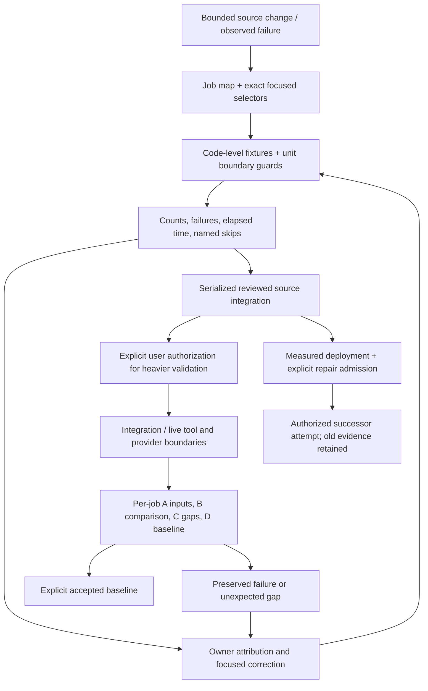

# Testing and operations

## As built today

The system has distinct code-level, integration, live and per-job acceptance boundaries.
[Testing architecture](testing.md#forward-contract-and-enforcement) is the single detailed home
for their forward rules, actual guards and unenforced portions. A successful unit test is not a
tool compatibility result, completed review or accepted finding.

The [job test map](../../tests/job-test-map.json) and
[selector](../../src/appsec_review/development/test_selection.py) enumerate intended coverage by
job/tier. Common contract cases do not replace handler coverage. The selector inspects metadata
without running a job; a generated command is not permission to execute a heavier tier.
The [root harness](../../tests/conftest.py) controls scratch paths, collection exclusions,
environment preflight, shuffle and timing reports. The
[unit guard](../../tests/unit/conftest.py) intercepts selected external boundaries under the
unit directory; it is not an operating-system sandbox.

[Phase budgets](../../tests/time_budgets.py) check elapsed setup/call/teardown after phases return.
They do not interrupt a hung phase. Legacy root/area test locations do not automatically inherit
the unit-directory guard or budget. [T-113](../TODO.md) migrates these files job by job without
calling heavyweight execution a unit test.

The [test wrapper](../../scripts/run-tests.sh) delegates to
[`ops_tests.py`](../../deploy/dagster/bin/ops_tests.py) and its
[supervisor](../../deploy/dagster/bin/ops_test_guard.py). It pins selector/count admission,
owns scratch/report paths and process cleanup, applies the selected deadline and emits a fixed
report. Baseline differentials attribute new/fixed/unchanged failures without deciding their cause.
The implementation does not make every stated whole-suite or authorization rule unavoidable.

Operational acceptance follows the [walk charter](../processes/walk-charter.md), not a green
dashboard. Each job requires verified admitted inputs, independent comparison, canonical gap
reconciliation and an explicitly accepted baseline. Host-local walk terms/state are not portable
repository instructions. A previously observed gap is not automatically expected for a different
walk, target or job.

Recovery keeps observation, code repair, source deployment and restart admission separate.
[Recovery operations](../operations/recovery-repair.md) preserve failed evidence and exact
implementation provenance before an authorized successor attempt.
[Images and deployment](images-and-deployment.md) explains why application-source reload and image
rebuild are different actions. Neither a repair nor this documentation authorizes a live restart.
Shared-host checkout/environment and serialized integration custody remain governed by
[`AGENTS.md`](../../AGENTS.md).

## Decisions

| Date | Retained record | Current consequence |
|---|---|---|
| 2026-11-12 | [T-113 and its dated tier-walk record](../TODO.md), [test-tier walk prompt](../processes/test-tier-walk-prompt.md) | Code-level units use canned fixtures; external engines/tools/models belong to separately authorized tiers. |
| 2026-11-13 | [Documentation program, Stage 5](../tasks/2026-11-13-docs-program-prompt.md#stage-5-testing-as-a-forward-contract) | Each testing promise names its real enforcement or an explicit TODO; a procedural rule is not reported as an implemented guard. |

## Named gaps

- [T-109](../TODO.md) owns hard run ceilings and the whole-unit-suite timing contract.
- [T-113](../TODO.md) owns the ongoing per-job migration and recertification of legacy tests.
- [T-158](../TODO.md) owns the specifically documented enforcement gaps: finite unit interception,
  serial guard omission, procedural authorization/ordering rules and stale timing-test
  expectations. The detailed table in `testing.md` identifies each source boundary.
- [T-148](../TODO.md) records the exact unavailable archive-link coverage; that named skip is not
  a successful historical-document check.

No integration, acceptance, live review or deployment result is claimed by this documentation
program's offline checks.

## Jobs and pages

| Work | Current home |
|---|---|
| Select a job's declared tests | [Generated inventory](../generated/inventory.json), [job map](../../tests/job-test-map.json) |
| Explain real job behavior and its acceptance evidence | [Canonical operations pages](../operations/README.md) |
| Write and run focused unit regressions | [Testing contract and working loop](testing.md#working-loop), [job-pass checklist](../processes/job-pass-checklist.md) |
| Decide a walk's result | [Four acceptance checks](../processes/walk-charter.md#5-accepting-a-job-the-four-checks) |
| Diagnose and admit recovery | [Recovery runbook](../operations/recovery-repair.md), [runtime interchange](runtime-interchange.md) |
| Deploy changed source/tooling | [Images and deployment](images-and-deployment.md), [source-mount contract](deployment-image-and-source-mount.md) |

## Dataflow

