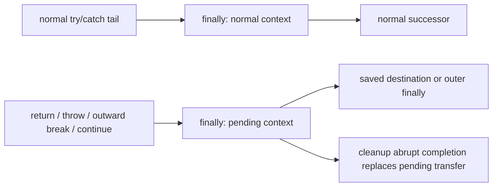

# Tree-sitter AST production

`job_tree_sitter_ast` is an independent syntax producer. It consumes the accepted review-intake
target snapshot and target-catalog ownership/topology handoffs, plus accepted language-build
outputs when that producer is enabled. It does not consume CodeQL, compiler AST/IR, SAST, or
inference output. Source-only graphs retain their original prerequisites.

The planner assigns only accepted inventory files to the most-specific accepted component and
build/source root, then partitions them by language and locked grammar. Each partition has a stable
scope identity and fingerprint over the target snapshot, exact source hashes, accepted exclusions,
declared grammar-lock metadata, container execution image ID, normalizer version, and bounds.
Changing one partition therefore invalidates only that partition.

Workspace-only generated source uses a bounded lane of accepted artifact identities, not a
workspace scan. Receipt/manifest validation binds selected customer bytes to their producer;
detached read-only copies back explicit generated logical paths. Scope and source-backing
provenance flow through AST/source entities and prioritization into source resolution. Retrieval
checks the accepted backing's run, target, canonical artifact, hash, size and custody, never
falling back to a similarly named target file. Supplied-platform roles are excluded before payload
access. Generated origin alone neither excludes source nor proves delivery; unresolved shipping
relationships remain gaps.

Large language partitions are deterministically chunked by configured file-count and source-byte
ceilings. The parser additionally enforces per-file bytes and nodes plus a total node ceiling for
the invocation, keeping container memory, output, and retry work bounded without silently dropping
the remainder.

The only production parser is `tool-tree-sitter`. Its image is assembled from a digest-pinned
Python base, hash-locked wheels, and pre-generated Linux grammar libraries. Image assembly verifies
every cached byte. Review execution is non-root, read-only, network-disabled, capability-free, and
bounded by the central container policy; it cannot download or compile grammars.
Those acquisition checks are platform maintenance, not customer-review payload fingerprinting.

The supported grammar contract is closed and identical across planner, parser routing, acquisition,
and the asset lock: C, C++, C#, Go, Java, JavaScript, Kotlin, PHP, PowerShell, Python, Ruby, Rust, Shell,
TSX, and TypeScript (plus the C/C++ catalog alias). Shell routes to the upstream Bash grammar.
Each library is pinned by upstream revision, SHA-256, size, and license. Catalog languages outside
that set, currently including Swift, continue through publication as explicit unavailable
coverage rather than a fallback parse.

Each successful scope emits:

- an immutable normalized AST JSONL shard;
- an immutable generic `analysis` SQLite retrieval shard;
- canonical AST-node identities and exact source locations;
- grammar-native node type and named/error/missing/extra flags;
- exact parent/child ordering and field relations;
- parse diagnostics, exclusions, counts, truncation, and container execution identity.

The nodes are concrete syntax, not semantic symbols. Consumers use the existing retrieval search,
find, trace, source-resolution, and coverage APIs, plus `query_syntax` through the retrieval core,
external MCP or the application-authorized in-process review loop.
`job_review_prioritization` rebuilds per-file trees from the accepted JSONL shards to derive
function complexity, imports, and heuristic signals; see
[`review-prioritization.md`](review-prioritization.md).
Unsupported languages, unavailable grammars, parser failures, malformed syntax, and bounds are
explicit coverage gaps. A failed scope does not discard successful sibling shards. Framework
integrity failures—changed accepted bytes, escaped paths, image/hash mismatch, corrupt outputs, or
invalid manifests—stop publication.

## Bounded syntax navigation

The host normalizer rereads only accepted files through hash-verified source custody and adds
`appsec-review/syntax-projection/1` to selected canonical AST nodes. It does not parse again or
require a build. Written names, exact name spans, syntactic enclosing-definition identities and
qualifier chains complement the existing node span, source hash, scope, language and grammar.
A partial SQLite expression index on source identity, category and written name bounds lookup;
the original AST JSONL, node types and parent relations remain available.

The initial explicit mappings cover C/C++, C#, Go, Java, JavaScript/TypeScript/TSX, Kotlin,
Python, Ruby, Rust and PHP. They are syntax subsets, not exhaustive language symbol tables.
PowerShell and Shell retain raw AST coverage with an unavailable projection mapping; Swift
still has no locked grammar and is not enabled. Names longer than 512 bytes are omitted.
Anonymous forms, local module resolution and semantic references remain gaps, not inferred facts.

`query_syntax(mode, subject, name?, limit?, cursor?)` accepts `definitions`, `calls`, `imports`
and `references`. The last mode means identifier occurrences, including defining occurrences,
not binding resolution. `name` matches the exact written spelling, without converting `.` or
`::`. A source-file identity bounds one immutable file; an AST subject further bounds the byte
span. Imports include syntactic declarations and known call forms, but never resolved module
edges. All names, imports and call targets are explicitly unresolved.

The existing exact source-file identities in a signed package/cell capability grant returned
nodes independently of CodeQL graph scopes. Only nodes actually returned become addressable
for subsequent source resolution; a filename, AST-kind prefix or sibling file is not a grant.
No SQL, path, glob, Tree-sitter query program or runtime source-tree scan is accepted.
Responses use the common manifest-bound cursors, page/time/byte limits and explicit coverage gaps.
Parse errors make per-file coverage partial. Scope-language metadata, including failed scopes,
drives the syntax language matrix; component-prefixed scope names are never parsed as languages.

Syntax nodes retain their existing evidence-admission rules: direct evidence for an affected
construct, never direct dataflow, input control or guard sufficiency. A successful syntax fallback
does not repair missing CodeQL coverage. Projection version changes invalidate scope reuse.

## Intra-procedural CFG and guard polarity (T-169, T-5211)

In addition to structural AST projection, `job_tree_sitter_ast` builds deterministic syntactic
CFGs for supported function/control shapes in C/C++, Java, JavaScript/TypeScript, Python, Ruby,
Go, C#, Rust and PHP (with Kotlin function recognition). These are not exhaustive language
semantics or guard-sufficiency proofs. Per-scope `cfg-nodes.jsonl`, `cfg-edges.jsonl` and
`cfg-manifest.json` use `appsec-review/tree-sitter-cfg/1`; function entities in the accepted
`analysis` index retain the same CFG payload.

- Edges use `entry`, `true_branch`, `false_branch`, `unconditional`, `loop_back`, `break_edge`,
  `continue_edge`, `return_exit`, `exception_edge` and `fallthrough`.
- Guard classifications are `null_check`, `bounds_check`, `auth_or_role_check`,
  `error_return_guard`, `sanitization_guard` and `general_condition`. They describe the
  written predicate, not a resolved safety property.
- Rust executable `expression_statement` wrappers are lowered to their control expressions,
  including nested returns, loop breaks/continues and match-arm **values** (patterns are not
  executable bodies). Unconditional `loop` has no invented false exit. Control embedded in
  otherwise opaque value expressions, labeled jumps and match guards remain named partial
  coverage rather than guessed semantics.
- A post-test `do` loop enters the body before testing its condition; `continue` reaches the
  condition, while `break` bypasses it. Missing/parser-missing conditions are gaps, never
  guards reconstructed from body text.
- Return, throw, break and continue pass through every applicable `finally`. A local loop
  transfer staying inside a protected body does not run cleanup early. Cleanup completion
  resumes the saved destination; an abrupt completion in cleanup replaces it. Separate CFG
  copies of cleanup retain separate pending continuations, preventing a return from acquiring
  a path to the normal successor.
- Try regions retain conservative exception edges even without explicit calls or throws:
  property access and arithmetic can also throw. These region edges use the same pending
  completion routing through finally; they are an overapproximation, not exception-type
  resolution.

Function summaries expose `coverage_status`, `truncated`, `unmodeled_constructs` and `gaps`.
The 2,048-node cap includes entry/exit, branch/handler nodes and duplicated cleanup contexts;
exhaustion stops lowering without inventing a normal exit. Unknown modeled-region control
(including `goto`/labels) and missing conditions make that function partial. Partial CFGs
publish no guard-dominator claims. Scope/accepted counts include `cfg_partial_functions`,
`cfg_truncated_functions` and `cfg_unmodeled_constructs` (distinct construct kinds summed
per function); CFG gaps propagate through the
scope index identity to the accepted job result. Raw AST coverage remains independent:
`cfg:<source_identity>` may be partial while the source-file parse row is complete.

A source AST ordinal can correspond to several cleanup execution contexts. Its AST projection
must not select one copy's guard facts or merge their flow edges into cross-continuation paths.
Ambiguous AST-level flow edges/block IDs are omitted with a `cfg_ast_context_projection` gap
and partial `cfg-ast-projection:<function_id>` coverage; the context-specific CFG remains
available. Common source-occurrence guards are intersected across the copies.

Public `query_cfg_function` and `query_guard_dominators` retain their existing row shapes.
The response's existing `coverage_gaps` carries function incompleteness, raw parse gaps and
contextual AST-projection gaps. A mismatch between the producer's node/edge counts and the
indexed payload is an explicit `cfg_payload_incomplete` gap, without raising storage or query
bounds. Missing completeness metadata in an older payload is reported
as unknown, never silently complete. Incomplete/unknown CFGs or partial raw parses publish no
guard-dominator claims through these queries.

Line, AST-subject and source-file guard queries intersect guards across all CFG contexts of the
selected source occurrence, including contexts with no guards. Common guards must identify the
same source branch, arm and predicate; identical expression text alone is insufficient. A
deterministic representative node ID carries these common facts without introducing new result
fields. An explicitly requested CFG `node_id` retains that execution context's guards; full CFG
queries retain the separate nodes and edges. An unresolved AST subject never falls back to
unrelated functions.

CFG retrieval selects a bounded metadata page in SQLite before decoding function payloads.
Function pages materialize at most the requested `limit`; guard pages examine at most the
configured retrieval `max_results` candidate functions. An explicit block ID is filtered in
SQLite before loading its function. Across shards, metadata pages are merged and duplicate
function keys removed before payload access. SQLite execution deadlines still bound selector
work; these queries do not scan source trees.

Signed, request/manifest-bound keyset cursors order functions by path, start/end line and function
ID, then guard occurrences within each function by start/end line and node ID. Continuations
retain the last returned occurrence when the response byte budget withholds trailing results.
Guard pages can be empty when their candidate budget is exhausted: the advancing cursor and
explicit gap require continuation, not a conclusion of absence. Coverage gaps are page-local;
they describe examined functions, not unvisited functions on later pages.

Scope checkpoints bind `cfg_builder.algorithm` (`appsec-review/tree-sitter-cfg-builder/1`) and
the builder's actual `max_nodes_per_function` in their fingerprint and metadata. Builder semantics
have their own identity, separate from the unchanged CFG and normalizer domain schemas. A changed
algorithm or node bound selects new artifact paths rather than reusing/overwriting the old
checkpoint. A hash-valid checkpoint under the current key with missing/mismatched builder metadata
is rejected, not relabeled. Future lowering changes must advance the builder identity.

`job_code_graph_index` consumes these indexed CFGs alongside other admitted graph evidence;
successful parsing or a nonempty graph does not establish complete control flow.
