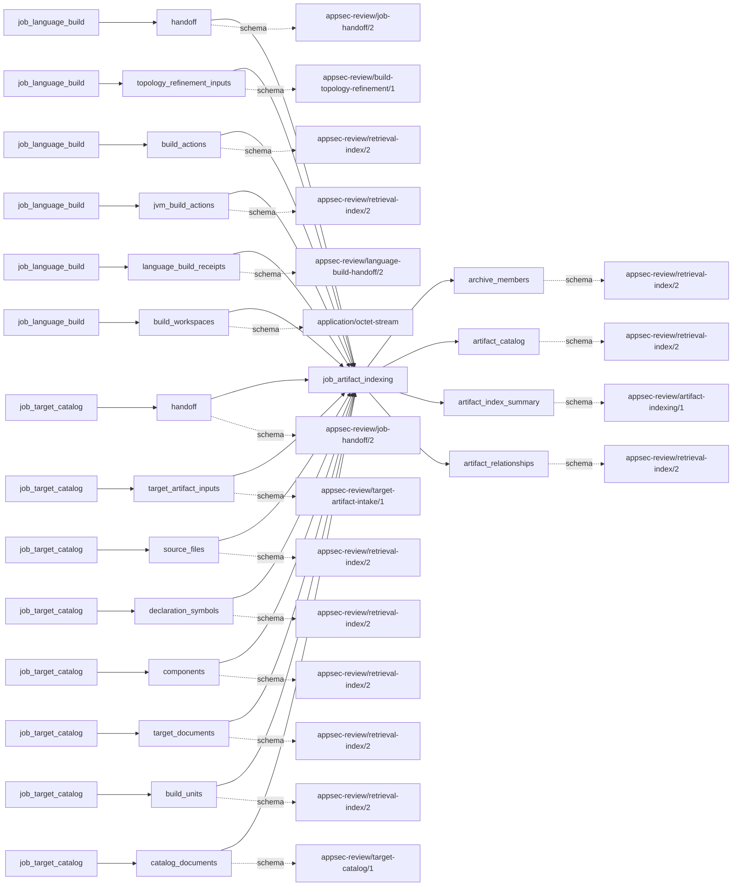
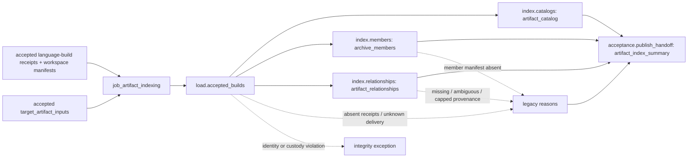

# artifact_indexing

## Purpose

Give accepted build outputs and separately admitted target artifacts stable retrieval identities,
archive-member membership and bounded producing/linking relationships. The question is what bytes
were retained and how strongly their provenance is known, not whether an artifact is safe,
delivered to production, or uniquely attributable to a compiler action.

<!-- generated:begin job=job_artifact_indexing -->
<!-- generated from: appsec-review.toml, containers/catalog.toml, pipeline/guidance/registry.json, tests/job-test-map.json, src/appsec_review/runtime/registry.py, src/appsec_review/runtime/contracts.py, src/appsec_review/runtime/datasets.py, src/appsec_review/guidance/workers.py, src/appsec_review/mcp/schema.py, src/appsec_review/orchestration/topology.py, src/appsec_review/orchestration/dagster/adapter.py by scripts/generate-docs.py; do not edit -->
## Declared job contract

artifact_indexing

Job: `job_artifact_indexing`. Enabled in the dev recipe: **true**.
Declarations describe possible work, not successful execution or consumed evidence.

### Steps and tasks

| Step | Task | Workers | Pool | Bound tool or gap | Handler |
| --- | --- | --- | --- | --- | --- |
| `acceptance` | `acceptance.publish_handoff` | 1 | `application` | Undeclared ([T-147](../TODO.md)) | [source](../../src/appsec_review/jobs/job_artifact_indexing/job.py#L1004) |
| `index` | `index.catalogs` | 1 | `application` | Undeclared ([T-147](../TODO.md)) | [source](../../src/appsec_review/jobs/job_artifact_indexing/job.py#L591) |
| `index` | `index.members` | 1 | `application` | Undeclared ([T-147](../TODO.md)) | [source](../../src/appsec_review/jobs/job_artifact_indexing/job.py#L783) |
| `index` | `index.relationships` | 1 | `application` | Undeclared ([T-147](../TODO.md)) | [source](../../src/appsec_review/jobs/job_artifact_indexing/job.py#L906) |
| `load` | `load.accepted_builds` | 1 | `application` | Undeclared ([T-147](../TODO.md)) | [source](../../src/appsec_review/jobs/job_artifact_indexing/job.py#L980) |

### Accepted input declarations

| Producer | Dataset | Schema | Channel | Availability | Missing policy |
| --- | --- | --- | --- | --- | --- |
| `job_language_build` | `handoff` | `appsec-review/job-handoff/2` | handoff | required | reject |
| `job_language_build` | `topology_refinement_inputs` | `appsec-review/build-topology-refinement/1` | handoff | optional | gap |
| `job_language_build` | `build_actions` | `appsec-review/retrieval-index/2` | handoff | optional | gap |
| `job_language_build` | `jvm_build_actions` | `appsec-review/retrieval-index/2` | handoff | optional | gap |
| `job_language_build` | `language_build_receipts` | `appsec-review/language-build-handoff/2` | handoff | required | reject |
| `job_language_build` | `build_workspaces` | `application/octet-stream` | handoff | optional | gap |
| `job_target_catalog` | `handoff` | `appsec-review/job-handoff/2` | handoff | optional | gap |
| `job_target_catalog` | `target_artifact_inputs` | `appsec-review/target-artifact-intake/1` | handoff | optional | gap |
| `job_target_catalog` | `source_files` | `appsec-review/retrieval-index/2` | handoff | optional | gap |
| `job_target_catalog` | `declaration_symbols` | `appsec-review/retrieval-index/2` | handoff | optional | gap |
| `job_target_catalog` | `components` | `appsec-review/retrieval-index/2` | handoff | optional | gap |
| `job_target_catalog` | `target_documents` | `appsec-review/retrieval-index/2` | handoff | optional | gap |
| `job_target_catalog` | `build_units` | `appsec-review/retrieval-index/2` | handoff | optional | gap |
| `job_target_catalog` | `catalog_documents` | `appsec-review/target-catalog/1` | handoff | optional | gap |

### Published dataset declarations

| Dataset | Step | Schema | Stage | Indexes | MCP route |
| --- | --- | --- | --- | --- | --- |
| `archive_members` | `index` | `appsec-review/retrieval-index/2` | indexed | `artifacts` | `query_artifacts` |
| `artifact_catalog` | `index` | `appsec-review/retrieval-index/2` | indexed | `artifacts` | `query_artifacts`, `query_precomputed` |
| `artifact_index_summary` | `acceptance` | `appsec-review/artifact-indexing/1` | artifact_only | Not indexed | `coverage`, `query_dataset_inventory` |
| `artifact_relationships` | `index` | `appsec-review/retrieval-index/2` | indexed | `artifacts` | `query_artifacts`, `trace` |

Protected and artifact-only routes expose sanitized metadata, not payload access.

### Model and guidance declarations

No job-level model declaration; absence of a task binding remains [T-147](../TODO.md), not a nonexecution claim.

### Test selection

| Tier | Files or selectors |
| --- | --- |
| acceptance | `tests/acceptance/job_artifact_indexing/test_artifact_index_shard_layout.py` `tests/acceptance/test_dependency_output_bounds.py::test_artifact_index_count_is_bounded_by_the_classified_catalog` |
| integration | `tests/integration/job_artifact_indexing/test_artifact_indexing_graph.py` `tests/integration/job_artifact_indexing/test_artifact_indexing_throughput.py` `tests/integration/job_artifact_indexing/test_artifact_input_contracts.py` `tests/integration/job_artifact_indexing/test_artifact_indexing_scale.py` |
| live | None declared |
| unit | `tests/unit/job_artifact_indexing/test_contract.py` `tests/unit/job_artifact_indexing/test_handler_wiring.py` `tests/unit/job_artifact_indexing/test_job_graph.py` `tests/unit/job_artifact_indexing/test_identities.py` `tests/unit/job_artifact_indexing/test_receipt_validation.py` `tests/unit/job_artifact_indexing/test_target_artifacts.py` `tests/unit/job_artifact_indexing/test_catalogs.py` `tests/unit/job_artifact_indexing/test_members.py` `tests/unit/job_artifact_indexing/test_relationships.py` `tests/unit/job_artifact_indexing/test_shards.py` |

### Dagster placement

Dispatch: `review_graph`. Review graph member: **true**. Enabled graph member: **true**.

Declared predecessors: `job_language_build`.

### Declared dataflow

<!-- generated:end -->

## Process

The [handler](../../src/appsec_review/jobs/job_artifact_indexing/job.py) consumes receipts and
member manifests; it does not unpack archives or invoke a scanner. Generated tool bindings remain
[T-147](../TODO.md).

### `load`

1. Load accepted language-build publication and its bound verified manifest. Require this target
   snapshot; validate receipt schema and unique build-unit identities.
2. For unsuccessful receipts, retain reasons but require no published artifacts. For successful
   receipts verify the workspace manifest, every artifact's canonical workspace path, bytes,
   size and manifest membership, including retained shared-object references.
3. Validate Node-specific build-unit, exact-mapping, origin and package-integrity metadata. Reject
   duplicate canonical artifacts or inconsistent receipt identities; these are integrity failures.
4. Optionally read accepted target-artifact intake from the catalog. Require target-intake origin,
   unknown scope/delivery status, exact target mapping and retained-object custody; attach catalog
   provenance. Missing/legacy inventory and unknown delivery are explicit reasons.

### `index`

1. In `index.catalogs`, group each receipt's validated artifacts by family and publish one catalog
   shard per family. Publish a separate target-intake shard with partial delivery coverage.
2. In `index.members`, join receipt `package_members` by package path, never scan an archive.
   Validate member paths/size/identity, reject duplicate members and create `CONTAINS` edges.
   Missing member manifests remain coverage gaps.
3. In `index.relationships`, join artifacts to recorded actions and output invocations. Preserve
   exact versus heuristic attribution. Prefer exact link inputs, deduplicate link edges and retain
   only bounded provenance observations. If no action maps but actions exist, relate to every
   candidate with low confidence and an ambiguity reason; if none exist, record missing provenance.
4. Greedily pack sorted member/relationship rows into deterministic build-unit batches bounded by
   artifact and row counts. A single oversized artifact occupies its own batch: the packing target
   is not a hard per-artifact row cap. Under a shard lock, verify metadata and SQLite integrity
   before reusing a completed shard, otherwise build it.

### `acceptance`

1. Replace inherited artifacts indices with the newly built set while preserving other index names.
   Write and verify `artifact-indexing-<attempt>.json`.
2. Write `accepted-index.json` with upstream handoff hashes, target artifacts, artifact/shard/reused
   counts and deduplicated reasons. Item count is shards, not artifacts; reasons yield
   completed-with-gaps.

## Dataflow

## Gaps

This job emits legacy reasons; [interchange](../architecture/job-interchange.md#the-control-layer-beneath-the-envelope)
wraps them as `producer_reported_gap`, normally non-retryable. That bit does not make them advisory.

- Input absent/failed: no accepted receipts, successful build without artifact entries, unavailable
  target intake, legacy catalog without target inventory, inherited build/catalog reasons and
  missing archive-member manifest.
- Coverage missing: unknown target-artifact delivery, ambiguous producing-action mapping, no
  producing-action receipt and link provenance exceeding its observation bound.
- Invalid schema, duplicate unit/artifact/member, escaping path, missing/changed artifact or
  workspace manifest, invalid Node integrity metadata and corrupt existing shards raise
  `ArtifactIndexIntegrityError`. Lock exhaustion is an execution failure, not a clean empty index.

Archive-intake omissions are inherited rather than repaired here. A known missing member manifest
does not imply approval by the current walk.

## Acceptance

1. **A. Inputs:** Match language-build and optional catalog handoff pins, workspace manifests and
   shared-object references; ensure unsuccessful receipts contributed no artifact bytes.
2. **B. Independent comparison:** Count receipt artifacts by build unit/family and target inventory
   entries independently; compare canonical identities, hashes and sizes. Count package-member
   rows and `CONTAINS` edges, then check a producing/link edge against its exact invocation
   inputs/outputs and confidence. Compare logical counts separately from batch-shard counts.
3. **C. Gaps:** Group verified outcome records and reconcile inherited failures, unknown delivery,
   missing members and ambiguous/capped provenance against receipts and the approved expected list.
4. **D. Baseline:** At authorized acceptance save `stepwise.py accept`, corpus namespace and baseline
   with artifact/member/relationship identities and shard counts. No live acceptance is claimed here.

## Resume and invalidation

Catalog fingerprints bind snapshot, artifact path/hash/size/family, producing actions and
invocations, dependencies, toolchain/image and parser/extractor/normalizer/mapping identities.
Member/relationship batches also bind layout and row content; target-intake fingerprints bind its
accepted records. Unchanged batches reuse verified immutable SQLite shards; changed membership
can repartition later batches without invalidating unrelated build units. See
[accepted index sets](../architecture/python-and-retrieval.md#accepted-index-sets) and
[input read receipts](../architecture/job-input-contracts.md#admission-and-read-receipts) for the
shared boundaries.
