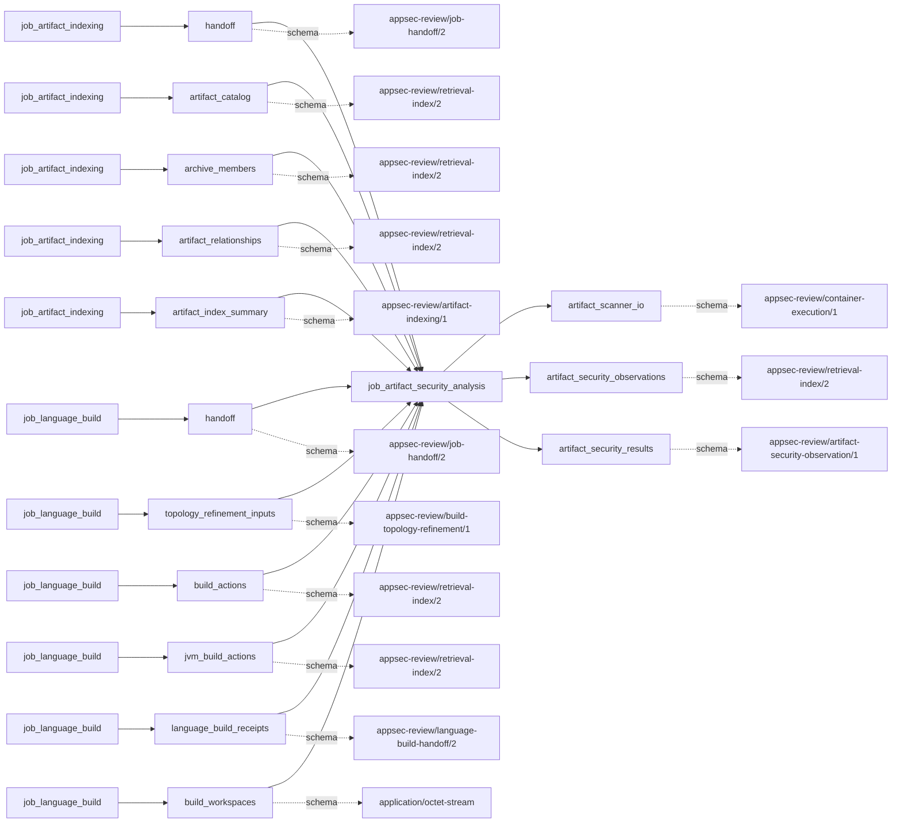
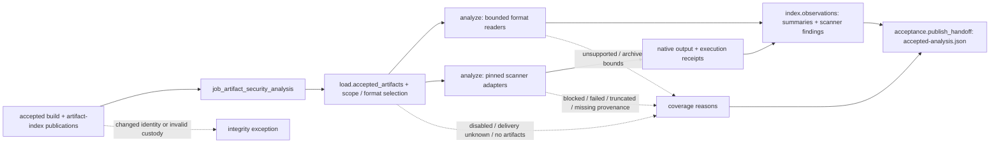

# artifact_security_analysis

## Purpose

Inspect accepted produced and target-intake artifacts with bounded format readers and applicable
pinned scanners, retaining what each scan actually examined and reported. The job separates scan
summaries, package inventory and scanner finding records. None is an adjudicated security finding;
unknown delivery, unsupported formats, disabled scanners or empty results do not prove an artifact
is safe or deployed.

<!-- generated:begin job=job_artifact_security_analysis -->
<!-- generated from: appsec-review.toml, containers/catalog.toml, pipeline/guidance/registry.json, tests/job-test-map.json, src/appsec_review/runtime/registry.py, src/appsec_review/runtime/contracts.py, src/appsec_review/runtime/datasets.py, src/appsec_review/guidance/workers.py, src/appsec_review/mcp/schema.py, src/appsec_review/orchestration/topology.py, src/appsec_review/orchestration/dagster/adapter.py by scripts/generate-docs.py; do not edit -->
## Declared job contract

artifact_security_analysis

Job: `job_artifact_security_analysis`. Enabled in the dev recipe: **true**.
Declarations describe possible work, not successful execution or consumed evidence.

### Steps and tasks

| Step | Task | Workers | Pool | Bound tool or gap | Handler |
| --- | --- | --- | --- | --- | --- |
| `acceptance` | `acceptance.publish_handoff` | 1 | `application` | Undeclared ([T-147](../TODO.md)) | [source](../../src/appsec_review/jobs/job_artifact_security_analysis/job.py#L795) |
| `analyze` | `analyze.blint` | 1 | `application` | Undeclared ([T-147](../TODO.md)) | [source](../../src/appsec_review/jobs/job_artifact_security_analysis/job.py#L596) |
| `analyze` | `analyze.grype` | 1 | `application` | Undeclared ([T-147](../TODO.md)) | [source](../../src/appsec_review/jobs/job_artifact_security_analysis/job.py#L596) |
| `analyze` | `analyze.inventory` | 1 | `application` | Undeclared ([T-147](../TODO.md)) | [source](../../src/appsec_review/jobs/job_artifact_security_analysis/job.py#L596) |
| `analyze` | `analyze.jvm` | 1 | `application` | Undeclared ([T-147](../TODO.md)) | [source](../../src/appsec_review/jobs/job_artifact_security_analysis/job.py#L596) |
| `analyze` | `analyze.native` | 1 | `application` | Undeclared ([T-147](../TODO.md)) | [source](../../src/appsec_review/jobs/job_artifact_security_analysis/job.py#L596) |
| `analyze` | `analyze.osv` | 1 | `application` | Undeclared ([T-147](../TODO.md)) | [source](../../src/appsec_review/jobs/job_artifact_security_analysis/job.py#L596) |
| `analyze` | `analyze.packages` | 1 | `application` | Undeclared ([T-147](../TODO.md)) | [source](../../src/appsec_review/jobs/job_artifact_security_analysis/job.py#L596) |
| `analyze` | `analyze.spotbugs` | 1 | `application` | Undeclared ([T-147](../TODO.md)) | [source](../../src/appsec_review/jobs/job_artifact_security_analysis/job.py#L596) |
| `analyze` | `analyze.syft` | 1 | `application` | Undeclared ([T-147](../TODO.md)) | [source](../../src/appsec_review/jobs/job_artifact_security_analysis/job.py#L596) |
| `analyze` | `analyze.wasm` | 1 | `application` | Undeclared ([T-147](../TODO.md)) | [source](../../src/appsec_review/jobs/job_artifact_security_analysis/job.py#L596) |
| `index` | `index.observations` | 1 | `application` | Undeclared ([T-147](../TODO.md)) | [source](../../src/appsec_review/jobs/job_artifact_security_analysis/job.py#L710) |
| `load` | `load.accepted_artifacts` | 1 | `application` | Undeclared ([T-147](../TODO.md)) | [source](../../src/appsec_review/jobs/job_artifact_security_analysis/job.py#L589) |

### Accepted input declarations

| Producer | Dataset | Schema | Channel | Availability | Missing policy |
| --- | --- | --- | --- | --- | --- |
| `job_artifact_indexing` | `handoff` | `appsec-review/job-handoff/2` | handoff | required | reject |
| `job_artifact_indexing` | `artifact_catalog` | `appsec-review/retrieval-index/2` | handoff | optional | gap |
| `job_artifact_indexing` | `archive_members` | `appsec-review/retrieval-index/2` | handoff | optional | gap |
| `job_artifact_indexing` | `artifact_relationships` | `appsec-review/retrieval-index/2` | handoff | optional | gap |
| `job_artifact_indexing` | `artifact_index_summary` | `appsec-review/artifact-indexing/1` | handoff | required | reject |
| `job_language_build` | `handoff` | `appsec-review/job-handoff/2` | handoff | required | reject |
| `job_language_build` | `topology_refinement_inputs` | `appsec-review/build-topology-refinement/1` | handoff | optional | gap |
| `job_language_build` | `build_actions` | `appsec-review/retrieval-index/2` | handoff | optional | gap |
| `job_language_build` | `jvm_build_actions` | `appsec-review/retrieval-index/2` | handoff | optional | gap |
| `job_language_build` | `language_build_receipts` | `appsec-review/language-build-handoff/2` | handoff | required | reject |
| `job_language_build` | `build_workspaces` | `application/octet-stream` | handoff | optional | gap |

### Published dataset declarations

| Dataset | Step | Schema | Stage | Indexes | MCP route |
| --- | --- | --- | --- | --- | --- |
| `artifact_scanner_io` | `analyze` | `appsec-review/container-execution/1` | protected | Not indexed | `coverage`, `query_dataset_inventory` |
| `artifact_security_observations` | `index` | `appsec-review/retrieval-index/2` | indexed | `observations` | `query_artifacts`, `query_precomputed` |
| `artifact_security_results` | `analyze` | `appsec-review/artifact-security-observation/1` | artifact_only | Not indexed | `coverage`, `query_dataset_inventory` |

Protected and artifact-only routes expose sanitized metadata, not payload access.

### Model and guidance declarations

No job-level model declaration; absence of a task binding remains [T-147](../TODO.md), not a nonexecution claim.

### Test selection

| Tier | Files or selectors |
| --- | --- |
| acceptance | `tests/acceptance/test_dependency_output_bounds.py::test_blint_reviews_production_dependency_binaries_but_not_build_only_ones` |
| integration | `tests/integration/test_installer_record_scans.py` `tests/integration/job_artifact_indexing/test_artifact_input_contracts.py` |
| live | None declared |
| unit | `tests/test_artifact_security_analysis.py` |

### Dagster placement

Dispatch: `review_graph`. Review graph member: **true**. Enabled graph member: **true**.

Declared predecessors: `job_artifact_indexing`.

### Declared dataflow

<!-- generated:end -->

## Process

Source: [handler graph](../../src/appsec_review/jobs/job_artifact_security_analysis/job.py),
[format readers](../../src/appsec_review/jobs/job_artifact_security_analysis/formats.py),
[scanner adapters](../../src/appsec_review/jobs/job_artifact_security_analysis/scanners.py) and
[record splitting](../../src/appsec_review/jobs/job_artifact_security_analysis/findings.py).
Generated task/tool bindings remain [T-147](../TODO.md); the following follows executed handlers.

### `load`

1. Read accepted language-build and artifact-index publications. Require matching build-handoff
   and snapshot identities; verify the artifact manifest before reading payloads.
2. Verify each receipt artifact and derive its canonical artifact identity. Reject platform
   content entering the customer-artifact contract. Deduplicate build artifacts by retained
   path/hash, not by filename alone.
3. Validate target-intake provenance against the catalog handoff, unknown scope/delivery policy and
   retained-object custody. Preserve producer and delivery reasons; no artifacts is a named gap.
   This is an [accepted-input read](../architecture/job-input-contracts.md#admission-and-read-receipts),
   not a scan of arbitrary workspace files.

### `analyze`

1. For each capability, apply artifact delivery/scope policy and classify verified bytes.
   Partition declared scanner input support before launch. Unsupported inputs are `SKIPPED_NA`;
   policy exclusions remain scope dispositions. Configured-disabled Grype runs nothing and
   records unavailable vulnerability coverage.
2. For installer-record scanners, select a verified installer record once and relate covered
   installed-package anchors to it. Avoid repeated package scans where that record supplies
   coverage; preserve dev-package omissions, incomplete record scans and unreported Syft anchors.
3. Fingerprint each selected artifact/capability using accepted artifact/build/index identities,
   classification, delivery policy, scanner/tool releases and settings. Reuse only eligible
   checkpoints with verified raw and native references.
4. Run inventory/native/JVM/package/Wasm built-ins as bounded byte readers. Archive inspection
   enforces member, expanded-byte, member-byte, ratio, path and depth policy without executing
   members. Native/JVM header facts do not substitute for scanner rules; Wasm parsing does not
   supply a feature-policy verdict.
5. Otherwise invoke the pinned SpotBugs, blint, Syft, Grype or OSV adapter. Resolve the executed
   tool identity before fingerprinting and reject identity disagreement afterward. Preserve
   timeout, exit, precondition and parser failures; OSV's documented unsupported-input result is
   a skip, not a clean vulnerability match.
6. Bound stdout/stderr, diagnostic tails and exact parser input independently. Retain native output,
   execution receipt and supported native report references. Missing provenance, malformed output,
   truncated parser/report data or absent blint per-binary output yields reasons; oversized parser
   input cannot remain usable observations. Execution-safety may stop before fallback publication.

### `index`

1. Gather capability results and split each scan into one summary plus bounded individual
   scanner finding records where a splitter exists. Built-in and Syft inventory are not made into
   synthetic vulnerability findings. Record finding truncation and incomplete scan outcomes.
2. Validate exact [native-result provenance](../architecture/job-interchange.md#native-result-and-common-observation).
   Index artifact and observation entities with `OBSERVED_AT` edges to artifacts, not invented
   source locations. Installer-record findings also reference verified matching package anchors.
3. Fingerprint the observations shard from scan fingerprints, splitting normalizer and upstream
   artifact manifest. Compose it with inherited indices, replacing only this shard, and verify
   the full manifest.

### `acceptance`

1. Publish `accepted-analysis.json` with upstream identities, artifact count, scan-result count,
   finding-record count, capability dispositions, installer-record coverage, reasons and manifest.
2. Distinguish `observation_count` here (scan results) from individual indexed finding records.
   Any retained reason yields completed-with-gaps; publication does not adjudicate exploitability.

## Dataflow

## Gaps

The handler emits legacy reasons, not source-emitted canonical code strings.
[Interchange](../architecture/job-interchange.md#the-control-layer-beneath-the-envelope) wraps them
as `producer_reported_gap` with default non-retryable metadata; non-retryable does not mean advisory.

- Input absent/failed: no target/produced artifacts, inherited build/index gaps, missing scanner
  executor or offline vulnerability-data prerequisites. Unknown delivery is a coverage limitation,
  not proof that the artifact is irrelevant.
- Present but unsupported: native symbol/import/loader/hardening facts requiring pinned tooling,
  JVM security rules beyond header inspection, Wasm policy requiring a validator, unsupported
  capability/format combinations and package vulnerability matching requiring scanner/data.
  Declared unsupported scanner inputs remain separate skip decisions.
- Coverage missing: disabled Grype; archive member/count/byte/expansion/path/depth restrictions,
  malformed or truncated archive/header/Wasm input; diagnostic/parser/report/finding bounds;
  no exact parser input or verified execution receipt; missing blint analysis; Grype dev-only
  installer packages, incomplete installer-record scans and Syft anchors not reported.
- Tooling failure: unavailable image/tool, timeout, nonaccepted exit, parse/assembly failure or
  incompatible output. Received diagnostics remain bounded retained artifacts.
- Accepted provenance/hash mismatch, scope-policy violation, changed executed tool identity or
  unexpected native report reference raises `FrameworkIntegrityError`; it is not successful
  gap publication.

For a walk, verify each actual cause and its lost capability against the user-approved expected
list. Broader produced-artifact Grype optimization and acceptance obligations are tracked in
[T-010](../TODO.md), not a blanket approval for package omissions.

## Acceptance

1. **A. Inputs:** Match build/index/catalog handoff pins and artifact hashes, origins and canonical
   identities. Reconcile selected/skipped scope dispositions and installer-record anchor mappings.
2. **B. Independent comparison:** Count verified artifacts and scanner launches independently.
   Compare retained native SpotBugs/blint/Grype/OSV results with summary and finding-record counts
   and selectors; compare Syft name/version pairs with verified package anchors. Independently
   check archive member counts and one artifact-to-observation edge; do not require a source span
   for artifact-native findings.
3. **C. Gaps:** Group verified outcome records by code and retained reason; reconcile limits,
   disabled/unsupported scans, failed receipts, unknown delivery and installer omissions with raw
   evidence and the approved expected list.
4. **D. Baseline:** At authorized acceptance save `stepwise.py accept`, corpus namespace and baseline
   with artifact identities, scan/finding counts and capability coverage. No live scan or acceptance
   is claimed by this documentation.

## Resume and invalidation

Per-artifact/capability checkpoints bind artifact bytes and canonical identity, producer/build
handoff, upstream artifact manifest, classification/delivery scope, scanner/resolved tool identity,
required component releases, parser/normalizer and settings; installer presentation also binds
record-scanning inputs. Changed artifact or capability inputs rebuild the affected scan; a
record-splitting-only change rebuilds the observation shard without inherently rerunning scanners.
Gap-bearing scan results may be checkpointed; eligibility requires declared releases and verified
raw/native artifacts, not simply a prior success flag. Disabled Grype bypasses reuse.

Shared runtime reuse, [image pins](image-pin-verification.md), [signing](signing.md) and
[manifest composition](../architecture/python-and-retrieval.md#accepted-index-sets) remain separate
boundaries. Language/applicability metadata incompleteness remains [T-157](../TODO.md).
