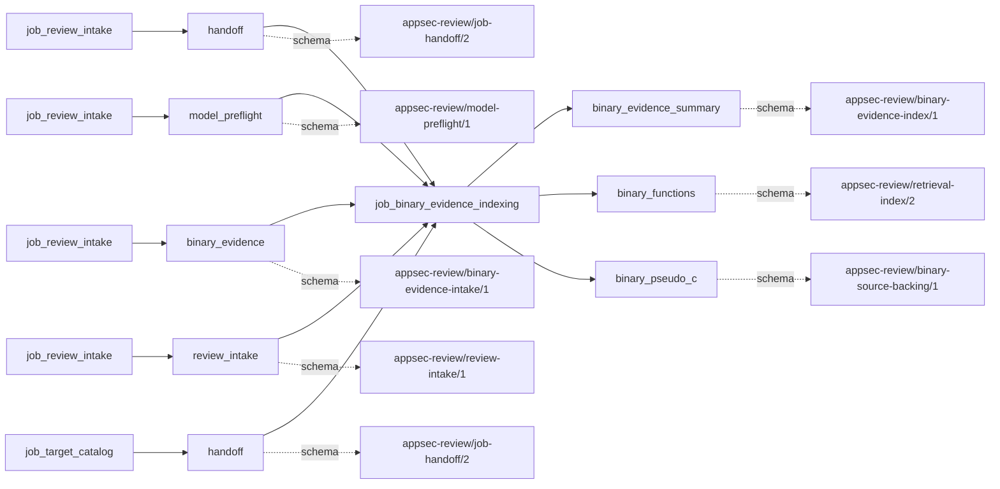
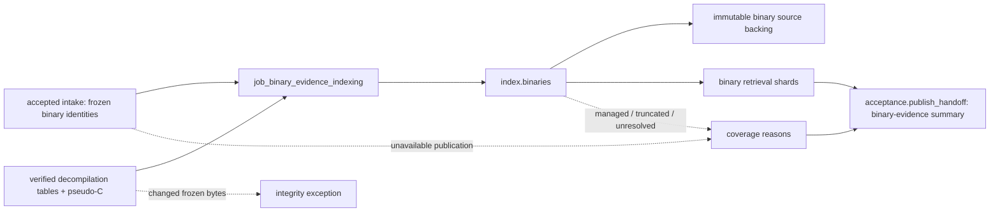

# binary_evidence_indexing

## Purpose

Make intake-frozen binary decompilation publications retrievable as binary functions, calls,
imports and strings, with pseudo-C locations where supportable. This job does not decompile a
binary, apply debug symbols, establish original-source equivalence, or make vulnerability
findings. Managed-code functions are retained as unlocated metadata, not native pseudo-C evidence.

<!-- generated:begin job=job_binary_evidence_indexing -->
<!-- generated from: appsec-review.toml, containers/catalog.toml, pipeline/guidance/registry.json, tests/job-test-map.json, src/appsec_review/runtime/registry.py, src/appsec_review/runtime/contracts.py, src/appsec_review/runtime/datasets.py, src/appsec_review/guidance/workers.py, src/appsec_review/mcp/schema.py, src/appsec_review/orchestration/topology.py, src/appsec_review/orchestration/dagster/adapter.py by scripts/generate-docs.py; do not edit -->
## Declared job contract

binary_evidence_indexing

Job: `job_binary_evidence_indexing`. Enabled in the dev recipe: **true**.
Declarations describe possible work, not successful execution or consumed evidence.

### Steps and tasks

| Step | Task | Workers | Pool | Bound tool or gap | Handler |
| --- | --- | --- | --- | --- | --- |
| `acceptance` | `acceptance.publish_handoff` | 1 | `application` | Undeclared ([T-147](../TODO.md)) | [source](../../src/appsec_review/jobs/job_binary_evidence_indexing/job.py#L402) |
| `index` | `index.binaries` | 1 | `application` | Undeclared ([T-147](../TODO.md)) | [source](../../src/appsec_review/jobs/job_binary_evidence_indexing/job.py#L388) |
| `load` | `load.accepted_publications` | 1 | `application` | Undeclared ([T-147](../TODO.md)) | [source](../../src/appsec_review/jobs/job_binary_evidence_indexing/job.py#L370) |

### Accepted input declarations

| Producer | Dataset | Schema | Channel | Availability | Missing policy |
| --- | --- | --- | --- | --- | --- |
| `job_review_intake` | `handoff` | `appsec-review/job-handoff/2` | handoff | required | reject |
| `job_review_intake` | `model_preflight` | `appsec-review/model-preflight/1` | handoff | optional | gap |
| `job_review_intake` | `binary_evidence` | `appsec-review/binary-evidence-intake/1` | handoff | optional | gap |
| `job_review_intake` | `review_intake` | `appsec-review/review-intake/1` | handoff | optional | gap |
| `job_target_catalog` | `handoff` | `appsec-review/job-handoff/2` | handoff | required | reject |

### Published dataset declarations

| Dataset | Step | Schema | Stage | Indexes | MCP route |
| --- | --- | --- | --- | --- | --- |
| `binary_evidence_summary` | `acceptance` | `appsec-review/binary-evidence-index/1` | artifact_only | Not indexed | `coverage`, `query_dataset_inventory` |
| `binary_functions` | `index` | `appsec-review/retrieval-index/2` | indexed | `binary` | `find`, `read_excerpt`, `trace` |
| `binary_pseudo_c` | `index` | `appsec-review/binary-source-backing/1` | artifact_only | Not indexed | `coverage`, `query_dataset_inventory` |

Protected and artifact-only routes expose sanitized metadata, not payload access.

### Model and guidance declarations

No job-level model declaration; absence of a task binding remains [T-147](../TODO.md), not a nonexecution claim.

### Test selection

| Tier | Files or selectors |
| --- | --- |
| acceptance | None declared |
| integration | None declared |
| live | None declared |
| unit | `tests/test_binary_evidence_indexing.py` |

### Dagster placement

Dispatch: `review_graph`. Review graph member: **true**. Enabled graph member: **true**.

Declared predecessors: `job_target_catalog`.

### Declared dataflow

<!-- generated:end -->

## Process

The [handler](../../src/appsec_review/jobs/job_binary_evidence_indexing/job.py) re-verifies
publications using the [publication implementation](../../src/appsec_review/binary_decompilation/publication.py);
the catalog supplies the retrieval manifest, not the binary's authority.

### `load`

1. Follow the accepted review-intake publication to its binary-evidence document; verify run-owned
   references and schemas. Separate resolved entries from unavailable entries by binary ID.
2. For each resolved entry, verify the external publication remains inside its configured store and
   still matches the frozen manifest hash, publication identity and binary SHA-256. Stop on change.
   Record unavailable entries as `binary_decompilation_unavailable` reasons.

### `index`

1. Re-read frozen intake; reject a changed resolved-ID set. For each sorted binary, load verified
   functions, calls, imports, strings and publication-gap tables. Cap functions, call sites,
   imports, strings, string cross-references and searchable text.
2. Create unlocated import entities and thunk mappings. For native functions with pseudo-C,
   recheck bytes, detach immutable run-owned backing, and bind locations under
   `@binary/<sha256>/<address>.c`. Preserve decompile/truncation metadata. Managed routing suppresses
   pseudo-C locations and points to the appropriate managed decompiler without running it.
3. For calls from retained functions, require a valid call-site address. Match a callee spelling
   to pseudo-C call lines: one match is located, several are marked ambiguous, none is unlocated.
   Relate callers/sites/callees when resolved; record unresolved computed calls.
4. Create unlocated string entities and bounded function-reference edges. Carry publication gaps
   and coverage flags, then build or reuse one binary shard. Zero configured entries is
   not-applicable; unavailable entries or any reason prevents clean coverage.

### `acceptance`

1. Use [scope publication](../../src/appsec_review/jobs/cpp_index_scopes.py) to compose binary
   shards and unavailable-scope coverage with the accepted retrieval manifest.
2. Publish `binary-evidence-index-summary.json` with counts for functions, located functions, call
   sites, located call sites, imports, strings and relations; item count is function count.

## Dataflow

## Gaps

Legacy reasons are converted to `producer_reported_gap` by
[interchange](../architecture/job-interchange.md#the-control-layer-beneath-the-envelope); their default
non-retryable bit is not advisory classification.

- Input absent: `binary_decompilation_unavailable`; unlike no configured binary, this is lost coverage.
- Present but unsupported: `managed_code` routing. Metadata counts do not imply located evidence.
- Coverage missing or failed: inherited `publication_gap` and `publication_coverage` flags
  (analysis timeout, functions/strings not exported); `functions_truncated`, `call_sites_truncated`,
  `imports_truncated`, `strings_truncated`, `pseudo_c_truncated`, `string_xrefs_truncated`,
  `call_site_unaddressed` and `unresolved_call`. String clipping is also retained in payload
  `truncated`; ambiguous/unlocated calls must be inspected even without a separate gap string.
- Store escape, changed publication/manifest/binary hash, changed pseudo-C or changed planned
  entry set raises an exception. It is not evidence of a successfully published unavailable shard.

The walk must separately approve any expected cause and its lost binary coverage.

## Acceptance

1. **A. Inputs:** Compare consumed intake identity and each frozen binary SHA, publication identity
   and manifest hash; verify the catalog manifest used for composition separately.
2. **B. Independent comparison:** Count verified publication-table rows and retained prefixes;
   compare import/function/site counts to the SQLite entities. Independently hash detached pseudo-C,
   inspect one uniquely located and one ambiguous call, and verify managed functions have no native
   pseudo-C locations. Imports and strings must not acquire citations.
3. **C. Gaps:** Group verified outcome records by canonical code plus retained reason; reconcile
   unavailable binaries, export flags, truncation and unresolved calls against publication tables
   and the walk's expected list.
4. **D. Baseline:** At authorized acceptance, record corpus namespace and saved `stepwise.py accept`
   baseline with publication identities and located/unlocated counts. No decompiler or live
   acceptance was run to write this page.

## Resume and invalidation

There is no scanner checkpoint here. A binary shard fingerprint binds target snapshot, binary and
publication identities, manifest hash, Ghidra tool/image/export metadata, parser/normalizer and
mapping limits. The binary-ID shard suffix separates identical bytes reviewed under different IDs.
Publications and pseudo-C are re-verified even when a shard file already exists. Changing one
publication or limit rebuilds its shard; unrelated binary shards can remain usable under the
[accepted-index contract](../architecture/python-and-retrieval.md#accepted-index-sets).
Generated task/tool bindings remain incomplete under
[T-147](../TODO.md);
the source boundary is indexing, not a Ghidra invocation.
