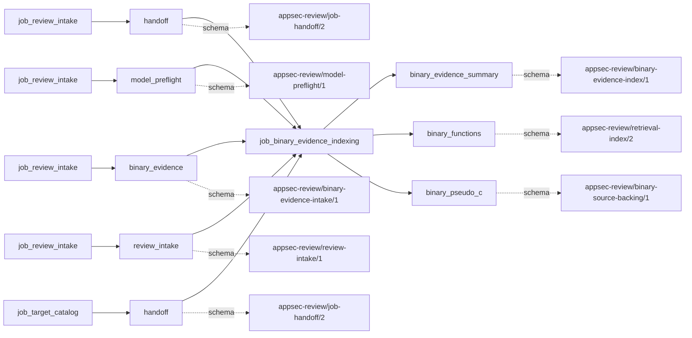

# binary_evidence_indexing

This page contains the generated contract; the authored process and acceptance description are tracked by [T-130](../TODO.md).

<!-- generated:begin job=job_binary_evidence_indexing -->
<!-- generated from: appsec-review.toml, containers/catalog.toml, pipeline/guidance/registry.json, tests/job-test-map.json, src/appsec_review/runtime/registry.py, src/appsec_review/runtime/contracts.py, src/appsec_review/runtime/datasets.py, src/appsec_review/guidance/workers.py, src/appsec_review/mcp/schema.py, src/appsec_review/orchestration/topology.py, src/appsec_review/orchestration/dagster/adapter.py by scripts/generate-docs.py; do not edit -->
## Declared job contract

binary_evidence_indexing

Job: `job_binary_evidence_indexing`. Enabled in the dev recipe: **true**.
Declarations describe possible work, not successful execution or consumed evidence.

### Steps and tasks

| Step | Task | Workers | Pool | Bound tool or gap | Handler |
| --- | --- | --- | --- | --- | --- |
| `acceptance` | `acceptance.publish_handoff` | 1 | `application` | Undeclared ([T-147](../TODO.md)) | [source](../../src/appsec_review/jobs/job_binary_evidence_indexing/job.py#L402) |
| `index` | `index.binaries` | 1 | `application` | Undeclared ([T-147](../TODO.md)) | [source](../../src/appsec_review/jobs/job_binary_evidence_indexing/job.py#L388) |
| `load` | `load.accepted_publications` | 1 | `application` | Undeclared ([T-147](../TODO.md)) | [source](../../src/appsec_review/jobs/job_binary_evidence_indexing/job.py#L370) |

### Accepted input declarations

| Producer | Dataset | Schema | Channel | Availability | Missing policy |
| --- | --- | --- | --- | --- | --- |
| `job_review_intake` | `handoff` | `appsec-review/job-handoff/2` | handoff | required | reject |
| `job_review_intake` | `model_preflight` | `appsec-review/model-preflight/1` | handoff | optional | gap |
| `job_review_intake` | `binary_evidence` | `appsec-review/binary-evidence-intake/1` | handoff | optional | gap |
| `job_review_intake` | `review_intake` | `appsec-review/review-intake/1` | handoff | optional | gap |
| `job_target_catalog` | `handoff` | `appsec-review/job-handoff/2` | handoff | required | reject |

### Published dataset declarations

| Dataset | Step | Schema | Stage | Indexes | MCP route |
| --- | --- | --- | --- | --- | --- |
| `binary_evidence_summary` | `acceptance` | `appsec-review/binary-evidence-index/1` | artifact_only | Not indexed | `coverage`, `query_dataset_inventory` |
| `binary_functions` | `index` | `appsec-review/retrieval-index/2` | indexed | `binary` | `find`, `read_excerpt`, `trace` |
| `binary_pseudo_c` | `index` | `appsec-review/binary-source-backing/1` | artifact_only | Not indexed | `coverage`, `query_dataset_inventory` |

Protected and artifact-only routes expose sanitized metadata, not payload access.

### Model and guidance declarations

No job-level model declaration; absence of a task binding remains [T-147](../TODO.md), not a nonexecution claim.

### Test selection

| Tier | Files or selectors |
| --- | --- |
| acceptance | None declared |
| integration | None declared |
| live | None declared |
| unit | `tests/test_binary_evidence_indexing.py` |

### Dagster placement

Dispatch: `review_graph`. Review graph member: **true**. Enabled graph member: **true**.

Declared predecessors: `job_target_catalog`.

### Declared dataflow

<!-- generated:end -->
