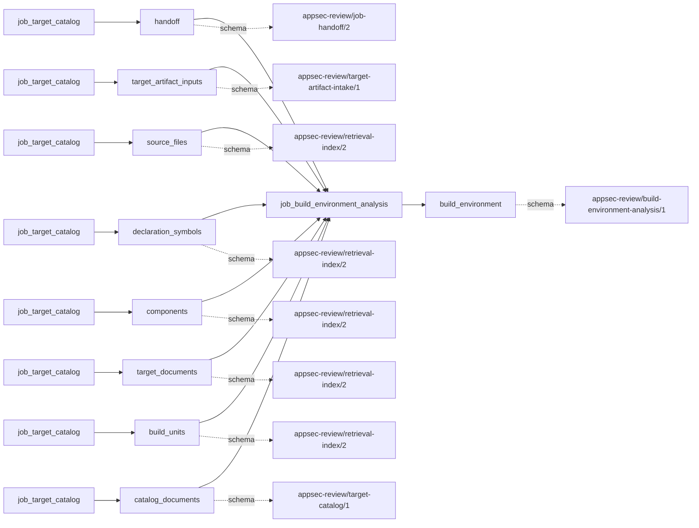
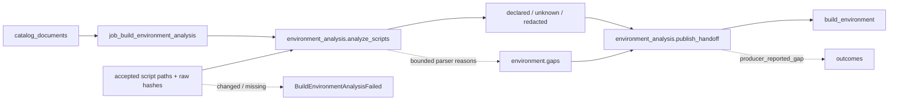

# build_environment_analysis

## Purpose

What environment declarations can be read statically from the accepted setup scripts without
executing them? This job publishes redacted, source-resolving literal/unknown declarations and
bounded coverage for planning. It refuses to identify those declarations as the effective build
environment, native compiler target proof, or evidence that arbitrary shell syntax was evaluated.

<!-- generated:begin job=job_build_environment_analysis -->
<!-- generated from: appsec-review.toml, containers/catalog.toml, pipeline/guidance/registry.json, tests/job-test-map.json, src/appsec_review/runtime/registry.py, src/appsec_review/runtime/contracts.py, src/appsec_review/runtime/datasets.py, src/appsec_review/guidance/workers.py, src/appsec_review/mcp/schema.py, src/appsec_review/orchestration/topology.py, src/appsec_review/orchestration/dagster/adapter.py by scripts/generate-docs.py; do not edit -->
## Declared job contract

build_environment_analysis

Job: `job_build_environment_analysis`. Enabled in the dev recipe: **true**.
Declarations describe possible work, not successful execution or consumed evidence.

### Steps and tasks

| Step | Task | Workers | Pool | Bound tool or gap | Handler |
| --- | --- | --- | --- | --- | --- |
| `environment_analysis` | `environment_analysis.analyze_scripts` | 1 | `application` | Undeclared ([T-147](../TODO.md)) | [source](../../src/appsec_review/jobs/job_build_environment_analysis/job.py#L353) |
| `environment_analysis` | `environment_analysis.publish_handoff` | 1 | `application` | Undeclared ([T-147](../TODO.md)) | [source](../../src/appsec_review/jobs/job_build_environment_analysis/job.py#L390) |

### Accepted input declarations

| Producer | Dataset | Schema | Channel | Availability | Missing policy |
| --- | --- | --- | --- | --- | --- |
| `job_target_catalog` | `handoff` | `appsec-review/job-handoff/2` | handoff | required | reject |
| `job_target_catalog` | `target_artifact_inputs` | `appsec-review/target-artifact-intake/1` | handoff | optional | gap |
| `job_target_catalog` | `source_files` | `appsec-review/retrieval-index/2` | handoff | optional | gap |
| `job_target_catalog` | `declaration_symbols` | `appsec-review/retrieval-index/2` | handoff | optional | gap |
| `job_target_catalog` | `components` | `appsec-review/retrieval-index/2` | handoff | optional | gap |
| `job_target_catalog` | `target_documents` | `appsec-review/retrieval-index/2` | handoff | optional | gap |
| `job_target_catalog` | `build_units` | `appsec-review/retrieval-index/2` | handoff | optional | gap |
| `job_target_catalog` | `catalog_documents` | `appsec-review/target-catalog/1` | handoff | optional | gap |

### Published dataset declarations

| Dataset | Step | Schema | Stage | Indexes | MCP route |
| --- | --- | --- | --- | --- | --- |
| `build_environment` | `environment_analysis` | `appsec-review/build-environment-analysis/1` | artifact_only | Not indexed | `coverage`, `query_dataset_inventory` |

Protected and artifact-only routes expose sanitized metadata, not payload access.

### Model and guidance declarations

No job-level model declaration; absence of a task binding remains [T-147](../TODO.md), not a nonexecution claim.

### Test selection

| Tier | Files or selectors |
| --- | --- |
| acceptance | None declared |
| integration | `tests/integration/test_build_topology_environment_lifecycle.py` |
| live | None declared |
| unit | `tests/test_build_environment_analysis.py` |

### Dagster placement

Dispatch: `review_graph`. Review graph member: **true**. Enabled graph member: **true**.

Declared predecessors: `job_target_catalog`.

### Declared dataflow

<!-- generated:end -->

## Process

Source: [static parser, validator and handlers](../../src/appsec_review/jobs/job_build_environment_analysis/job.py).
The [environment operations page](build-environment-analysis.md) explains planner availability
modes; [input contracts](../architecture/job-input-contracts.md) govern actual accepted reads.

### `environment_analysis`

1. Validate the single step's task order and typed settings; reject attempts to exceed supported
   parser ceilings.
2. Load the accepted catalog and require its source fingerprint to match the claim. Require
   target custody; select sorted accepted `.sh`, `.bash`, `.bat` and `.cmd` paths with
   environment/setup/setvars/bootstrap stems.
3. Traverse only bounded literal source/call references to accepted script paths. Enforce
   script count, bytes, source depth, assignment count and internal deadline. Never execute
   scripts or discover new paths outside the accepted inventory.
4. Verify each read against its accepted hash. Parse assignments; dynamic syntax, conditions,
   invocation-dependent sourcing and unsupported statements keep values unknown. Propagate
   uncertainty even when a sourced script was already inspected.
5. Redact sensitive names and credential-bearing URLs. Keep raw source hashes and line
   locations; do not publish raw script text or claim a redacted value is known.
6. Validate the environment document's closed schema and coverage invariants. Write bounded
   `build-environment.json`; convert its deduplicated reason strings to strict
   `producer_reported_gap` records and return `COMPLETED_WITH_GAPS` when any remain.
7. Missing/changed accepted files, a reader violating its byte contract, invalid catalog
   binding or oversized publication raise `BuildEnvironmentAnalysisFailed`, not partial success.

## Dataflow

## Gaps

At `environment_analysis.publish_handoff`, `gap_records` maps every bounded analysis reason
to `producer_reported_gap`, `retryable=False`; script-path reasons retain `scope_id`, global
reasons do not. This parser's declarations are advisory by design, but the missing coverage
still needs a walk decision.

| Reason in the artifact | Emission condition |
| --- | --- |
| `script_count_exhausted`, `assignment_count_exhausted`, `internal_environment_deadline` | Selection, assignment or internal elapsed-time bound reached. |
| `script_byte_bound`, `source_depth_or_script_bound`, `declaration_value_byte_bound` | Script, traversal or literal-value bound prevents complete interpretation. |
| `unsupported_script_encoding`, `unsupported_script_statement` | Bytes or statements fall outside the static grammar. |
| `unresolved_script_context_or_condition`, `unresolved_sourcing`, `unresolved_declaration_value` | Invocation context, reference or value cannot be established statically. |
| PowerShell unsupported statement | An accepted `.ps1` file exists; it is not interpreted. |

Sensitive declarations have `status=redacted` and no value; redaction is not itself a fabricated
parser gap. No selected scripts and no gaps is `not_applicable` within the accepted inventory,
not a whole-target absence claim. Unexpected errors, framework deadlines or killed tasks are
failed attempts rather than the parser's named internal deadline. Canonical failure handling is
defined in [job interchange](../architecture/job-interchange.md).

## Acceptance

1. **A. Inputs:** Compare the observed catalog handoff, artifact and source hashes with the
   claim. Confirm every inspected and sourced path belongs to that accepted inventory.
2. **B. Independent comparison:** Count eligible scripts and declared assignments from source
   lines without executing them. Compare inspected/omitted counts, source hashes and sample
   line numbers; check that a conditional/sourced assignment remains unknown and sensitive
   content is absent from the published document.
3. **C. Gaps:** Group canonical records by reason and script scope; compare exhaustion counts
   with actual eligible scripts/assignments. Unsupported PowerShell or dynamic syntax is a
   coverage cost, not automatically an expected gap. Stop on unlisted causes.
4. **D. Baseline:** After acceptance checks, run `stepwise.py accept` and record corpus namespace
   and saved baseline of script/declaration counts, coverage and redaction dispositions.

## Resume and invalidation

The output binds `source_fingerprint`, `catalog_handoff_sha256`, the static `RULES` identity
and the effective parser bounds. Source/catalog/configuration or implementation changes
invalidate whole-job reuse under [Wave 1 resumability](../architecture/jobs-and-runtime.md#wave-1-resumability).
There is no per-script persistent cache. Its artifact-bearing analysis/publication results are
not portable failed-attempt checkpoints. Planner reuse additionally rechecks the signed
environment availability contract and exact reference: stale deliberately optional prior
evidence becomes unavailable; missing or changed expected-current evidence blocks planning.
