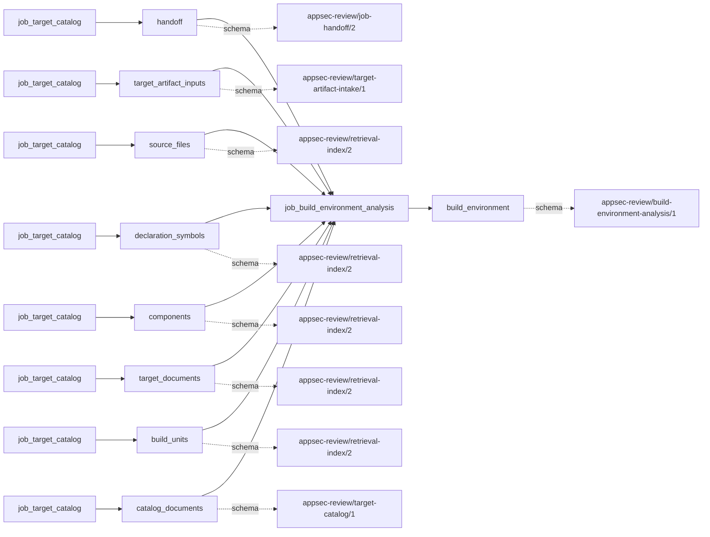

# build_environment_analysis

This page contains the generated contract; the authored process and acceptance description are tracked by [T-130](../TODO.md).

<!-- generated:begin job=job_build_environment_analysis -->
<!-- generated from: appsec-review.toml, containers/catalog.toml, pipeline/guidance/registry.json, tests/job-test-map.json, src/appsec_review/runtime/registry.py, src/appsec_review/runtime/contracts.py, src/appsec_review/runtime/datasets.py, src/appsec_review/guidance/workers.py, src/appsec_review/mcp/schema.py, src/appsec_review/orchestration/topology.py, src/appsec_review/orchestration/dagster/adapter.py by scripts/generate-docs.py; do not edit -->
## Declared job contract

build_environment_analysis

Job: `job_build_environment_analysis`. Enabled in the dev recipe: **true**.
Declarations describe possible work, not successful execution or consumed evidence.

### Steps and tasks

| Step | Task | Workers | Pool | Bound tool or gap | Handler |
| --- | --- | --- | --- | --- | --- |
| `environment_analysis` | `environment_analysis.analyze_scripts` | 1 | `application` | Undeclared ([T-147](../TODO.md)) | [source](../../src/appsec_review/jobs/job_build_environment_analysis/job.py#L353) |
| `environment_analysis` | `environment_analysis.publish_handoff` | 1 | `application` | Undeclared ([T-147](../TODO.md)) | [source](../../src/appsec_review/jobs/job_build_environment_analysis/job.py#L390) |

### Accepted input declarations

| Producer | Dataset | Schema | Channel | Availability | Missing policy |
| --- | --- | --- | --- | --- | --- |
| `job_target_catalog` | `handoff` | `appsec-review/job-handoff/2` | handoff | required | reject |
| `job_target_catalog` | `target_artifact_inputs` | `appsec-review/target-artifact-intake/1` | handoff | optional | gap |
| `job_target_catalog` | `source_files` | `appsec-review/retrieval-index/2` | handoff | optional | gap |
| `job_target_catalog` | `declaration_symbols` | `appsec-review/retrieval-index/2` | handoff | optional | gap |
| `job_target_catalog` | `components` | `appsec-review/retrieval-index/2` | handoff | optional | gap |
| `job_target_catalog` | `target_documents` | `appsec-review/retrieval-index/2` | handoff | optional | gap |
| `job_target_catalog` | `build_units` | `appsec-review/retrieval-index/2` | handoff | optional | gap |
| `job_target_catalog` | `catalog_documents` | `appsec-review/target-catalog/1` | handoff | optional | gap |

### Published dataset declarations

| Dataset | Step | Schema | Stage | Indexes | MCP route |
| --- | --- | --- | --- | --- | --- |
| `build_environment` | `environment_analysis` | `appsec-review/build-environment-analysis/1` | artifact_only | Not indexed | `coverage`, `query_dataset_inventory` |

Protected and artifact-only routes expose sanitized metadata, not payload access.

### Model and guidance declarations

No job-level model declaration; absence of a task binding remains [T-147](../TODO.md), not a nonexecution claim.

### Test selection

| Tier | Files or selectors |
| --- | --- |
| acceptance | None declared |
| integration | `tests/integration/test_build_topology_environment_lifecycle.py` |
| live | None declared |
| unit | `tests/test_build_environment_analysis.py` |

### Dagster placement

Dispatch: `review_graph`. Review graph member: **true**. Enabled graph member: **true**.

Declared predecessors: `job_target_catalog`.

### Declared dataflow

<!-- generated:end -->
