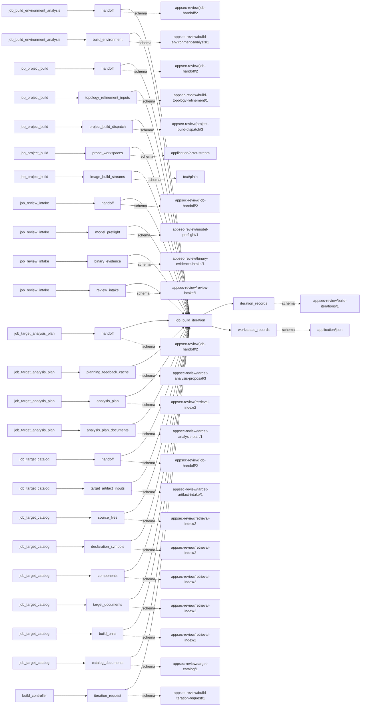
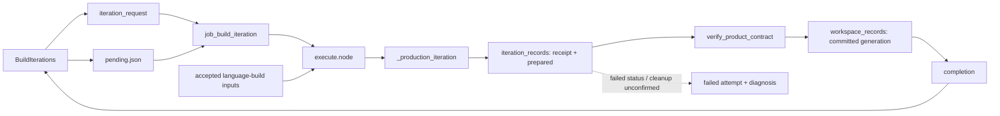

# build_iteration

## Purpose

Can one controller-selected build node safely advance the shared workspace from its pinned
input generation to verified products? This internal job performs one bounded transaction and
retains immutable request, receipt and completion evidence. It refuses arbitrary standalone
commands, an unclaimed request, or a mutable ledger entry as proof of successful compilation;
the language-build parent owns review-facing publication.

<!-- generated:begin job=job_build_iteration -->
<!-- generated from: appsec-review.toml, containers/catalog.toml, pipeline/guidance/registry.json, tests/job-test-map.json, src/appsec_review/runtime/registry.py, src/appsec_review/runtime/contracts.py, src/appsec_review/runtime/datasets.py, src/appsec_review/guidance/workers.py, src/appsec_review/mcp/schema.py, src/appsec_review/orchestration/topology.py, src/appsec_review/orchestration/dagster/adapter.py by scripts/generate-docs.py; do not edit -->
## Declared job contract

build_iteration

Job: `job_build_iteration`. Enabled in the dev recipe: **true**.
Declarations describe possible work, not successful execution or consumed evidence.

### Steps and tasks

| Step | Task | Workers | Pool | Bound tool or gap | Handler |
| --- | --- | --- | --- | --- | --- |
| `execute` | `execute.node` | 1 | `cpp_build` | Undeclared ([T-147](../TODO.md)) | [source](../../src/appsec_review/jobs/job_build_iteration/job.py#L93) |

### Accepted input declarations

| Producer | Dataset | Schema | Channel | Availability | Missing policy |
| --- | --- | --- | --- | --- | --- |
| `job_build_environment_analysis` | `handoff` | `appsec-review/job-handoff/2` | handoff | optional | gap |
| `job_build_environment_analysis` | `build_environment` | `appsec-review/build-environment-analysis/1` | handoff | optional | gap |
| `job_project_build` | `handoff` | `appsec-review/job-handoff/2` | handoff | optional | gap |
| `job_project_build` | `topology_refinement_inputs` | `appsec-review/build-topology-refinement/1` | handoff | optional | gap |
| `job_project_build` | `project_build_dispatch` | `appsec-review/project-build-dispatch/3` | handoff | optional | gap |
| `job_project_build` | `probe_workspaces` | `application/octet-stream` | handoff | optional | gap |
| `job_project_build` | `image_build_streams` | `text/plain` | handoff | optional | gap |
| `job_review_intake` | `handoff` | `appsec-review/job-handoff/2` | handoff | optional | gap |
| `job_review_intake` | `model_preflight` | `appsec-review/model-preflight/1` | handoff | optional | gap |
| `job_review_intake` | `binary_evidence` | `appsec-review/binary-evidence-intake/1` | handoff | optional | gap |
| `job_review_intake` | `review_intake` | `appsec-review/review-intake/1` | handoff | optional | gap |
| `job_target_analysis_plan` | `handoff` | `appsec-review/job-handoff/2` | handoff | optional | gap |
| `job_target_analysis_plan` | `planning_feedback_cache` | `appsec-review/target-analysis-proposal/3` | handoff | optional | gap |
| `job_target_analysis_plan` | `analysis_plan` | `appsec-review/retrieval-index/2` | handoff | optional | gap |
| `job_target_analysis_plan` | `analysis_plan_documents` | `appsec-review/target-analysis-plan/1` | handoff | optional | gap |
| `job_target_catalog` | `handoff` | `appsec-review/job-handoff/2` | handoff | optional | gap |
| `job_target_catalog` | `target_artifact_inputs` | `appsec-review/target-artifact-intake/1` | handoff | optional | gap |
| `job_target_catalog` | `source_files` | `appsec-review/retrieval-index/2` | handoff | optional | gap |
| `job_target_catalog` | `declaration_symbols` | `appsec-review/retrieval-index/2` | handoff | optional | gap |
| `job_target_catalog` | `components` | `appsec-review/retrieval-index/2` | handoff | optional | gap |
| `job_target_catalog` | `target_documents` | `appsec-review/retrieval-index/2` | handoff | optional | gap |
| `job_target_catalog` | `build_units` | `appsec-review/retrieval-index/2` | handoff | optional | gap |
| `job_target_catalog` | `catalog_documents` | `appsec-review/target-catalog/1` | handoff | optional | gap |
| `build_controller` | `iteration_request` | `appsec-review/build-iteration-request/1` | transaction | required | reject |

### Published dataset declarations

| Dataset | Step | Schema | Stage | Indexes | MCP route |
| --- | --- | --- | --- | --- | --- |
| `iteration_records` | `execute` | `appsec-review/build-iterations/1` | protected | Not indexed | `coverage`, `query_dataset_inventory` |
| `workspace_records` | `execute` | `application/json` | protected | Not indexed | `coverage`, `query_dataset_inventory` |

Protected and artifact-only routes expose sanitized metadata, not payload access.

### Model and guidance declarations

No job-level model declaration; absence of a task binding remains [T-147](../TODO.md), not a nonexecution claim.

### Test selection

| Tier | Files or selectors |
| --- | --- |
| acceptance | None declared |
| integration | `tests/integration/job_build_iteration/test_controller_recovery.py` `tests/integration/job_build_iteration/test_build_recipe_replay.py` `tests/integration/job_build_iteration/test_build_iteration_executor.py` `tests/integration/job_build_iteration/test_build_iteration_cli.py` |
| live | None declared |
| unit | `tests/unit/job_build_iteration/test_contract.py` `tests/unit/job_build_iteration/test_job_graph.py` `tests/unit/job_build_iteration/test_controller.py` `tests/unit/job_build_iteration/test_executor_capture.py` `tests/unit/job_build_iteration/test_workspace_resume.py` |

### Dagster placement

Dispatch: `internal_transaction`. Review graph member: **false**. Enabled graph member: **false**.

Declared predecessors: None.

### Declared dataflow

<!-- generated:end -->

## Process

Source: [registered transaction](../../src/appsec_review/jobs/job_build_iteration/job.py),
[controller](../../src/appsec_review/jobs/build_iterations.py) and
[production adapter](../../src/appsec_review/jobs/job_language_build/job.py).
The [topology and iteration architecture](../architecture/build-topology-and-iterations.md)
owns shared workspace/recovery semantics.

### `execute`

1. Require `iteration_request` in trusted orchestration metadata. Read its immutable reference
   and observe the declared transaction input from `build_controller`.
2. Require `pending.json` to name this exact request. Reload the selected configuration layers
   and require their resolved hash to equal the frozen run; verify the target fingerprint in
   the launch path before starting the job.
3. Reconstruct the language-build controller from accepted inputs. Require request run/schema,
   node, dispatch, graph, configuration, target and product selection to equal the current
   controller selection.
4. Acquire the workspace writer. Revalidate node binding, committed producer generations,
   prerequisite products, readiness and exact interfaces; then begin the attempt against
   the request's generation. A different pending claim or prerequisite cannot be silently used.
5. Execute only the selected generic/JVM/Wasm production adapter, using language-build settings,
   the shared target/install paths and bounded executor leases. Retain a receipt and immutable
   prepared record before deciding whether products can commit.
6. Require `cleanup_complete=True`, receipt status `SUCCEEDED` and verified product contracts.
   On failure retain diagnosis/evidence where a failed receipt exists, mark the workspace
   attempt failed and raise; do not return a successful partial transaction.
7. Commit the product generation and retain a completion record linking request, receipt,
   prepared state, binding and orchestration run ID. Return its reference to the parent
   controller; protected transaction/workspace datasets are not a top-level review result.

## Dataflow

## Gaps

There is no successful job-specific producer-gap fallback in `execute.node`. Missing/mismatched
request, changed configuration/target, absent controller claim, invalid prerequisite products,
failed receipt, product rejection or unconfirmed cleanup raises. The failed framework attempt
has rejected diagnostic outcomes (`producer_failed` or blocked-task accounting with retry
semantics), not an accepted partial transaction.

The parent `BuildIterations.run` can produce blocked/failed **language-build receipts** for
unavailable images/releases/dispatches, failed dependencies or unsupported topology. Those
legacy reasons and any preserved typed build gaps belong to the controller/parent publication,
not invented causes emitted by this internal job. A failed worker with a prepared receipt
allows rollback only after cleanup is confirmed; without that evidence the workspace stays
held. [Job interchange](../architecture/job-interchange.md) defines framework outcomes.
Walk acceptance cannot waive an integrity or cleanup failure as an expected missing input.

## Acceptance

1. **A. Inputs:** Compare the observed transaction reference with the controller's pending
   request, request binding, frozen configuration and admitted upstream pins. Confirm only
   this node's selected recipe and product interfaces were supplied.
2. **B. Independent comparison:** Compare raw command/capture evidence with the immutable
   receipt, independently hash committed product bytes, and compare before/after generation
   identities and cleanup evidence. A ledger/completion count alone is insufficient.
3. **C. Gaps:** Inspect rejected framework outcomes and the parent's per-node receipt, keeping
   them distinct. A failed transaction is not accepted; record the blocking cause and stop
   if it is not covered by the walk's explicit recovery terms.
4. **D. Baseline:** Record the transaction request/completion/product hashes in the job record.
   This internal job has no independent unconditional walk stage: use `stepwise.py accept`
   for the enclosing language-build result after its checks, recording that corpus namespace
   and saved baseline rather than inventing a separate internal-job acceptance.

## Resume and invalidation

`always_execute=True` and `propagate_handoff=False` prevent top-level handoff reuse from
standing in for a new claimed transaction. `iteration_input_identity` hashes the exact verified
pending request reference (or explicit absence). Reuse happens in `BuildIterations`, not by
rerunning an arbitrary old request: `NodeBinding` includes source, topology, configuration,
recipe, image/toolchain, upstream product hashes, execution identity and output/selection policy.
The controller verifies retained products and receipts, invalidates the affected dependent
closure, and reconstructs or rolls back workspace generations under serialized custody.
Crash recovery can finish indexing an already committed verified product; it cannot turn an
uncommitted prepared receipt into success. Generic portable checkpoints are not a shortcut for
these side effects; see [Wave 1 resumability](../architecture/jobs-and-runtime.md#wave-1-resumability).
