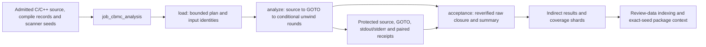
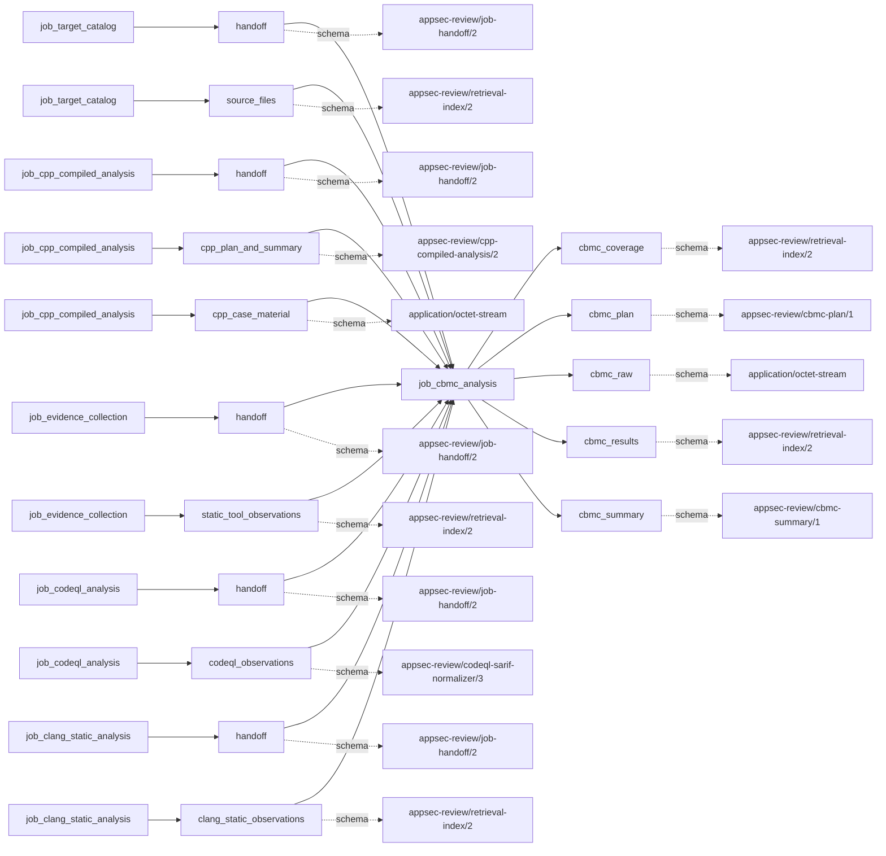

# CBMC bounded analysis

## Purpose

`job_cbmc_analysis` adds bounded function-entry analysis to eligible, accepted C/C++ scanner
leads before review indexing. It is enabled by default, uses no model, and never executes a
target binary. See the [design and artifact contract](../architecture/cbmc-bounded-analysis.md).

## Provisioning and configuration

Provision [`tool-cbmc`](../../containers/tools/cbmc/README.md) on the review host, update its
host-local image binding and sign/verify it with the existing operator policy. The job
requires the catalog tag and immutable configured image ID to agree. Do not copy another
host's image ID, provision new keys implicitly, or rebuild the image for application-code edits.
Host-pins application checks configured settings tags even for disabled jobs, so merely setting
CBMC `enabled = false` does not bypass a missing binding. Provisioning, exact pin verification,
signature policy and native acceptance are per-host prerequisites; WSL readiness is not HAL
readiness. [T-5263](../TODO.md) retains the rollout and real-engine acceptance boundary.

The central `[jobs.job_cbmc_analysis.settings]` table selects:

| Bound | Default |
| --- | --- |
| Native scopes / seeds per scope | 8 / 32 |
| Total translation units / function entries | 8 / 16 |
| Command timeout / analysis launch deadline | 45 s / 300 s |
| Increasing unwind limits | 8, 32 |
| Native stdout/stderr / GOTO file | 4 MiB / 64 MiB |
| Source staging | 10,000 files / 128 MiB per scope |
| GOTO instructions / properties | 100,000 / 2,000 |
| Indexed property summaries / trace steps / value characters | 16 / 24 / 200 |

The existing executor retains its no-network, read-only, non-root, 1 GiB memory, two-CPU,
256-PID boundary. Each tool command is wrapped with the image's `timeout`, reserving three
seconds within its outer deadline for termination/cleanup. Its expected deadline exit is
an inconclusive tool result, not a verification pass. Resource admission remains governed by
the central queue; the analysis launch deadline does not bound earlier input verification
or later index publication. Guardian cancellation, OOM/fatal execution policy stops and input
integrity failures propagate; the job does not catch or bypass `ReviewStopped`.

Set `settings.enabled = false` to omit the job from a newly resolved graph. Frozen runs
retain their original configuration and must not be edited to follow this setting.
Disabling a producer or selecting no eligible seeds never establishes safety.

## Process

### `load`

1. Read admitted C/C++ case material and eligible scanner datasets through the typed input
   contract. Verify snapshot, source/compile identities and source-mapped seed locations.
   Resolve each candidate shard's exact owner from the pinned producer dataset contract before
   opening it for seeds. The shared `observations` index name is not permission to consume
   coverage datasets: Clang's findings are admitted, but `clang_static_scope_coverage` is not.
   Keep schema, authority and byte verification in the runtime read guard; filtering does not
   replace those checks or widen CBMC's declared inputs.
2. Select deterministic bounded scope/translation-unit/function work. Keep missing inputs,
   unsupported selections and budget omissions explicit; no whole-program fallback is inferred.
3. Publish `plan.json` with its verified nested references and canonical job-level gaps.

### `analyze`

1. Reverify the retained plan. Stage only accepted source bytes; reject unsupported semantic
   compiler arguments instead of silently dropping them.
2. Compile the original translation unit to GOTO and resolve source-located function entries
   from bounded discovery output. Reuse verified GOTO read-only within the attempt.
3. Run increasing configured unwind bounds through the pinned executor. Classify consistent
   native results, retain each launched round's output/receipt pair and name unlaunched bounds.
4. Publish `analysis.json`, source/GOTO/native artifacts, counts and preserved selection/
   execution gaps. A later failed round cannot borrow the earlier output's receipt identity.

### `acceptance`

1. Reopen the plan/analysis and verify every nested artifact, including failed-discovery
   diagnostics. Retain parsed native evidence through the active run-owned publication boundary.
2. Publish indirect `review_signal` results and coverage shards with source/seed identities,
   bounded property/trace previews and explicit omissions.
3. Validate the manifest and summary against the exact image, counts and analysis gaps.
   These immutable outputs are review context, not a final finding decision.

## Read the result

The load step retains `plan.json`, including exact selected source/compile identities and
selection omissions. The analysis step retains its source-only input copies, GOTO binaries,
function tables, native solver JSON and container receipts under the attempt's
`artifacts/cbmc/` tree. Only files bound by the accepted source mapping reach the container:
unlisted workspace files and symlink ancestors cannot supply headers.

Load, analysis and acceptance expose nested raw artifact references. Acceptance and accepted
reuse reverify staged source, GOTO, compilation/discovery/solver stdout and stderr, and their
execution receipts. Deleted or changed raw bytes refuse reuse even when the summary JSON is
unchanged. Shared selection/execution gaps remain job-level canonical records across the three
unit outcomes, not gaps falsely attributed to a different unit.
Native-result retention requires the active run-owned publication attempt. An absent or foreign
owner refuses publication instead of producing a seemingly usable result without native evidence.

The acceptance step publishes result and coverage shards plus `summary.json`. Results use
the existing **`review_signal`** entity kind, which is indirect for every security predicate.
They do not become duplicate scanner leads. Source-mapped property and trace previews remain
bounded; omitted preview data is counted and the complete bounded native artifact is retained.

Inspect the judgment, function-entry assumptions, source hashes, unwind limits, property
statuses, model warnings and coverage together:

- `counterexample_candidate`: a source-mapped safety-property failure with a retained trace,
  conditional on this entry model; not exploitability or caller-reachability proof.
- `bounded_pass`: nonempty consistent successful properties, with unwinding assertions and no
  model warning; not an automatic false-positive dismissal.
- `inconclusive`: no accepted positive/negative conclusion; examine the named gap and receipt.
- `not_attempted`: a selection, staging, function or time budget prevented analysis.

Also inspect each `rounds` entry: `validated`, `failed` or `not_attempted`, its gaps and its
output/receipt pair. `unwind_limits_attempted` includes executed failed retries, not unlaunched
bounds. After a failed retry the result is inconclusive with zero candidates; retained parsed
`native_output` and `native_execution` still identify the last validated round. The failed
retry's separate artifacts and earlier unwinding gap are not discarded.

No eligible native work produces `NOT_APPLICABLE`; missing applicable build/scanner evidence
or omitted supported work produces canonical producer gaps. Review packages join results by
the originating observation IDs **and exact source hash/line range**, include their bounded
previews and preserve missing/partial coverage. Existing review adjudication, dossiers and
publication gates remain authoritative.

## Dataflow

## Gaps

Missing applicable inputs, unsupported compilation/mapping, absent function bodies, warnings,
partial unwinding and exhausted budgets remain explicit coverage limitations. No eligible work
is not the same as a failed applicable scope. Shared canonical producer gaps have
`unit_id = null` and are deliberately retained through load, analysis and acceptance; payload
judgments never widen `ProducerStatus`. Integrity and publication-owner failures refuse
acceptance/reuse rather than yielding a gap-bearing successful evidence record.

## Acceptance

These are the charter checks for a separately authorized walk, not a claim they ran here:

1. **A. Inputs:** Compare admitted upstream hashes, selected source/compile mappings, seed
   identities, frozen budgets and the host's actual tooling pin with the accepted plan.
2. **B. Independent comparison:** Compare a bounded, version-attributed native sample with its
   raw properties, source locations, unwind status and matching execution receipt. Handwritten
   JSON fixtures cannot settle real warning/missing-body or function-table behavior.
3. **C. Gaps:** Reconcile plan omissions, round outcomes, raw-retention failures, indexed coverage
   and canonical job gaps against the walk's confirmed expected causes; absence is not safety.
4. **D. Baseline:** Record the exact source, target, configuration, image and accepted artifacts
   before any later comparison. Preserve old evidence and do not infer another host's readiness.

## Resume and invalidation

Runtime reuse requires matching admitted implementation/configuration/upstream identities and
an intact accepted artifact closure. Missing or changed source copies, GOTO, discovery/solver
output or receipts invalidate reuse even when summary bytes remain unchanged. Changed code
requires normal repair admission; changed host settings require an appropriate newly resolved
configuration, not edits to a frozen run. Application-code reload and tool-image provisioning
remain separate, per-host operations; [T-5263](../TODO.md) tracks native rollout/acceptance.

## Manual validation boundary

Focused units fake only external container/upstream service boundaries and exercise parsing,
selection, source custody, publication, consumer joins, budgets and evidence classification.
They are not a real-engine or Dagster acceptance claim. A separately authorized trial should
cover a real accepted safe/failing native pair, sufficient/insufficient unwinding, an external
body gap, unsupported C++, deadline exhaustion and end-to-end finding-package visibility.
Do not run a target merely because this job or image is now registered.
Handwritten native JSON fixtures do not qualify an actual CBMC release's warning, missing-body,
function-discovery or trace shapes; those remain named real-engine acceptance gaps.

<!-- generated:begin job=job_cbmc_analysis -->
<!-- generated from: appsec-review.toml, containers/catalog.toml, pipeline/guidance/registry.json, tests/job-test-map.json, src/appsec_review/runtime/registry.py, src/appsec_review/runtime/contracts.py, src/appsec_review/runtime/datasets.py, src/appsec_review/guidance/workers.py, src/appsec_review/mcp/schema.py, src/appsec_review/orchestration/topology.py, src/appsec_review/orchestration/dagster/adapter.py by scripts/generate-docs.py; do not edit -->
## Declared job contract

cbmc_analysis

Job: `job_cbmc_analysis`. Enabled in the dev recipe: **true**.
Declarations describe possible work, not successful execution or consumed evidence.

### Steps and tasks

| Step | Task | Workers | Pool | Bound tool or gap | Handler |
| --- | --- | --- | --- | --- | --- |
| `acceptance` | `acceptance.publish_handoff` | 1 | `application` | Undeclared ([T-147](../TODO.md)) | [source](../../src/appsec_review/jobs/job_cbmc_analysis/job.py#L352) |
| `analyze` | `analyze.bounded_checks` | 1 | `application` | Undeclared ([T-147](../TODO.md)) | [source](../../src/appsec_review/jobs/job_cbmc_analysis/job.py#L341) |
| `load` | `load.accepted_inputs` | 1 | `application` | Undeclared ([T-147](../TODO.md)) | [source](../../src/appsec_review/jobs/job_cbmc_analysis/job.py#L334) |

### Accepted input declarations

| Producer | Dataset | Schema | Channel | Availability | Missing policy |
| --- | --- | --- | --- | --- | --- |
| `job_target_catalog` | `handoff` | `appsec-review/job-handoff/2` | handoff | optional | gap |
| `job_target_catalog` | `source_files` | `appsec-review/retrieval-index/2` | handoff | optional | gap |
| `job_cpp_compiled_analysis` | `handoff` | `appsec-review/job-handoff/2` | handoff | when_producer_enabled | reject |
| `job_cpp_compiled_analysis` | `cpp_plan_and_summary` | `appsec-review/cpp-compiled-analysis/2` | handoff | optional | gap |
| `job_cpp_compiled_analysis` | `cpp_case_material` | `application/octet-stream` | handoff | optional | gap |
| `job_evidence_collection` | `handoff` | `appsec-review/job-handoff/2` | handoff | optional | gap |
| `job_evidence_collection` | `static_tool_observations` | `appsec-review/retrieval-index/2` | handoff | optional | gap |
| `job_codeql_analysis` | `handoff` | `appsec-review/job-handoff/2` | handoff | optional | gap |
| `job_codeql_analysis` | `codeql_observations` | `appsec-review/codeql-sarif-normalizer/3` | handoff | optional | gap |
| `job_clang_static_analysis` | `handoff` | `appsec-review/job-handoff/2` | handoff | optional | gap |
| `job_clang_static_analysis` | `clang_static_observations` | `appsec-review/retrieval-index/2` | handoff | optional | gap |

### Published dataset declarations

| Dataset | Step | Schema | Stage | Indexes | MCP route |
| --- | --- | --- | --- | --- | --- |
| `cbmc_coverage` | `acceptance` | `appsec-review/retrieval-index/2` | indexed | `observations` | `coverage` |
| `cbmc_plan` | `load` | `appsec-review/cbmc-plan/1` | artifact_only | Not indexed | `coverage`, `query_dataset_inventory` |
| `cbmc_raw` | `analyze` | `application/octet-stream` | protected | Not indexed | `coverage`, `query_dataset_inventory` |
| `cbmc_results` | `acceptance` | `appsec-review/retrieval-index/2` | indexed | `observations` | `find`, `search` |
| `cbmc_summary` | `acceptance` | `appsec-review/cbmc-summary/1` | artifact_only | Not indexed | `coverage`, `query_dataset_inventory` |

Protected and artifact-only routes expose sanitized metadata, not payload access.

### Model and guidance declarations

No job-level model declaration; absence of a task binding remains [T-147](../TODO.md), not a nonexecution claim.

### Test selection

| Tier | Files or selectors |
| --- | --- |
| acceptance | None declared |
| integration | None declared |
| live | None declared |
| unit | `tests/unit/job_cbmc_analysis/test_cbmc_analysis.py` |

### Dagster placement

Dispatch: `review_graph`. Review graph member: **true**. Enabled graph member: **true**.

Declared predecessors: `job_codeql_analysis`.

### Declared dataflow

<!-- generated:end -->
