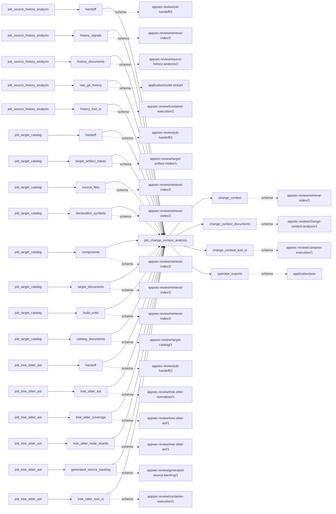
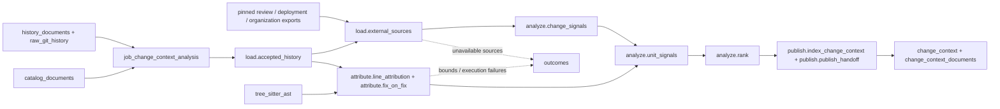

# change_context_analysis

## Purpose

Which accepted changes and ownership/review/deployment patterns deserve closer inspection?
This job combines source history with optional source-scoped records to rank files, functions
and components while retaining missing-signal coverage. It refuses to call a fast review,
concentrated ownership, absent associated tests or a high priority score a vulnerability finding.

<!-- generated:begin job=job_change_context_analysis -->
<!-- generated from: appsec-review.toml, containers/catalog.toml, pipeline/guidance/registry.json, tests/job-test-map.json, src/appsec_review/runtime/registry.py, src/appsec_review/runtime/contracts.py, src/appsec_review/runtime/datasets.py, src/appsec_review/guidance/workers.py, src/appsec_review/mcp/schema.py, src/appsec_review/orchestration/topology.py, src/appsec_review/orchestration/dagster/adapter.py by scripts/generate-docs.py; do not edit -->
## Declared job contract

change_context_analysis

Job: `job_change_context_analysis`. Enabled in the dev recipe: **true**.
Declarations describe possible work, not successful execution or consumed evidence.

### Steps and tasks

| Step | Task | Workers | Pool | Bound tool or gap | Handler |
| --- | --- | --- | --- | --- | --- |
| `analyze` | `analyze.change_signals` | 1 | `application` | Undeclared ([T-147](../TODO.md)) | [source](../../src/appsec_review/jobs/source_lanes.py#L57) |
| `analyze` | `analyze.rank` | 1 | `application` | Undeclared ([T-147](../TODO.md)) | [source](../../src/appsec_review/jobs/source_lanes.py#L57) |
| `analyze` | `analyze.unit_signals` | 1 | `application` | Undeclared ([T-147](../TODO.md)) | [source](../../src/appsec_review/jobs/source_lanes.py#L57) |
| `attribute` | `attribute.fix_on_fix` | 1 | `application` | Undeclared ([T-147](../TODO.md)) | [source](../../src/appsec_review/jobs/source_lanes.py#L57) |
| `attribute` | `attribute.line_attribution` | 1 | `application` | Undeclared ([T-147](../TODO.md)) | [source](../../src/appsec_review/jobs/source_lanes.py#L57) |
| `load` | `load.accepted_history` | 1 | `application` | Undeclared ([T-147](../TODO.md)) | [source](../../src/appsec_review/jobs/job_change_context_analysis/job.py#L165) |
| `load` | `load.external_sources` | 1 | `application` | Undeclared ([T-147](../TODO.md)) | [source](../../src/appsec_review/jobs/source_lanes.py#L57) |
| `publish` | `publish.index_change_context` | 1 | `application` | Undeclared ([T-147](../TODO.md)) | [source](../../src/appsec_review/jobs/source_lanes.py#L57) |
| `publish` | `publish.publish_handoff` | 1 | `application` | Undeclared ([T-147](../TODO.md)) | [source](../../src/appsec_review/jobs/source_lanes.py#L57) |

### Accepted input declarations

| Producer | Dataset | Schema | Channel | Availability | Missing policy |
| --- | --- | --- | --- | --- | --- |
| `job_source_history_analysis` | `handoff` | `appsec-review/job-handoff/2` | handoff | optional | gap |
| `job_source_history_analysis` | `history_signals` | `appsec-review/retrieval-index/2` | handoff | optional | gap |
| `job_source_history_analysis` | `history_documents` | `appsec-review/source-history-analysis/2` | handoff | optional | gap |
| `job_source_history_analysis` | `raw_git_history` | `application/octet-stream` | handoff | optional | gap |
| `job_source_history_analysis` | `history_tool_io` | `appsec-review/container-execution/1` | handoff | optional | gap |
| `job_target_catalog` | `handoff` | `appsec-review/job-handoff/2` | handoff | optional | gap |
| `job_target_catalog` | `target_artifact_inputs` | `appsec-review/target-artifact-intake/1` | handoff | optional | gap |
| `job_target_catalog` | `source_files` | `appsec-review/retrieval-index/2` | handoff | optional | gap |
| `job_target_catalog` | `declaration_symbols` | `appsec-review/retrieval-index/2` | handoff | optional | gap |
| `job_target_catalog` | `components` | `appsec-review/retrieval-index/2` | handoff | optional | gap |
| `job_target_catalog` | `target_documents` | `appsec-review/retrieval-index/2` | handoff | optional | gap |
| `job_target_catalog` | `build_units` | `appsec-review/retrieval-index/2` | handoff | optional | gap |
| `job_target_catalog` | `catalog_documents` | `appsec-review/target-catalog/1` | handoff | optional | gap |
| `job_tree_sitter_ast` | `handoff` | `appsec-review/job-handoff/2` | handoff | optional | gap |
| `job_tree_sitter_ast` | `tree_sitter_ast` | `appsec-review/tree-sitter-normalizer/1` | handoff | optional | gap |
| `job_tree_sitter_ast` | `tree_sitter_coverage` | `appsec-review/tree-sitter-ast/1` | handoff | optional | gap |
| `job_tree_sitter_ast` | `tree_sitter_node_shards` | `appsec-review/tree-sitter-ast/1` | handoff | optional | gap |
| `job_tree_sitter_ast` | `generated_source_backing` | `appsec-review/generated-source-backing/1` | handoff | optional | gap |
| `job_tree_sitter_ast` | `tree_sitter_tool_io` | `appsec-review/container-execution/1` | handoff | optional | gap |

### Published dataset declarations

| Dataset | Step | Schema | Stage | Indexes | MCP route |
| --- | --- | --- | --- | --- | --- |
| `change_context` | `publish` | `appsec-review/retrieval-index/2` | indexed | `history` | `query_change_context`, `query_precomputed` |
| `change_context_documents` | `publish` | `appsec-review/change-context-analysis/1` | artifact_only | Not indexed | `coverage`, `query_dataset_inventory` |
| `change_context_tool_io` | `attribute` | `appsec-review/container-execution/1` | protected | Not indexed | `coverage`, `query_dataset_inventory` |
| `operator_exports` | `load` | `application/json` | protected | Not indexed | `coverage`, `query_dataset_inventory` |

Protected and artifact-only routes expose sanitized metadata, not payload access.

### Model and guidance declarations

No job-level model declaration; absence of a task binding remains [T-147](../TODO.md), not a nonexecution claim.

### Test selection

| Tier | Files or selectors |
| --- | --- |
| acceptance | None declared |
| integration | None declared |
| live | None declared |
| unit | `tests/test_change_context_analysis.py::test_lifetime_normalization_uses_all_walked_commits_without_calendar_underflow` `tests/test_change_context_analysis.py::test_rolling_window_requires_more_than_three_fixes_within_sixty_days` `tests/test_change_context_analysis.py::test_review_speed_distinguishes_final_head_approval_stale_approval_and_direct_push` |

### Dagster placement

Dispatch: `review_graph`. Review graph member: **true**. Enabled graph member: **true**.

Declared predecessors: `job_tree_sitter_ast`.

### Declared dataflow

<!-- generated:end -->

## Process

Source: [handlers](../../src/appsec_review/jobs/job_change_context_analysis/job.py),
[export admission](../../src/appsec_review/jobs/job_change_context_analysis/sources.py),
[attribution](../../src/appsec_review/jobs/job_change_context_analysis/attribution.py) and
[metrics](../../src/appsec_review/jobs/job_change_context_analysis/metrics.py).
Definitions and operator selections live in [architecture](../architecture/change-context-analysis.md)
and [operations](change-context-analysis.md).

### `load`

1. Require accepted catalog and source-history handoffs in the handlers, verify their artifacts
   and full accepted result, and require the catalog snapshot to match the claim. Some declared
   inputs are optional; that declaration does not make these handler prerequisites optional.
2. Split history into its existing source lanes. Reuse accepted normalized changes, message
   classifications and GitHub facts; recompute lifetime ownership from all **walked** raw
   commits, not just the recent window. Name truncated/shallow lifetime coverage.
3. Choose review records by configured mode: explicit export, deny, acquired source-scoped
   export, or accepted GitHub enrichment. Do not query a review host here.
4. Load configured deployment/organization exports only beneath repository storage and outside
   the target, with matching pins and byte/record bounds. Reject ambiguous global review or
   deployment attribution across multiple sources; preserve unavailable reasons.
5. Validate the configured time zone and test-association policy; retain bounded normalized
   records and protected raw export copies without treating missing data as empty trusted data.

### `attribute`

1. Select exact, size-bounded files in descending churn order up to the attribution-file bound.
   Read optional accepted Tree-sitter artifacts for the same snapshot; validate source hashes
   and spans before mapping surviving lines to innermost functions.
2. Run bounded Git blame and pseudonymize authors. Record unreliable or absent function mapping
   separately from file ownership. The current blame command names `HEAD`; do not infer that
   an independently moved checkout was revalidated solely from an old history handoff.
3. For classified non-bulk fixes deleting lines, bound candidate fix/path checks. Diff against
   the first parent, retain bounded old-line hunks, and blame those parent ranges.
4. Count repeated repairs only when prior lines resolve to a known earlier fix within the
   configured interval; preserve outside-window/unclassified lines and execution failures.

### `analyze`

1. Compute change-level scope-sprawl, review timing/approval, local-time schedule, deployment
   proximity and test-association facts using explicit records and configured thresholds.
   Unknown approvals, unmatched deployments and absent tests are not invented evidence.
2. Aggregate changes to files/components; add lifetime ownership concentration and organization
   status only where known. Function ownership uses surviving-line authorship, not whole-file
   commit ownership. Link history hotspot scores only when identities/spans match.
3. Rank each source and scope independently with configured weights, normalization, missing
   signals and coverage. Do not zero-fill unavailable metrics or globally normalize separate
   repositories.

### `publish`

1. Fingerprint and build a `change-context` shard of the `history` index. Bound indexed top
   files/functions/components and supporting changes.
2. Add resolving file/function locations, supporting change/review/deployment entities and
   `DERIVED_FROM` relations; include coverage rows for each unavailable source or attribution area.
3. Compose the upstream manifest without deleting unrelated history shards. Write
   `change-context.json`, preserving source-local priorities and protected export references.
4. Publish no-history coverage as `SKIPPED_NA` with reasons, not a clean result. Attach retry
   dispositions for execution-failure reasons; framework identity/publication errors reject.

## Dataflow

## Gaps

The job emits legacy strings, not dedicated producer-gap codes for each reason. Canonical
outcomes convert these to `producer_reported_gap`, `retryable=False`. Publication additionally
creates `GAP` dispositions for reasons ending `_execution_failed`; those are distinct retry
accounting, not a blanket retry flag for all missing inputs. See
[interchange](../architecture/job-interchange.md).

| Where | Reasons and coverage cost |
| --- | --- |
| `load.accepted_history` | Upstream history gaps, `history_source_unavailable`, `lifetime_history_truncated`, `lifetime_history_shallow`; publication adds `git_history_unavailable` if no bound history exists. |
| `load.external_sources` review branch | `review_records_disabled`, `review_export_source_ambiguous`, `review_records_unavailable`, `review_records_partial`, or export-admission reasons; no review record is not proof of a direct push. |
| `sources.load_export` | For review/deployment/organization: disabled, unpinned, outside repository, inside target, missing, oversized, hash-mismatched or invalid export. These make the source unavailable. |
| External normalization/schedule | `deployment_export_source_ambiguous`, `deployment_events_rejected`, `organization_members_rejected`, `time_zone_not_configured`, `time_zone_database_unavailable`, `test_association_disabled`; invalid source schemas retain their export-invalid reasons. |
| `attribute.line_attribution` | `line_attribution_bound_reached`, `function_spans_unavailable:tree_sitter_not_accepted`, `function_mapping_unreliable`, `line_attribution_execution_failed`. |
| `attribute.fix_on_fix` | `fix_on_fix_disabled`, `fix_on_fix_bound_reached`, `fix_on_fix_execution_failed`; unclassified prior lines remain a count, not confirmed repeated repairs. |
| `analyze.change_signals` | `deployment_commit_not_in_history`, `review_records_missing_for_changes`; per-record unavailable fields retain their own explanation. |

Missing accepted history/catalog, wrong snapshots, changed artifacts and malformed shared
authority can raise rather than publish. Source-local load errors are contained only where the
multi-source handler explicitly does so. Disabled exports and absent time zones are understood
limitations, not automatically authorized expected gaps in a walk.

## Acceptance

1. **A. Inputs:** Compare pinned history/catalog/optional Tree-sitter handoffs and actual read
   receipts with the claim. Verify export pins, source association and protected copies; a
   supplied but ambiguous global export must not be assigned to every repository.
2. **B. Independent comparison:** Recompute a repeated-fix window, one ownership share and
   one review's approval timing from raw accepted changes/review records. Compare attributed
   line/function counts with independent blame and source spans; check deployment timestamps
   and the explicit time zone. List fields not independently verified.
3. **C. Gaps:** Group canonical outcomes by reason/source and compare source coverage with
   available exports/history. Missing signals must reduce reported coverage. Stop for causes
   outside the walk's expected list, including policy-disabled but relevant sources.
4. **D. Baseline:** Use `stepwise.py accept` after the checks; record corpus namespace and saved
   per-source baseline of record counts, ranking populations, coverage and export identities.

## Resume and invalidation

Whole-job reuse binds source, configuration (including export pins), accepted upstream identities
and implementation/validation. Unlike source history, this job installs no additional
`input_identity` probe for live Git metadata or export-file freshness; do not promise automatic
refresh merely because a file at a configured path changed. An executing loader still checks
the pin. The shard fingerprint binds history handoff, ranked/change/external artifacts, complete
job settings, metric/priority/attribution rules and test-association/mapping identities.
Changed semantic inputs invalidate downstream consumers under
[Wave 1 resumability](../architecture/jobs-and-runtime.md#wave-1-resumability), while unrelated
shards remain available. Configured export-pin changes require a newly frozen configuration,
not rewriting an accepted run.
