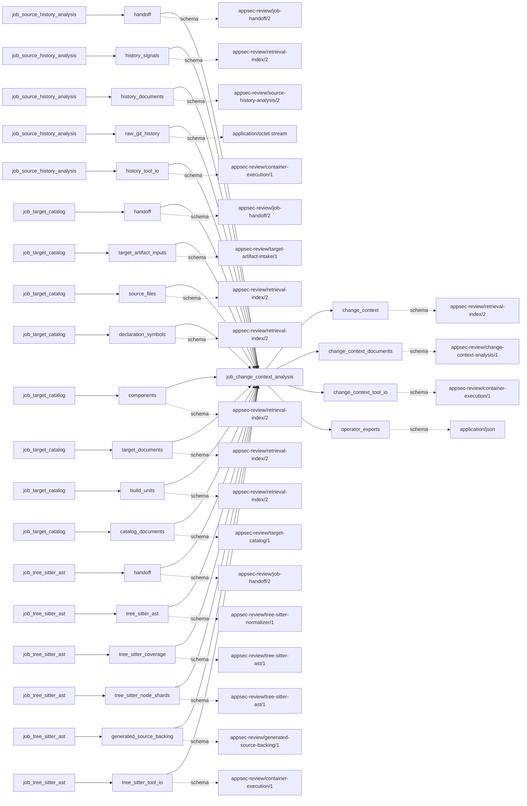

# change_context_analysis

This page contains the generated contract; the authored process and acceptance description are tracked by [T-130](../TODO.md).

<!-- generated:begin job=job_change_context_analysis -->
<!-- generated from: appsec-review.toml, containers/catalog.toml, pipeline/guidance/registry.json, tests/job-test-map.json, src/appsec_review/runtime/registry.py, src/appsec_review/runtime/contracts.py, src/appsec_review/runtime/datasets.py, src/appsec_review/guidance/workers.py, src/appsec_review/mcp/schema.py, src/appsec_review/orchestration/topology.py, src/appsec_review/orchestration/dagster/adapter.py by scripts/generate-docs.py; do not edit -->
## Declared job contract

change_context_analysis

Job: `job_change_context_analysis`. Enabled in the dev recipe: **true**.
Declarations describe possible work, not successful execution or consumed evidence.

### Steps and tasks

| Step | Task | Workers | Pool | Bound tool or gap | Handler |
| --- | --- | --- | --- | --- | --- |
| `analyze` | `analyze.change_signals` | 1 | `application` | Undeclared ([T-147](../TODO.md)) | [source](../../src/appsec_review/jobs/source_lanes.py#L57) |
| `analyze` | `analyze.rank` | 1 | `application` | Undeclared ([T-147](../TODO.md)) | [source](../../src/appsec_review/jobs/source_lanes.py#L57) |
| `analyze` | `analyze.unit_signals` | 1 | `application` | Undeclared ([T-147](../TODO.md)) | [source](../../src/appsec_review/jobs/source_lanes.py#L57) |
| `attribute` | `attribute.fix_on_fix` | 1 | `application` | Undeclared ([T-147](../TODO.md)) | [source](../../src/appsec_review/jobs/source_lanes.py#L57) |
| `attribute` | `attribute.line_attribution` | 1 | `application` | Undeclared ([T-147](../TODO.md)) | [source](../../src/appsec_review/jobs/source_lanes.py#L57) |
| `load` | `load.accepted_history` | 1 | `application` | Undeclared ([T-147](../TODO.md)) | [source](../../src/appsec_review/jobs/job_change_context_analysis/job.py#L165) |
| `load` | `load.external_sources` | 1 | `application` | Undeclared ([T-147](../TODO.md)) | [source](../../src/appsec_review/jobs/source_lanes.py#L57) |
| `publish` | `publish.index_change_context` | 1 | `application` | Undeclared ([T-147](../TODO.md)) | [source](../../src/appsec_review/jobs/source_lanes.py#L57) |
| `publish` | `publish.publish_handoff` | 1 | `application` | Undeclared ([T-147](../TODO.md)) | [source](../../src/appsec_review/jobs/source_lanes.py#L57) |

### Accepted input declarations

| Producer | Dataset | Schema | Channel | Availability | Missing policy |
| --- | --- | --- | --- | --- | --- |
| `job_source_history_analysis` | `handoff` | `appsec-review/job-handoff/2` | handoff | optional | gap |
| `job_source_history_analysis` | `history_signals` | `appsec-review/retrieval-index/2` | handoff | optional | gap |
| `job_source_history_analysis` | `history_documents` | `appsec-review/source-history-analysis/2` | handoff | optional | gap |
| `job_source_history_analysis` | `raw_git_history` | `application/octet-stream` | handoff | optional | gap |
| `job_source_history_analysis` | `history_tool_io` | `appsec-review/container-execution/1` | handoff | optional | gap |
| `job_target_catalog` | `handoff` | `appsec-review/job-handoff/2` | handoff | optional | gap |
| `job_target_catalog` | `target_artifact_inputs` | `appsec-review/target-artifact-intake/1` | handoff | optional | gap |
| `job_target_catalog` | `source_files` | `appsec-review/retrieval-index/2` | handoff | optional | gap |
| `job_target_catalog` | `declaration_symbols` | `appsec-review/retrieval-index/2` | handoff | optional | gap |
| `job_target_catalog` | `components` | `appsec-review/retrieval-index/2` | handoff | optional | gap |
| `job_target_catalog` | `target_documents` | `appsec-review/retrieval-index/2` | handoff | optional | gap |
| `job_target_catalog` | `build_units` | `appsec-review/retrieval-index/2` | handoff | optional | gap |
| `job_target_catalog` | `catalog_documents` | `appsec-review/target-catalog/1` | handoff | optional | gap |
| `job_tree_sitter_ast` | `handoff` | `appsec-review/job-handoff/2` | handoff | optional | gap |
| `job_tree_sitter_ast` | `tree_sitter_ast` | `appsec-review/tree-sitter-normalizer/1` | handoff | optional | gap |
| `job_tree_sitter_ast` | `tree_sitter_coverage` | `appsec-review/tree-sitter-ast/1` | handoff | optional | gap |
| `job_tree_sitter_ast` | `tree_sitter_node_shards` | `appsec-review/tree-sitter-ast/1` | handoff | optional | gap |
| `job_tree_sitter_ast` | `generated_source_backing` | `appsec-review/generated-source-backing/1` | handoff | optional | gap |
| `job_tree_sitter_ast` | `tree_sitter_tool_io` | `appsec-review/container-execution/1` | handoff | optional | gap |

### Published dataset declarations

| Dataset | Step | Schema | Stage | Indexes | MCP route |
| --- | --- | --- | --- | --- | --- |
| `change_context` | `publish` | `appsec-review/retrieval-index/2` | indexed | `history` | `query_change_context`, `query_precomputed` |
| `change_context_documents` | `publish` | `appsec-review/change-context-analysis/1` | artifact_only | Not indexed | `coverage`, `query_dataset_inventory` |
| `change_context_tool_io` | `attribute` | `appsec-review/container-execution/1` | protected | Not indexed | `coverage`, `query_dataset_inventory` |
| `operator_exports` | `load` | `application/json` | protected | Not indexed | `coverage`, `query_dataset_inventory` |

Protected and artifact-only routes expose sanitized metadata, not payload access.

### Model and guidance declarations

No job-level model declaration; absence of a task binding remains [T-147](../TODO.md), not a nonexecution claim.

### Test selection

| Tier | Files or selectors |
| --- | --- |
| acceptance | None declared |
| integration | None declared |
| live | None declared |
| unit | `tests/test_change_context_analysis.py::test_lifetime_normalization_uses_all_walked_commits_without_calendar_underflow` `tests/test_change_context_analysis.py::test_rolling_window_requires_more_than_three_fixes_within_sixty_days` `tests/test_change_context_analysis.py::test_review_speed_distinguishes_final_head_approval_stale_approval_and_direct_push` |

### Dagster placement

Dispatch: `review_graph`. Review graph member: **true**. Enabled graph member: **true**.

Declared predecessors: `job_tree_sitter_ast`.

### Declared dataflow

<!-- generated:end -->
