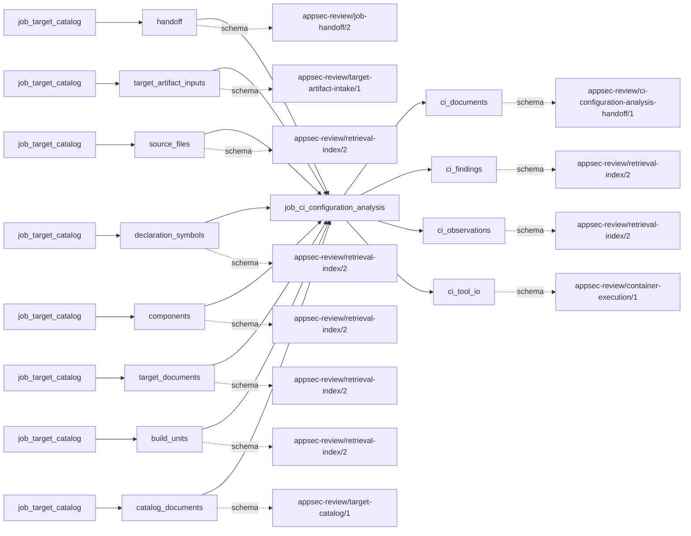
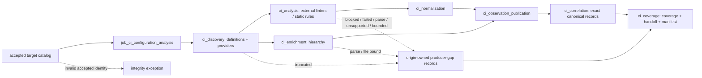

# ci_configuration_analysis

## Purpose

Identify accepted CI definitions, run applicable provider linters and structural rules, and
correlate exact duplicate observations into canonical CI records. The job answers which
configuration concerns have bounded source support, not whether a pipeline is exploitable or a
repository is secure. Its canonical “findings” are correlated scanner/rule judgments; the handoff's
security-findings list remains empty.

<!-- generated:begin job=job_ci_configuration_analysis -->
<!-- generated from: appsec-review.toml, containers/catalog.toml, pipeline/guidance/registry.json, tests/job-test-map.json, src/appsec_review/runtime/registry.py, src/appsec_review/runtime/contracts.py, src/appsec_review/runtime/datasets.py, src/appsec_review/guidance/workers.py, src/appsec_review/mcp/schema.py, src/appsec_review/orchestration/topology.py, src/appsec_review/orchestration/dagster/adapter.py by scripts/generate-docs.py; do not edit -->
## Declared job contract

ci_configuration_analysis

Job: `job_ci_configuration_analysis`. Enabled in the dev recipe: **true**.
Declarations describe possible work, not successful execution or consumed evidence.

### Steps and tasks

| Step | Task | Workers | Pool | Bound tool or gap | Handler |
| --- | --- | --- | --- | --- | --- |
| `ci_analysis` | `ci_analysis.azure_checkov_scan` | 1 | `ci_linter` | `tool-checkov` | [source](../../src/appsec_review/jobs/job_ci_configuration_analysis/job.py#L724) |
| `ci_analysis` | `ci_analysis.azure_schema_scan` | 1 | `ci_linter` | Internal: `ci-schema` | [source](../../src/appsec_review/jobs/job_ci_configuration_analysis/job.py#L724) |
| `ci_analysis` | `ci_analysis.bitbucket_checkov_scan` | 1 | `ci_linter` | `tool-checkov` | [source](../../src/appsec_review/jobs/job_ci_configuration_analysis/job.py#L724) |
| `ci_analysis` | `ci_analysis.bitbucket_schema_scan` | 1 | `ci_linter` | Internal: `ci-schema` | [source](../../src/appsec_review/jobs/job_ci_configuration_analysis/job.py#L724) |
| `ci_analysis` | `ci_analysis.circleci_checkov_scan` | 1 | `ci_linter` | `tool-checkov` | [source](../../src/appsec_review/jobs/job_ci_configuration_analysis/job.py#L724) |
| `ci_analysis` | `ci_analysis.circleci_schema_scan` | 1 | `ci_linter` | Internal: `ci-schema` | [source](../../src/appsec_review/jobs/job_ci_configuration_analysis/job.py#L724) |
| `ci_analysis` | `ci_analysis.github_actionlint_scan` | 1 | `ci_linter` | `tool-actionlint` | [source](../../src/appsec_review/jobs/job_ci_configuration_analysis/job.py#L724) |
| `ci_analysis` | `ci_analysis.github_checkov_scan` | 1 | `ci_linter` | `tool-checkov` | [source](../../src/appsec_review/jobs/job_ci_configuration_analysis/job.py#L724) |
| `ci_analysis` | `ci_analysis.github_schema_scan` | 1 | `ci_linter` | Internal: `ci-schema` | [source](../../src/appsec_review/jobs/job_ci_configuration_analysis/job.py#L724) |
| `ci_analysis` | `ci_analysis.github_zizmor_scan` | 1 | `ci_linter` | `tool-zizmor` | [source](../../src/appsec_review/jobs/job_ci_configuration_analysis/job.py#L724) |
| `ci_analysis` | `ci_analysis.gitlab_checkov_scan` | 1 | `ci_linter` | `tool-checkov` | [source](../../src/appsec_review/jobs/job_ci_configuration_analysis/job.py#L724) |
| `ci_analysis` | `ci_analysis.gitlab_schema_scan` | 1 | `ci_linter` | Internal: `ci-schema` | [source](../../src/appsec_review/jobs/job_ci_configuration_analysis/job.py#L724) |
| `ci_analysis` | `ci_analysis.jenkins_structural_scan` | 1 | `ci_linter` | Internal: `ci-jenkins-structural` | [source](../../src/appsec_review/jobs/job_ci_configuration_analysis/job.py#L724) |
| `ci_analysis` | `ci_analysis.other_discovery_scan` | 1 | `ci_linter` | Internal: `supported_discovery_without_linter` | [source](../../src/appsec_review/jobs/job_ci_configuration_analysis/job.py#L724) |
| `ci_analysis` | `ci_analysis.teamcity_structural_scan` | 1 | `ci_linter` | Internal: `ci-teamcity-structural` | [source](../../src/appsec_review/jobs/job_ci_configuration_analysis/job.py#L724) |
| `ci_correlation` | `ci_correlation.correlate_findings` | 1 | `application` | Undeclared ([T-147](../TODO.md)) | [source](../../src/appsec_review/jobs/job_ci_configuration_analysis/job.py#L734) |
| `ci_coverage` | `ci_coverage.join_coverage` | 1 | `application` | Undeclared ([T-147](../TODO.md)) | [source](../../src/appsec_review/jobs/job_ci_configuration_analysis/job.py#L736) |
| `ci_coverage` | `ci_coverage.publish_handoff` | 1 | `application` | Undeclared ([T-147](../TODO.md)) | [source](../../src/appsec_review/jobs/job_ci_configuration_analysis/job.py#L739) |
| `ci_discovery` | `ci_discovery.classify_providers` | 1 | `application` | Undeclared ([T-147](../TODO.md)) | [source](../../src/appsec_review/jobs/job_ci_configuration_analysis/job.py#L705) |
| `ci_discovery` | `ci_discovery.discover_definitions` | 1 | `application` | Undeclared ([T-147](../TODO.md)) | [source](../../src/appsec_review/jobs/job_ci_configuration_analysis/job.py#L693) |
| `ci_enrichment` | `ci_enrichment.build_hierarchy` | 1 | `application` | Undeclared ([T-147](../TODO.md)) | [source](../../src/appsec_review/jobs/job_ci_configuration_analysis/job.py#L489) |
| `ci_normalization` | `ci_normalization.azure_checkov_normalize` | 1 | `application` | Undeclared ([T-147](../TODO.md)) | [source](../../src/appsec_review/jobs/job_ci_configuration_analysis/job.py#L726) |
| `ci_normalization` | `ci_normalization.azure_schema_normalize` | 1 | `application` | Undeclared ([T-147](../TODO.md)) | [source](../../src/appsec_review/jobs/job_ci_configuration_analysis/job.py#L726) |
| `ci_normalization` | `ci_normalization.bitbucket_checkov_normalize` | 1 | `application` | Undeclared ([T-147](../TODO.md)) | [source](../../src/appsec_review/jobs/job_ci_configuration_analysis/job.py#L726) |
| `ci_normalization` | `ci_normalization.bitbucket_schema_normalize` | 1 | `application` | Undeclared ([T-147](../TODO.md)) | [source](../../src/appsec_review/jobs/job_ci_configuration_analysis/job.py#L726) |
| `ci_normalization` | `ci_normalization.circleci_checkov_normalize` | 1 | `application` | Undeclared ([T-147](../TODO.md)) | [source](../../src/appsec_review/jobs/job_ci_configuration_analysis/job.py#L726) |
| `ci_normalization` | `ci_normalization.circleci_schema_normalize` | 1 | `application` | Undeclared ([T-147](../TODO.md)) | [source](../../src/appsec_review/jobs/job_ci_configuration_analysis/job.py#L726) |
| `ci_normalization` | `ci_normalization.github_actionlint_normalize` | 1 | `application` | Undeclared ([T-147](../TODO.md)) | [source](../../src/appsec_review/jobs/job_ci_configuration_analysis/job.py#L726) |
| `ci_normalization` | `ci_normalization.github_checkov_normalize` | 1 | `application` | Undeclared ([T-147](../TODO.md)) | [source](../../src/appsec_review/jobs/job_ci_configuration_analysis/job.py#L726) |
| `ci_normalization` | `ci_normalization.github_schema_normalize` | 1 | `application` | Undeclared ([T-147](../TODO.md)) | [source](../../src/appsec_review/jobs/job_ci_configuration_analysis/job.py#L726) |
| `ci_normalization` | `ci_normalization.github_zizmor_normalize` | 1 | `application` | Undeclared ([T-147](../TODO.md)) | [source](../../src/appsec_review/jobs/job_ci_configuration_analysis/job.py#L726) |
| `ci_normalization` | `ci_normalization.gitlab_checkov_normalize` | 1 | `application` | Undeclared ([T-147](../TODO.md)) | [source](../../src/appsec_review/jobs/job_ci_configuration_analysis/job.py#L726) |
| `ci_normalization` | `ci_normalization.gitlab_schema_normalize` | 1 | `application` | Undeclared ([T-147](../TODO.md)) | [source](../../src/appsec_review/jobs/job_ci_configuration_analysis/job.py#L726) |
| `ci_normalization` | `ci_normalization.jenkins_structural_normalize` | 1 | `application` | Undeclared ([T-147](../TODO.md)) | [source](../../src/appsec_review/jobs/job_ci_configuration_analysis/job.py#L726) |
| `ci_normalization` | `ci_normalization.other_discovery_normalize` | 1 | `application` | Undeclared ([T-147](../TODO.md)) | [source](../../src/appsec_review/jobs/job_ci_configuration_analysis/job.py#L726) |
| `ci_normalization` | `ci_normalization.teamcity_structural_normalize` | 1 | `application` | Undeclared ([T-147](../TODO.md)) | [source](../../src/appsec_review/jobs/job_ci_configuration_analysis/job.py#L726) |
| `ci_observation_publication` | `ci_observation_publication.azure_checkov_index` | 1 | `index` | Undeclared ([T-147](../TODO.md)) | [source](../../src/appsec_review/jobs/job_ci_configuration_analysis/job.py#L732) |
| `ci_observation_publication` | `ci_observation_publication.azure_schema_index` | 1 | `index` | Undeclared ([T-147](../TODO.md)) | [source](../../src/appsec_review/jobs/job_ci_configuration_analysis/job.py#L732) |
| `ci_observation_publication` | `ci_observation_publication.bitbucket_checkov_index` | 1 | `index` | Undeclared ([T-147](../TODO.md)) | [source](../../src/appsec_review/jobs/job_ci_configuration_analysis/job.py#L732) |
| `ci_observation_publication` | `ci_observation_publication.bitbucket_schema_index` | 1 | `index` | Undeclared ([T-147](../TODO.md)) | [source](../../src/appsec_review/jobs/job_ci_configuration_analysis/job.py#L732) |
| `ci_observation_publication` | `ci_observation_publication.circleci_checkov_index` | 1 | `index` | Undeclared ([T-147](../TODO.md)) | [source](../../src/appsec_review/jobs/job_ci_configuration_analysis/job.py#L732) |
| `ci_observation_publication` | `ci_observation_publication.circleci_schema_index` | 1 | `index` | Undeclared ([T-147](../TODO.md)) | [source](../../src/appsec_review/jobs/job_ci_configuration_analysis/job.py#L732) |
| `ci_observation_publication` | `ci_observation_publication.github_actionlint_index` | 1 | `index` | Undeclared ([T-147](../TODO.md)) | [source](../../src/appsec_review/jobs/job_ci_configuration_analysis/job.py#L732) |
| `ci_observation_publication` | `ci_observation_publication.github_checkov_index` | 1 | `index` | Undeclared ([T-147](../TODO.md)) | [source](../../src/appsec_review/jobs/job_ci_configuration_analysis/job.py#L732) |
| `ci_observation_publication` | `ci_observation_publication.github_schema_index` | 1 | `index` | Undeclared ([T-147](../TODO.md)) | [source](../../src/appsec_review/jobs/job_ci_configuration_analysis/job.py#L732) |
| `ci_observation_publication` | `ci_observation_publication.github_zizmor_index` | 1 | `index` | Undeclared ([T-147](../TODO.md)) | [source](../../src/appsec_review/jobs/job_ci_configuration_analysis/job.py#L732) |
| `ci_observation_publication` | `ci_observation_publication.gitlab_checkov_index` | 1 | `index` | Undeclared ([T-147](../TODO.md)) | [source](../../src/appsec_review/jobs/job_ci_configuration_analysis/job.py#L732) |
| `ci_observation_publication` | `ci_observation_publication.gitlab_schema_index` | 1 | `index` | Undeclared ([T-147](../TODO.md)) | [source](../../src/appsec_review/jobs/job_ci_configuration_analysis/job.py#L732) |
| `ci_observation_publication` | `ci_observation_publication.jenkins_structural_index` | 1 | `index` | Undeclared ([T-147](../TODO.md)) | [source](../../src/appsec_review/jobs/job_ci_configuration_analysis/job.py#L732) |
| `ci_observation_publication` | `ci_observation_publication.other_discovery_index` | 1 | `index` | Undeclared ([T-147](../TODO.md)) | [source](../../src/appsec_review/jobs/job_ci_configuration_analysis/job.py#L732) |
| `ci_observation_publication` | `ci_observation_publication.teamcity_structural_index` | 1 | `index` | Undeclared ([T-147](../TODO.md)) | [source](../../src/appsec_review/jobs/job_ci_configuration_analysis/job.py#L732) |

### Accepted input declarations

| Producer | Dataset | Schema | Channel | Availability | Missing policy |
| --- | --- | --- | --- | --- | --- |
| `job_target_catalog` | `handoff` | `appsec-review/job-handoff/2` | handoff | required | reject |
| `job_target_catalog` | `target_artifact_inputs` | `appsec-review/target-artifact-intake/1` | handoff | optional | gap |
| `job_target_catalog` | `source_files` | `appsec-review/retrieval-index/2` | handoff | optional | gap |
| `job_target_catalog` | `declaration_symbols` | `appsec-review/retrieval-index/2` | handoff | optional | gap |
| `job_target_catalog` | `components` | `appsec-review/retrieval-index/2` | handoff | optional | gap |
| `job_target_catalog` | `target_documents` | `appsec-review/retrieval-index/2` | handoff | optional | gap |
| `job_target_catalog` | `build_units` | `appsec-review/retrieval-index/2` | handoff | optional | gap |
| `job_target_catalog` | `catalog_documents` | `appsec-review/target-catalog/1` | handoff | optional | gap |

### Published dataset declarations

| Dataset | Step | Schema | Stage | Indexes | MCP route |
| --- | --- | --- | --- | --- | --- |
| `ci_documents` | `ci_coverage` | `appsec-review/ci-configuration-analysis-handoff/1` | artifact_only | Not indexed | `coverage`, `query_dataset_inventory` |
| `ci_findings` | `ci_correlation` | `appsec-review/retrieval-index/2` | indexed | `evidence` | `query_ci_configuration` |
| `ci_observations` | `ci_observation_publication` | `appsec-review/retrieval-index/2` | indexed | `observations` | `query_ci_configuration`, `query_precomputed` |
| `ci_tool_io` | `ci_analysis` | `appsec-review/container-execution/1` | protected | Not indexed | `coverage`, `query_dataset_inventory` |

Protected and artifact-only routes expose sanitized metadata, not payload access.

### Model and guidance declarations

No job-level model declaration; absence of a task binding remains [T-147](../TODO.md), not a nonexecution claim.

### Test selection

| Tier | Files or selectors |
| --- | --- |
| acceptance | None declared |
| integration | None declared |
| live | `tests/test_ci_configuration_analysis.py::test_live_target_acceptance_is_static_offline_resumable_and_queryable` |
| unit | `tests/test_ci_configuration_analysis.py::test_discovery_is_exact_bounded_and_prompt_text_is_inert` `tests/test_ci_configuration_analysis.py::test_spans_hierarchy_redaction_and_exact_only_correlation` `tests/test_ci_configuration_analysis.py::test_dag_exposes_parallel_provider_branches_and_deterministic_join` |

### Dagster placement

Dispatch: `review_graph`. Review graph member: **true**. Enabled graph member: **true**.

Declared predecessors: `job_target_catalog`.

### Declared dataflow

<!-- generated:end -->

## Process

Source: [handler graph](../../src/appsec_review/jobs/job_ci_configuration_analysis/job.py),
[discovery](../../src/appsec_review/jobs/job_ci_configuration_analysis/discovery.py) and
[structural rules](../../src/appsec_review/jobs/job_ci_configuration_analysis/static_rules.py).
The job declares strict structured gaps; generated task bindings remain [T-147](../TODO.md).

### `ci_discovery`

1. Verify the accepted target catalog and snapshot through
   [job input contracts](../architecture/job-input-contracts.md); use its enumerated files,
   not repository-wide discovery outside that inventory.
2. Identify and bound CI definitions, then sort by provider/path. The discovery bound emits
   `truncated` records. Publish definition catalog and provider classification.
3. Carry discovery gap records as classification payload without re-declaring them in the unit's
   gap array, so the control layer counts each cause once.

### `ci_analysis`

1. Select definitions per provider/tool spec. No definitions is not-applicable without gaps;
   inputs outside an external linter's declared support are skipped before image resolution.
2. Run GitHub zizmor/actionlint and provider-specific Checkov frameworks where configured.
   Resolve pinned offline images; unavailable resolution emits retryable `producer_blocked`.
   Execute per definition with bounded container policy, accepting the adapter's diagnostic
   exit convention. Failed invocation/timeout/OOM emits `producer_failed`.
3. Parse native output with tool-specific mappings. Zizmor spans and Checkov source-range
   reconstruction retain exact or ambiguous mapping provenance; malformed native output emits
   `parser_error`, not a clean empty result.
4. For static specs, read bounded UTF-8 definitions and run source structural rules. Jenkins and
   TeamCity use structural analysis, not target-language execution. Unreadable/invalid text emits
   `parser_error`; file bounds emit `producer_reported_gap`. Other-provider discovery without a
   configured linter emits `producer_reported_gap`.
5. Cap observations with `truncated`, redact credential-like message values, and retain raw
   observations plus execution identities. External gaps with no records mean failed scan;
   otherwise reasons make it partial.

### `ci_normalization`

1. Read and verify each raw artifact, normalize source ranges and identity fields, and derive
   deterministic observation IDs. Deduplicate exact IDs, preserving raw and duplicate counts.
2. Publish normalized observations. Normalization's own success does not erase the scan outcome:
   scan status and gap records travel in payload fields rather than being declared a second time.

### `ci_enrichment`

1. Read accepted definitions within the file-byte/UTF-8 bounds and derive structural stage/job/step
   hierarchy. Over-bound files emit `producer_reported_gap`; unreadable hierarchy emits `parser_error`.
2. Publish `hierarchy.json`. Later enrichment uses the latest preceding node of each kind in the
   same path; this is structural context, not proof of CI runtime control flow.

### `ci_observation_publication`

1. Enrich normalized records with pipeline/workflow and hierarchy context. Map retained locations
   against source bytes while preserving mapping confidence and ambiguity.
2. Write one observations shard per provider/tool with scan coverage: complete for successful scan,
   unavailable for failed/not-applicable scan, partial otherwise. Publication's own status remains
   success, carrying scan gaps only as payload.

### `ci_correlation`

1. Group only exact provider/path/range/category/message matches; ambiguous mappings must also
   match provenance and byte ranges. Do not merge merely similar wording or neighboring spans.
2. Publish `canonical-findings.json` plus an evidence shard linking canonical records to their
   observation IDs/tool lists. Duplicate count is an accounting fact, not confidence in exploitability.

### `ci_coverage`

1. Join discovery, scan and hierarchy gaps by stable gap ID; publish `coverage.json` with provider
   counts, tool statuses and skipped-input accounting. Do not re-declare joined records.
2. Replace this producer's prior shards in the verified upstream manifest and publish `handoff.json`
   with coverage/canonical-record references, finding count and an empty security-findings list.
   Publication succeeds on its own terms; originating unit gaps determine job coverage.

## Dataflow

## Gaps

These are actual `producer-gap/1` records from the
[handler helpers](../../src/appsec_review/jobs/job_ci_configuration_analysis/job.py#L91), not inferred
codes. Their semantics follow [interchange](../architecture/job-interchange.md#the-control-layer-beneath-the-envelope).

- `producer_blocked`, retryable **true**: unavailable pinned offline image; tooling failure
  requiring operator action.
- `producer_failed`, retryable **false**: failed/exceptional linter invocation, timeout, OOM or
  unacceptable exit. Non-retryable here is **not advisory**.
- `parser_error`, retryable **false**: malformed linter output, invalid source-range reconstruction
  or unreadable/invalid UTF-8 static/hierarchy input.
- `truncated`, retryable **false**: discovery definition or observation cap; coverage missing.
- `producer_reported_gap`, retryable **false**: file/hierarchy byte bound or discovery without
  enabled provider linter; coverage missing or present-but-unsupported capability.

No definitions and declared unsupported inputs are not-applicable/skip decisions, not linter
failures. Changed own artifact hashes and unusable internal commands raise
`CiConfigurationAnalysisFailed`; accepted-input integrity failures also stop, rather than producing
successful gap artifacts. Execution-safety may stop before a tool fallback is published.
Known causes still need the particular walk's user-approved expected classification.

## Acceptance

1. **A. Inputs:** Compare admitted catalog pin and definition paths/hashes, provider assignment and
   supported input decisions; match actual linter image and argv receipts to selected definitions.
2. **B. Independent comparison:** Independently count provider definitions and native linter records;
   inspect structural rule spans against source bytes. Recalculate exact correlation groups and
   duplicate counts, including two ambiguous mappings that must remain distinct. Compare hierarchy
   attachment to source ordering, not assumed pipeline execution semantics.
3. **C. Gaps:** Read verified outcomes and compare unique gap IDs to `coverage.json`; each originating
   cause should occur once despite normalization/index joins. Reconcile failed tools, bounds and
   unsupported providers with raw evidence and the approved expected list.
4. **D. Baseline:** At authorized acceptance save `stepwise.py accept`, corpus namespace and baseline
   with definition/observation/canonical counts, mapping identities and gap IDs. This page asserts
   no live CI linter acceptance.

## Resume and invalidation

This job has no bespoke external-linter checkpoint; replay follows
[runtime unit receipts](../architecture/jobs-and-runtime.md#wave-1-resumability).
Observation fingerprints bind snapshot, normalized artifact, hierarchy, provider/tool/framework,
ruleset, settings and parser/normalizer/mapping identities. Canonical evidence fingerprints bind
the exact correlation document. Changed definitions, hierarchy, mappings or rules must not be
treated as unchanged observations. Fresh unit execution builds the shards; a matching filename
alone is not a scanner execution receipt. Shared [image pins](image-pin-verification.md),
[signing](signing.md) and [retrieval manifests](../architecture/python-and-retrieval.md#accepted-index-sets)
remain independent verification boundaries.
