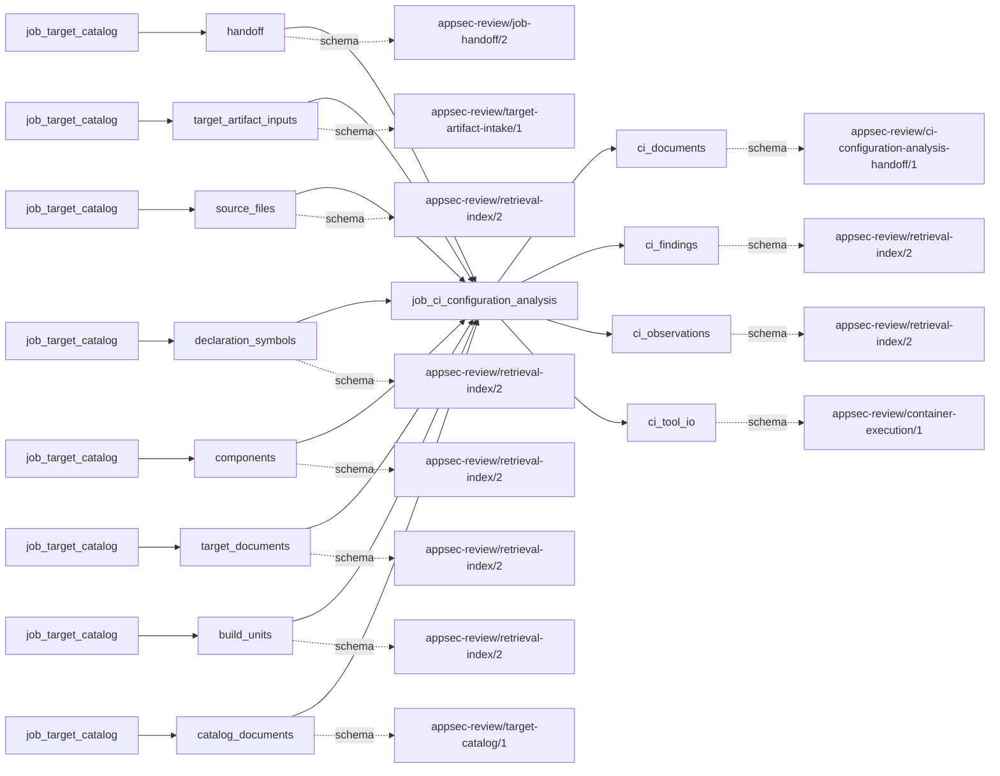

# ci_configuration_analysis

This page contains the generated contract; the authored process and acceptance description are tracked by [T-130](../TODO.md).

<!-- generated:begin job=job_ci_configuration_analysis -->
<!-- generated from: appsec-review.toml, containers/catalog.toml, pipeline/guidance/registry.json, tests/job-test-map.json, src/appsec_review/runtime/registry.py, src/appsec_review/runtime/contracts.py, src/appsec_review/runtime/datasets.py, src/appsec_review/guidance/workers.py, src/appsec_review/mcp/schema.py, src/appsec_review/orchestration/topology.py, src/appsec_review/orchestration/dagster/adapter.py by scripts/generate-docs.py; do not edit -->
## Declared job contract

ci_configuration_analysis

Job: `job_ci_configuration_analysis`. Enabled in the dev recipe: **true**.
Declarations describe possible work, not successful execution or consumed evidence.

### Steps and tasks

| Step | Task | Workers | Pool | Bound tool or gap | Handler |
| --- | --- | --- | --- | --- | --- |
| `ci_analysis` | `ci_analysis.azure_checkov_scan` | 1 | `ci_linter` | `tool-checkov` | [source](../../src/appsec_review/jobs/job_ci_configuration_analysis/job.py#L724) |
| `ci_analysis` | `ci_analysis.azure_schema_scan` | 1 | `ci_linter` | Internal: `ci-schema` | [source](../../src/appsec_review/jobs/job_ci_configuration_analysis/job.py#L724) |
| `ci_analysis` | `ci_analysis.bitbucket_checkov_scan` | 1 | `ci_linter` | `tool-checkov` | [source](../../src/appsec_review/jobs/job_ci_configuration_analysis/job.py#L724) |
| `ci_analysis` | `ci_analysis.bitbucket_schema_scan` | 1 | `ci_linter` | Internal: `ci-schema` | [source](../../src/appsec_review/jobs/job_ci_configuration_analysis/job.py#L724) |
| `ci_analysis` | `ci_analysis.circleci_checkov_scan` | 1 | `ci_linter` | `tool-checkov` | [source](../../src/appsec_review/jobs/job_ci_configuration_analysis/job.py#L724) |
| `ci_analysis` | `ci_analysis.circleci_schema_scan` | 1 | `ci_linter` | Internal: `ci-schema` | [source](../../src/appsec_review/jobs/job_ci_configuration_analysis/job.py#L724) |
| `ci_analysis` | `ci_analysis.github_actionlint_scan` | 1 | `ci_linter` | `tool-actionlint` | [source](../../src/appsec_review/jobs/job_ci_configuration_analysis/job.py#L724) |
| `ci_analysis` | `ci_analysis.github_checkov_scan` | 1 | `ci_linter` | `tool-checkov` | [source](../../src/appsec_review/jobs/job_ci_configuration_analysis/job.py#L724) |
| `ci_analysis` | `ci_analysis.github_schema_scan` | 1 | `ci_linter` | Internal: `ci-schema` | [source](../../src/appsec_review/jobs/job_ci_configuration_analysis/job.py#L724) |
| `ci_analysis` | `ci_analysis.github_zizmor_scan` | 1 | `ci_linter` | `tool-zizmor` | [source](../../src/appsec_review/jobs/job_ci_configuration_analysis/job.py#L724) |
| `ci_analysis` | `ci_analysis.gitlab_checkov_scan` | 1 | `ci_linter` | `tool-checkov` | [source](../../src/appsec_review/jobs/job_ci_configuration_analysis/job.py#L724) |
| `ci_analysis` | `ci_analysis.gitlab_schema_scan` | 1 | `ci_linter` | Internal: `ci-schema` | [source](../../src/appsec_review/jobs/job_ci_configuration_analysis/job.py#L724) |
| `ci_analysis` | `ci_analysis.jenkins_structural_scan` | 1 | `ci_linter` | Internal: `ci-jenkins-structural` | [source](../../src/appsec_review/jobs/job_ci_configuration_analysis/job.py#L724) |
| `ci_analysis` | `ci_analysis.other_discovery_scan` | 1 | `ci_linter` | Internal: `supported_discovery_without_linter` | [source](../../src/appsec_review/jobs/job_ci_configuration_analysis/job.py#L724) |
| `ci_analysis` | `ci_analysis.teamcity_structural_scan` | 1 | `ci_linter` | Internal: `ci-teamcity-structural` | [source](../../src/appsec_review/jobs/job_ci_configuration_analysis/job.py#L724) |
| `ci_correlation` | `ci_correlation.correlate_findings` | 1 | `application` | Undeclared ([T-147](../TODO.md)) | [source](../../src/appsec_review/jobs/job_ci_configuration_analysis/job.py#L734) |
| `ci_coverage` | `ci_coverage.join_coverage` | 1 | `application` | Undeclared ([T-147](../TODO.md)) | [source](../../src/appsec_review/jobs/job_ci_configuration_analysis/job.py#L736) |
| `ci_coverage` | `ci_coverage.publish_handoff` | 1 | `application` | Undeclared ([T-147](../TODO.md)) | [source](../../src/appsec_review/jobs/job_ci_configuration_analysis/job.py#L739) |
| `ci_discovery` | `ci_discovery.classify_providers` | 1 | `application` | Undeclared ([T-147](../TODO.md)) | [source](../../src/appsec_review/jobs/job_ci_configuration_analysis/job.py#L705) |
| `ci_discovery` | `ci_discovery.discover_definitions` | 1 | `application` | Undeclared ([T-147](../TODO.md)) | [source](../../src/appsec_review/jobs/job_ci_configuration_analysis/job.py#L693) |
| `ci_enrichment` | `ci_enrichment.build_hierarchy` | 1 | `application` | Undeclared ([T-147](../TODO.md)) | [source](../../src/appsec_review/jobs/job_ci_configuration_analysis/job.py#L489) |
| `ci_normalization` | `ci_normalization.azure_checkov_normalize` | 1 | `application` | Undeclared ([T-147](../TODO.md)) | [source](../../src/appsec_review/jobs/job_ci_configuration_analysis/job.py#L726) |
| `ci_normalization` | `ci_normalization.azure_schema_normalize` | 1 | `application` | Undeclared ([T-147](../TODO.md)) | [source](../../src/appsec_review/jobs/job_ci_configuration_analysis/job.py#L726) |
| `ci_normalization` | `ci_normalization.bitbucket_checkov_normalize` | 1 | `application` | Undeclared ([T-147](../TODO.md)) | [source](../../src/appsec_review/jobs/job_ci_configuration_analysis/job.py#L726) |
| `ci_normalization` | `ci_normalization.bitbucket_schema_normalize` | 1 | `application` | Undeclared ([T-147](../TODO.md)) | [source](../../src/appsec_review/jobs/job_ci_configuration_analysis/job.py#L726) |
| `ci_normalization` | `ci_normalization.circleci_checkov_normalize` | 1 | `application` | Undeclared ([T-147](../TODO.md)) | [source](../../src/appsec_review/jobs/job_ci_configuration_analysis/job.py#L726) |
| `ci_normalization` | `ci_normalization.circleci_schema_normalize` | 1 | `application` | Undeclared ([T-147](../TODO.md)) | [source](../../src/appsec_review/jobs/job_ci_configuration_analysis/job.py#L726) |
| `ci_normalization` | `ci_normalization.github_actionlint_normalize` | 1 | `application` | Undeclared ([T-147](../TODO.md)) | [source](../../src/appsec_review/jobs/job_ci_configuration_analysis/job.py#L726) |
| `ci_normalization` | `ci_normalization.github_checkov_normalize` | 1 | `application` | Undeclared ([T-147](../TODO.md)) | [source](../../src/appsec_review/jobs/job_ci_configuration_analysis/job.py#L726) |
| `ci_normalization` | `ci_normalization.github_schema_normalize` | 1 | `application` | Undeclared ([T-147](../TODO.md)) | [source](../../src/appsec_review/jobs/job_ci_configuration_analysis/job.py#L726) |
| `ci_normalization` | `ci_normalization.github_zizmor_normalize` | 1 | `application` | Undeclared ([T-147](../TODO.md)) | [source](../../src/appsec_review/jobs/job_ci_configuration_analysis/job.py#L726) |
| `ci_normalization` | `ci_normalization.gitlab_checkov_normalize` | 1 | `application` | Undeclared ([T-147](../TODO.md)) | [source](../../src/appsec_review/jobs/job_ci_configuration_analysis/job.py#L726) |
| `ci_normalization` | `ci_normalization.gitlab_schema_normalize` | 1 | `application` | Undeclared ([T-147](../TODO.md)) | [source](../../src/appsec_review/jobs/job_ci_configuration_analysis/job.py#L726) |
| `ci_normalization` | `ci_normalization.jenkins_structural_normalize` | 1 | `application` | Undeclared ([T-147](../TODO.md)) | [source](../../src/appsec_review/jobs/job_ci_configuration_analysis/job.py#L726) |
| `ci_normalization` | `ci_normalization.other_discovery_normalize` | 1 | `application` | Undeclared ([T-147](../TODO.md)) | [source](../../src/appsec_review/jobs/job_ci_configuration_analysis/job.py#L726) |
| `ci_normalization` | `ci_normalization.teamcity_structural_normalize` | 1 | `application` | Undeclared ([T-147](../TODO.md)) | [source](../../src/appsec_review/jobs/job_ci_configuration_analysis/job.py#L726) |
| `ci_observation_publication` | `ci_observation_publication.azure_checkov_index` | 1 | `index` | Undeclared ([T-147](../TODO.md)) | [source](../../src/appsec_review/jobs/job_ci_configuration_analysis/job.py#L732) |
| `ci_observation_publication` | `ci_observation_publication.azure_schema_index` | 1 | `index` | Undeclared ([T-147](../TODO.md)) | [source](../../src/appsec_review/jobs/job_ci_configuration_analysis/job.py#L732) |
| `ci_observation_publication` | `ci_observation_publication.bitbucket_checkov_index` | 1 | `index` | Undeclared ([T-147](../TODO.md)) | [source](../../src/appsec_review/jobs/job_ci_configuration_analysis/job.py#L732) |
| `ci_observation_publication` | `ci_observation_publication.bitbucket_schema_index` | 1 | `index` | Undeclared ([T-147](../TODO.md)) | [source](../../src/appsec_review/jobs/job_ci_configuration_analysis/job.py#L732) |
| `ci_observation_publication` | `ci_observation_publication.circleci_checkov_index` | 1 | `index` | Undeclared ([T-147](../TODO.md)) | [source](../../src/appsec_review/jobs/job_ci_configuration_analysis/job.py#L732) |
| `ci_observation_publication` | `ci_observation_publication.circleci_schema_index` | 1 | `index` | Undeclared ([T-147](../TODO.md)) | [source](../../src/appsec_review/jobs/job_ci_configuration_analysis/job.py#L732) |
| `ci_observation_publication` | `ci_observation_publication.github_actionlint_index` | 1 | `index` | Undeclared ([T-147](../TODO.md)) | [source](../../src/appsec_review/jobs/job_ci_configuration_analysis/job.py#L732) |
| `ci_observation_publication` | `ci_observation_publication.github_checkov_index` | 1 | `index` | Undeclared ([T-147](../TODO.md)) | [source](../../src/appsec_review/jobs/job_ci_configuration_analysis/job.py#L732) |
| `ci_observation_publication` | `ci_observation_publication.github_schema_index` | 1 | `index` | Undeclared ([T-147](../TODO.md)) | [source](../../src/appsec_review/jobs/job_ci_configuration_analysis/job.py#L732) |
| `ci_observation_publication` | `ci_observation_publication.github_zizmor_index` | 1 | `index` | Undeclared ([T-147](../TODO.md)) | [source](../../src/appsec_review/jobs/job_ci_configuration_analysis/job.py#L732) |
| `ci_observation_publication` | `ci_observation_publication.gitlab_checkov_index` | 1 | `index` | Undeclared ([T-147](../TODO.md)) | [source](../../src/appsec_review/jobs/job_ci_configuration_analysis/job.py#L732) |
| `ci_observation_publication` | `ci_observation_publication.gitlab_schema_index` | 1 | `index` | Undeclared ([T-147](../TODO.md)) | [source](../../src/appsec_review/jobs/job_ci_configuration_analysis/job.py#L732) |
| `ci_observation_publication` | `ci_observation_publication.jenkins_structural_index` | 1 | `index` | Undeclared ([T-147](../TODO.md)) | [source](../../src/appsec_review/jobs/job_ci_configuration_analysis/job.py#L732) |
| `ci_observation_publication` | `ci_observation_publication.other_discovery_index` | 1 | `index` | Undeclared ([T-147](../TODO.md)) | [source](../../src/appsec_review/jobs/job_ci_configuration_analysis/job.py#L732) |
| `ci_observation_publication` | `ci_observation_publication.teamcity_structural_index` | 1 | `index` | Undeclared ([T-147](../TODO.md)) | [source](../../src/appsec_review/jobs/job_ci_configuration_analysis/job.py#L732) |

### Accepted input declarations

| Producer | Dataset | Schema | Channel | Availability | Missing policy |
| --- | --- | --- | --- | --- | --- |
| `job_target_catalog` | `handoff` | `appsec-review/job-handoff/2` | handoff | required | reject |
| `job_target_catalog` | `target_artifact_inputs` | `appsec-review/target-artifact-intake/1` | handoff | optional | gap |
| `job_target_catalog` | `source_files` | `appsec-review/retrieval-index/2` | handoff | optional | gap |
| `job_target_catalog` | `declaration_symbols` | `appsec-review/retrieval-index/2` | handoff | optional | gap |
| `job_target_catalog` | `components` | `appsec-review/retrieval-index/2` | handoff | optional | gap |
| `job_target_catalog` | `target_documents` | `appsec-review/retrieval-index/2` | handoff | optional | gap |
| `job_target_catalog` | `build_units` | `appsec-review/retrieval-index/2` | handoff | optional | gap |
| `job_target_catalog` | `catalog_documents` | `appsec-review/target-catalog/1` | handoff | optional | gap |

### Published dataset declarations

| Dataset | Step | Schema | Stage | Indexes | MCP route |
| --- | --- | --- | --- | --- | --- |
| `ci_documents` | `ci_coverage` | `appsec-review/ci-configuration-analysis-handoff/1` | artifact_only | Not indexed | `coverage`, `query_dataset_inventory` |
| `ci_findings` | `ci_correlation` | `appsec-review/retrieval-index/2` | indexed | `evidence` | `query_ci_configuration` |
| `ci_observations` | `ci_observation_publication` | `appsec-review/retrieval-index/2` | indexed | `observations` | `query_ci_configuration`, `query_precomputed` |
| `ci_tool_io` | `ci_analysis` | `appsec-review/container-execution/1` | protected | Not indexed | `coverage`, `query_dataset_inventory` |

Protected and artifact-only routes expose sanitized metadata, not payload access.

### Model and guidance declarations

No job-level model declaration; absence of a task binding remains [T-147](../TODO.md), not a nonexecution claim.

### Test selection

| Tier | Files or selectors |
| --- | --- |
| acceptance | None declared |
| integration | None declared |
| live | `tests/test_ci_configuration_analysis.py::test_live_target_acceptance_is_static_offline_resumable_and_queryable` |
| unit | `tests/test_ci_configuration_analysis.py::test_discovery_is_exact_bounded_and_prompt_text_is_inert` `tests/test_ci_configuration_analysis.py::test_spans_hierarchy_redaction_and_exact_only_correlation` `tests/test_ci_configuration_analysis.py::test_dag_exposes_parallel_provider_branches_and_deterministic_join` |

### Dagster placement

Dispatch: `review_graph`. Review graph member: **true**. Enabled graph member: **true**.

Declared predecessors: `job_target_catalog`.

### Declared dataflow

<!-- generated:end -->
