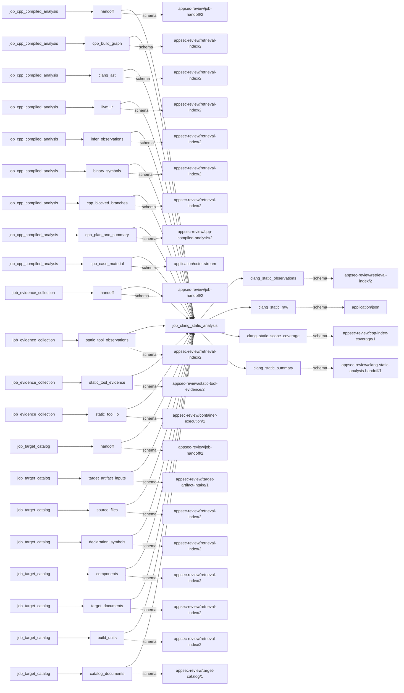
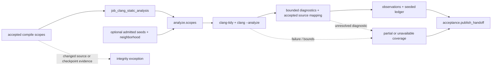

# clang_static_analysis

## Purpose

Run clang-tidy and Clang's static analyzer over supported accepted compile units and retain
source-bound diagnostics, notes and fix-it presence. This supplies scanner judgments for later
review and graph corroboration, not confirmed vulnerabilities. Seeded mode covers only selected
translation units and explicitly labels diagnostics relative to seeds and their known neighborhood.

<!-- generated:begin job=job_clang_static_analysis -->
<!-- generated from: appsec-review.toml, containers/catalog.toml, pipeline/guidance/registry.json, tests/job-test-map.json, src/appsec_review/runtime/registry.py, src/appsec_review/runtime/contracts.py, src/appsec_review/runtime/datasets.py, src/appsec_review/guidance/workers.py, src/appsec_review/mcp/schema.py, src/appsec_review/orchestration/topology.py, src/appsec_review/orchestration/dagster/adapter.py by scripts/generate-docs.py; do not edit -->
## Declared job contract

clang_static_analysis

Job: `job_clang_static_analysis`. Enabled in the dev recipe: **true**.
Declarations describe possible work, not successful execution or consumed evidence.

### Steps and tasks

| Step | Task | Workers | Pool | Bound tool or gap | Handler |
| --- | --- | --- | --- | --- | --- |
| `acceptance` | `acceptance.publish_handoff` | 1 | `application` | Undeclared ([T-147](../TODO.md)) | [source](../../src/appsec_review/jobs/job_clang_static_analysis/job.py#L419) |
| `analyze` | `analyze.scopes` | 1 | `application` | Undeclared ([T-147](../TODO.md)) | [source](../../src/appsec_review/jobs/job_clang_static_analysis/job.py#L393) |
| `load` | `load.accepted_cpp` | 1 | `application` | Undeclared ([T-147](../TODO.md)) | [source](../../src/appsec_review/jobs/job_clang_static_analysis/job.py#L385) |

### Accepted input declarations

| Producer | Dataset | Schema | Channel | Availability | Missing policy |
| --- | --- | --- | --- | --- | --- |
| `job_cpp_compiled_analysis` | `handoff` | `appsec-review/job-handoff/2` | handoff | required | reject |
| `job_cpp_compiled_analysis` | `cpp_build_graph` | `appsec-review/retrieval-index/2` | handoff | optional | gap |
| `job_cpp_compiled_analysis` | `clang_ast` | `appsec-review/retrieval-index/2` | handoff | optional | gap |
| `job_cpp_compiled_analysis` | `llvm_ir` | `appsec-review/retrieval-index/2` | handoff | optional | gap |
| `job_cpp_compiled_analysis` | `infer_observations` | `appsec-review/retrieval-index/2` | handoff | optional | gap |
| `job_cpp_compiled_analysis` | `binary_symbols` | `appsec-review/retrieval-index/2` | handoff | optional | gap |
| `job_cpp_compiled_analysis` | `cpp_blocked_branches` | `appsec-review/retrieval-index/2` | handoff | optional | gap |
| `job_cpp_compiled_analysis` | `cpp_plan_and_summary` | `appsec-review/cpp-compiled-analysis/2` | handoff | optional | gap |
| `job_cpp_compiled_analysis` | `cpp_case_material` | `application/octet-stream` | handoff | optional | gap |
| `job_evidence_collection` | `handoff` | `appsec-review/job-handoff/2` | handoff | optional | gap |
| `job_evidence_collection` | `static_tool_observations` | `appsec-review/retrieval-index/2` | handoff | optional | gap |
| `job_evidence_collection` | `static_tool_evidence` | `appsec-review/static-tool-evidence/2` | handoff | optional | gap |
| `job_evidence_collection` | `static_tool_io` | `appsec-review/container-execution/1` | handoff | optional | gap |
| `job_target_catalog` | `handoff` | `appsec-review/job-handoff/2` | handoff | optional | gap |
| `job_target_catalog` | `target_artifact_inputs` | `appsec-review/target-artifact-intake/1` | handoff | optional | gap |
| `job_target_catalog` | `source_files` | `appsec-review/retrieval-index/2` | handoff | optional | gap |
| `job_target_catalog` | `declaration_symbols` | `appsec-review/retrieval-index/2` | handoff | optional | gap |
| `job_target_catalog` | `components` | `appsec-review/retrieval-index/2` | handoff | optional | gap |
| `job_target_catalog` | `target_documents` | `appsec-review/retrieval-index/2` | handoff | optional | gap |
| `job_target_catalog` | `build_units` | `appsec-review/retrieval-index/2` | handoff | optional | gap |
| `job_target_catalog` | `catalog_documents` | `appsec-review/target-catalog/1` | handoff | optional | gap |

### Published dataset declarations

| Dataset | Step | Schema | Stage | Indexes | MCP route |
| --- | --- | --- | --- | --- | --- |
| `clang_static_observations` | `analyze` | `appsec-review/retrieval-index/2` | indexed | `observations` | `find`, `query_precomputed`, `search` |
| `clang_static_raw` | `analyze` | `application/json` | protected | Not indexed | `coverage`, `query_dataset_inventory` |
| `clang_static_scope_coverage` | `acceptance` | `appsec-review/cpp-index-coverage/1` | indexed | `observations` | `coverage` |
| `clang_static_summary` | `acceptance` | `appsec-review/clang-static-analysis-handoff/1` | artifact_only | Not indexed | `coverage`, `query_dataset_inventory` |

Protected and artifact-only routes expose sanitized metadata, not payload access.

### Model and guidance declarations

No job-level model declaration; absence of a task binding remains [T-147](../TODO.md), not a nonexecution claim.

### Test selection

| Tier | Files or selectors |
| --- | --- |
| acceptance | None declared |
| integration | None declared |
| live | `tests/live/test_seeded_clang_live.py` |
| unit | `tests/test_clang_static_analysis.py` |

### Dagster placement

Dispatch: `review_graph`. Review graph member: **true**. Enabled graph member: **true**.

Declared predecessors: `job_cpp_compiled_analysis`.

### Declared dataflow

<!-- generated:end -->

## Process

Source: [handler and diagnostic adapter](../../src/appsec_review/jobs/job_clang_static_analysis/job.py),
[seed selection](../../src/appsec_review/jobs/job_clang_static_analysis/seeded.py) and
[scope custody](../../src/appsec_review/jobs/cpp_index_scopes.py).

### `load`

1. Read accepted compiled-analysis catalogs and verify their manifest, compile databases, source
   mappings and target snapshot. Preserve failed or commandless projects as unavailable cases.
2. Freeze planned scope identities; no build is repeated by this job.

### `analyze`

1. Re-read and compare scope sets. Partition supported compile commands; do not launch scopes
   containing only unsupported inputs. In seeded mode, derive an admitted seed plan and the
   compiled-analysis neighborhood per scope.
2. Bind scope, adapter, settings, tool and optional seed/neighborhood identities to a checkpoint.
   Reuse only verified matching evidence. With no seeds or selected supported rows, run no engine
   and preserve the seeded ledger's omissions.
3. Invoke both engines through `tool-clang-static-analysis`, each in its own scratch directory
   with a file-size ceiling. On tool/image exception, timeout, OOM or truncated streams/output,
   discard that engine's result and record why. A failed exit is discarded except seeded per-unit failure reports allow
   successful units to survive.
4. Read bounded JSON diagnostics and per-unit results. Preserve parse/diagnostic-cap reasons.
   Resolve each diagnostic to accepted source; drop unresolved diagnostics with a reason.
   Publish observations, accepted source entities and `OBSERVED_AT` edges, including notes,
   reported severity and fix-it flag.
5. In seeded mode classify placement and record failed/unresolved seeds; never claim whole-scope
   coverage. Publish an observations shard and coverage row. Save full-mode results, but do not
   checkpoint seeded results with engine or translation-unit failures.

### `acceptance`

1. Compose scope shards and unavailable-scope coverage under the
   [retrieval manifest contract](../architecture/python-and-retrieval.md#accepted-index-sets).
2. Publish `clang-static-analysis-summary.json` with upstream identity, per-scope results,
   observation counts and reasons. No runnable scopes and no unavailable cases is not-applicable.

## Dataflow

## Gaps

This producer's text reasons become `producer_reported_gap` through
[interchange](../architecture/job-interchange.md#the-control-layer-beneath-the-envelope). Their
default non-retryable metadata is not advisory classification.

- Input absent/failed: unavailable compiled catalog, missing commands or upstream failure.
  Unsupported units are `SKIPPED_NA`, not failed Clang coverage.
- Tooling failure: unavailable tool/image, timeout, OOM, nonzero engine exit, and seeded per-unit
  failures; malformed/missing JSON is an adapter/output failure.
- Coverage missing: execution/output/diagnostic bounds; diagnostic path outside accepted source;
  no seeds, unselected/unsupported seed units, missing known neighborhood and unresolved seed
  dispositions. Seeded coverage stays partial, or unavailable when every executed engine failed.
- Changed accepted mappings/database or matching checkpoint artifacts raises an integrity error.
  The execution-safety policy may stop at a tool failure before the fallback gap is published.

Read [per-input support](../architecture/jobs-and-runtime.md#per-input-tool-support) separately from
coverage. None of these reasons is automatically expected in a walk.

## Acceptance

1. **A. Inputs:** Compare consumed compiled handoff and source/compile hashes, supported command
   set, and, for seeded mode, seed identities and neighborhood provenance.
2. **B. Independent comparison:** Count diagnostics in each raw engine JSON before normalization;
   reconcile accepted versus dropped locations against source bytes, traces and fix-it flags.
   Compare executed translation-unit lists and per-seed placement with the input plan.
3. **C. Gaps:** Group verified canonical outcomes by code and retained reason; compare failures to
   receipts and parser outputs, and seeded omissions to the ledger. Record the cost of any
   user-approved expected cause.
4. **D. Baseline:** At authorized acceptance, save `stepwise.py accept`, corpus namespace and baseline
   with per-engine diagnostic/coverage counts and seed disposition counts. No live engine run is
   claimed here.

## Resume and invalidation

Scope checkpoints include accepted source/compile identities, adapter version, central settings,
tool identity and seeded identities. Changing engine settings, tool pin, source, compile rows,
seeds or neighborhood invalidates the affected scope. Matching checkpoints verify referenced
evidence; seeded failed engines are deliberately retried rather than reused. Full-mode partial
results may be reused. Runtime unit-level reuse is separate
([resumability](../architecture/jobs-and-runtime.md#wave-1-resumability)).
Generated task/tool bindings remain [T-147](../TODO.md);
this is deterministic tool execution, not model inference.
