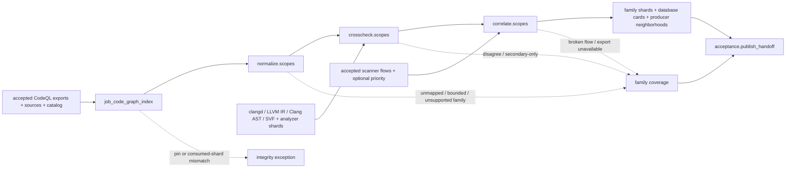

# code_graph_index

## Purpose

Normalize accepted CodeQL exports into bounded, source-resolving graph facts, cross-check them
against independent native producers, and correlate scanner code flows. The graph supplies
review context, not vulnerability findings. Missing exports, incomplete neighborhoods and absent
secondary evidence cannot become negative evidence; disagreement removes direct eligibility
rather than being resolved by majority vote.

<!-- generated:begin job=job_code_graph_index -->
<!-- generated from: appsec-review.toml, containers/catalog.toml, pipeline/guidance/registry.json, tests/job-test-map.json, src/appsec_review/runtime/registry.py, src/appsec_review/runtime/contracts.py, src/appsec_review/runtime/datasets.py, src/appsec_review/guidance/workers.py, src/appsec_review/mcp/schema.py, src/appsec_review/orchestration/topology.py, src/appsec_review/orchestration/dagster/adapter.py by scripts/generate-docs.py; do not edit -->
## Declared job contract

code_graph_index

Job: `job_code_graph_index`. Enabled in the dev recipe: **true**.
Declarations describe possible work, not successful execution or consumed evidence.

### Steps and tasks

| Step | Task | Workers | Pool | Bound tool or gap | Handler |
| --- | --- | --- | --- | --- | --- |
| `acceptance` | `acceptance.publish_handoff` | 1 | `index` | Undeclared ([T-147](../TODO.md)) | [source](../../src/appsec_review/jobs/job_code_graph_index/job.py#L360) |
| `correlate` | `correlate.scopes` | 1 | `index` | Undeclared ([T-147](../TODO.md)) | [source](../../src/appsec_review/jobs/job_code_graph_index/job.py#L287) |
| `crosscheck` | `crosscheck.scopes` | 1 | `index` | Undeclared ([T-147](../TODO.md)) | [source](../../src/appsec_review/jobs/job_code_graph_index/job.py#L211) |
| `load` | `load.accepted_inputs` | 1 | `index` | Undeclared ([T-147](../TODO.md)) | [source](../../src/appsec_review/jobs/job_code_graph_index/job.py#L133) |
| `normalize` | `normalize.scopes` | 1 | `index` | Undeclared ([T-147](../TODO.md)) | [source](../../src/appsec_review/jobs/job_code_graph_index/job.py#L185) |

### Accepted input declarations

| Producer | Dataset | Schema | Channel | Availability | Missing policy |
| --- | --- | --- | --- | --- | --- |
| `job_clang_static_analysis` | `handoff` | `appsec-review/job-handoff/2` | handoff | optional | gap |
| `job_clang_static_analysis` | `clang_static_observations` | `appsec-review/retrieval-index/2` | handoff | optional | gap |
| `job_clang_static_analysis` | `clang_static_scope_coverage` | `appsec-review/cpp-index-coverage/1` | handoff | optional | gap |
| `job_clang_static_analysis` | `clang_static_summary` | `appsec-review/clang-static-analysis-handoff/1` | handoff | optional | gap |
| `job_clang_static_analysis` | `clang_static_raw` | `application/json` | handoff | optional | gap |
| `job_codeql_analysis` | `handoff` | `appsec-review/job-handoff/2` | handoff | required | reject |
| `job_codeql_analysis` | `codeql_predecessor_import` | `appsec-review/codeql-predecessor-import/1` | handoff | optional | gap |
| `job_codeql_analysis` | `codeql_graph_export` | `appsec-review/codeql-graph-export/1` | handoff | optional | gap |
| `job_codeql_analysis` | `codeql_observations` | `appsec-review/codeql-sarif-normalizer/3` | handoff | optional | gap |
| `job_codeql_analysis` | `codeql_plan_and_summary` | `appsec-review/codeql-analysis-handoff/1` | handoff | optional | gap |
| `job_codeql_analysis` | `codeql_scope_material` | `application/octet-stream` | handoff | optional | gap |
| `job_cpg_analysis` | `handoff` | `appsec-review/job-handoff/2` | handoff | optional | gap |
| `job_cpg_analysis` | `cpg_graph_coverage` | `appsec-review/retrieval-index/2` | handoff | optional | gap |
| `job_cpg_analysis` | `cpg_scope_coverage` | `appsec-review/cpp-index-coverage/1` | handoff | optional | gap |
| `job_cpg_analysis` | `cpg_summary` | `appsec-review/cpg-analysis/1` | handoff | optional | gap |
| `job_cpg_analysis` | `cpg_binary` | `application/octet-stream` | handoff | optional | gap |
| `job_cpp_compiled_analysis` | `handoff` | `appsec-review/job-handoff/2` | handoff | optional | gap |
| `job_cpp_compiled_analysis` | `cpp_build_graph` | `appsec-review/retrieval-index/2` | handoff | optional | gap |
| `job_cpp_compiled_analysis` | `clang_ast` | `appsec-review/retrieval-index/2` | handoff | optional | gap |
| `job_cpp_compiled_analysis` | `llvm_ir` | `appsec-review/retrieval-index/2` | handoff | optional | gap |
| `job_cpp_compiled_analysis` | `infer_observations` | `appsec-review/retrieval-index/2` | handoff | optional | gap |
| `job_cpp_compiled_analysis` | `binary_symbols` | `appsec-review/retrieval-index/2` | handoff | optional | gap |
| `job_cpp_compiled_analysis` | `cpp_blocked_branches` | `appsec-review/retrieval-index/2` | handoff | optional | gap |
| `job_cpp_compiled_analysis` | `cpp_plan_and_summary` | `appsec-review/cpp-compiled-analysis/2` | handoff | optional | gap |
| `job_cpp_compiled_analysis` | `cpp_case_material` | `application/octet-stream` | handoff | optional | gap |
| `job_cpp_symbol_index` | `handoff` | `appsec-review/job-handoff/2` | handoff | optional | gap |
| `job_cpp_symbol_index` | `clangd_symbols` | `appsec-review/retrieval-index/2` | handoff | optional | gap |
| `job_cpp_symbol_index` | `clangd_coverage` | `appsec-review/cpp-index-coverage/1` | handoff | optional | gap |
| `job_cpp_symbol_index` | `clangd_summary` | `appsec-review/cpp-symbol-index/1` | handoff | optional | gap |
| `job_cpp_symbol_index` | `clangd_tool_io` | `appsec-review/container-execution/1` | handoff | optional | gap |
| `job_review_prioritization` | `handoff` | `appsec-review/job-handoff/2` | handoff | optional | gap |
| `job_review_prioritization` | `priority_items` | `appsec-review/retrieval-index/2` | handoff | optional | gap |
| `job_review_prioritization` | `prioritization_documents` | `appsec-review/review-prioritization/1` | handoff | optional | gap |
| `job_svf_alias_analysis` | `handoff` | `appsec-review/job-handoff/2` | handoff | optional | gap |
| `job_svf_alias_analysis` | `svf_alias_sets` | `appsec-review/retrieval-index/2` | handoff | optional | gap |
| `job_svf_alias_analysis` | `svf_alias_scope_coverage` | `appsec-review/cpp-index-coverage/1` | handoff | optional | gap |
| `job_svf_alias_analysis` | `svf_alias_summary` | `appsec-review/svf-alias-analysis-handoff/1` | handoff | optional | gap |
| `job_svf_alias_analysis` | `svf_alias_raw` | `application/json` | handoff | optional | gap |
| `job_target_catalog` | `handoff` | `appsec-review/job-handoff/2` | handoff | optional | gap |
| `job_target_catalog` | `target_artifact_inputs` | `appsec-review/target-artifact-intake/1` | handoff | optional | gap |
| `job_target_catalog` | `source_files` | `appsec-review/retrieval-index/2` | handoff | optional | gap |
| `job_target_catalog` | `declaration_symbols` | `appsec-review/retrieval-index/2` | handoff | optional | gap |
| `job_target_catalog` | `components` | `appsec-review/retrieval-index/2` | handoff | optional | gap |
| `job_target_catalog` | `target_documents` | `appsec-review/retrieval-index/2` | handoff | optional | gap |
| `job_target_catalog` | `build_units` | `appsec-review/retrieval-index/2` | handoff | optional | gap |
| `job_target_catalog` | `catalog_documents` | `appsec-review/target-catalog/1` | handoff | optional | gap |
| `job_tree_sitter_ast` | `handoff` | `appsec-review/job-handoff/2` | handoff | optional | gap |
| `job_tree_sitter_ast` | `tree_sitter_ast` | `appsec-review/tree-sitter-normalizer/1` | handoff | optional | gap |
| `job_tree_sitter_ast` | `tree_sitter_coverage` | `appsec-review/tree-sitter-ast/1` | handoff | optional | gap |
| `job_tree_sitter_ast` | `tree_sitter_node_shards` | `appsec-review/tree-sitter-ast/1` | handoff | optional | gap |
| `job_tree_sitter_ast` | `generated_source_backing` | `appsec-review/generated-source-backing/1` | handoff | optional | gap |
| `job_tree_sitter_ast` | `tree_sitter_tool_io` | `appsec-review/container-execution/1` | handoff | optional | gap |

### Published dataset declarations

| Dataset | Step | Schema | Stage | Indexes | MCP route |
| --- | --- | --- | --- | --- | --- |
| `code_graph_checkpoints` | `correlate` | `appsec-review/code-graph-checkpoint/1` | artifact_only | Not indexed | `coverage`, `query_dataset_inventory` |
| `code_graph_facts` | `correlate` | `appsec-review/graph-fact/1` | indexed | `graph` | `list_codeql_databases`, `query_code_graph`, `query_codeql_neighborhood`, `query_observations` |
| `code_graph_stages` | `normalize` | `appsec-review/code-graph-stage/1` | artifact_only | Not indexed | `coverage`, `query_dataset_inventory` |
| `code_graph_summary` | `acceptance` | `appsec-review/code-graph-index/1` | artifact_only | Not indexed | `coverage`, `query_dataset_inventory` |

Protected and artifact-only routes expose sanitized metadata, not payload access.

### Model and guidance declarations

No job-level model declaration; absence of a task binding remains [T-147](../TODO.md), not a nonexecution claim.

### Test selection

| Tier | Files or selectors |
| --- | --- |
| acceptance | None declared |
| integration | `tests/integration/test_code_graph_integration.py` |
| live | `tests/live/test_code_graph_live.py` |
| unit | `tests/test_code_graph_index_job.py` |

### Dagster placement

Dispatch: `review_graph`. Review graph member: **true**. Enabled graph member: **true**.

Declared predecessors: `job_review_prioritization`.

### Declared dataflow

```mermaid
flowchart LR
  job["job_code_graph_index"]
  producer0["job_clang_static_analysis"]
  input0["handoff"]
  input_schema0["appsec-review/job-handoff/2"]
  producer0 --> input0 --> job
  input0 -. schema .-> input_schema0
  producer1["job_clang_static_analysis"]
  input1["clang_static_observations"]
  input_schema1["appsec-review/retrieval-index/2"]
  producer1 --> input1 --> job
  input1 -. schema .-> input_schema1
  producer2["job_clang_static_analysis"]
  input2["clang_static_scope_coverage"]
  input_schema2["appsec-review/cpp-index-coverage/1"]
  producer2 --> input2 --> job
  input2 -. schema .-> input_schema2
  producer3["job_clang_static_analysis"]
  input3["clang_static_summary"]
  input_schema3["appsec-review/clang-static-analysis-handoff/1"]
  producer3 --> input3 --> job
  input3 -. schema .-> input_schema3
  producer4["job_clang_static_analysis"]
  input4["clang_static_raw"]
  input_schema4["application/json"]
  producer4 --> input4 --> job
  input4 -. schema .-> input_schema4
  producer5["job_codeql_analysis"]
  input5["handoff"]
  input_schema5["appsec-review/job-handoff/2"]
  producer5 --> input5 --> job
  input5 -. schema .-> input_schema5
  producer6["job_codeql_analysis"]
  input6["codeql_predecessor_import"]
  input_schema6["appsec-review/codeql-predecessor-import/1"]
  producer6 --> input6 --> job
  input6 -. schema .-> input_schema6
  producer7["job_codeql_analysis"]
  input7["codeql_graph_export"]
  input_schema7["appsec-review/codeql-graph-export/1"]
  producer7 --> input7 --> job
  input7 -. schema .-> input_schema7
  producer8["job_codeql_analysis"]
  input8["codeql_observations"]
  input_schema8["appsec-review/codeql-sarif-normalizer/3"]
  producer8 --> input8 --> job
  input8 -. schema .-> input_schema8
  producer9["job_codeql_analysis"]
  input9["codeql_plan_and_summary"]
  input_schema9["appsec-review/codeql-analysis-handoff/1"]
  producer9 --> input9 --> job
  input9 -. schema .-> input_schema9
  producer10["job_codeql_analysis"]
  input10["codeql_scope_material"]
  input_schema10["application/octet-stream"]
  producer10 --> input10 --> job
  input10 -. schema .-> input_schema10
  producer11["job_cpg_analysis"]
  input11["handoff"]
  input_schema11["appsec-review/job-handoff/2"]
  producer11 --> input11 --> job
  input11 -. schema .-> input_schema11
  producer12["job_cpg_analysis"]
  input12["cpg_graph_coverage"]
  input_schema12["appsec-review/retrieval-index/2"]
  producer12 --> input12 --> job
  input12 -. schema .-> input_schema12
  producer13["job_cpg_analysis"]
  input13["cpg_scope_coverage"]
  input_schema13["appsec-review/cpp-index-coverage/1"]
  producer13 --> input13 --> job
  input13 -. schema .-> input_schema13
  producer14["job_cpg_analysis"]
  input14["cpg_summary"]
  input_schema14["appsec-review/cpg-analysis/1"]
  producer14 --> input14 --> job
  input14 -. schema .-> input_schema14
  producer15["job_cpg_analysis"]
  input15["cpg_binary"]
  input_schema15["application/octet-stream"]
  producer15 --> input15 --> job
  input15 -. schema .-> input_schema15
  producer16["job_cpp_compiled_analysis"]
  input16["handoff"]
  input_schema16["appsec-review/job-handoff/2"]
  producer16 --> input16 --> job
  input16 -. schema .-> input_schema16
  producer17["job_cpp_compiled_analysis"]
  input17["cpp_build_graph"]
  input_schema17["appsec-review/retrieval-index/2"]
  producer17 --> input17 --> job
  input17 -. schema .-> input_schema17
  producer18["job_cpp_compiled_analysis"]
  input18["clang_ast"]
  input_schema18["appsec-review/retrieval-index/2"]
  producer18 --> input18 --> job
  input18 -. schema .-> input_schema18
  producer19["job_cpp_compiled_analysis"]
  input19["llvm_ir"]
  input_schema19["appsec-review/retrieval-index/2"]
  producer19 --> input19 --> job
  input19 -. schema .-> input_schema19
  producer20["job_cpp_compiled_analysis"]
  input20["infer_observations"]
  input_schema20["appsec-review/retrieval-index/2"]
  producer20 --> input20 --> job
  input20 -. schema .-> input_schema20
  producer21["job_cpp_compiled_analysis"]
  input21["binary_symbols"]
  input_schema21["appsec-review/retrieval-index/2"]
  producer21 --> input21 --> job
  input21 -. schema .-> input_schema21
  producer22["job_cpp_compiled_analysis"]
  input22["cpp_blocked_branches"]
  input_schema22["appsec-review/retrieval-index/2"]
  producer22 --> input22 --> job
  input22 -. schema .-> input_schema22
  producer23["job_cpp_compiled_analysis"]
  input23["cpp_plan_and_summary"]
  input_schema23["appsec-review/cpp-compiled-analysis/2"]
  producer23 --> input23 --> job
  input23 -. schema .-> input_schema23
  producer24["job_cpp_compiled_analysis"]
  input24["cpp_case_material"]
  input_schema24["application/octet-stream"]
  producer24 --> input24 --> job
  input24 -. schema .-> input_schema24
  producer25["job_cpp_symbol_index"]
  input25["handoff"]
  input_schema25["appsec-review/job-handoff/2"]
  producer25 --> input25 --> job
  input25 -. schema .-> input_schema25
  producer26["job_cpp_symbol_index"]
  input26["clangd_symbols"]
  input_schema26["appsec-review/retrieval-index/2"]
  producer26 --> input26 --> job
  input26 -. schema .-> input_schema26
  producer27["job_cpp_symbol_index"]
  input27["clangd_coverage"]
  input_schema27["appsec-review/cpp-index-coverage/1"]
  producer27 --> input27 --> job
  input27 -. schema .-> input_schema27
  producer28["job_cpp_symbol_index"]
  input28["clangd_summary"]
  input_schema28["appsec-review/cpp-symbol-index/1"]
  producer28 --> input28 --> job
  input28 -. schema .-> input_schema28
  producer29["job_cpp_symbol_index"]
  input29["clangd_tool_io"]
  input_schema29["appsec-review/container-execution/1"]
  producer29 --> input29 --> job
  input29 -. schema .-> input_schema29
  producer30["job_review_prioritization"]
  input30["handoff"]
  input_schema30["appsec-review/job-handoff/2"]
  producer30 --> input30 --> job
  input30 -. schema .-> input_schema30
  producer31["job_review_prioritization"]
  input31["priority_items"]
  input_schema31["appsec-review/retrieval-index/2"]
  producer31 --> input31 --> job
  input31 -. schema .-> input_schema31
  producer32["job_review_prioritization"]
  input32["prioritization_documents"]
  input_schema32["appsec-review/review-prioritization/1"]
  producer32 --> input32 --> job
  input32 -. schema .-> input_schema32
  producer33["job_svf_alias_analysis"]
  input33["handoff"]
  input_schema33["appsec-review/job-handoff/2"]
  producer33 --> input33 --> job
  input33 -. schema .-> input_schema33
  producer34["job_svf_alias_analysis"]
  input34["svf_alias_sets"]
  input_schema34["appsec-review/retrieval-index/2"]
  producer34 --> input34 --> job
  input34 -. schema .-> input_schema34
  producer35["job_svf_alias_analysis"]
  input35["svf_alias_scope_coverage"]
  input_schema35["appsec-review/cpp-index-coverage/1"]
  producer35 --> input35 --> job
  input35 -. schema .-> input_schema35
  producer36["job_svf_alias_analysis"]
  input36["svf_alias_summary"]
  input_schema36["appsec-review/svf-alias-analysis-handoff/1"]
  producer36 --> input36 --> job
  input36 -. schema .-> input_schema36
  producer37["job_svf_alias_analysis"]
  input37["svf_alias_raw"]
  input_schema37["application/json"]
  producer37 --> input37 --> job
  input37 -. schema .-> input_schema37
  producer38["job_target_catalog"]
  input38["handoff"]
  input_schema38["appsec-review/job-handoff/2"]
  producer38 --> input38 --> job
  input38 -. schema .-> input_schema38
  producer39["job_target_catalog"]
  input39["target_artifact_inputs"]
  input_schema39["appsec-review/target-artifact-intake/1"]
  producer39 --> input39 --> job
  input39 -. schema .-> input_schema39
  producer40["job_target_catalog"]
  input40["source_files"]
  input_schema40["appsec-review/retrieval-index/2"]
  producer40 --> input40 --> job
  input40 -. schema .-> input_schema40
  producer41["job_target_catalog"]
  input41["declaration_symbols"]
  input_schema41["appsec-review/retrieval-index/2"]
  producer41 --> input41 --> job
  input41 -. schema .-> input_schema41
  producer42["job_target_catalog"]
  input42["components"]
  input_schema42["appsec-review/retrieval-index/2"]
  producer42 --> input42 --> job
  input42 -. schema .-> input_schema42
  producer43["job_target_catalog"]
  input43["target_documents"]
  input_schema43["appsec-review/retrieval-index/2"]
  producer43 --> input43 --> job
  input43 -. schema .-> input_schema43
  producer44["job_target_catalog"]
  input44["build_units"]
  input_schema44["appsec-review/retrieval-index/2"]
  producer44 --> input44 --> job
  input44 -. schema .-> input_schema44
  producer45["job_target_catalog"]
  input45["catalog_documents"]
  input_schema45["appsec-review/target-catalog/1"]
  producer45 --> input45 --> job
  input45 -. schema .-> input_schema45
  producer46["job_tree_sitter_ast"]
  input46["handoff"]
  input_schema46["appsec-review/job-handoff/2"]
  producer46 --> input46 --> job
  input46 -. schema .-> input_schema46
  producer47["job_tree_sitter_ast"]
  input47["tree_sitter_ast"]
  input_schema47["appsec-review/tree-sitter-normalizer/1"]
  producer47 --> input47 --> job
  input47 -. schema .-> input_schema47
  producer48["job_tree_sitter_ast"]
  input48["tree_sitter_coverage"]
  input_schema48["appsec-review/tree-sitter-ast/1"]
  producer48 --> input48 --> job
  input48 -. schema .-> input_schema48
  producer49["job_tree_sitter_ast"]
  input49["tree_sitter_node_shards"]
  input_schema49["appsec-review/tree-sitter-ast/1"]
  producer49 --> input49 --> job
  input49 -. schema .-> input_schema49
  producer50["job_tree_sitter_ast"]
  input50["generated_source_backing"]
  input_schema50["appsec-review/generated-source-backing/1"]
  producer50 --> input50 --> job
  input50 -. schema .-> input_schema50
  producer51["job_tree_sitter_ast"]
  input51["tree_sitter_tool_io"]
  input_schema51["appsec-review/container-execution/1"]
  producer51 --> input51 --> job
  input51 -. schema .-> input_schema51
  output0["code_graph_checkpoints"]
  output_schema0["appsec-review/code-graph-checkpoint/1"]
  job --> output0
  output0 -. schema .-> output_schema0
  output1["code_graph_facts"]
  output_schema1["appsec-review/graph-fact/1"]
  job --> output1
  output1 -. schema .-> output_schema1
  output2["code_graph_stages"]
  output_schema2["appsec-review/code-graph-stage/1"]
  job --> output2
  output2 -. schema .-> output_schema2
  output3["code_graph_summary"]
  output_schema3["appsec-review/code-graph-index/1"]
  job --> output3
  output3 -. schema .-> output_schema3
```

<!-- generated:end -->

## Process

Source: [handler graph](../../src/appsec_review/jobs/job_code_graph_index/job.py),
[scope/publication helpers](../../src/appsec_review/jobs/job_code_graph_index/scopes.py),
[normalizer](../../src/appsec_review/graph/normalize.py) and
[producer neighborhoods](../../src/appsec_review/jobs/job_code_graph_index/producers.py).

### `load`

1. Read accepted CodeQL graph-export records and the accepted retrieval manifest. Verify the
   catalog release pin, export/source identities and source files for successful scopes.
2. Assign secondary clangd, LLVM IR, Clang AST and SVF shards, analyzer observations, scanner
   observations and optional priority context to matching scopes. Restore missing secondary
   shards only through their own accepted producer handoffs, not arbitrary files.
3. Bind those shard references and scope/export/release/settings identities. Reuse scope
   checkpoints only when required graph/validation releases are declared and output hashes verify.

### `normalize`

1. For unreused scopes with successful exports, validate bounded export documents and map rows
   against accepted source bytes and catalog classifications.
2. Build call sites, sinks, entry points, flow summaries, dataflow paths, guards and ranges,
   retaining ambiguity, unresolved operands, language-specific unavailability and truncation.
   Enforce path/step/text bounds; do not promote post-dominating-only checks to guarding predicates.
3. Write a normalized stage with facts, symbols, relations and per-family coverage. Failed or
   absent exports skip this stage, not the later unavailable-family publication.

### `crosscheck`

1. Read that stage and independent call producers. Compare supported call locations/targets;
   preserve agree, disagree, partial and not-covered states and secondary-only sites.
2. Apply analyzer sink corroboration when available, then SVF cross-checking. Only appropriately
   closed-world/complete points-to evidence can contradict a graph claim; open-world absence is
   not a refutation.
3. Record disagreements and secondary-only coverage, update family coverage and write the
   crosschecked stage. Do not equate exact symbol linking with independent security validation.

### `correlate`

1. Reuse a valid completed scope when possible. For an unavailable export, publish no graph facts
   and one unavailable row per family plus a database card.
2. Otherwise correlate tool-observation code flows against the graph; use optional priority only
   as context. Retain broken/unindexed flow reasons with a bounded diagnostic list, and apply
   seeded coverage limits.
3. Publish one graph shard per family, database card and bounded producer-neighborhood shard.
   Neighborhoods retain IR flow, analyzer diagnostics, linked clangd symbols and optional seeded
   CPG function facts; they are partial when populated, unavailable otherwise. Save the scope checkpoint.

### `acceptance`

1. Re-verify the current manifest and ensure every consumed secondary/analyzer/observation/priority
   shard is still present or explicitly restored. Missing consumed identities is an integrity error.
2. Replace this producer's shards, compose restored shards and publish the verified manifest plus
   `code-graph-summary.json`, with family coverage counts and scope/database/fact/reuse counts.

## Dataflow

## Gaps

The producer emits legacy reasons/status summaries; [interchange](../architecture/job-interchange.md#the-control-layer-beneath-the-envelope)
wraps reasons as `producer_reported_gap`, normally non-retryable, not advisory.

- Input absent/failed: `export_unavailable`, missing secondary producer/neighborhood output and
  missing source/priority coverage. An unavailable export produces no positive family facts.
- Coverage missing: inexact/macro/unmapped locations; unclassified sinks/sources; unavailable or
  truncated operand text; unknown sink-operand constraint; post-dominating-only checks; unsupported
  or non-integral ranges; unresolved indirect calls; limited flow summaries; truncated path steps,
  ambiguous step locations, unmatched sources and omitted paths.
- Independent disagreement: `cross_check_disagreements`, `svf_cross_check_disagreements`,
  `secondary_only`; unresolvable clangd references and per-edge location omissions are retained.
- Correlation/neighborhood loss: `sarif_correlation_broken`, missing flow indices, producer not
  run, and bounded flow/diagnostic/symbol/CPG/trace/related-symbol rows. Inspect shard coverage as
  well as top-level outcome reasons.
- Export hash/source/cross-scope/catalog-pin errors or disappearance of consumed shards raise an
  integrity exception. They are not successful graph coverage gaps.

Known limitations still require the walk's explicit expected-cause decision.

## Acceptance

1. **A. Inputs:** Compare CodeQL handoff/export manifests, catalog release and every consumed
   shard identity with admitted handoffs/read receipts; verify scope assignment and restoration.
2. **B. Independent comparison:** Count native export rows versus accepted/dropped facts per family;
   resolve sampled spans against source bytes. Independently compare a call against clangd/IR and
   a closed-world SVF result, and trace one SARIF code flow to graph relations. Count unavailable
   family rows and bounded neighborhood rows separately.
3. **C. Gaps:** Group verified outcomes, reconcile family and neighborhood coverage with export
   truncations, disagreement states and broken-flow records, then check the walk's approved list.
4. **D. Baseline:** On authorized acceptance save corpus namespace and `stepwise.py accept` baseline
   with scope/family counts, export/shard identities and cross-check states. This page asserts no
   live graph acceptance.

## Resume and invalidation

Scope identity binds snapshot, language/root/build unit, database/export identity/status/reasons,
seeds, file identities, catalog/column/normalizer releases, rules/settings/tool version and all
secondary/analyzer/observation/priority shard references. A changed input rebuilds only affected
scopes. Unlike accepted-input corruption, an unverifiable matching **local output checkpoint**
is discarded with its own shard files and rebuilt by `reuse_checkpoint`; it is never republished.
No CodeQL queries or models execute in this job. Shared composition is in
[accepted index sets](../architecture/python-and-retrieval.md#accepted-index-sets).
Generated task/language bindings remain
[T-147](../TODO.md) and [T-157](../TODO.md).
