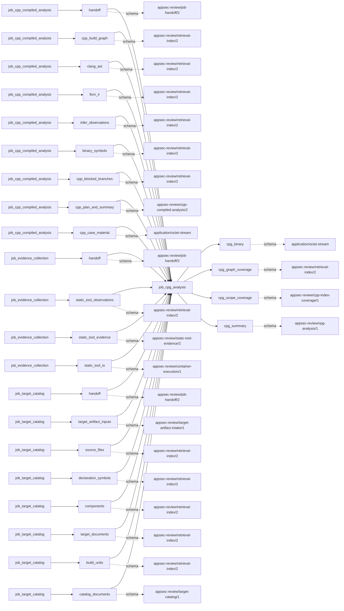
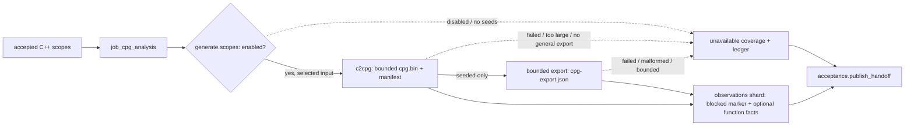

# cpg_analysis

## Purpose

Retain a bounded Joern CPG for accepted native scopes and, in seeded mode, expose the bounded
per-function export that was actually produced. A retained CPG binary is not usable CPG/PDG
coverage, a security observation, or a finding. The producer deliberately publishes a blocked
evidence marker and zero security observations even when a CPG exists.

<!-- generated:begin job=job_cpg_analysis -->
<!-- generated from: appsec-review.toml, containers/catalog.toml, pipeline/guidance/registry.json, tests/job-test-map.json, src/appsec_review/runtime/registry.py, src/appsec_review/runtime/contracts.py, src/appsec_review/runtime/datasets.py, src/appsec_review/guidance/workers.py, src/appsec_review/mcp/schema.py, src/appsec_review/orchestration/topology.py, src/appsec_review/orchestration/dagster/adapter.py by scripts/generate-docs.py; do not edit -->
## Declared job contract

cpg_analysis

Job: `job_cpg_analysis`. Enabled in the dev recipe: **false**.
Declarations describe possible work, not successful execution or consumed evidence.

### Steps and tasks

| Step | Task | Workers | Pool | Bound tool or gap | Handler |
| --- | --- | --- | --- | --- | --- |
| `acceptance` | `acceptance.publish_handoff` | 1 | `application` | Undeclared ([T-147](../TODO.md)) | [source](../../src/appsec_review/jobs/job_cpg_analysis/job.py#L355) |
| `generate` | `generate.scopes` | 1 | `application` | Undeclared ([T-147](../TODO.md)) | [source](../../src/appsec_review/jobs/job_cpg_analysis/job.py#L327) |
| `load` | `load.accepted_cpp` | 1 | `application` | Undeclared ([T-147](../TODO.md)) | [source](../../src/appsec_review/jobs/job_cpg_analysis/job.py#L318) |

### Accepted input declarations

| Producer | Dataset | Schema | Channel | Availability | Missing policy |
| --- | --- | --- | --- | --- | --- |
| `job_cpp_compiled_analysis` | `handoff` | `appsec-review/job-handoff/2` | handoff | required | reject |
| `job_cpp_compiled_analysis` | `cpp_build_graph` | `appsec-review/retrieval-index/2` | handoff | optional | gap |
| `job_cpp_compiled_analysis` | `clang_ast` | `appsec-review/retrieval-index/2` | handoff | optional | gap |
| `job_cpp_compiled_analysis` | `llvm_ir` | `appsec-review/retrieval-index/2` | handoff | optional | gap |
| `job_cpp_compiled_analysis` | `infer_observations` | `appsec-review/retrieval-index/2` | handoff | optional | gap |
| `job_cpp_compiled_analysis` | `binary_symbols` | `appsec-review/retrieval-index/2` | handoff | optional | gap |
| `job_cpp_compiled_analysis` | `cpp_blocked_branches` | `appsec-review/retrieval-index/2` | handoff | optional | gap |
| `job_cpp_compiled_analysis` | `cpp_plan_and_summary` | `appsec-review/cpp-compiled-analysis/2` | handoff | optional | gap |
| `job_cpp_compiled_analysis` | `cpp_case_material` | `application/octet-stream` | handoff | optional | gap |
| `job_evidence_collection` | `handoff` | `appsec-review/job-handoff/2` | handoff | optional | gap |
| `job_evidence_collection` | `static_tool_observations` | `appsec-review/retrieval-index/2` | handoff | optional | gap |
| `job_evidence_collection` | `static_tool_evidence` | `appsec-review/static-tool-evidence/2` | handoff | optional | gap |
| `job_evidence_collection` | `static_tool_io` | `appsec-review/container-execution/1` | handoff | optional | gap |
| `job_target_catalog` | `handoff` | `appsec-review/job-handoff/2` | handoff | optional | gap |
| `job_target_catalog` | `target_artifact_inputs` | `appsec-review/target-artifact-intake/1` | handoff | optional | gap |
| `job_target_catalog` | `source_files` | `appsec-review/retrieval-index/2` | handoff | optional | gap |
| `job_target_catalog` | `declaration_symbols` | `appsec-review/retrieval-index/2` | handoff | optional | gap |
| `job_target_catalog` | `components` | `appsec-review/retrieval-index/2` | handoff | optional | gap |
| `job_target_catalog` | `target_documents` | `appsec-review/retrieval-index/2` | handoff | optional | gap |
| `job_target_catalog` | `build_units` | `appsec-review/retrieval-index/2` | handoff | optional | gap |
| `job_target_catalog` | `catalog_documents` | `appsec-review/target-catalog/1` | handoff | optional | gap |

### Published dataset declarations

| Dataset | Step | Schema | Stage | Indexes | MCP route |
| --- | --- | --- | --- | --- | --- |
| `cpg_binary` | `generate` | `application/octet-stream` | protected | Not indexed | `coverage`, `query_dataset_inventory` |
| `cpg_graph_coverage` | `generate` | `appsec-review/retrieval-index/2` | indexed | `observations` | `coverage`, `find` |
| `cpg_scope_coverage` | `acceptance` | `appsec-review/cpp-index-coverage/1` | indexed | `observations` | `coverage` |
| `cpg_summary` | `acceptance` | `appsec-review/cpg-analysis/1` | artifact_only | Not indexed | `coverage`, `query_dataset_inventory` |

Protected and artifact-only routes expose sanitized metadata, not payload access.

### Model and guidance declarations

No job-level model declaration; absence of a task binding remains [T-147](../TODO.md), not a nonexecution claim.

### Test selection

| Tier | Files or selectors |
| --- | --- |
| acceptance | None declared |
| integration | None declared |
| live | None declared |
| unit | `tests/test_cpg_export.py` `tests/test_cpp_index_jobs.py::test_cpg_job_retains_the_cpg_but_claims_no_coverage` `tests/test_cpp_index_jobs.py::test_cpg_job_is_disabled_by_default_and_runs_no_joern` |

### Dagster placement

Dispatch: `review_graph`. Review graph member: **true**. Enabled graph member: **false**.

Declared predecessors: `job_cpp_compiled_analysis`.

### Declared dataflow

<!-- generated:end -->

## Process

Source: [job](../../src/appsec_review/jobs/job_cpg_analysis/job.py),
[seeded execution](../../src/appsec_review/jobs/job_cpg_analysis/seeded.py) and
[export reader](../../src/appsec_review/jobs/job_cpg_analysis/export.py).

### `load`

1. Read and verify accepted compiled-analysis scopes, compile databases, materialized sources and
   manifest via [scope helpers](../../src/appsec_review/jobs/cpp_index_scopes.py).
2. Require the current target snapshot and retain unavailable cases. Do not repair or rebuild them.

### `generate`

1. Re-read scopes and reject a changed plan. If disabled, launch nothing and return named disabled
   coverage for existing scopes. This describes the handler if dispatched; scheduling enablement
   is separate from the in-job flag.
2. If enabled, plan optional seeds and run bounded scope workers. No seeds, or no supported selected
   rows, yields a seeded ledger and blocked shard without running a container.
3. Verify a matching checkpoint or invoke `tool-joern` c2cpg on the accepted source root and
   rewritten compile database. Enforce `max_cpg_bytes` with `RLIMIT_FSIZE` at limit plus one;
   discard partial, oversized, empty or non-regular output. Record timeout, OOM and nonzero exits.
4. Retain a valid CPG and its manifest, accepted database, receipt and resource-limit disposition.
   Always carry `JOERN_GAP`: generation alone is not the missing general CPG/PDG export pipeline.
5. In seeded mode with a valid CPG, run the separate export command with per-file limits. Reject
   failed/missing export output; parse bounded CSV into `cpg-export.json`, retaining per-function
   facts and gaps, then discard raw export intermediates.
6. Publish a blocked evidence entity with zero observations. Exported functions add AST-node
   facts and partial coverage; otherwise coverage is unavailable. Attach seeded ledger/selection
   reasons. Do not checkpoint a failed seeded build; ordinary generated results can be checkpointed.

### `acceptance`

1. Compose scope shards and disabled/unavailable coverage; verify the full manifest.
2. Publish `cpg-analysis-summary.json` with scope, disabled and generated-CPG counts. Observation
   and item counts remain zero. Existing scopes always finish with gaps; no scopes/cases is
   not-applicable.

## Dataflow

## Gaps

`JOERN_GAP`, `JOERN_DISABLED`, seeded export-scope/no-export/no-seed messages, selection omissions
and tool reasons are **legacy text**, not canonical gap-code names. The
[interchange layer](../architecture/job-interchange.md#the-control-layer-beneath-the-envelope)
wraps them as `producer_reported_gap` with default non-retryable metadata, not an advisory waiver.

- Coverage missing: disabled analysis, retained binary without general source-mapped CPG/PDG
  export, seeded-only extent, absent seeds, unsupported selected units and export parser bounds.
- Tooling failure: CPG/export timeout, OOM, exit failure, missing/empty output, file-size ceiling,
  missing export directory or unusable CSV. Partial CPG bytes are discarded, not evidence.
- Input absent/failed: upstream unavailable catalogs and commandless scopes. Changed accepted
  source/database or mismatched matching-checkpoint manifest raises an integrity exception.

The permanent-looking limitation is still a cost that a specific walk must explicitly approve.

## Acceptance

1. **A. Inputs:** Compare compiled handoff, scope/database/source identities, enabled flag and
   optional seed plan with admitted inputs and actual execution receipts.
2. **B. Independent comparison:** Hash and size-check retained CPG bytes against the manifest and
   limit disposition. In seeded mode compare bounded export function rows with indexed facts.
   Verify zero security observations and distinguish blocked markers from exported functions.
3. **C. Gaps:** Group verified outcomes and compare disabled/no-seed scopes, discarded binaries,
   export failures and inherited unavailable cases to receipts and ledgers. Reconcile all causes
   with the walk's approved expected list.
4. **D. Baseline:** On authorized acceptance, record corpus namespace and `stepwise.py accept`
   baseline with generated/exported/disabled counts and coverage. No CPG or live acceptance was
   produced by this documentation change.

## Resume and invalidation

The scope checkpoint binds accepted scope/database, container database hash, adapter/argv,
tool identity, CPG byte ceiling and seeded identities. Reuse validates receipt, database and CPG
manifest agreement, the retained file boundary and indexed artifacts. Failed seeded builds are
not reused; unseeded gap-bearing results may be. Disabled work must not reuse enabled success as
coverage. [Image pins](image-pin-verification.md) and [signing](signing.md) are shared gates.
The [source](../../src/appsec_review/jobs/job_cpg_analysis/job.py) is authoritative where legacy
operations prose says all export is absent: seeded per-function export exists, general CPG/PDG
coverage does not. Generated bindings remain
[T-147](../TODO.md).
