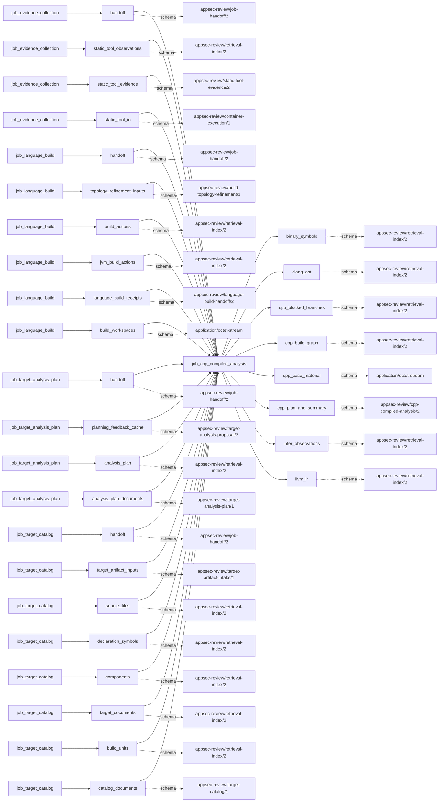
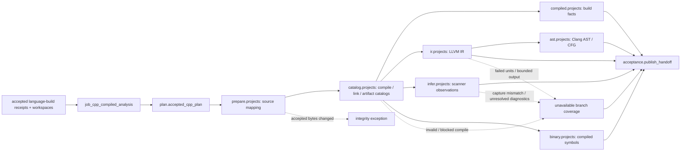

# cpp_compiled_analysis

## Purpose

Turn accepted native build receipts, including captured native components of other build families,
into compile/link provenance, Clang AST, LLVM IR, Infer diagnostics and binary-symbol indices.
This job replays analysis over accepted materialized build inputs; it is not the original language
build, a proof of complete compilation, or an adjudicator of scanner findings.

<!-- generated:begin job=job_cpp_compiled_analysis -->
<!-- generated from: appsec-review.toml, containers/catalog.toml, pipeline/guidance/registry.json, tests/job-test-map.json, src/appsec_review/runtime/registry.py, src/appsec_review/runtime/contracts.py, src/appsec_review/runtime/datasets.py, src/appsec_review/guidance/workers.py, src/appsec_review/mcp/schema.py, src/appsec_review/orchestration/topology.py, src/appsec_review/orchestration/dagster/adapter.py by scripts/generate-docs.py; do not edit -->
## Declared job contract

cpp_compiled_analysis

Job: `job_cpp_compiled_analysis`. Enabled in the dev recipe: **true**.
Declarations describe possible work, not successful execution or consumed evidence.

### Steps and tasks

| Step | Task | Workers | Pool | Bound tool or gap | Handler |
| --- | --- | --- | --- | --- | --- |
| `acceptance` | `acceptance.publish_handoff` | 1 | `application` | Undeclared ([T-147](../TODO.md)) | [source](../../src/appsec_review/jobs/job_cpp_compiled_analysis/job.py#L1246) |
| `ast` | `ast.projects` | 1 | `cpp_analysis` | Undeclared ([T-147](../TODO.md)) | [source](../../src/appsec_review/jobs/job_cpp_compiled_analysis/job.py#L1153) |
| `binary` | `binary.projects` | 1 | `cpp_analysis` | Undeclared ([T-147](../TODO.md)) | [source](../../src/appsec_review/jobs/job_cpp_compiled_analysis/job.py#L1153) |
| `catalog` | `catalog.projects` | 1 | `cpp_build` | Undeclared ([T-147](../TODO.md)) | [source](../../src/appsec_review/jobs/job_cpp_compiled_analysis/job.py#L1088) |
| `compiled` | `compiled.projects` | 1 | `cpp_analysis` | Undeclared ([T-147](../TODO.md)) | [source](../../src/appsec_review/jobs/job_cpp_compiled_analysis/job.py#L1153) |
| `infer` | `infer.projects` | 1 | `application` | Undeclared ([T-147](../TODO.md)) | [source](../../src/appsec_review/jobs/job_cpp_compiled_analysis/job.py#L1153) |
| `ir` | `ir.projects` | 1 | `cpp_analysis` | Undeclared ([T-147](../TODO.md)) | [source](../../src/appsec_review/jobs/job_cpp_compiled_analysis/job.py#L1153) |
| `plan` | `plan.accepted_cpp_plan` | 1 | `application` | Undeclared ([T-147](../TODO.md)) | [source](../../src/appsec_review/jobs/job_cpp_compiled_analysis/job.py#L969) |
| `prepare` | `prepare.projects` | 1 | `cpp_build` | Undeclared ([T-147](../TODO.md)) | [source](../../src/appsec_review/jobs/job_cpp_compiled_analysis/job.py#L994) |

### Accepted input declarations

| Producer | Dataset | Schema | Channel | Availability | Missing policy |
| --- | --- | --- | --- | --- | --- |
| `job_evidence_collection` | `handoff` | `appsec-review/job-handoff/2` | handoff | optional | gap |
| `job_evidence_collection` | `static_tool_observations` | `appsec-review/retrieval-index/2` | handoff | optional | gap |
| `job_evidence_collection` | `static_tool_evidence` | `appsec-review/static-tool-evidence/2` | handoff | optional | gap |
| `job_evidence_collection` | `static_tool_io` | `appsec-review/container-execution/1` | handoff | optional | gap |
| `job_language_build` | `handoff` | `appsec-review/job-handoff/2` | handoff | required | reject |
| `job_language_build` | `topology_refinement_inputs` | `appsec-review/build-topology-refinement/1` | handoff | optional | gap |
| `job_language_build` | `build_actions` | `appsec-review/retrieval-index/2` | handoff | optional | gap |
| `job_language_build` | `jvm_build_actions` | `appsec-review/retrieval-index/2` | handoff | optional | gap |
| `job_language_build` | `language_build_receipts` | `appsec-review/language-build-handoff/2` | handoff | optional | gap |
| `job_language_build` | `build_workspaces` | `application/octet-stream` | handoff | optional | gap |
| `job_target_analysis_plan` | `handoff` | `appsec-review/job-handoff/2` | handoff | optional | gap |
| `job_target_analysis_plan` | `planning_feedback_cache` | `appsec-review/target-analysis-proposal/3` | handoff | optional | gap |
| `job_target_analysis_plan` | `analysis_plan` | `appsec-review/retrieval-index/2` | handoff | optional | gap |
| `job_target_analysis_plan` | `analysis_plan_documents` | `appsec-review/target-analysis-plan/1` | handoff | optional | gap |
| `job_target_catalog` | `handoff` | `appsec-review/job-handoff/2` | handoff | optional | gap |
| `job_target_catalog` | `target_artifact_inputs` | `appsec-review/target-artifact-intake/1` | handoff | optional | gap |
| `job_target_catalog` | `source_files` | `appsec-review/retrieval-index/2` | handoff | optional | gap |
| `job_target_catalog` | `declaration_symbols` | `appsec-review/retrieval-index/2` | handoff | optional | gap |
| `job_target_catalog` | `components` | `appsec-review/retrieval-index/2` | handoff | optional | gap |
| `job_target_catalog` | `target_documents` | `appsec-review/retrieval-index/2` | handoff | optional | gap |
| `job_target_catalog` | `build_units` | `appsec-review/retrieval-index/2` | handoff | optional | gap |
| `job_target_catalog` | `catalog_documents` | `appsec-review/target-catalog/1` | handoff | optional | gap |

### Published dataset declarations

| Dataset | Step | Schema | Stage | Indexes | MCP route |
| --- | --- | --- | --- | --- | --- |
| `binary_symbols` | `binary` | `appsec-review/retrieval-index/2` | indexed | `compiled` | `find`, `trace` |
| `clang_ast` | `ast` | `appsec-review/retrieval-index/2` | indexed | `analysis` | `find`, `search` |
| `cpp_blocked_branches` | `acceptance` | `appsec-review/retrieval-index/2` | indexed | `analysis` | `coverage` |
| `cpp_build_graph` | `compiled` | `appsec-review/retrieval-index/2` | indexed | `build` | `find`, `trace` |
| `cpp_case_material` | `prepare` | `application/octet-stream` | protected | Not indexed | `coverage`, `query_dataset_inventory` |
| `cpp_plan_and_summary` | `acceptance` | `appsec-review/cpp-compiled-analysis/2` | artifact_only | Not indexed | `coverage`, `query_dataset_inventory` |
| `infer_observations` | `infer` | `appsec-review/retrieval-index/2` | indexed | `observations` | `find`, `query_precomputed`, `search` |
| `llvm_ir` | `ir` | `appsec-review/retrieval-index/2` | indexed | `analysis` | `find`, `trace` |

Protected and artifact-only routes expose sanitized metadata, not payload access.

### Model and guidance declarations

No job-level model declaration; absence of a task binding remains [T-147](../TODO.md), not a nonexecution claim.

### Test selection

| Tier | Files or selectors |
| --- | --- |
| acceptance | None declared |
| integration | None declared |
| live | None declared |
| unit | `tests/test_cpp_compiled_analysis.py::test_compile_database_normalization_preserves_only_reviewed_build_semantics` `tests/test_cpp_compiled_analysis.py::test_infer_compile_database_uses_stable_read_only_container_paths` `tests/test_cpp_compiled_analysis.py::test_clang_ast_loader_accepts_bounded_concatenated_declarations` |

### Dagster placement

Dispatch: `review_graph`. Review graph member: **true**. Enabled graph member: **true**.

Declared predecessors: `job_language_build`, `job_evidence_collection`.

### Declared dataflow

<!-- generated:end -->

## Process

Source: [handler and branch normalizers](../../src/appsec_review/jobs/job_cpp_compiled_analysis/job.py),
[seeded replay](../../src/appsec_review/jobs/job_cpp_compiled_analysis/seeded.py),
[IR normalization](../../src/appsec_review/jobs/job_cpp_compiled_analysis/llvm_ir.py) and
[source CFG parsing](../../src/appsec_review/jobs/job_cpp_compiled_analysis/clang_cfg.py).

### `plan`

1. Load accepted language-build receipts, require this snapshot, and derive native analysis actions.
   Require a capture-backed `native_compile_database` on each materialized native receipt;
   missing capture raises before project preparation. Include captured native components from
   other build families and require unique project keys. A build-system database alone is not
   a substitute for this admitted capture.
2. Sort by root/build system and publish `accepted-cpp-plan.json` with topology counts. No actions
   is explicitly not-applicable, not a successful compiler coverage claim.

### `prepare`

1. For each action recreate its run-owned case root. If an unsuccessful build has no workspace,
   retain a named blocked project instead of attempting analysis.
2. Verify workspace location, manifest schema, complete file-set equality and every file/artifact
   hash. Missing or changed accepted bytes raises; it is not an ordinary parser gap.
3. Copy the project's source and accepted build directory. For native and mixed-family captured
   components, verify and install their accepted compile database. Write `source-mapping.json`
   with target paths, scratch paths, source hashes, case snapshot and language-build provenance.

### `catalog`

1. Block unsuccessful or empty capture-backed native builds. Otherwise verify/reuse a catalog
   checkpoint keyed by build fingerprint, mapping and link normalizer.
2. Locate and normalize compile commands, source paths, arguments and output paths; write the
   normalized database. Invalid/missing compile data yields `INVALID_COMPILE_DATABASE` and reasons.
3. Catalog accepted build objects/libraries/executables and normalize bounded captured link
   commands. Publish artifact/link catalogs and counts, then checkpoint the catalog.

### `compiled`

1. For a blocked project publish unavailable branch coverage without tool execution.
2. Otherwise build project, build-action, source, compile-unit and output entities. Use explicit
   compile-output and captured link relationships for `COMPILES_TO` and `LINKS_INTO`.
3. If no exact compile/link relationship resolves, mark the shard coverage partial. This reason
   is currently in the coverage row, not the branch's top-level gap list.

### `ir`

1. For each usable catalog, check the branch checkpoint; select admitted seeds in seeded mode,
   otherwise clear stale subset replay state before invoking `tool-native-cpp` IR analysis.
2. Inspect per-translation-unit replay results. Exit 2 with explicit failed-unit receipts allows
   unaffected units to survive; other failed executions produce unavailable branch coverage.
3. Parse bounded LLVM IR and publish function/call/control-flow and def-use context with source
   mappings. Name missing/oversized unit output and ambiguous cross-unit callees; do not invent
   edges. Seeded mode retains its bounded neighborhood/ledger and incomplete scope.

### `ast`

1. Run after IR: seeded AST selection uses the IR-defined neighborhood and binds its handoff
   identity. Full mode clears stale seeded replay state.
2. Invoke bounded Clang AST/source-CFG replay for selected or full compile units; preserve
   per-unit failures rather than erasing successful siblings.
3. Normalize bounded AST declarations/calls and supported source CFG facts; invalid/missing output
   becomes a named unit gap. AST traversal limits are not whole-program semantic coverage.

### `infer`

1. For a usable project, invoke `tool-infer` using the accepted normalized compile database, not
   a new build plan. Retain execution, compile database, report and bounded logs.
2. Parse bounded report JSON; preserve timeout/OOM/exit/malformed-report reasons. Compare Infer's
   logged captured-source count with unique accepted compile sources; missing or unequal counts
   prevents complete coverage.
3. Retain only diagnostics mapping to accepted source hashes, with bounded traces and scanner
   severity/category. Unresolved diagnostic paths are gaps; changed mapped source bytes raises.

### `binary`

1. Invoke `tool-native-cpp` symbol inspection for usable projects; failed execution produces
   unavailable coverage. Missing/invalid records produces a named binary-analysis reason.
2. Index retained artifact metadata and bounded native symbol-table rows with containment edges.
   Do not assign original-source locations merely from symbol names.
3. The normalizer slices records and symbol lists; it does not emit a separate reason for every
   such cut. Compare native counts explicitly rather than treating complete coverage as unbounded.

### `acceptance`

1. Collect each branch's index identity and disposition, including blocked outputs. Preserve
   unrelated upstream indices and replace this job's prior shards; verify the composed manifest.
2. Publish `cpp-compiled-summary.json`, project/branch counts and deduplicated reasons.
   Physical shard/item count includes inherited indices, not just newly produced facts.

## Dataflow

## Gaps

Legacy reasons become `producer_reported_gap` under
[interchange](../architecture/job-interchange.md#the-control-layer-beneath-the-envelope), with
default non-retryable metadata, not advisory status.

- Input absent/failed: unbuilt planned projects, failed accepted builds, empty captured native
  database and invalid/missing produced compile data during catalog normalization.
  A materialized native receipt lacking the required capture-backed database instead fails
  planning in `native_analysis_actions`; it is not a successful gap publication.
- Tooling failure: AST/IR/binary exit/timeout/OOM, failed replay units, missing/invalid AST, IR,
  binary or Infer reports, Infer capture-count absence/mismatch and unsupported output parsing.
- Coverage missing: no exact compile/link relation, ambiguous cross-unit IR callee, unresolved
  Infer path and seeded selection/no-seed/neighborhood limits. Inspect branch coverage and seeded
  ledgers as well as canonical outcomes: some local coverage reasons and bounded slices are not
  promoted to top-level gaps in the current source.
- Workspace/artifact/source hash and custody violations raise. The execution-safety policy can
  stop a tool failure before fallback gap publication.

Every cause must be checked against a specific walk's approved expected list; build success alone
does not approve analysis loss.

## Acceptance

1. **A. Inputs:** Compare admitted language-build receipt/workspace/source hashes and captured
   native-component databases with planned project identities and prepared mappings.
2. **B. Independent comparison:** Count native compile and link rows, artifacts and per-unit replay
   outcomes independently. Compare AST/IR records and sampled source locations, Infer capture and
   diagnostic counts, and raw binary symbol counts with retained indexed prefixes. Separate
   project, new-shard and inherited-shard counts.
3. **C. Gaps:** Group verified outcomes, reconcile every branch coverage row and seeded ledger,
   account for omitted slices and partial siblings, and compare causes with the expected list.
4. **D. Baseline:** At authorized acceptance save `stepwise.py accept`, corpus namespace and baseline
   with compile identities and per-branch counts/dispositions. No live compiler acceptance is
   asserted by this page.

## Resume and invalidation

Catalog and branch checkpoints bind project/stage, tool pin and declared platform/validation/tool
releases. Branch inputs include compile database and branch identity; non-Infer branches also
bind artifact/link catalogs, seeded IR/AST bind seed policy and AST binds IR neighborhood identity.
Only success or explicitly checkpointable results qualify; stale/invalid referenced artifacts
cause a local checkpoint miss. Re-running `prepare.projects` deletes the case root, including
these local checkpoints: selective branch reuse assumes its prepared case survives runtime unit
reuse. See [runtime resumability](../architecture/jobs-and-runtime.md#wave-1-resumability).

The source's hard-coded compiler/tool labels and generated missing task bindings are not proof of
the executed tool version. Verify execution receipts and [image pins](image-pin-verification.md);
[T-147](../TODO.md) and [T-157](../TODO.md)
remain metadata limitations, not documentation-authorized code repairs.
