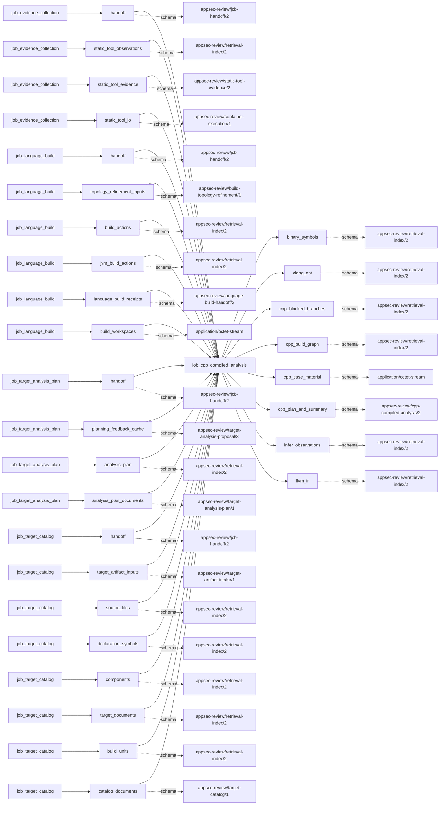

# cpp_compiled_analysis

This page contains the generated contract; the authored process and acceptance description are tracked by [T-130](../TODO.md).

<!-- generated:begin job=job_cpp_compiled_analysis -->
<!-- generated from: appsec-review.toml, containers/catalog.toml, pipeline/guidance/registry.json, tests/job-test-map.json, src/appsec_review/runtime/registry.py, src/appsec_review/runtime/contracts.py, src/appsec_review/runtime/datasets.py, src/appsec_review/guidance/workers.py, src/appsec_review/mcp/schema.py, src/appsec_review/orchestration/topology.py, src/appsec_review/orchestration/dagster/adapter.py by scripts/generate-docs.py; do not edit -->
## Declared job contract

cpp_compiled_analysis

Job: `job_cpp_compiled_analysis`. Enabled in the dev recipe: **true**.
Declarations describe possible work, not successful execution or consumed evidence.

### Steps and tasks

| Step | Task | Workers | Pool | Bound tool or gap | Handler |
| --- | --- | --- | --- | --- | --- |
| `acceptance` | `acceptance.publish_handoff` | 1 | `application` | Undeclared ([T-147](../TODO.md)) | [source](../../src/appsec_review/jobs/job_cpp_compiled_analysis/job.py#L1247) |
| `ast` | `ast.projects` | 1 | `cpp_analysis` | Undeclared ([T-147](../TODO.md)) | [source](../../src/appsec_review/jobs/job_cpp_compiled_analysis/job.py#L1154) |
| `binary` | `binary.projects` | 1 | `cpp_analysis` | Undeclared ([T-147](../TODO.md)) | [source](../../src/appsec_review/jobs/job_cpp_compiled_analysis/job.py#L1154) |
| `catalog` | `catalog.projects` | 1 | `cpp_build` | Undeclared ([T-147](../TODO.md)) | [source](../../src/appsec_review/jobs/job_cpp_compiled_analysis/job.py#L1089) |
| `compiled` | `compiled.projects` | 1 | `cpp_analysis` | Undeclared ([T-147](../TODO.md)) | [source](../../src/appsec_review/jobs/job_cpp_compiled_analysis/job.py#L1154) |
| `infer` | `infer.projects` | 1 | `application` | Undeclared ([T-147](../TODO.md)) | [source](../../src/appsec_review/jobs/job_cpp_compiled_analysis/job.py#L1154) |
| `ir` | `ir.projects` | 1 | `cpp_analysis` | Undeclared ([T-147](../TODO.md)) | [source](../../src/appsec_review/jobs/job_cpp_compiled_analysis/job.py#L1154) |
| `plan` | `plan.accepted_cpp_plan` | 1 | `application` | Undeclared ([T-147](../TODO.md)) | [source](../../src/appsec_review/jobs/job_cpp_compiled_analysis/job.py#L970) |
| `prepare` | `prepare.projects` | 1 | `cpp_build` | Undeclared ([T-147](../TODO.md)) | [source](../../src/appsec_review/jobs/job_cpp_compiled_analysis/job.py#L995) |

### Accepted input declarations

| Producer | Dataset | Schema | Channel | Availability | Missing policy |
| --- | --- | --- | --- | --- | --- |
| `job_evidence_collection` | `handoff` | `appsec-review/job-handoff/2` | handoff | optional | gap |
| `job_evidence_collection` | `static_tool_observations` | `appsec-review/retrieval-index/2` | handoff | optional | gap |
| `job_evidence_collection` | `static_tool_evidence` | `appsec-review/static-tool-evidence/2` | handoff | optional | gap |
| `job_evidence_collection` | `static_tool_io` | `appsec-review/container-execution/1` | handoff | optional | gap |
| `job_language_build` | `handoff` | `appsec-review/job-handoff/2` | handoff | required | reject |
| `job_language_build` | `topology_refinement_inputs` | `appsec-review/build-topology-refinement/1` | handoff | optional | gap |
| `job_language_build` | `build_actions` | `appsec-review/retrieval-index/2` | handoff | optional | gap |
| `job_language_build` | `jvm_build_actions` | `appsec-review/retrieval-index/2` | handoff | optional | gap |
| `job_language_build` | `language_build_receipts` | `appsec-review/language-build-handoff/2` | handoff | optional | gap |
| `job_language_build` | `build_workspaces` | `application/octet-stream` | handoff | optional | gap |
| `job_target_analysis_plan` | `handoff` | `appsec-review/job-handoff/2` | handoff | optional | gap |
| `job_target_analysis_plan` | `planning_feedback_cache` | `appsec-review/target-analysis-proposal/3` | handoff | optional | gap |
| `job_target_analysis_plan` | `analysis_plan` | `appsec-review/retrieval-index/2` | handoff | optional | gap |
| `job_target_analysis_plan` | `analysis_plan_documents` | `appsec-review/target-analysis-plan/1` | handoff | optional | gap |
| `job_target_catalog` | `handoff` | `appsec-review/job-handoff/2` | handoff | optional | gap |
| `job_target_catalog` | `target_artifact_inputs` | `appsec-review/target-artifact-intake/1` | handoff | optional | gap |
| `job_target_catalog` | `source_files` | `appsec-review/retrieval-index/2` | handoff | optional | gap |
| `job_target_catalog` | `declaration_symbols` | `appsec-review/retrieval-index/2` | handoff | optional | gap |
| `job_target_catalog` | `components` | `appsec-review/retrieval-index/2` | handoff | optional | gap |
| `job_target_catalog` | `target_documents` | `appsec-review/retrieval-index/2` | handoff | optional | gap |
| `job_target_catalog` | `build_units` | `appsec-review/retrieval-index/2` | handoff | optional | gap |
| `job_target_catalog` | `catalog_documents` | `appsec-review/target-catalog/1` | handoff | optional | gap |

### Published dataset declarations

| Dataset | Step | Schema | Stage | Indexes | MCP route |
| --- | --- | --- | --- | --- | --- |
| `binary_symbols` | `binary` | `appsec-review/retrieval-index/2` | indexed | `compiled` | `find`, `trace` |
| `clang_ast` | `ast` | `appsec-review/retrieval-index/2` | indexed | `analysis` | `find`, `search` |
| `cpp_blocked_branches` | `acceptance` | `appsec-review/retrieval-index/2` | indexed | `analysis` | `coverage` |
| `cpp_build_graph` | `compiled` | `appsec-review/retrieval-index/2` | indexed | `build` | `find`, `trace` |
| `cpp_case_material` | `prepare` | `application/octet-stream` | protected | Not indexed | `coverage`, `query_dataset_inventory` |
| `cpp_plan_and_summary` | `acceptance` | `appsec-review/cpp-compiled-analysis/2` | artifact_only | Not indexed | `coverage`, `query_dataset_inventory` |
| `infer_observations` | `infer` | `appsec-review/retrieval-index/2` | indexed | `observations` | `find`, `query_precomputed`, `search` |
| `llvm_ir` | `ir` | `appsec-review/retrieval-index/2` | indexed | `analysis` | `find`, `trace` |

Protected and artifact-only routes expose sanitized metadata, not payload access.

### Model and guidance declarations

No job-level model declaration; absence of a task binding remains [T-147](../TODO.md), not a nonexecution claim.

### Test selection

| Tier | Files or selectors |
| --- | --- |
| acceptance | None declared |
| integration | None declared |
| live | None declared |
| unit | `tests/test_cpp_compiled_analysis.py::test_compile_database_normalization_preserves_only_reviewed_build_semantics` `tests/test_cpp_compiled_analysis.py::test_infer_compile_database_uses_stable_read_only_container_paths` `tests/test_cpp_compiled_analysis.py::test_clang_ast_loader_accepts_bounded_concatenated_declarations` |

### Dagster placement

Dispatch: `review_graph`. Review graph member: **true**. Enabled graph member: **true**.

Declared predecessors: `job_language_build`, `job_evidence_collection`.

### Declared dataflow

<!-- generated:end -->
