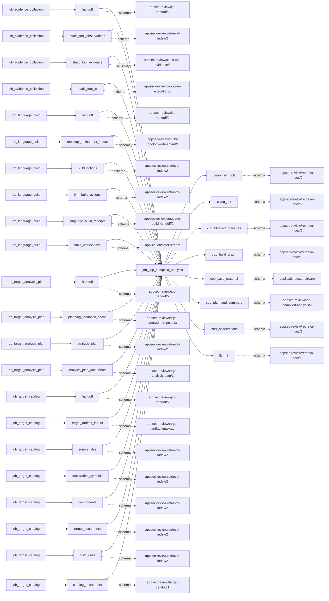
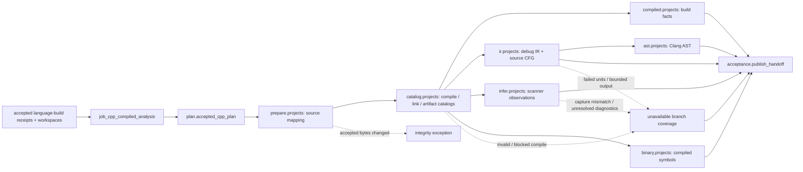

# cpp_compiled_analysis

## Purpose

Turn accepted native build receipts, including captured native components of other build families,
into compile/link provenance, Clang AST, LLVM IR, Infer diagnostics and binary-symbol indices.
This job replays analysis over accepted materialized build inputs; it is not the original language
build, a proof of complete compilation, or an adjudicator of scanner findings.

<!-- generated:begin job=job_cpp_compiled_analysis -->
<!-- generated from: appsec-review.toml, containers/catalog.toml, pipeline/guidance/registry.json, tests/job-test-map.json, src/appsec_review/runtime/registry.py, src/appsec_review/runtime/contracts.py, src/appsec_review/runtime/datasets.py, src/appsec_review/guidance/workers.py, src/appsec_review/mcp/schema.py, src/appsec_review/orchestration/topology.py, src/appsec_review/orchestration/dagster/adapter.py by scripts/generate-docs.py; do not edit -->
## Declared job contract

cpp_compiled_analysis

Job: `job_cpp_compiled_analysis`. Enabled in the dev recipe: **true**.
Declarations describe possible work, not successful execution or consumed evidence.

### Steps and tasks

| Step | Task | Workers | Pool | Bound tool or gap | Handler |
| --- | --- | --- | --- | --- | --- |
| `acceptance` | `acceptance.publish_handoff` | 1 | `application` | Undeclared ([T-147](../TODO.md)) | [source](../../src/appsec_review/jobs/job_cpp_compiled_analysis/job.py#L2030) |
| `ast` | `ast.projects` | 1 | `cpp_analysis` | Undeclared ([T-147](../TODO.md)) | [source](../../src/appsec_review/jobs/job_cpp_compiled_analysis/job.py#L1913) |
| `binary` | `binary.projects` | 1 | `cpp_analysis` | Undeclared ([T-147](../TODO.md)) | [source](../../src/appsec_review/jobs/job_cpp_compiled_analysis/job.py#L1913) |
| `catalog` | `catalog.projects` | 1 | `cpp_build` | Undeclared ([T-147](../TODO.md)) | [source](../../src/appsec_review/jobs/job_cpp_compiled_analysis/job.py#L1832) |
| `compiled` | `compiled.projects` | 1 | `cpp_analysis` | Undeclared ([T-147](../TODO.md)) | [source](../../src/appsec_review/jobs/job_cpp_compiled_analysis/job.py#L1913) |
| `infer` | `infer.projects` | 1 | `application` | Undeclared ([T-147](../TODO.md)) | [source](../../src/appsec_review/jobs/job_cpp_compiled_analysis/job.py#L1913) |
| `ir` | `ir.projects` | 1 | `cpp_analysis` | Undeclared ([T-147](../TODO.md)) | [source](../../src/appsec_review/jobs/job_cpp_compiled_analysis/job.py#L1913) |
| `plan` | `plan.accepted_cpp_plan` | 1 | `application` | Undeclared ([T-147](../TODO.md)) | [source](../../src/appsec_review/jobs/job_cpp_compiled_analysis/job.py#L1694) |
| `prepare` | `prepare.projects` | 1 | `cpp_build` | Undeclared ([T-147](../TODO.md)) | [source](../../src/appsec_review/jobs/job_cpp_compiled_analysis/job.py#L1719) |

### Accepted input declarations

| Producer | Dataset | Schema | Channel | Availability | Missing policy |
| --- | --- | --- | --- | --- | --- |
| `job_evidence_collection` | `handoff` | `appsec-review/job-handoff/2` | handoff | optional | gap |
| `job_evidence_collection` | `static_tool_observations` | `appsec-review/retrieval-index/2` | handoff | optional | gap |
| `job_evidence_collection` | `static_tool_evidence` | `appsec-review/static-tool-evidence/2` | handoff | optional | gap |
| `job_evidence_collection` | `static_tool_io` | `appsec-review/container-execution/1` | handoff | optional | gap |
| `job_language_build` | `handoff` | `appsec-review/job-handoff/2` | handoff | required | reject |
| `job_language_build` | `topology_refinement_inputs` | `appsec-review/build-topology-refinement/1` | handoff | optional | gap |
| `job_language_build` | `build_actions` | `appsec-review/retrieval-index/2` | handoff | optional | gap |
| `job_language_build` | `jvm_build_actions` | `appsec-review/retrieval-index/2` | handoff | optional | gap |
| `job_language_build` | `language_build_receipts` | `appsec-review/language-build-handoff/2` | handoff | optional | gap |
| `job_language_build` | `build_workspaces` | `application/octet-stream` | handoff | optional | gap |
| `job_target_analysis_plan` | `handoff` | `appsec-review/job-handoff/2` | handoff | optional | gap |
| `job_target_analysis_plan` | `planning_feedback_cache` | `appsec-review/target-analysis-proposal/3` | handoff | optional | gap |
| `job_target_analysis_plan` | `analysis_plan` | `appsec-review/retrieval-index/2` | handoff | optional | gap |
| `job_target_analysis_plan` | `analysis_plan_documents` | `appsec-review/target-analysis-plan/1` | handoff | optional | gap |
| `job_target_catalog` | `handoff` | `appsec-review/job-handoff/2` | handoff | optional | gap |
| `job_target_catalog` | `target_artifact_inputs` | `appsec-review/target-artifact-intake/1` | handoff | optional | gap |
| `job_target_catalog` | `source_files` | `appsec-review/retrieval-index/2` | handoff | optional | gap |
| `job_target_catalog` | `declaration_symbols` | `appsec-review/retrieval-index/2` | handoff | optional | gap |
| `job_target_catalog` | `components` | `appsec-review/retrieval-index/2` | handoff | optional | gap |
| `job_target_catalog` | `target_documents` | `appsec-review/retrieval-index/2` | handoff | optional | gap |
| `job_target_catalog` | `build_units` | `appsec-review/retrieval-index/2` | handoff | optional | gap |
| `job_target_catalog` | `catalog_documents` | `appsec-review/target-catalog/1` | handoff | optional | gap |

### Published dataset declarations

| Dataset | Step | Schema | Stage | Indexes | MCP route |
| --- | --- | --- | --- | --- | --- |
| `binary_symbols` | `binary` | `appsec-review/retrieval-index/2` | indexed | `compiled` | `find`, `trace` |
| `clang_ast` | `ast` | `appsec-review/retrieval-index/2` | indexed | `analysis` | `find`, `search` |
| `cpp_blocked_branches` | `acceptance` | `appsec-review/retrieval-index/2` | indexed | `analysis` | `coverage` |
| `cpp_build_graph` | `compiled` | `appsec-review/retrieval-index/2` | indexed | `build` | `find`, `trace` |
| `cpp_case_material` | `prepare` | `application/octet-stream` | protected | Not indexed | `coverage`, `query_dataset_inventory` |
| `cpp_plan_and_summary` | `acceptance` | `appsec-review/cpp-compiled-analysis/2` | artifact_only | Not indexed | `coverage`, `query_dataset_inventory` |
| `infer_observations` | `infer` | `appsec-review/retrieval-index/2` | indexed | `observations` | `find`, `query_precomputed`, `search` |
| `llvm_ir` | `ir` | `appsec-review/retrieval-index/2` | indexed | `analysis` | `find`, `trace` |

Protected and artifact-only routes expose sanitized metadata, not payload access.

### Model and guidance declarations

No job-level model declaration; absence of a task binding remains [T-147](../TODO.md), not a nonexecution claim.

### Test selection

| Tier | Files or selectors |
| --- | --- |
| acceptance | None declared |
| integration | `tests/integration/job_cpp_compiled_analysis/test_cpp_compiled_analysis_graph.py` |
| live | `tests/live/test_seeded_clang_live.py` |
| unit | `tests/unit/job_cpp_compiled_analysis/test_clang_cfg.py` `tests/unit/job_cpp_compiled_analysis/test_compile_and_replay.py` `tests/unit/job_cpp_compiled_analysis/test_contract.py` `tests/unit/job_cpp_compiled_analysis/test_job_pipeline.py` `tests/unit/job_cpp_compiled_analysis/test_seeded_compiled.py` `tests/unit/job_cpp_compiled_analysis/test_seeded_ir_and_record.py` `tests/unit/job_cpp_compiled_analysis/test_terminal_gap.py` `tests/unit/job_cpp_compiled_analysis/test_binary_and_infer_repairs.py` |

### Dagster placement

Dispatch: `review_graph`. Review graph member: **true**. Enabled graph member: **true**.

Declared predecessors: `job_language_build`, `job_evidence_collection`.

### Declared dataflow

<!-- generated:end -->

## Process

Source: [handler and branch normalizers](../../src/appsec_review/jobs/job_cpp_compiled_analysis/job.py),
[seeded replay](../../src/appsec_review/jobs/job_cpp_compiled_analysis/seeded.py),
[IR normalization](../../src/appsec_review/jobs/job_cpp_compiled_analysis/llvm_ir.py) and
[source CFG parsing](../../src/appsec_review/jobs/job_cpp_compiled_analysis/clang_cfg.py).

### `plan`

1. Load accepted language-build receipts, require this snapshot, and derive native analysis actions.
   Require a capture-backed `native_compile_database` on each materialized native receipt;
   missing capture raises before project preparation. Include captured native components from
   other build families and require unique project keys. A build-system database alone is not
   a substitute for this admitted capture.
2. Sort by root/build system and publish `accepted-cpp-plan.json` with topology counts. No actions
   is explicitly not-applicable, not a successful compiler coverage claim.

### `prepare`

1. For each action recreate mutable source/build/replay staging and local checkpoints, preserving
   content-addressed evidence and ledgers. If an unsuccessful build has no workspace,
   retain a named blocked project instead of attempting analysis.
2. Verify workspace location, manifest schema, complete file-set equality and every file/artifact
   hash. Missing or changed accepted bytes raises; it is not an ordinary parser gap.
3. Copy the project's source and exact accepted recipe build directory. Names such as
   `src/build` and `src/target` do not exclude legitimate sources; only VCS metadata is ignored.
   For native and mixed-family captured components, verify and install their accepted compile
   database. The content-addressed `cpp-source-mapping/4` document binds source and retained build
   hashes, recipe directories, case snapshot and language-build provenance.

### `catalog`

1. Block unsuccessful or empty capture-backed native builds. Otherwise verify/reuse a catalog
   checkpoint keyed by build fingerprint, mapping, accepted compile/link identities and normalizer.
2. Locate and normalize compile commands, source paths, arguments and output paths; write the
   normalized database. Relative paths resolve from the accepted command directory; the recipe's
   exact source/build roots map to distinct scratch roots, including nonstandard build layouts.
   A filename suffix is never source admission. Directory plus arguments define command identity.
   The mutable replay database is reconstructed from verified immutable commands on catalog reuse
   and before AST/IR branch reuse or execution; altered staging never becomes new authority.
   Changed immutable bytes or conflicting embedded command context reject before replay.
   Invalid/missing compile data during normalization yields `INVALID_COMPILE_DATABASE` and reasons.
3. Catalog accepted build objects/libraries/executables and normalize bounded captured link
   commands from the receipt's hash-verified `link_database`, not a guessed workspace filename.
   A valid empty link list is distinct from absent or malformed data. Publish immutable
   artifact/link/compile catalogs and counts, then checkpoint an eligible catalog. Downstream
   C++ scopes verify the database's embedded command context and retained build bytes, preserve
   the working directory, and rebase path operands without changing macro values.
   Account for every accepted input/output link pair: a missing input creates a named relationship
   gap even when other inputs in the same link row survive. Retain the valid edges.

### `compiled`

1. For a blocked project publish unavailable branch coverage without tool execution.
2. Otherwise build project, build-action, source, compile-unit and output entities. Use explicit
   compile-output and captured link relationships for `COMPILES_TO` and `LINKS_INTO`.
3. If no exact compile/link relationship resolves, mark shard coverage partial and propagate the
   same reason through the branch, disposition and final summary.

### `ir`

1. For each usable catalog, check the branch checkpoint; select admitted seeds in seeded mode,
   otherwise clear stale subset replay state before invoking `tool-native-cpp` IR analysis.
2. Require usable per-translation-unit replay results in both modes. Exit 2 with explicit
   failed-unit receipts allows unaffected units to survive; unusable receipts or other failed
   executions produce unavailable branch coverage and cannot be checkpointed.
3. Parse bounded LLVM IR and publish function/call/control-flow and def-use context with source
   mappings in both modes, using the same debug-aware parser and source CFG replay. Retain
   TU/linkage identities, accepted source hashes and real debug positions, never exact TU line 1.
   Instruction-detail bounds retain structural successors, dominance and bounded direct calls;
   omitted detail is named. Name missing/malformed/oversized output and ambiguous cross-unit
   callees; do not invent edges. Seeded mode retains its bounded neighborhood/ledger and
   incomplete scope. Parse/CFG failures remain retryable, unlike intentional neighborhood bounds.

### `ast`

1. Run after IR: seeded AST selection uses the IR-defined neighborhood and binds its handoff
   identity. Full mode clears stale seeded replay state.
2. Invoke bounded Clang AST replay for selected or full compile units; preserve per-unit failures
   rather than erasing successful siblings. Full mode uses no guessed source-name/namespace filter.
3. Normalize bounded AST declarations/calls. Full-mode source admission uses accepted paths before
   applying the node-detail limit; both source exclusions and detail truncation are named gaps.
   Missing/malformed output is a failed unit, not an empty valid translation unit. Finalize seeded
   resolution only after parsing and observing the requested linkage. Callable declarations include
   functions, methods, conversions, constructors and destructors; ABI variants are not rewritten or
   joined by display name. A failed parse or genuinely absent requested function cannot create a
   reusable resolved-seed result. An unobserved function in a unit stopped at the node-detail limit
   instead keeps an `ast_detail_limit` reason and a named gap, without scanning beyond the cutoff.
   That valid bounded partial result is reusable at the same limit; changing the limit invalidates it.

Seeded IR joins and handoff keys use compile-unit plus compiler linkage identity, never an
overload's display name. Local definitions take precedence; cross-TU matches require unique
external linkage. Ambiguous callees remain scoped declarations with a gap. The handoff retains
display names separately, and AST output is filtered by its mangled identity after the compiler's
broader name query; absent linkage metadata retains a membership-uncertainty gap. Equal innermost
seed ranges are unresolved, not arbitrary overload choices.

AST `loc`/`range.begin` positions and dump-order file elision resolve against accepted source
records and their unchanged bytes. Header tokens retain header hashes and byte positions.
Missing/conflicting positions, ambiguous mappings and macro spelling/expansion alternatives
retain raw metadata and compile-unit scope without normalized locations, with
`ast_location_unresolved` gaps. No absent position becomes exact TU line 1.

Filename tracking is separate from that coordinate uncertainty. Following LLVM 18.1.3's
[`JSONNodeDumper`](https://github.com/llvm/llvm-project/blob/llvmorg-18.1.3/clang/lib/AST/JSONNodeDumper.cpp),
each macro advances filename state through **spelling, then expansion**, in `loc`, range-begin
and range-end emission order. An omitted nested filename retains the preceding bare location's
state; `includedFrom` is not filename authority. The macro itself remains unlocated. Subsequent
file-elided foreign declarations are filtered before the node-detail budget, while accepted
transitions still require the existing cwd, source-hash, coordinate and custody checks. The
regressions for this rule are schema-derived fixtures, not claimed compiler recordings.

Node admission also retains the provenance of each supplied `loc`/`range` point, including both
macro branches, separately from the final stream filename. A node is excluded before detail
accounting only when every relevant branch is known foreign. Valid bare-point filename elision
uses the emitter state at that point; a missing/empty/malformed branch or unknown filename
prevents exclusion, as does any accepted source branch. Mixed and uncertain macros therefore
remain unlocated with their raw evidence and gaps. Neither `includedFrom` nor the final stream
filename establishes whole-node ownership. Filtering a foreign node does not prune its children
or skip filename-state advancement: accepted descendants can still use the detail budget.

### `infer`

1. For a usable project, invoke single-worker `tool-infer` (`--jobs 1`, `memory="4g"`,
   `OCAMLRUNPARAM="o=40"`) using the accepted normalized compile database with per-procedure bounds
   (`--pulse-max-heap 201326592`, `--timeout 60`, `--compaction-if-heap-greater-equal-to-GB 1`). If
   `infer run` exits before writing `report.json` while `.infer_runstate.json` and `results.db`
   exist, run fallback `infer report --quiet` to salvage completed procedure observations while
   preserving the primary failure receipt. Retain execution, compile database, report, bounded logs
   and `stats.jsonl`.
2. Parse bounded report JSON; preserve timeout/OOM/exit/malformed-report reasons, incomplete
   per-file progress, and per-procedure `--pulse-max-heap` / `--timeout` / `--pulse-max-cfg-size`
   bounds as explicit gaps. Compare Infer's logged captured-source count with unique accepted
   compile sources; missing or unequal counts prevent complete coverage.
3. Retain only diagnostics mapping to accepted source hashes, with bounded traces and scanner
   severity/category. Unresolved diagnostic paths are gaps; changed mapped source bytes raises.

### `binary`

1. Invoke `tool-native-cpp` symbol inspection for usable projects. Per-artifact `nm`/`readelf`
   receipts must carry a valid `"tools"` subcommand mapping (and replay/catalog records validate
   `compile_unit_id` fail-closed), retaining exit, timeout, bounded stderr and truncation. Exit 2
   permits partial inspection results; other failed execution produces unavailable coverage.
   Missing/invalid `"tools"` or `compile_unit_id` records, missing subcommand receipts and omitted
   accepted artifacts fail closed into named reasons rather than empty clean coverage.
2. Index retained artifact metadata and bounded native symbol-table rows with containment edges.
   Do not assign original-source locations merely from symbol names.
3. Record/symbol/output cuts are explicit gaps. Failed inspection is not reusable complete empty
   symbol coverage; successful inspection with zero symbols remains valid.

### `acceptance`

1. Collect each branch's index identity and disposition, including blocked outputs. Preserve
   unrelated upstream indices and replace this job's prior shards; verify the composed manifest.
2. Publish `cpp-compiled-summary.json`, project/branch counts and deduplicated reasons.
   Physical shard/item count includes inherited indices, not just newly produced facts.

## Dataflow

## Gaps

Legacy reasons become `producer_reported_gap` under
[interchange](../architecture/job-interchange.md#the-control-layer-beneath-the-envelope), with
default non-retryable metadata, not advisory status.

- Input absent/failed: unbuilt planned projects, failed accepted builds, empty captured native
  database and invalid/missing produced compile data during catalog normalization.
  A materialized native receipt lacking the required capture-backed database instead fails
  planning in `native_analysis_actions`; it is not a successful gap publication.
- Tooling failure: AST/IR/binary exit/timeout/OOM, failed replay units, missing/invalid AST, IR,
  binary or Infer reports, Infer capture-count absence/mismatch and unsupported output parsing.
- Coverage missing: no exact compile/link relation, ambiguous cross-unit IR callee, unresolved
  Infer path and seeded selection/no-seed/neighborhood limits. Inspect branch coverage and seeded
  ledgers as well as canonical outcomes. Named presentation limits do not establish completeness
  outside the retained detail.
- Workspace/artifact/source hash and custody violations raise. The execution-safety policy can
  stop a tool failure before fallback gap publication.

Every cause must be checked against a specific walk's approved expected list; build success alone
does not approve analysis loss.

## Acceptance

1. **A. Inputs:** Compare admitted language-build receipt/workspace/source hashes and captured
   native-component databases with planned project identities and prepared mappings.
2. **B. Independent comparison:** Count native compile and link rows, artifacts and per-unit replay
   outcomes independently. Compare AST/IR records and sampled source locations, Infer capture and
   diagnostic counts, and raw binary symbol counts with retained indexed prefixes. Separate
   project, new-shard and inherited-shard counts.
3. **C. Gaps:** Group verified outcomes, reconcile every branch coverage row and seeded ledger,
   account for omitted slices and partial siblings, and compare causes with the expected list.
4. **D. Baseline:** At authorized acceptance save `stepwise.py accept`, corpus namespace and baseline
   with compile identities and per-branch counts/dispositions. No live compiler acceptance is
   asserted by this page.

## Resume and invalidation

Job is the atomic recovery boundary: accepted upstream handoffs allow reusing the entire accepted
job when inputs, configuration (up to compatible `[operational.*]` tuning), dataset contract, and
implementation/schema/validation identities match, whereas any failed, invalidated, or forced job
re-executes `prepare.projects` and all enabled compiler/analyzer branches in a fresh
`attempts/<attempt_id>/` workspace without salvaging branch or unit checkpoints from prior
attempts. Attempt-local branch records bind project/stage, tool pin, declared
platform/validation/tool releases, compile database, accepted mapping, mode/bounds, artifact/link
catalogs and seeded policy. Physical index identity includes retained compiler-output bytes and
final semantic outcomes, and content-addressed compiler evidence/ledgers never overwrite prior
published bytes.

Historical catalogs cannot retroactively recover lost cwd/link context; regenerate them from
accepted build receipts. See
[Wave 1 resumability](../architecture/jobs-and-runtime.md#wave-1-resumability),
[job-local operational tuning](job-tuning.md) and [cpp-compiled-analysis](cpp-compiled-analysis.md#tuning-and-whole-job-recovery-job_cpp_compiled_analysis).
## Deployment boundary

The Python job and scope normalizers are source-mounted; application-code deployment follows the
existing signed-source reload procedure. However, the native tool Dockerfile **copies**
`native.py` to `/opt/appsec/native.py`: unfiltered full AST replay, command-directory replay and
binary subcommand receipts require an operator rebuild of `tool-native-cpp` and the normal
verified image-pin/release rollout. A source reload alone cannot update that driver. These repairs
do not change catalog versions, recipe tags, asset hashes, host pins or signing enforcement, and
do not establish that any deployed image contains the repaired driver. No rebuild or live tool
validation is implied by unit fixtures.

The source's hard-coded compiler/tool labels and generated missing task bindings are not proof of
the executed tool version. Verify execution receipts and [image pins](image-pin-verification.md);
[T-147](../TODO.md) and [T-157](../TODO.md)
remain metadata limitations, not documentation-authorized code repairs.
