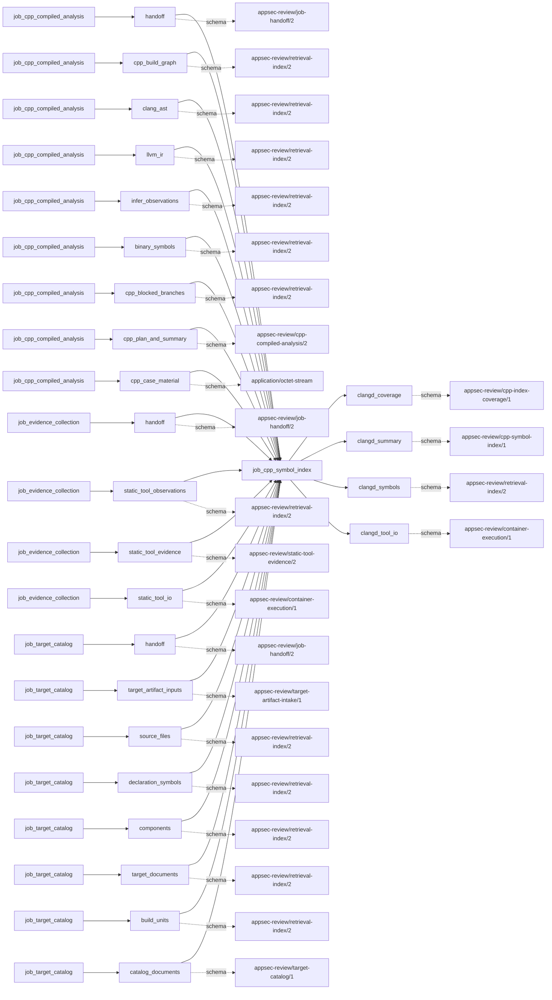
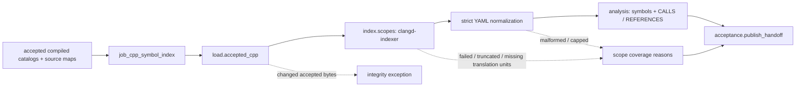

# cpp_symbol_index

## Purpose

Recover compiler-aware symbol definitions, declarations and reference/call neighborhoods from
accepted C/C++ compile scopes using clangd. These are navigation and cross-check facts, not
vulnerabilities or proof that every dynamic call is known. Symbols outside accepted sources are
counted but not indexed as source evidence.

<!-- generated:begin job=job_cpp_symbol_index -->
<!-- generated from: appsec-review.toml, containers/catalog.toml, pipeline/guidance/registry.json, tests/job-test-map.json, src/appsec_review/runtime/registry.py, src/appsec_review/runtime/contracts.py, src/appsec_review/runtime/datasets.py, src/appsec_review/guidance/workers.py, src/appsec_review/mcp/schema.py, src/appsec_review/orchestration/topology.py, src/appsec_review/orchestration/dagster/adapter.py by scripts/generate-docs.py; do not edit -->
## Declared job contract

cpp_symbol_index

Job: `job_cpp_symbol_index`. Enabled in the dev recipe: **true**.
Declarations describe possible work, not successful execution or consumed evidence.

### Steps and tasks

| Step | Task | Workers | Pool | Bound tool or gap | Handler |
| --- | --- | --- | --- | --- | --- |
| `acceptance` | `acceptance.publish_handoff` | 1 | `application` | Undeclared ([T-147](../TODO.md)) | [source](../../src/appsec_review/jobs/job_cpp_symbol_index/job.py#L300) |
| `index` | `index.scopes` | 1 | `application` | Undeclared ([T-147](../TODO.md)) | [source](../../src/appsec_review/jobs/job_cpp_symbol_index/job.py#L284) |
| `load` | `load.accepted_cpp` | 1 | `application` | Undeclared ([T-147](../TODO.md)) | [source](../../src/appsec_review/jobs/job_cpp_symbol_index/job.py#L275) |

### Accepted input declarations

| Producer | Dataset | Schema | Channel | Availability | Missing policy |
| --- | --- | --- | --- | --- | --- |
| `job_cpp_compiled_analysis` | `handoff` | `appsec-review/job-handoff/2` | handoff | required | reject |
| `job_cpp_compiled_analysis` | `cpp_build_graph` | `appsec-review/retrieval-index/2` | handoff | optional | gap |
| `job_cpp_compiled_analysis` | `clang_ast` | `appsec-review/retrieval-index/2` | handoff | optional | gap |
| `job_cpp_compiled_analysis` | `llvm_ir` | `appsec-review/retrieval-index/2` | handoff | optional | gap |
| `job_cpp_compiled_analysis` | `infer_observations` | `appsec-review/retrieval-index/2` | handoff | optional | gap |
| `job_cpp_compiled_analysis` | `binary_symbols` | `appsec-review/retrieval-index/2` | handoff | optional | gap |
| `job_cpp_compiled_analysis` | `cpp_blocked_branches` | `appsec-review/retrieval-index/2` | handoff | optional | gap |
| `job_cpp_compiled_analysis` | `cpp_plan_and_summary` | `appsec-review/cpp-compiled-analysis/2` | handoff | optional | gap |
| `job_cpp_compiled_analysis` | `cpp_case_material` | `application/octet-stream` | handoff | optional | gap |
| `job_evidence_collection` | `handoff` | `appsec-review/job-handoff/2` | handoff | optional | gap |
| `job_evidence_collection` | `static_tool_observations` | `appsec-review/retrieval-index/2` | handoff | optional | gap |
| `job_evidence_collection` | `static_tool_evidence` | `appsec-review/static-tool-evidence/2` | handoff | optional | gap |
| `job_evidence_collection` | `static_tool_io` | `appsec-review/container-execution/1` | handoff | optional | gap |
| `job_target_catalog` | `handoff` | `appsec-review/job-handoff/2` | handoff | optional | gap |
| `job_target_catalog` | `target_artifact_inputs` | `appsec-review/target-artifact-intake/1` | handoff | optional | gap |
| `job_target_catalog` | `source_files` | `appsec-review/retrieval-index/2` | handoff | optional | gap |
| `job_target_catalog` | `declaration_symbols` | `appsec-review/retrieval-index/2` | handoff | optional | gap |
| `job_target_catalog` | `components` | `appsec-review/retrieval-index/2` | handoff | optional | gap |
| `job_target_catalog` | `target_documents` | `appsec-review/retrieval-index/2` | handoff | optional | gap |
| `job_target_catalog` | `build_units` | `appsec-review/retrieval-index/2` | handoff | optional | gap |
| `job_target_catalog` | `catalog_documents` | `appsec-review/target-catalog/1` | handoff | optional | gap |

### Published dataset declarations

| Dataset | Step | Schema | Stage | Indexes | MCP route |
| --- | --- | --- | --- | --- | --- |
| `clangd_coverage` | `acceptance` | `appsec-review/cpp-index-coverage/1` | indexed | `analysis` | `coverage` |
| `clangd_summary` | `acceptance` | `appsec-review/cpp-symbol-index/1` | artifact_only | Not indexed | `coverage`, `query_dataset_inventory` |
| `clangd_symbols` | `index` | `appsec-review/retrieval-index/2` | indexed | `analysis` | `find`, `query_precomputed`, `trace` |
| `clangd_tool_io` | `index` | `appsec-review/container-execution/1` | protected | Not indexed | `coverage`, `query_dataset_inventory` |

Protected and artifact-only routes expose sanitized metadata, not payload access.

### Model and guidance declarations

No job-level model declaration; absence of a task binding remains [T-147](../TODO.md), not a nonexecution claim.

### Test selection

| Tier | Files or selectors |
| --- | --- |
| acceptance | None declared |
| integration | None declared |
| live | None declared |
| unit | `tests/test_cpp_index_jobs.py::test_symbol_index_publishes_accepted_symbols_with_complete_coverage` |

### Dagster placement

Dispatch: `review_graph`. Review graph member: **true**. Enabled graph member: **true**.

Declared predecessors: `job_cpp_compiled_analysis`.

### Declared dataflow

<!-- generated:end -->

## Process

Source: [job and normalizer](../../src/appsec_review/jobs/job_cpp_symbol_index/job.py),
[strict YAML parser](../../src/appsec_review/jobs/job_cpp_symbol_index/clangd_yaml.py), and
[accepted scope helpers](../../src/appsec_review/jobs/cpp_index_scopes.py).
Tool binding omissions in the generated metadata remain
[T-147](../TODO.md);
the executed tool is resolved in the handler, not inferred from that table.

### `load`

1. Read the accepted compiled-analysis result and manifest through the
   [input contract](../architecture/job-input-contracts.md). Require this snapshot.
2. Verify each successful catalog's compile database and materialized source mapping. Retain
   unsuccessful catalogs or catalogs without commands as unavailable cases, not empty scopes.

### `index`

1. Re-load scopes and reject changes to the planned scope-ID set. Partition compile commands by
   declared Clang support; scopes with no supported commands become `SKIPPED_NA` without launch.
2. In bounded parallel scope workers, check the per-scope checkpoint. Otherwise invoke
   `tool-clangd-indexer` over rewritten accepted compile commands using `--executor=all-TUs`
   and YAML output. [Image pinning](image-pin-verification.md) and
   [signing](signing.md) remain shared launch gates.
3. Compare stderr's processed translation units with the supported database, then parse only the
   supported YAML document subset. Preserve timeout, OOM, exit, output truncation, missing units,
   malformed document and document-cap reasons.
4. Accept unique clangd IDs with an accepted definition or canonical declaration, preferring the
   definition. Convert zero-based positions to accepted source locations. Count external-only
   symbols separately; enforce symbol bounds.
5. Link retained reference containers and targets: call-bit references become `CALLS`, others
   `REFERENCES`. Aggregate repeated edges with occurrence counts and bounded locations; count
   unresolved references without inventing edges. Enforce relation bounds.
6. Publish one analysis shard per scope and save its checkpoint. Coverage is unavailable for a
   failed exit with no symbols, partial with reasons, complete otherwise.

### `acceptance`

1. Compose scope shards plus unavailable-scope coverage with the upstream manifest.
2. Write `cpp-symbol-index-summary.json`, retaining upstream identity, per-scope results, counts
   and reasons. Item count is accepted symbols; external symbols are not included.

## Dataflow

## Gaps

The source emits text reasons. [Interchange](../architecture/job-interchange.md#the-control-layer-beneath-the-envelope)
wraps them as `producer_reported_gap`, normally non-retryable; this does not make them advisory.

- Input absent or upstream failed: unavailable accepted catalog and no compile commands. Unsupported
  compile units are explicit `SKIPPED_NA` decisions, not missing supported-unit failures.
- Tooling failure: clangd timeout, OOM or nonzero exit; malformed YAML and an incomplete final
  document also prevent trustworthy full coverage.
- Coverage missing: processed/expected translation-unit mismatch, truncated stdout, document,
  symbol and relation limits. External symbols and unresolved references are separate counters,
  not automatically gap records or evidence of complete resolution.
- Changed source/database/manifest or a matching checkpoint with missing/changed evidence is an
  integrity exception, not a successfully published gap.

Check each cause and its affected scope against the walk's user-approved expected list.

## Acceptance

1. **A. Inputs:** Match compiled handoff/result/manifest identities, source-map hashes and normalized
   compile database to admitted inputs; account for supported versus skipped commands.
2. **B. Independent comparison:** Compare clangd stderr's processed-file set with supported command
   files. Count accepted versus external YAML symbols independently; resolve sampled declaration
   spans against source bytes and compare call-bit references to stored edges and occurrence counts.
3. **C. Gaps:** Group verified outcome records and compare each missing unit, parse failure or
   truncation to raw stdout/stderr and configured bounds; record unsupported inputs separately and
   stop for any unapproved cause.
4. **D. Baseline:** On authorized acceptance, save the corpus namespace and `stepwise.py accept`
   baseline with symbol/edge counts and translation-unit sets. This documentation is not live
   clangd acceptance.

## Resume and invalidation

The scope checkpoint binds schema, scope/source/compile identities, normalizer, tool pin and all
index limits except worker count. Reuse verifies its shard, execution receipt and rewritten
database as well as accepted inputs; a matching but damaged checkpoint fails closed.
Partial outputs can be checkpointed by this producer: unchanged inputs do not promise a retry.
A tool/source/compile/normalizer/limit change invalidates that scope, while other scopes remain
independent. Composition follows [accepted index sets](../architecture/python-and-retrieval.md#accepted-index-sets).
