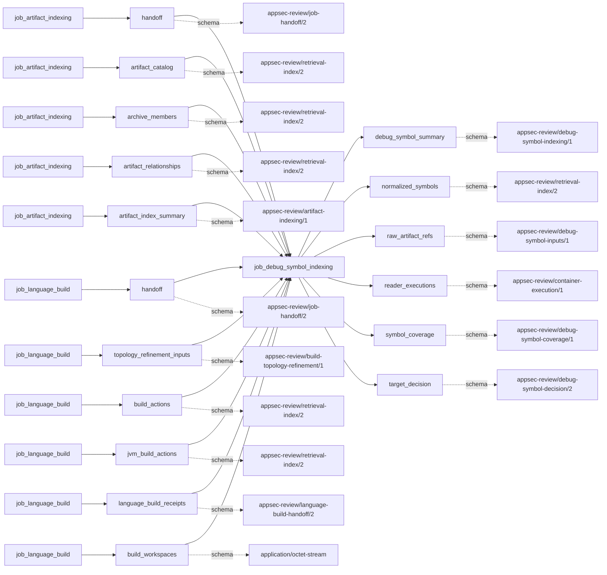
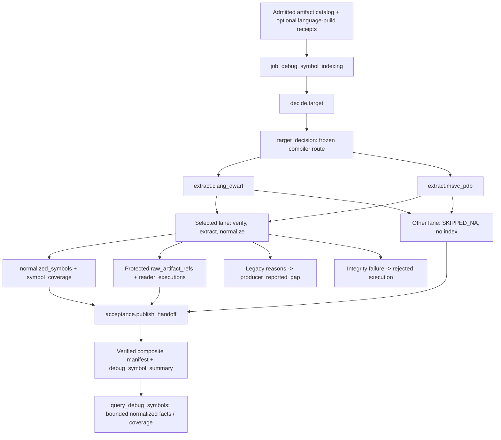

# Debug-symbol indexing job

## Purpose

`job_debug_symbol_indexing` turns accepted native binary/debug artifacts into bounded,
build-bound symbols, layouts, inline frames and source relationships. It answers which debug
facts the selected compiler lane can establish, and where that evidence is unavailable. It
does not rebuild or execute the target, fetch symbols, treat a filename as pairing evidence,
or turn an unverified debug source path into a source citation. Symbols and coverage are not
vulnerability judgments.

<!-- generated:begin job=job_debug_symbol_indexing -->
<!-- generated from: appsec-review.toml, containers/catalog.toml, pipeline/guidance/registry.json, tests/job-test-map.json, src/appsec_review/runtime/registry.py, src/appsec_review/runtime/contracts.py, src/appsec_review/runtime/datasets.py, src/appsec_review/guidance/workers.py, src/appsec_review/mcp/schema.py, src/appsec_review/orchestration/topology.py, src/appsec_review/orchestration/dagster/adapter.py by scripts/generate-docs.py; do not edit -->
## Declared job contract

debug_symbol_indexing

Job: `job_debug_symbol_indexing`. Enabled in the dev recipe: **true**.
Declarations describe possible work, not successful execution or consumed evidence.

### Steps and tasks

| Step | Task | Workers | Pool | Bound tool or gap | Handler |
| --- | --- | --- | --- | --- | --- |
| `acceptance` | `acceptance.publish_handoff` | 1 | `application` | Undeclared ([T-147](../TODO.md)) | [source](../../src/appsec_review/jobs/job_debug_symbol_indexing/job.py#L746) |
| `decide` | `decide.target` | 1 | `application` | Undeclared ([T-147](../TODO.md)) | [source](../../src/appsec_review/jobs/job_debug_symbol_indexing/job.py#L739) |
| `extract` | `extract.clang_dwarf` | 1 | `application` | Undeclared ([T-147](../TODO.md)) | [source](../../src/appsec_review/jobs/job_debug_symbol_indexing/job.py#L740) |
| `extract` | `extract.msvc_pdb` | 1 | `application` | Undeclared ([T-147](../TODO.md)) | [source](../../src/appsec_review/jobs/job_debug_symbol_indexing/job.py#L743) |

### Accepted input declarations

| Producer | Dataset | Schema | Channel | Availability | Missing policy |
| --- | --- | --- | --- | --- | --- |
| `job_artifact_indexing` | `handoff` | `appsec-review/job-handoff/2` | handoff | optional | gap |
| `job_artifact_indexing` | `artifact_catalog` | `appsec-review/retrieval-index/2` | handoff | optional | gap |
| `job_artifact_indexing` | `archive_members` | `appsec-review/retrieval-index/2` | handoff | optional | gap |
| `job_artifact_indexing` | `artifact_relationships` | `appsec-review/retrieval-index/2` | handoff | optional | gap |
| `job_artifact_indexing` | `artifact_index_summary` | `appsec-review/artifact-indexing/1` | handoff | optional | gap |
| `job_language_build` | `handoff` | `appsec-review/job-handoff/2` | handoff | optional | gap |
| `job_language_build` | `topology_refinement_inputs` | `appsec-review/build-topology-refinement/1` | handoff | optional | gap |
| `job_language_build` | `build_actions` | `appsec-review/retrieval-index/2` | handoff | optional | gap |
| `job_language_build` | `jvm_build_actions` | `appsec-review/retrieval-index/2` | handoff | optional | gap |
| `job_language_build` | `language_build_receipts` | `appsec-review/language-build-handoff/2` | handoff | optional | gap |
| `job_language_build` | `build_workspaces` | `application/octet-stream` | handoff | optional | gap |

### Published dataset declarations

| Dataset | Step | Schema | Stage | Indexes | MCP route |
| --- | --- | --- | --- | --- | --- |
| `debug_symbol_summary` | `acceptance` | `appsec-review/debug-symbol-indexing/1` | artifact_only | Not indexed | `coverage`, `query_dataset_inventory` |
| `normalized_symbols` | `extract` | `appsec-review/retrieval-index/2` | indexed | `debug_symbols` | `query_debug_symbols` |
| `raw_artifact_refs` | `extract` | `appsec-review/debug-symbol-inputs/1` | protected | Not indexed | `coverage`, `query_dataset_inventory` |
| `reader_executions` | `extract` | `appsec-review/container-execution/1` | protected | Not indexed | `coverage`, `query_dataset_inventory` |
| `symbol_coverage` | `extract` | `appsec-review/debug-symbol-coverage/1` | artifact_only | Not indexed | `coverage`, `query_debug_symbols` |
| `target_decision` | `decide` | `appsec-review/debug-symbol-decision/2` | artifact_only | Not indexed | `coverage`, `query_dataset_inventory` |

Protected and artifact-only routes expose sanitized metadata, not payload access.

### Model and guidance declarations

No job-level model declaration; absence of a task binding remains [T-147](../TODO.md), not a nonexecution claim.

### Test selection

| Tier | Files or selectors |
| --- | --- |
| acceptance | None declared |
| integration | `tests/integration/job_debug_symbol_indexing/test_debug_symbol_indexing_graph.py` `tests/integration/job_debug_symbol_indexing/test_debug_symbol_execution.py` `tests/integration/job_debug_symbol_indexing/test_debug_symbol_end_to_end.py` `tests/integration/job_artifact_indexing/test_artifact_indexing_scale.py` |
| live | None declared |
| unit | `tests/unit/job_debug_symbol_indexing/test_contract.py` `tests/unit/job_debug_symbol_indexing/test_job_graph.py` `tests/unit/job_debug_symbol_indexing/test_workflow.py` `tests/unit/job_debug_symbol_indexing/test_settings.py` `tests/unit/job_debug_symbol_indexing/test_host_bindings.py` `tests/unit/job_debug_symbol_indexing/test_accepted_inputs.py` `tests/unit/job_debug_symbol_indexing/test_decision.py` `tests/unit/job_debug_symbol_indexing/test_probe_and_privacy.py` `tests/unit/job_debug_symbol_indexing/test_sources.py` `tests/unit/job_debug_symbol_indexing/test_source_bounds.py` `tests/unit/job_debug_symbol_indexing/test_extract.py` `tests/unit/job_debug_symbol_indexing/test_normalize.py` `tests/unit/job_debug_symbol_indexing/test_publish.py` `tests/unit/job_debug_symbol_indexing/test_accepted_loader.py` `tests/unit/job_debug_symbol_indexing/test_metrics.py` `tests/unit/runtime/test_wave1a_contracts.py` |

### Dagster placement

Dispatch: `review_graph`. Review graph member: **true**. Enabled graph member: **true**.

Declared predecessors: `job_artifact_indexing`.

### Declared dataflow

<!-- generated:end -->

## Process

The [job implementation](../../src/appsec_review/jobs/job_debug_symbol_indexing/job.py) owns
selection, normalization and publication. [Reader operations](debug-symbol-indexing.md) owns
the managed-image procedure and configured bounds; the [design](../architecture/debug-symbol-indexing.md)
owns the symbol/query contract. This job has no model dispatch.

### `decide`

1. `target`: load the admitted artifact catalog and verify its run, snapshot, manifest and
   artifact identities. If language-build evidence is available, verify the matching handoff
   and bind each successful build artifact to its recorded build image.
2. Enumerate bounded native candidates. Record `max_artifacts` or
   `accepted_artifacts_unavailable` as needed; a corrupt accepted identity fails execution.
3. Freeze `compiler_target`, the single selected lane, settings, reader identity, input hashes
   and production execution plan in `decision.json`. Both the declaration and readers use
   `appsec-review/debug-symbol-decision/2`; this is routing metadata, not another symbol index.

### `extract`

1. `clang_dwarf` and `msvc_pdb`: each re-reads and verifies the frozen decision. The unselected
   lane returns domain status `SKIPPED` and terminal status `SKIPPED_NA`, with no index.
2. The selected lane probes bounded accepted inputs, verifies their hashes and pairs binary/debug
   content by the appropriate ELF or PE/PDB identity. No basename-only association is accepted.
3. Run the offline reader through the receipt-bound container exporter. The accepted build
   image is tried first when present; only an unavailable/incompatible image or missing reader
   permits the declared compatibility fallback. Parser, timeout, bound and identity failures
   do not select another lane.
4. Normalize approved records. Bind source locations only to checksum-verified accepted source
   bytes, including verified generated-source backing. Retain unresolved mappings as coverage
   reasons rather than trusting recorded paths.
5. Write the `debug_symbols` shard, per-artifact coverage, protected raw references/records and
   reader receipts. Return `COMPLETED_WITH_GAPS` for reported reasons, otherwise `SUCCEEDED`.
   Accepted-evidence integrity errors escape as execution failures.

### `acceptance`

1. `publish_handoff`: require exactly one selected shard and one deliberately skipped lane.
2. Preserve upstream indexes except an older `debug_symbols` index; add the selected shard and
   publish a verified composite manifest.
3. Bind the decision, reader evidence, artifact handoff, counts and manifest in
   `accepted-index.json`. Return the selected lane's gaps, not a clean result inferred from the
   existence of a database. The accepted loader re-verifies these bindings and retained receipts.

## Dataflow

## Gaps

The job still reports legacy reason strings. The
[root outcome projection](../../src/appsec_review/runtime/handoff.py) turns each into canonical
`producer_reported_gap` with `retryable: false`; it does not infer a retry policy from words such
as `tool_timeout`. Execution failure instead produces `producer_failed` with the runtime's retry
flag. Neither flag makes a cause advisory or user-approved. The selected extraction and
publication units can repeat a reason, so compare causes and unit scopes, not just a total count.

| Reason family | Conditions and walk expectation |
|---|---|
| `max_artifacts`, `accepted_artifacts_unavailable`, `native_binary_unavailable` | Candidate enumeration was bounded or no native binary was available. An empty index does not establish successful symbol coverage. |
| `max_input_bytes`, `max_records`, `max_records_total`, `max_output_bytes`, `artifact_integrity_unavailable` | Job-side input/output bounds or unavailable inputs. Inspect each artifact's coverage and the bound reached. Changed accepted hashes are hard integrity failures, not this last unavailable-input reason. |
| `debug_symbol_indexing_disabled`, `debug_symbol_reader_unavailable`, `debug_symbols_unavailable`, `missing_debug_artifact`, `ambiguous_debug_artifact`, `reader_failed: <exception type>` | Disabled/missing infrastructure, no unique companion, no records or a caught reader failure. Compare the selected lane, artifact identities and retained execution evidence before authorizing repair. |
| `source_mapping_unverified: checksum unavailable`, `source_checksum_invalid`, `source_checksum_algorithm_unsupported`, `source_line_offset_bound`, `source_checksum_ambiguous`, `source_checksum_unverified`, `native_parent_unavailable` | A source binding or parent relationship was not proved. Unmapped records may remain useful, but cannot supply a verified source span or missing relation. |
| Reader input/execution reasons | `input_limit`, `input_unavailable`, `input_identity_changed`, `output_limit`, `record_limit`, `depth_limit`, `tool_unavailable`, `tool_identity_unpinned`, `tool_identity_mismatch`, `tool_timeout`, `tool_failed`, `tool_oom`, `image_unavailable`, `image_incompatible`, `export_configuration_invalid`, `malformed_tool_output`. Inspect the actual production exporter receipt; host-path tool reasons also exist in the isolated reader seam, not as production PATH discovery. |
| Binary/pairing reasons | `ambiguous_build_id`, `ambiguous_codeview_identity`, `ambiguous_elf_sections`, `dwarf_missing`, `dwarf_supplementary_unavailable`, `elf_build_id_mismatch`, `elf_debuglink_mismatch`, `elf_pairing_unavailable`, `malformed_input`, `pdb_missing`, `pdb_identity_mismatch`, `pdb_invalid_address`, `pdb_invalid_section`, `pe_codeview_missing`, `split_dwarf_unavailable`, `unsupported_binary_format`, `unsupported_codeview_identity`, `unsupported_elf_extended_sections`, `unsupported_elf_format`, `unsupported_pdb_directory`, `unsupported_pdb_format`, `unsupported_pe_format`. Compare actual bytes and format identity; do not change the lane to hide an unsupported input. |
| Common record limitations | `source_paths_unverified`, `variable_locations_not_indexed`, `location_expressions_not_evaluated`, `optimized_debug_information`, `source_checksums_unavailable`, `source_ranges_unavailable`, `functions_without_address_ranges`, `types_recursive_reference`, `types_reference_unavailable`, `type_member_location_unavailable`, `type_layouts_unavailable`, `inline_frames_not_emitted`. These describe unavailable families or incomplete normalization, not an absence of vulnerable behavior. |
| Additional DWARF limitations | `address_ranges_unavailable`, `dwarf_compilation_units_unavailable`, `dwarf_reference_cycle`, `dwarf_reference_unavailable`, `dwarf_type_units_unavailable`, `functions_unavailable`, `inline_ranges_unavailable`, `source_ranges_file_unavailable`, `source_ranges_unterminated_sequence`, `type_size_unavailable`, `unsupported_dwarf_version`. Compare the bounded export and the native debug sections. |
| Additional PDB limitations | `compilation_units_unavailable`, `function_parameters_unavailable`, `function_ranges_unavailable`, `function_record_unsupported`, `function_signature_unavailable`, `pdb_export_identity_mismatch`, `pdb_export_identity_unavailable`, `pdb_subsection_unsupported`, `pdb_type_cycle`, `pdb_yaml_alias_refused`, `public_symbol_record_unsupported`, `public_symbols_have_no_lengths_or_signatures`, `signature_parameter_names_unavailable`, `source_checksum_unsupported`, `type_fields_unavailable`, `type_layout_member_unsupported`, `type_name_unavailable`, `type_primitive_unavailable`, `type_record_unsupported`, `unsupported_pdb_yaml_tag`. Public-only symbols do not establish lengths, signatures or source mappings. |
| Native inline-data limitations | `inline_annotation_address_invalid`, `inline_annotation_opcode_unsupported`, `inline_annotation_parent_range_mismatch`, `inline_annotation_ranges_ambiguous`, `inline_annotations_malformed`, `inline_native_data_malformed`, `inline_native_data_unavailable`, `inline_native_export_mismatch`, `inline_native_format_unsupported`, `inline_native_parent_invalid`, `inline_separated_code_unavailable`. Compare native CodeView data and its export rather than inventing inline frames. |
| Decision, accepted input, image, isolation, launcher, output receipt or publication mismatch | Fail execution/publication and preserve the integrity evidence. A generic runtime retry flag does not authorize accepting changed evidence. |

The reader reason families come from
[binary checks](../../src/appsec_review/debug_symbols/_reader_binary.py),
[DWARF](../../src/appsec_review/debug_symbols/_reader_dwarf.py),
[PDB](../../src/appsec_review/debug_symbols/_reader_pdb.py),
[native CodeView](../../src/appsec_review/debug_symbols/_reader_codeview.py),
[reader orchestration](../../src/appsec_review/debug_symbols/readers.py) and
[container execution](../../src/appsec_review/debug_symbols/execution.py).
The unselected lane is deliberate non-applicability, not a missing-reader gap. A walk must stop
on any other cause not on its confirmed expected-gap list.

## Acceptance

Apply the [four walk checks](../processes/walk-charter.md#5-accepting-a-job-the-four-checks):

- **A. Inputs:** verify admitted artifact and language-build pins, snapshot, binary/debug hashes,
  compiler target, reader image/release and decision fingerprint. Use the actual accepted read
  receipts, not only scheduling ancestry.
- **B. Independent comparison:** compare representative symbols, addresses, PDB GUID/age or ELF
  pairing, layouts and inline frames with independent bounded native-reader output. Verify
  claimed source checksums and byte/line ranges independently. Check coverage queries as well
  as populated queries; do not inspect protected raw records through a public retrieval grant.
- **C. Gaps:** reconcile per-artifact coverage, reason families, selected/unselected lanes and
  canonical outcomes. A tool crash, unsupported family or unverified mapping remains a named
  limitation even when other symbols were extracted.
- **D. Baseline:** record the accepted compiler/debug corpus, source identities, expected
  unsupported families and approved reader environment. A new image or changed pairing is not
  automatically equivalent evidence.

## Resume and invalidation

The decision binds source and upstream identities, settings, reader identity and the frozen
execution plan. The shard fingerprint additionally binds observed probes and, in production,
retained execution receipts so new attempts do not cite an older attempt's evidence by alias.
Changes to compiler target, accepted artifact bytes, source snapshot, input handoffs, reader
identity, declared release, image or typed policy invalidate the corresponding identity.
Missing declared release identity prevents accepted-job reuse. The runtime still verifies
accepted publication hashes and repair admission; see [resume](../architecture/jobs-and-runtime.md),
[input contracts](../architecture/job-input-contracts.md) and
[retrieval identity](../architecture/python-and-retrieval.md).
