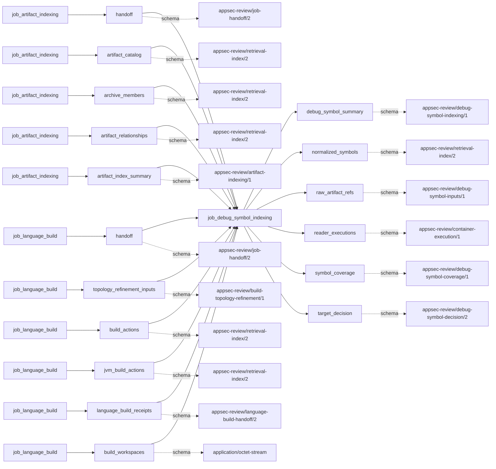

# debug_symbol_indexing

This page contains the generated contract; the authored process and acceptance description are tracked by [T-130](../TODO.md).

<!-- generated:begin job=job_debug_symbol_indexing -->
<!-- generated from: appsec-review.toml, containers/catalog.toml, pipeline/guidance/registry.json, tests/job-test-map.json, src/appsec_review/runtime/registry.py, src/appsec_review/runtime/contracts.py, src/appsec_review/runtime/datasets.py, src/appsec_review/guidance/workers.py, src/appsec_review/mcp/schema.py, src/appsec_review/orchestration/topology.py, src/appsec_review/orchestration/dagster/adapter.py by scripts/generate-docs.py; do not edit -->
## Declared job contract

debug_symbol_indexing

Job: `job_debug_symbol_indexing`. Enabled in the dev recipe: **true**.
Declarations describe possible work, not successful execution or consumed evidence.

### Steps and tasks

| Step | Task | Workers | Pool | Bound tool or gap | Handler |
| --- | --- | --- | --- | --- | --- |
| `acceptance` | `acceptance.publish_handoff` | 1 | `application` | Undeclared ([T-147](../TODO.md)) | [source](../../src/appsec_review/jobs/job_debug_symbol_indexing/job.py#L746) |
| `decide` | `decide.target` | 1 | `application` | Undeclared ([T-147](../TODO.md)) | [source](../../src/appsec_review/jobs/job_debug_symbol_indexing/job.py#L739) |
| `extract` | `extract.clang_dwarf` | 1 | `application` | Undeclared ([T-147](../TODO.md)) | [source](../../src/appsec_review/jobs/job_debug_symbol_indexing/job.py#L740) |
| `extract` | `extract.msvc_pdb` | 1 | `application` | Undeclared ([T-147](../TODO.md)) | [source](../../src/appsec_review/jobs/job_debug_symbol_indexing/job.py#L743) |

### Accepted input declarations

| Producer | Dataset | Schema | Channel | Availability | Missing policy |
| --- | --- | --- | --- | --- | --- |
| `job_artifact_indexing` | `handoff` | `appsec-review/job-handoff/2` | handoff | optional | gap |
| `job_artifact_indexing` | `artifact_catalog` | `appsec-review/retrieval-index/2` | handoff | optional | gap |
| `job_artifact_indexing` | `archive_members` | `appsec-review/retrieval-index/2` | handoff | optional | gap |
| `job_artifact_indexing` | `artifact_relationships` | `appsec-review/retrieval-index/2` | handoff | optional | gap |
| `job_artifact_indexing` | `artifact_index_summary` | `appsec-review/artifact-indexing/1` | handoff | optional | gap |
| `job_language_build` | `handoff` | `appsec-review/job-handoff/2` | handoff | optional | gap |
| `job_language_build` | `topology_refinement_inputs` | `appsec-review/build-topology-refinement/1` | handoff | optional | gap |
| `job_language_build` | `build_actions` | `appsec-review/retrieval-index/2` | handoff | optional | gap |
| `job_language_build` | `jvm_build_actions` | `appsec-review/retrieval-index/2` | handoff | optional | gap |
| `job_language_build` | `language_build_receipts` | `appsec-review/language-build-handoff/2` | handoff | optional | gap |
| `job_language_build` | `build_workspaces` | `application/octet-stream` | handoff | optional | gap |

### Published dataset declarations

| Dataset | Step | Schema | Stage | Indexes | MCP route |
| --- | --- | --- | --- | --- | --- |
| `debug_symbol_summary` | `acceptance` | `appsec-review/debug-symbol-indexing/1` | artifact_only | Not indexed | `coverage`, `query_dataset_inventory` |
| `normalized_symbols` | `extract` | `appsec-review/retrieval-index/2` | indexed | `debug_symbols` | `query_debug_symbols` |
| `raw_artifact_refs` | `extract` | `appsec-review/debug-symbol-inputs/1` | protected | Not indexed | `coverage`, `query_dataset_inventory` |
| `reader_executions` | `extract` | `appsec-review/container-execution/1` | protected | Not indexed | `coverage`, `query_dataset_inventory` |
| `symbol_coverage` | `extract` | `appsec-review/debug-symbol-coverage/1` | artifact_only | Not indexed | `coverage`, `query_debug_symbols` |
| `target_decision` | `decide` | `appsec-review/debug-symbol-decision/2` | artifact_only | Not indexed | `coverage`, `query_dataset_inventory` |

Protected and artifact-only routes expose sanitized metadata, not payload access.

### Model and guidance declarations

No job-level model declaration; absence of a task binding remains [T-147](../TODO.md), not a nonexecution claim.

### Test selection

| Tier | Files or selectors |
| --- | --- |
| acceptance | None declared |
| integration | `tests/integration/job_debug_symbol_indexing/test_debug_symbol_indexing_graph.py` `tests/integration/job_debug_symbol_indexing/test_debug_symbol_execution.py` `tests/integration/job_debug_symbol_indexing/test_debug_symbol_end_to_end.py` `tests/integration/job_artifact_indexing/test_artifact_indexing_scale.py` |
| live | None declared |
| unit | `tests/unit/job_debug_symbol_indexing/test_contract.py` `tests/unit/job_debug_symbol_indexing/test_job_graph.py` `tests/unit/job_debug_symbol_indexing/test_workflow.py` `tests/unit/job_debug_symbol_indexing/test_settings.py` `tests/unit/job_debug_symbol_indexing/test_host_bindings.py` `tests/unit/job_debug_symbol_indexing/test_accepted_inputs.py` `tests/unit/job_debug_symbol_indexing/test_decision.py` `tests/unit/job_debug_symbol_indexing/test_probe_and_privacy.py` `tests/unit/job_debug_symbol_indexing/test_sources.py` `tests/unit/job_debug_symbol_indexing/test_source_bounds.py` `tests/unit/job_debug_symbol_indexing/test_extract.py` `tests/unit/job_debug_symbol_indexing/test_normalize.py` `tests/unit/job_debug_symbol_indexing/test_publish.py` `tests/unit/job_debug_symbol_indexing/test_accepted_loader.py` `tests/unit/job_debug_symbol_indexing/test_metrics.py` `tests/unit/runtime/test_wave1a_contracts.py` |

### Dagster placement

Dispatch: `review_graph`. Review graph member: **true**. Enabled graph member: **true**.

Declared predecessors: `job_artifact_indexing`.

### Declared dataflow

<!-- generated:end -->
