# dependency_intelligence

This page contains the generated contract; the authored process and acceptance description are tracked by [T-130](../TODO.md).

<!-- generated:begin job=job_dependency_intelligence -->
<!-- generated from: appsec-review.toml, containers/catalog.toml, pipeline/guidance/registry.json, tests/job-test-map.json, src/appsec_review/runtime/registry.py, src/appsec_review/runtime/contracts.py, src/appsec_review/runtime/datasets.py, src/appsec_review/guidance/workers.py, src/appsec_review/mcp/schema.py, src/appsec_review/orchestration/topology.py, src/appsec_review/orchestration/dagster/adapter.py by scripts/generate-docs.py; do not edit -->
## Declared job contract

dependency_intelligence

Job: `job_dependency_intelligence`. Enabled in the dev recipe: **true**.
Declarations describe possible work, not successful execution or consumed evidence.

### Steps and tasks

| Step | Task | Workers | Pool | Bound tool or gap | Handler |
| --- | --- | --- | --- | --- | --- |
| `acceptance` | `acceptance.publish_handoff` | 1 | `application` | Undeclared ([T-147](../TODO.md)) | [source](../../src/appsec_review/jobs/job_dependency_intelligence/job.py#L460) |
| `inputs` | `inputs.load_accepted` | 1 | `application` | Undeclared ([T-147](../TODO.md)) | [source](../../src/appsec_review/jobs/job_dependency_intelligence/job.py#L243) |
| `publication` | `publication.publish_context` | 1 | `application` | Undeclared ([T-147](../TODO.md)) | [source](../../src/appsec_review/jobs/job_dependency_intelligence/job.py#L393) |
| `publication` | `publication.publish_sbom` | 1 | `application` | Undeclared ([T-147](../TODO.md)) | [source](../../src/appsec_review/jobs/job_dependency_intelligence/job.py#L500) |
| `repositories` | `repositories.deduplicate` | 1 | `application` | Undeclared ([T-147](../TODO.md)) | [source](../../src/appsec_review/jobs/job_dependency_intelligence/job.py#L320) |
| `resolution` | `resolution.curate_components` | 1 | `application` | Undeclared ([T-147](../TODO.md)) | [source](../../src/appsec_review/jobs/job_dependency_intelligence/job.py#L492) |
| `resolution` | `resolution.detect_dependencies` | 1 | `application` | Undeclared ([T-147](../TODO.md)) | [source](../../src/appsec_review/jobs/job_dependency_intelligence/job.py#L261) |
| `resolution` | `resolution.infer_repositories` | 1 | `application` | Undeclared ([T-147](../TODO.md)) | [source](../../src/appsec_review/jobs/job_dependency_intelligence/job.py#L292) |
| `resolution` | `resolution.investigate_components` | 1 | `application` | Undeclared ([T-147](../TODO.md)) | [source](../../src/appsec_review/jobs/job_dependency_intelligence/job.py#L494) |
| `scorecards` | `scorecards.fetch` | 1 | `application` | Undeclared ([T-147](../TODO.md)) | [source](../../src/appsec_review/jobs/job_dependency_intelligence/job.py#L328) |

### Accepted input declarations

| Producer | Dataset | Schema | Channel | Availability | Missing policy |
| --- | --- | --- | --- | --- | --- |
| `job_artifact_indexing` | `handoff` | `appsec-review/job-handoff/2` | handoff | optional | gap |
| `job_artifact_indexing` | `artifact_catalog` | `appsec-review/retrieval-index/2` | handoff | optional | gap |
| `job_artifact_indexing` | `archive_members` | `appsec-review/retrieval-index/2` | handoff | optional | gap |
| `job_artifact_indexing` | `artifact_relationships` | `appsec-review/retrieval-index/2` | handoff | optional | gap |
| `job_artifact_indexing` | `artifact_index_summary` | `appsec-review/artifact-indexing/1` | handoff | optional | gap |
| `job_cpp_compiled_analysis` | `handoff` | `appsec-review/job-handoff/2` | handoff | optional | gap |
| `job_cpp_compiled_analysis` | `cpp_build_graph` | `appsec-review/retrieval-index/2` | handoff | optional | gap |
| `job_cpp_compiled_analysis` | `clang_ast` | `appsec-review/retrieval-index/2` | handoff | optional | gap |
| `job_cpp_compiled_analysis` | `llvm_ir` | `appsec-review/retrieval-index/2` | handoff | optional | gap |
| `job_cpp_compiled_analysis` | `infer_observations` | `appsec-review/retrieval-index/2` | handoff | optional | gap |
| `job_cpp_compiled_analysis` | `binary_symbols` | `appsec-review/retrieval-index/2` | handoff | optional | gap |
| `job_cpp_compiled_analysis` | `cpp_blocked_branches` | `appsec-review/retrieval-index/2` | handoff | optional | gap |
| `job_cpp_compiled_analysis` | `cpp_plan_and_summary` | `appsec-review/cpp-compiled-analysis/2` | handoff | optional | gap |
| `job_cpp_compiled_analysis` | `cpp_case_material` | `application/octet-stream` | handoff | optional | gap |
| `job_evidence_collection` | `handoff` | `appsec-review/job-handoff/2` | handoff | optional | gap |
| `job_evidence_collection` | `static_tool_observations` | `appsec-review/retrieval-index/2` | handoff | optional | gap |
| `job_evidence_collection` | `static_tool_evidence` | `appsec-review/static-tool-evidence/2` | handoff | optional | gap |
| `job_evidence_collection` | `static_tool_io` | `appsec-review/container-execution/1` | handoff | optional | gap |
| `job_language_build` | `handoff` | `appsec-review/job-handoff/2` | handoff | optional | gap |
| `job_language_build` | `topology_refinement_inputs` | `appsec-review/build-topology-refinement/1` | handoff | optional | gap |
| `job_language_build` | `build_actions` | `appsec-review/retrieval-index/2` | handoff | optional | gap |
| `job_language_build` | `jvm_build_actions` | `appsec-review/retrieval-index/2` | handoff | optional | gap |
| `job_language_build` | `language_build_receipts` | `appsec-review/language-build-handoff/2` | handoff | optional | gap |
| `job_language_build` | `build_workspaces` | `application/octet-stream` | handoff | optional | gap |
| `job_target_catalog` | `handoff` | `appsec-review/job-handoff/2` | handoff | optional | gap |
| `job_target_catalog` | `target_artifact_inputs` | `appsec-review/target-artifact-intake/1` | handoff | optional | gap |
| `job_target_catalog` | `source_files` | `appsec-review/retrieval-index/2` | handoff | optional | gap |
| `job_target_catalog` | `declaration_symbols` | `appsec-review/retrieval-index/2` | handoff | optional | gap |
| `job_target_catalog` | `components` | `appsec-review/retrieval-index/2` | handoff | optional | gap |
| `job_target_catalog` | `target_documents` | `appsec-review/retrieval-index/2` | handoff | optional | gap |
| `job_target_catalog` | `build_units` | `appsec-review/retrieval-index/2` | handoff | optional | gap |
| `job_target_catalog` | `catalog_documents` | `appsec-review/target-catalog/1` | handoff | optional | gap |
| `job_third_party_data_sync` | `feed_snapshot` | `appsec-review/public-feed-use/1` | external | optional | gap |

### Published dataset declarations

| Dataset | Step | Schema | Stage | Indexes | MCP route |
| --- | --- | --- | --- | --- | --- |
| `dependency_context` | `publication` | `appsec-review/retrieval-index/2` | indexed | `inventory` | `find`, `query_precomputed`, `search` |
| `dependency_intelligence_handoff` | `acceptance` | `appsec-review/dependency-intelligence-handoff/1` | artifact_only | Not indexed | `coverage`, `query_dataset_inventory` |
| `native_component_curation` | `resolution` | `appsec-review/native-component-curation/1` | artifact_only | Not indexed | `coverage`, `query_dataset_inventory` |
| `native_discovery` | `resolution` | `appsec-review/native-discovery/1` | artifact_only | Not indexed | `coverage`, `query_dataset_inventory` |
| `native_inference_metrics` | `resolution` | `appsec-review/native-inference-metrics/1` | artifact_only | Not indexed | `coverage`, `query_dataset_inventory` |
| `native_metadata_investigation` | `resolution` | `appsec-review/native-metadata-investigation/1` | artifact_only | Not indexed | `coverage`, `query_dataset_inventory` |
| `native_sbom_metrics` | `publication` | `appsec-review/native-sbom-metrics/1` | artifact_only | Not indexed | `coverage`, `query_dataset_inventory` |
| `native_sbom_provenance` | `publication` | `appsec-review/native-sbom-provenance/1` | artifact_only | Not indexed | `coverage`, `query_dataset_inventory` |
| `native_spdx` | `publication` | `SPDX-2.3` | artifact_only | Not indexed | `coverage`, `query_dataset_inventory` |
| `scorecard_responses` | `scorecards` | `application/json` | artifact_only | Not indexed | `coverage`, `query_dataset_inventory` |

Protected and artifact-only routes expose sanitized metadata, not payload access.

### Model and guidance declarations

These are job-level declarations; exact per-task selection is not declared ([T-147](../TODO.md)).

```json
{
  "model": {
    "enabled": true,
    "max_input_tokens": 32000,
    "max_output_tokens": 4000,
    "model": "claude-haiku-5-5",
    "provider": "claude-cli",
    "reasoning": "medium",
    "retries": 1,
    "timeout_seconds": 120
  }
}
```

- Role: [native_dependency_resolver](../generated/guidance.md#roles-native_dependency_resolver).
- Persona: [dependency_repository_investigator](../generated/guidance.md#personas-dependency_repository_investigator).
- Task prompt: `native_repository_resolution`.
- Runtime skill: [native-dependency-resolution](../generated/guidance.md#runtime_skills-native-dependency-resolution).
- Role: [native_sbom_investigator](../generated/guidance.md#roles-native_sbom_investigator).
- Persona: [native_dependency_analyst](../generated/guidance.md#personas-native_dependency_analyst).
- Task prompt: `native_component_curation`.
- Runtime skill: [native-sbom-investigation](../generated/guidance.md#runtime_skills-native-sbom-investigation).
- Role: [native_sbom_investigator](../generated/guidance.md#roles-native_sbom_investigator).
- Persona: [native_dependency_analyst](../generated/guidance.md#personas-native_dependency_analyst).
- Task prompt: `native_metadata_investigation`.
- Runtime skill: [native-sbom-investigation](../generated/guidance.md#runtime_skills-native-sbom-investigation).
- Role: [native_sbom_investigator](../generated/guidance.md#roles-native_sbom_investigator).
- Persona: [native_dependency_analyst](../generated/guidance.md#personas-native_dependency_analyst).
- Task prompt: `native_metadata_investigation`.
- Runtime skill: [native-sbom-investigation](../generated/guidance.md#runtime_skills-native-sbom-investigation).

### Test selection

| Tier | Files or selectors |
| --- | --- |
| acceptance | None declared |
| integration | `tests/integration/test_dependency_job_acceptance.py` |
| live | None declared |
| unit | `tests/test_dependency_intelligence.py::test_native_detection_covers_link_loader_and_metadata_and_deduplicates`<br>`tests/test_dependency_intelligence.py::test_native_detection_records_command_bounds`<br>`tests/test_dependency_intelligence.py::test_normalization_prefers_package_repository_metadata_and_deduplicates` |

### Dagster placement

Dispatch: `review_graph`. Review graph member: **true**. Enabled graph member: **true**.

Declared predecessors: `job_artifact_indexing`, `job_cpp_compiled_analysis`.

### Declared dataflow

```mermaid
flowchart LR
  job["job_dependency_intelligence"]
  producer0["job_artifact_indexing"]
  input0["handoff"]
  input_schema0["appsec-review/job-handoff/2"]
  producer0 --> input0 --> job
  input0 -. schema .-> input_schema0
  producer1["job_artifact_indexing"]
  input1["artifact_catalog"]
  input_schema1["appsec-review/retrieval-index/2"]
  producer1 --> input1 --> job
  input1 -. schema .-> input_schema1
  producer2["job_artifact_indexing"]
  input2["archive_members"]
  input_schema2["appsec-review/retrieval-index/2"]
  producer2 --> input2 --> job
  input2 -. schema .-> input_schema2
  producer3["job_artifact_indexing"]
  input3["artifact_relationships"]
  input_schema3["appsec-review/retrieval-index/2"]
  producer3 --> input3 --> job
  input3 -. schema .-> input_schema3
  producer4["job_artifact_indexing"]
  input4["artifact_index_summary"]
  input_schema4["appsec-review/artifact-indexing/1"]
  producer4 --> input4 --> job
  input4 -. schema .-> input_schema4
  producer5["job_cpp_compiled_analysis"]
  input5["handoff"]
  input_schema5["appsec-review/job-handoff/2"]
  producer5 --> input5 --> job
  input5 -. schema .-> input_schema5
  producer6["job_cpp_compiled_analysis"]
  input6["cpp_build_graph"]
  input_schema6["appsec-review/retrieval-index/2"]
  producer6 --> input6 --> job
  input6 -. schema .-> input_schema6
  producer7["job_cpp_compiled_analysis"]
  input7["clang_ast"]
  input_schema7["appsec-review/retrieval-index/2"]
  producer7 --> input7 --> job
  input7 -. schema .-> input_schema7
  producer8["job_cpp_compiled_analysis"]
  input8["llvm_ir"]
  input_schema8["appsec-review/retrieval-index/2"]
  producer8 --> input8 --> job
  input8 -. schema .-> input_schema8
  producer9["job_cpp_compiled_analysis"]
  input9["infer_observations"]
  input_schema9["appsec-review/retrieval-index/2"]
  producer9 --> input9 --> job
  input9 -. schema .-> input_schema9
  producer10["job_cpp_compiled_analysis"]
  input10["binary_symbols"]
  input_schema10["appsec-review/retrieval-index/2"]
  producer10 --> input10 --> job
  input10 -. schema .-> input_schema10
  producer11["job_cpp_compiled_analysis"]
  input11["cpp_blocked_branches"]
  input_schema11["appsec-review/retrieval-index/2"]
  producer11 --> input11 --> job
  input11 -. schema .-> input_schema11
  producer12["job_cpp_compiled_analysis"]
  input12["cpp_plan_and_summary"]
  input_schema12["appsec-review/cpp-compiled-analysis/2"]
  producer12 --> input12 --> job
  input12 -. schema .-> input_schema12
  producer13["job_cpp_compiled_analysis"]
  input13["cpp_case_material"]
  input_schema13["application/octet-stream"]
  producer13 --> input13 --> job
  input13 -. schema .-> input_schema13
  producer14["job_evidence_collection"]
  input14["handoff"]
  input_schema14["appsec-review/job-handoff/2"]
  producer14 --> input14 --> job
  input14 -. schema .-> input_schema14
  producer15["job_evidence_collection"]
  input15["static_tool_observations"]
  input_schema15["appsec-review/retrieval-index/2"]
  producer15 --> input15 --> job
  input15 -. schema .-> input_schema15
  producer16["job_evidence_collection"]
  input16["static_tool_evidence"]
  input_schema16["appsec-review/static-tool-evidence/2"]
  producer16 --> input16 --> job
  input16 -. schema .-> input_schema16
  producer17["job_evidence_collection"]
  input17["static_tool_io"]
  input_schema17["appsec-review/container-execution/1"]
  producer17 --> input17 --> job
  input17 -. schema .-> input_schema17
  producer18["job_language_build"]
  input18["handoff"]
  input_schema18["appsec-review/job-handoff/2"]
  producer18 --> input18 --> job
  input18 -. schema .-> input_schema18
  producer19["job_language_build"]
  input19["topology_refinement_inputs"]
  input_schema19["appsec-review/build-topology-refinement/1"]
  producer19 --> input19 --> job
  input19 -. schema .-> input_schema19
  producer20["job_language_build"]
  input20["build_actions"]
  input_schema20["appsec-review/retrieval-index/2"]
  producer20 --> input20 --> job
  input20 -. schema .-> input_schema20
  producer21["job_language_build"]
  input21["jvm_build_actions"]
  input_schema21["appsec-review/retrieval-index/2"]
  producer21 --> input21 --> job
  input21 -. schema .-> input_schema21
  producer22["job_language_build"]
  input22["language_build_receipts"]
  input_schema22["appsec-review/language-build-handoff/2"]
  producer22 --> input22 --> job
  input22 -. schema .-> input_schema22
  producer23["job_language_build"]
  input23["build_workspaces"]
  input_schema23["application/octet-stream"]
  producer23 --> input23 --> job
  input23 -. schema .-> input_schema23
  producer24["job_target_catalog"]
  input24["handoff"]
  input_schema24["appsec-review/job-handoff/2"]
  producer24 --> input24 --> job
  input24 -. schema .-> input_schema24
  producer25["job_target_catalog"]
  input25["target_artifact_inputs"]
  input_schema25["appsec-review/target-artifact-intake/1"]
  producer25 --> input25 --> job
  input25 -. schema .-> input_schema25
  producer26["job_target_catalog"]
  input26["source_files"]
  input_schema26["appsec-review/retrieval-index/2"]
  producer26 --> input26 --> job
  input26 -. schema .-> input_schema26
  producer27["job_target_catalog"]
  input27["declaration_symbols"]
  input_schema27["appsec-review/retrieval-index/2"]
  producer27 --> input27 --> job
  input27 -. schema .-> input_schema27
  producer28["job_target_catalog"]
  input28["components"]
  input_schema28["appsec-review/retrieval-index/2"]
  producer28 --> input28 --> job
  input28 -. schema .-> input_schema28
  producer29["job_target_catalog"]
  input29["target_documents"]
  input_schema29["appsec-review/retrieval-index/2"]
  producer29 --> input29 --> job
  input29 -. schema .-> input_schema29
  producer30["job_target_catalog"]
  input30["build_units"]
  input_schema30["appsec-review/retrieval-index/2"]
  producer30 --> input30 --> job
  input30 -. schema .-> input_schema30
  producer31["job_target_catalog"]
  input31["catalog_documents"]
  input_schema31["appsec-review/target-catalog/1"]
  producer31 --> input31 --> job
  input31 -. schema .-> input_schema31
  producer32["job_third_party_data_sync"]
  input32["feed_snapshot"]
  input_schema32["appsec-review/public-feed-use/1"]
  producer32 --> input32 --> job
  input32 -. schema .-> input_schema32
  output0["dependency_context"]
  output_schema0["appsec-review/retrieval-index/2"]
  job --> output0
  output0 -. schema .-> output_schema0
  output1["dependency_intelligence_handoff"]
  output_schema1["appsec-review/dependency-intelligence-handoff/1"]
  job --> output1
  output1 -. schema .-> output_schema1
  output2["native_component_curation"]
  output_schema2["appsec-review/native-component-curation/1"]
  job --> output2
  output2 -. schema .-> output_schema2
  output3["native_discovery"]
  output_schema3["appsec-review/native-discovery/1"]
  job --> output3
  output3 -. schema .-> output_schema3
  output4["native_inference_metrics"]
  output_schema4["appsec-review/native-inference-metrics/1"]
  job --> output4
  output4 -. schema .-> output_schema4
  output5["native_metadata_investigation"]
  output_schema5["appsec-review/native-metadata-investigation/1"]
  job --> output5
  output5 -. schema .-> output_schema5
  output6["native_sbom_metrics"]
  output_schema6["appsec-review/native-sbom-metrics/1"]
  job --> output6
  output6 -. schema .-> output_schema6
  output7["native_sbom_provenance"]
  output_schema7["appsec-review/native-sbom-provenance/1"]
  job --> output7
  output7 -. schema .-> output_schema7
  output8["native_spdx"]
  output_schema8["SPDX-2.3"]
  job --> output8
  output8 -. schema .-> output_schema8
  output9["scorecard_responses"]
  output_schema9["application/json"]
  job --> output9
  output9 -. schema .-> output_schema9
```



<!-- generated:end -->
