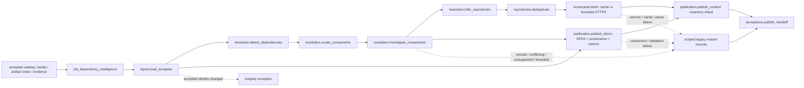

# dependency_intelligence

## Purpose

Reconcile declared, scanner-observed and native dependency evidence into package/repository context,
an enriched SPDX inventory and bounded OpenSSF Scorecard context. The job distinguishes observed,
inferred, corroborated, conflicted and unknown identity claims. Package presence, inferred upstream,
maximal exposure and Scorecard score are review context, not vulnerability findings or verified
deployment facts.

<!-- generated:begin job=job_dependency_intelligence -->
<!-- generated from: appsec-review.toml, containers/catalog.toml, pipeline/guidance/registry.json, tests/job-test-map.json, src/appsec_review/runtime/registry.py, src/appsec_review/runtime/contracts.py, src/appsec_review/runtime/datasets.py, src/appsec_review/guidance/workers.py, src/appsec_review/mcp/schema.py, src/appsec_review/orchestration/topology.py, src/appsec_review/orchestration/dagster/adapter.py by scripts/generate-docs.py; do not edit -->
## Declared job contract

dependency_intelligence

Job: `job_dependency_intelligence`. Enabled in the dev recipe: **true**.
Declarations describe possible work, not successful execution or consumed evidence.

### Steps and tasks

| Step | Task | Workers | Pool | Bound tool or gap | Handler |
| --- | --- | --- | --- | --- | --- |
| `acceptance` | `acceptance.publish_handoff` | 1 | `application` | Undeclared ([T-147](../TODO.md)) | [source](../../src/appsec_review/jobs/job_dependency_intelligence/job.py#L460) |
| `inputs` | `inputs.load_accepted` | 1 | `application` | Undeclared ([T-147](../TODO.md)) | [source](../../src/appsec_review/jobs/job_dependency_intelligence/job.py#L243) |
| `publication` | `publication.publish_context` | 1 | `application` | Undeclared ([T-147](../TODO.md)) | [source](../../src/appsec_review/jobs/job_dependency_intelligence/job.py#L393) |
| `publication` | `publication.publish_sbom` | 1 | `application` | Undeclared ([T-147](../TODO.md)) | [source](../../src/appsec_review/jobs/job_dependency_intelligence/job.py#L500) |
| `repositories` | `repositories.deduplicate` | 1 | `application` | Undeclared ([T-147](../TODO.md)) | [source](../../src/appsec_review/jobs/job_dependency_intelligence/job.py#L320) |
| `resolution` | `resolution.curate_components` | 1 | `application` | Undeclared ([T-147](../TODO.md)) | [source](../../src/appsec_review/jobs/job_dependency_intelligence/job.py#L492) |
| `resolution` | `resolution.detect_dependencies` | 1 | `application` | Undeclared ([T-147](../TODO.md)) | [source](../../src/appsec_review/jobs/job_dependency_intelligence/job.py#L261) |
| `resolution` | `resolution.infer_repositories` | 1 | `application` | Undeclared ([T-147](../TODO.md)) | [source](../../src/appsec_review/jobs/job_dependency_intelligence/job.py#L292) |
| `resolution` | `resolution.investigate_components` | 1 | `application` | Undeclared ([T-147](../TODO.md)) | [source](../../src/appsec_review/jobs/job_dependency_intelligence/job.py#L494) |
| `scorecards` | `scorecards.fetch` | 1 | `application` | Undeclared ([T-147](../TODO.md)) | [source](../../src/appsec_review/jobs/job_dependency_intelligence/job.py#L328) |

### Accepted input declarations

| Producer | Dataset | Schema | Channel | Availability | Missing policy |
| --- | --- | --- | --- | --- | --- |
| `job_artifact_indexing` | `handoff` | `appsec-review/job-handoff/2` | handoff | optional | gap |
| `job_artifact_indexing` | `artifact_catalog` | `appsec-review/retrieval-index/2` | handoff | optional | gap |
| `job_artifact_indexing` | `archive_members` | `appsec-review/retrieval-index/2` | handoff | optional | gap |
| `job_artifact_indexing` | `artifact_relationships` | `appsec-review/retrieval-index/2` | handoff | optional | gap |
| `job_artifact_indexing` | `artifact_index_summary` | `appsec-review/artifact-indexing/1` | handoff | optional | gap |
| `job_cpp_compiled_analysis` | `handoff` | `appsec-review/job-handoff/2` | handoff | optional | gap |
| `job_cpp_compiled_analysis` | `cpp_build_graph` | `appsec-review/retrieval-index/2` | handoff | optional | gap |
| `job_cpp_compiled_analysis` | `clang_ast` | `appsec-review/retrieval-index/2` | handoff | optional | gap |
| `job_cpp_compiled_analysis` | `llvm_ir` | `appsec-review/retrieval-index/2` | handoff | optional | gap |
| `job_cpp_compiled_analysis` | `infer_observations` | `appsec-review/retrieval-index/2` | handoff | optional | gap |
| `job_cpp_compiled_analysis` | `binary_symbols` | `appsec-review/retrieval-index/2` | handoff | optional | gap |
| `job_cpp_compiled_analysis` | `cpp_blocked_branches` | `appsec-review/retrieval-index/2` | handoff | optional | gap |
| `job_cpp_compiled_analysis` | `cpp_plan_and_summary` | `appsec-review/cpp-compiled-analysis/2` | handoff | optional | gap |
| `job_cpp_compiled_analysis` | `cpp_case_material` | `application/octet-stream` | handoff | optional | gap |
| `job_evidence_collection` | `handoff` | `appsec-review/job-handoff/2` | handoff | optional | gap |
| `job_evidence_collection` | `static_tool_observations` | `appsec-review/retrieval-index/2` | handoff | optional | gap |
| `job_evidence_collection` | `static_tool_evidence` | `appsec-review/static-tool-evidence/2` | handoff | optional | gap |
| `job_evidence_collection` | `static_tool_io` | `appsec-review/container-execution/1` | handoff | optional | gap |
| `job_language_build` | `handoff` | `appsec-review/job-handoff/2` | handoff | optional | gap |
| `job_language_build` | `topology_refinement_inputs` | `appsec-review/build-topology-refinement/1` | handoff | optional | gap |
| `job_language_build` | `build_actions` | `appsec-review/retrieval-index/2` | handoff | optional | gap |
| `job_language_build` | `jvm_build_actions` | `appsec-review/retrieval-index/2` | handoff | optional | gap |
| `job_language_build` | `language_build_receipts` | `appsec-review/language-build-handoff/2` | handoff | optional | gap |
| `job_language_build` | `build_workspaces` | `application/octet-stream` | handoff | optional | gap |
| `job_target_catalog` | `handoff` | `appsec-review/job-handoff/2` | handoff | optional | gap |
| `job_target_catalog` | `target_artifact_inputs` | `appsec-review/target-artifact-intake/1` | handoff | optional | gap |
| `job_target_catalog` | `source_files` | `appsec-review/retrieval-index/2` | handoff | optional | gap |
| `job_target_catalog` | `declaration_symbols` | `appsec-review/retrieval-index/2` | handoff | optional | gap |
| `job_target_catalog` | `components` | `appsec-review/retrieval-index/2` | handoff | optional | gap |
| `job_target_catalog` | `target_documents` | `appsec-review/retrieval-index/2` | handoff | optional | gap |
| `job_target_catalog` | `build_units` | `appsec-review/retrieval-index/2` | handoff | optional | gap |
| `job_target_catalog` | `catalog_documents` | `appsec-review/target-catalog/1` | handoff | optional | gap |
| `job_third_party_data_sync` | `feed_snapshot` | `appsec-review/public-feed-use/1` | external | optional | gap |

### Published dataset declarations

| Dataset | Step | Schema | Stage | Indexes | MCP route |
| --- | --- | --- | --- | --- | --- |
| `dependency_context` | `publication` | `appsec-review/retrieval-index/2` | indexed | `inventory` | `find`, `query_precomputed`, `search` |
| `dependency_intelligence_handoff` | `acceptance` | `appsec-review/dependency-intelligence-handoff/1` | artifact_only | Not indexed | `coverage`, `query_dataset_inventory` |
| `native_component_curation` | `resolution` | `appsec-review/native-component-curation/1` | artifact_only | Not indexed | `coverage`, `query_dataset_inventory` |
| `native_discovery` | `resolution` | `appsec-review/native-discovery/1` | artifact_only | Not indexed | `coverage`, `query_dataset_inventory` |
| `native_inference_inputs` | `resolution` | `appsec-review/native-inference-artifacts/1` | artifact_only | Not indexed | `coverage`, `query_dataset_inventory` |
| `native_inference_io` | `resolution` | `appsec-review/native-inference-attempt/1` | protected | Not indexed | `coverage`, `query_dataset_inventory` |
| `native_inference_metrics` | `resolution` | `appsec-review/native-inference-metrics/1` | artifact_only | Not indexed | `coverage`, `query_dataset_inventory` |
| `native_inputs` | `inputs` | `appsec-review/native-inputs/1` | protected | Not indexed | `coverage`, `query_dataset_inventory` |
| `native_metadata_investigation` | `resolution` | `appsec-review/native-metadata-investigation/1` | artifact_only | Not indexed | `coverage`, `query_dataset_inventory` |
| `native_sbom_conversion` | `publication` | `appsec-review/container-execution/1` | protected | Not indexed | `coverage`, `query_dataset_inventory` |
| `native_sbom_metrics` | `publication` | `appsec-review/native-sbom-metrics/1` | artifact_only | Not indexed | `coverage`, `query_dataset_inventory` |
| `native_sbom_provenance` | `publication` | `appsec-review/native-sbom-provenance/1` | artifact_only | Not indexed | `coverage`, `query_dataset_inventory` |
| `native_spdx` | `publication` | `SPDX-2.3` | artifact_only | Not indexed | `coverage`, `query_dataset_inventory` |
| `scorecard_responses` | `scorecards` | `application/json` | artifact_only | Not indexed | `coverage`, `query_dataset_inventory` |
| `unity_inventory` | `inputs` | `appsec-review/unity-inventory/1` | artifact_only | Not indexed | `coverage`, `query_dataset_inventory` |

Protected and artifact-only routes expose sanitized metadata, not payload access.

### Model and guidance declarations

These are job-level declarations; exact per-task selection is not declared ([T-147](../TODO.md)).

```json
{
  "model": {
    "enabled": true,
    "max_input_tokens": 32000,
    "max_output_tokens": 4000,
    "model": "claude-haiku-5-5",
    "provider": "claude-cli",
    "reasoning": "medium",
    "retries": 1,
    "timeout_seconds": 120
  }
}
```

- Role: [native_dependency_resolver](../generated/guidance.md#roles-native_dependency_resolver).
- Persona: [dependency_repository_investigator](../generated/guidance.md#personas-dependency_repository_investigator).
- Task prompt: `native_repository_resolution`.
- Runtime skill: [native-dependency-resolution](../generated/guidance.md#runtime_skills-native-dependency-resolution).
- Role: [native_sbom_investigator](../generated/guidance.md#roles-native_sbom_investigator).
- Persona: [native_dependency_analyst](../generated/guidance.md#personas-native_dependency_analyst).
- Task prompt: `native_component_curation`.
- Runtime skill: [native-sbom-investigation](../generated/guidance.md#runtime_skills-native-sbom-investigation).
- Role: [native_sbom_investigator](../generated/guidance.md#roles-native_sbom_investigator).
- Persona: [native_dependency_analyst](../generated/guidance.md#personas-native_dependency_analyst).
- Task prompt: `native_metadata_investigation`.
- Runtime skill: [native-sbom-investigation](../generated/guidance.md#runtime_skills-native-sbom-investigation).
- Role: [native_sbom_investigator](../generated/guidance.md#roles-native_sbom_investigator).
- Persona: [native_dependency_analyst](../generated/guidance.md#personas-native_dependency_analyst).
- Task prompt: `native_metadata_investigation`.
- Runtime skill: [native-sbom-investigation](../generated/guidance.md#runtime_skills-native-sbom-investigation).

### Test selection

| Tier | Files or selectors |
| --- | --- |
| acceptance | None declared |
| integration | `tests/integration/test_dependency_job_acceptance.py` |
| live | None declared |
| unit | `tests/test_dependency_intelligence.py::test_native_detection_covers_link_loader_and_metadata_and_deduplicates`<br>`tests/test_dependency_intelligence.py::test_native_detection_records_command_bounds`<br>`tests/test_dependency_intelligence.py::test_normalization_prefers_package_repository_metadata_and_deduplicates` |

### Dagster placement

Dispatch: `review_graph`. Review graph member: **true**. Enabled graph member: **true**.

Declared predecessors: `job_artifact_indexing`, `job_cpp_compiled_analysis`.

### Declared dataflow

```mermaid
flowchart LR
  job["job_dependency_intelligence"]
  producer0["job_artifact_indexing"]
  input0["handoff"]
  input_schema0["appsec-review/job-handoff/2"]
  producer0 --> input0 --> job
  input0 -. schema .-> input_schema0
  producer1["job_artifact_indexing"]
  input1["artifact_catalog"]
  input_schema1["appsec-review/retrieval-index/2"]
  producer1 --> input1 --> job
  input1 -. schema .-> input_schema1
  producer2["job_artifact_indexing"]
  input2["archive_members"]
  input_schema2["appsec-review/retrieval-index/2"]
  producer2 --> input2 --> job
  input2 -. schema .-> input_schema2
  producer3["job_artifact_indexing"]
  input3["artifact_relationships"]
  input_schema3["appsec-review/retrieval-index/2"]
  producer3 --> input3 --> job
  input3 -. schema .-> input_schema3
  producer4["job_artifact_indexing"]
  input4["artifact_index_summary"]
  input_schema4["appsec-review/artifact-indexing/1"]
  producer4 --> input4 --> job
  input4 -. schema .-> input_schema4
  producer5["job_cpp_compiled_analysis"]
  input5["handoff"]
  input_schema5["appsec-review/job-handoff/2"]
  producer5 --> input5 --> job
  input5 -. schema .-> input_schema5
  producer6["job_cpp_compiled_analysis"]
  input6["cpp_build_graph"]
  input_schema6["appsec-review/retrieval-index/2"]
  producer6 --> input6 --> job
  input6 -. schema .-> input_schema6
  producer7["job_cpp_compiled_analysis"]
  input7["clang_ast"]
  input_schema7["appsec-review/retrieval-index/2"]
  producer7 --> input7 --> job
  input7 -. schema .-> input_schema7
  producer8["job_cpp_compiled_analysis"]
  input8["llvm_ir"]
  input_schema8["appsec-review/retrieval-index/2"]
  producer8 --> input8 --> job
  input8 -. schema .-> input_schema8
  producer9["job_cpp_compiled_analysis"]
  input9["infer_observations"]
  input_schema9["appsec-review/retrieval-index/2"]
  producer9 --> input9 --> job
  input9 -. schema .-> input_schema9
  producer10["job_cpp_compiled_analysis"]
  input10["binary_symbols"]
  input_schema10["appsec-review/retrieval-index/2"]
  producer10 --> input10 --> job
  input10 -. schema .-> input_schema10
  producer11["job_cpp_compiled_analysis"]
  input11["cpp_blocked_branches"]
  input_schema11["appsec-review/retrieval-index/2"]
  producer11 --> input11 --> job
  input11 -. schema .-> input_schema11
  producer12["job_cpp_compiled_analysis"]
  input12["cpp_plan_and_summary"]
  input_schema12["appsec-review/cpp-compiled-analysis/2"]
  producer12 --> input12 --> job
  input12 -. schema .-> input_schema12
  producer13["job_cpp_compiled_analysis"]
  input13["cpp_case_material"]
  input_schema13["application/octet-stream"]
  producer13 --> input13 --> job
  input13 -. schema .-> input_schema13
  producer14["job_evidence_collection"]
  input14["handoff"]
  input_schema14["appsec-review/job-handoff/2"]
  producer14 --> input14 --> job
  input14 -. schema .-> input_schema14
  producer15["job_evidence_collection"]
  input15["static_tool_observations"]
  input_schema15["appsec-review/retrieval-index/2"]
  producer15 --> input15 --> job
  input15 -. schema .-> input_schema15
  producer16["job_evidence_collection"]
  input16["static_tool_evidence"]
  input_schema16["appsec-review/static-tool-evidence/2"]
  producer16 --> input16 --> job
  input16 -. schema .-> input_schema16
  producer17["job_evidence_collection"]
  input17["static_tool_io"]
  input_schema17["appsec-review/container-execution/1"]
  producer17 --> input17 --> job
  input17 -. schema .-> input_schema17
  producer18["job_language_build"]
  input18["handoff"]
  input_schema18["appsec-review/job-handoff/2"]
  producer18 --> input18 --> job
  input18 -. schema .-> input_schema18
  producer19["job_language_build"]
  input19["topology_refinement_inputs"]
  input_schema19["appsec-review/build-topology-refinement/1"]
  producer19 --> input19 --> job
  input19 -. schema .-> input_schema19
  producer20["job_language_build"]
  input20["build_actions"]
  input_schema20["appsec-review/retrieval-index/2"]
  producer20 --> input20 --> job
  input20 -. schema .-> input_schema20
  producer21["job_language_build"]
  input21["jvm_build_actions"]
  input_schema21["appsec-review/retrieval-index/2"]
  producer21 --> input21 --> job
  input21 -. schema .-> input_schema21
  producer22["job_language_build"]
  input22["language_build_receipts"]
  input_schema22["appsec-review/language-build-handoff/2"]
  producer22 --> input22 --> job
  input22 -. schema .-> input_schema22
  producer23["job_language_build"]
  input23["build_workspaces"]
  input_schema23["application/octet-stream"]
  producer23 --> input23 --> job
  input23 -. schema .-> input_schema23
  producer24["job_target_catalog"]
  input24["handoff"]
  input_schema24["appsec-review/job-handoff/2"]
  producer24 --> input24 --> job
  input24 -. schema .-> input_schema24
  producer25["job_target_catalog"]
  input25["target_artifact_inputs"]
  input_schema25["appsec-review/target-artifact-intake/1"]
  producer25 --> input25 --> job
  input25 -. schema .-> input_schema25
  producer26["job_target_catalog"]
  input26["source_files"]
  input_schema26["appsec-review/retrieval-index/2"]
  producer26 --> input26 --> job
  input26 -. schema .-> input_schema26
  producer27["job_target_catalog"]
  input27["declaration_symbols"]
  input_schema27["appsec-review/retrieval-index/2"]
  producer27 --> input27 --> job
  input27 -. schema .-> input_schema27
  producer28["job_target_catalog"]
  input28["components"]
  input_schema28["appsec-review/retrieval-index/2"]
  producer28 --> input28 --> job
  input28 -. schema .-> input_schema28
  producer29["job_target_catalog"]
  input29["target_documents"]
  input_schema29["appsec-review/retrieval-index/2"]
  producer29 --> input29 --> job
  input29 -. schema .-> input_schema29
  producer30["job_target_catalog"]
  input30["build_units"]
  input_schema30["appsec-review/retrieval-index/2"]
  producer30 --> input30 --> job
  input30 -. schema .-> input_schema30
  producer31["job_target_catalog"]
  input31["catalog_documents"]
  input_schema31["appsec-review/target-catalog/1"]
  producer31 --> input31 --> job
  input31 -. schema .-> input_schema31
  producer32["job_third_party_data_sync"]
  input32["feed_snapshot"]
  input_schema32["appsec-review/public-feed-use/1"]
  producer32 --> input32 --> job
  input32 -. schema .-> input_schema32
  output0["dependency_context"]
  output_schema0["appsec-review/retrieval-index/2"]
  job --> output0
  output0 -. schema .-> output_schema0
  output1["dependency_intelligence_handoff"]
  output_schema1["appsec-review/dependency-intelligence-handoff/1"]
  job --> output1
  output1 -. schema .-> output_schema1
  output2["native_component_curation"]
  output_schema2["appsec-review/native-component-curation/1"]
  job --> output2
  output2 -. schema .-> output_schema2
  output3["native_discovery"]
  output_schema3["appsec-review/native-discovery/1"]
  job --> output3
  output3 -. schema .-> output_schema3
  output4["native_inference_inputs"]
  output_schema4["appsec-review/native-inference-artifacts/1"]
  job --> output4
  output4 -. schema .-> output_schema4
  output5["native_inference_io"]
  output_schema5["appsec-review/native-inference-attempt/1"]
  job --> output5
  output5 -. schema .-> output_schema5
  output6["native_inference_metrics"]
  output_schema6["appsec-review/native-inference-metrics/1"]
  job --> output6
  output6 -. schema .-> output_schema6
  output7["native_inputs"]
  output_schema7["appsec-review/native-inputs/1"]
  job --> output7
  output7 -. schema .-> output_schema7
  output8["native_metadata_investigation"]
  output_schema8["appsec-review/native-metadata-investigation/1"]
  job --> output8
  output8 -. schema .-> output_schema8
  output9["native_sbom_conversion"]
  output_schema9["appsec-review/container-execution/1"]
  job --> output9
  output9 -. schema .-> output_schema9
  output10["native_sbom_metrics"]
  output_schema10["appsec-review/native-sbom-metrics/1"]
  job --> output10
  output10 -. schema .-> output_schema10
  output11["native_sbom_provenance"]
  output_schema11["appsec-review/native-sbom-provenance/1"]
  job --> output11
  output11 -. schema .-> output_schema11
  output12["native_spdx"]
  output_schema12["SPDX-2.3"]
  job --> output12
  output12 -. schema .-> output_schema12
  output13["scorecard_responses"]
  output_schema13["application/json"]
  job --> output13
  output13 -. schema .-> output_schema13
  output14["unity_inventory"]
  output_schema14["appsec-review/unity-inventory/1"]
  job --> output14
  output14 -. schema .-> output_schema14
```



<!-- generated:end -->

## Process

Source: [handler graph](../../src/appsec_review/jobs/job_dependency_intelligence/job.py),
[accepted-input/SBOM integration](../../src/appsec_review/jobs/job_dependency_intelligence/integration.py),
[discovery](../../src/appsec_review/jobs/job_dependency_intelligence/discovery.py) and
[repository resolution](../../src/appsec_review/jobs/job_dependency_intelligence/resolution.py).
Generated task and applicability bindings remain [T-147](../TODO.md) and [T-157](../TODO.md).

### `inputs`

1. Read accepted catalog declarations, language-build receipts, artifact-index publication and
   evidence-collection package observations. Verify their handoff-bound artifacts and snapshot
   agreement through [input contracts](../architecture/job-input-contracts.md#admission-and-read-receipts).
2. Construct authenticated native-file, invocation and artifact inputs, preserving target versus
   workspace domains, backing references, exclusions and upstream partial coverage.
3. Retain the source Syft inventory if available and collect bounded Unity inventory from accepted
   catalog paths. Missing source SBOM or unmerged artifact inventory remains named coverage loss;
   changed identity/custody is not an ordinary absent-input result.

### `resolution`

1. In `resolution.detect_dependencies`, inspect only selected authenticated metadata and invocation
   inputs within native bounds. Extract dependency hints from compile/link tokens, loader
   metadata, vendored paths, headers, pkg-config, CMake and package/license documents.
   Preserve competing claims and evidence identities rather than choosing an unsupported version.
2. Publish bounded `native-discovery.json`; normalize declared, package and native candidates
   under dependency-count and supported-repository-host limits. Unusable identities are reasons.
   Conservative maximal exposure retains conflicting evidence and defaults to production when
   no recognized scope exists; that default is not observed deployment.
3. In `resolution.curate_components`, run bounded native curation over candidate/catalog paths.
   Optional model proposals are validated against allowed identities and bounds; unavailable or
   rejected proposals leave named gaps, not newly authoritative package identities.
4. In `resolution.investigate_components`, choose bounded in-scope metadata paths, authenticate
   their bytes, and validate metadata claims against retained source references. Preserve unread
   files, unresolved locality, conflicting claims and invalid proposals. Publish result,
   discovery, model-artifact manifest and usage/metrics receipts.
5. In `resolution.infer_repositories`, renormalize the investigated candidates. For unresolved
   native candidates only, optionally request bounded repository inference. Require matching
   candidate/schema, supported consistent host/owner/name/URL fields, supplied evidence references
   and bounded confidence; mark accepted model identities as inexact.
6. Disabled/unavailable inference, exceeded input limits and exhausted retries retain gaps.
   Explicit model abstention leaves the repository unresolved; missing/unsupported repositories
   are recorded even when the inference call itself succeeded.

### `repositories`

1. Group resolved dependencies by canonical repository identity so several packages share one
   Scorecard request.
2. Sort and cap unique repositories, retaining a `repository_bound` reason for each affected
   dependency rather than dropping it from dependency inventory.

### `scorecards`

1. For each repository, load and normalize a valid age-bounded cache entry under its repository
   key; invalid cache is a retained reason, followed by a bounded fetch attempt.
2. Fetch only through the configured HTTPS host boundary with request/response/time/retry limits.
   Persist successful raw JSON by hash and fan out its context to all grouped dependencies.
3. Retain bounded received error/malformed-response bytes where available. Record not-found,
   rate-limit, request, parse, host and bounds failures; cache write failure remains a reason
   even when the fresh response was usable. Publish request/cache-hit/repository counts separately.

### `publication`

1. In `publication.publish_sbom`, convert accepted source Syft using the pinned converter when
   available. Verify the converter's retained artifact, source identity and exact document bytes;
   integrity/infrastructure exceptions stop rather than masquerading as a conversion gap.
2. Merge native discovery and Unity enrichment into bounded SPDX 2.3. Preserve provenance and
   conflicts; apply field/package/document/schema bounds. Conversion failure may leave partial
   inventory; schema validation failure publishes no SPDX document, but does retain provenance
   and metrics with failed SBOM status.
3. In `publication.publish_context`, deduplicate reasons and index dependency packages, native
   evidence and Scorecard review signals. Link Scorecard context with explicit context-only
   semantics; retain per-dependency coverage and SBOM identities.
4. Publish a verified dependency-intelligence inventory manifest. It contains this context shard;
   it is not represented as a flattened copy of every upstream index.

### `acceptance`

1. Publish `dependency-intelligence-handoff.json` with upstream hashes, dependencies/repositories,
   Scorecard responses/metrics, raw and investigated native discovery, curation/metadata receipts,
   Unity inventory, SBOM/provenance/metrics and retrieval manifest.
2. Keep `security_findings` empty; item count is dependencies. Reasons yield completed-with-gaps.
   The SBOM's own publication/validation status must still be inspected independently.

## Dataflow



## Gaps

Dependency-scoped `kind`/`detail` records and native `kind`/`scope`/evidence records are legacy
domain payloads, **not** canonical gap-code names. [Interchange](../architecture/job-interchange.md#the-control-layer-beneath-the-envelope)
wraps them as `producer_reported_gap`, normally non-retryable; this does not make them advisory.

- Input absent/partial: `input_missing`, `upstream_partial`, `artifact_inventory_not_merged`,
  missing usable dependency identity and unresolved repository.
- Present but unsupported: `unsupported_metadata`, `unsupported_response_file`, `unsupported_host`,
  unrecognized literal metadata and unsupported path/repository forms.
- Coverage missing: `bounds`, `repository_bound`, `unmapped_path`, `ambiguous_root`, unread metadata,
  `identity_conflict`, `version_conflict` and `repository_conflict`. Preserve unknown or
  conflicting claims rather than manufacturing a unique package.
- Tooling/read/model failures: `read_failed`, `decode_failed`, `model_unavailable`, `model_failure`,
  rejected native proposals, `sbom_conversion_failed`, `sbom_validation_failed`.
- Scorecard failures: `scorecard_not_found`, `scorecard_rate_limit`, `scorecard_request_failure`,
  `scorecard_malformed_response`, `scorecard_cache_invalid`, `scorecard_cache_write_failure`, host
  rejection and request/byte bounds. A missing Scorecard says nothing about package safety.

Native proposal failures may be represented as `upstream_partial` or `unsupported_metadata` with
the specific stage/reason retained. Inspect SBOM and inference metrics, not only final reason
counts. Accepted hash/schema/snapshot mismatch, malformed authenticated custody and converter
identity disagreement raise; execution-safety may also stop before a model fallback is published.
No known cause automatically belongs on the walk's approved expected list.

## Acceptance

1. **A. Inputs:** Compare all four admitted handoff hashes, native source/workspace references,
   invocation/artifact identities and exact Syft input against accepted pins and read receipts.
2. **B. Independent comparison:** Independently count declared/scanner/native candidates and
   repository groups; resolve sampled metadata claims against retained byte/line references.
   Compare SPDX packages/relationships with native evidence and the native Syft baseline, including
   conflicts and Unity additions. Compare Scorecard JSON identity/score and unique repository,
   request/cache-hit counts without interpreting score as a finding.
3. **C. Gaps:** Group verified outcomes and reconcile discovery, inference, SBOM and HTTP/cache
   receipts with retained omissions/failures; compare actual causes and costs with the expected list.
4. **D. Baseline:** On authorized acceptance save `stepwise.py accept`, corpus namespace and baseline
   with package/repository/SPDX identities, model provenance and Scorecard context. No live model,
   converter, HTTP or acceptance validation is asserted here.

## Resume and invalidation

Runtime units follow [receipt reuse](../architecture/jobs-and-runtime.md#wave-1-resumability);
the job also declares external feed-input identity. Native inference receipts bind input document,
bounds, model settings, guidance hashes and result identity; they are provenance, not permission
to reuse an unrelated candidate answer. SBOM computation binds accepted identities, native/SBOM
bounds, discovery/merge/schema identities, inference artifacts and conversion identities/status.
The inventory fingerprint includes upstream pins and resolved context, gaps, Scorecard API and
SBOM fingerprint/hash.

Scorecard caching is a distinct age/identity-validated repository cache; a valid hit avoids HTTP,
but does not prove a fresh upstream scan. Changing accepted dependencies, model/guidance,
normalizers, conversion or feed identities must be reconciled at their own boundaries rather
than treating a warm cache as accepted job output. Shared tool launch uses
[image pins](image-pin-verification.md) and [signing](signing.md).

## Model usage

The [native SBOM investigator role](../generated/guidance.md#roles-native_sbom_investigator) with
the [native dependency analyst persona](../generated/guidance.md#personas-native_dependency_analyst)
is used for curation, bounded metadata planning and metadata proposals: candidate grouping and
metadata interpretation need judgment, but accepted paths and resolving source references remain
the authority. The model cannot invent an uncataloged file or promote its own recollection into
corroborated metadata.

The [native dependency resolver](../generated/guidance.md#roles-native_dependency_resolver) with
the [repository investigator persona](../generated/guidance.md#personas-dependency_repository_investigator)
addresses only unresolved native repository context. Its output remains model-inferred and
inexact even after structural/evidence validation. These are separate calls, not a model-driven
Scorecard fetch or arbitrary repository browse. Selection and hash-pinned guidance follow
[worker contracts](../architecture/worker-prompt-contracts.md#publication-and-compatibility) and
[guidance procedures](../architecture/guidance-procedures.md#selection-and-provenance);
central configuration controls budgets and retries.
