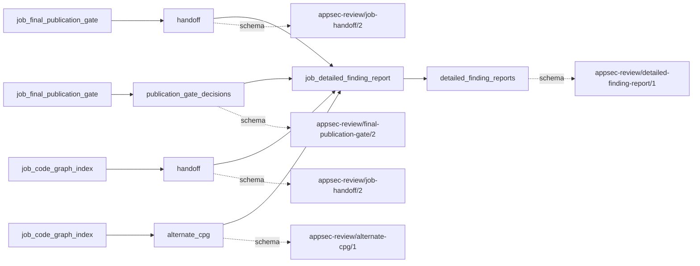
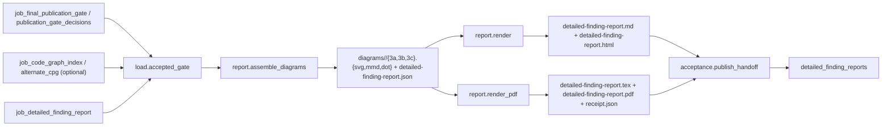

# detailed_finding_report

## Purpose

Assemble a deterministic per-defect visual report (`appsec-review/detailed-finding-report/1`) from
the certified final publication gate snapshot and optional accepted code-graph slices. Each
publishable confirmed defect is paired with three complementary bounded code-flow diagrams —
**3a** (source taint / invariant flow), **3b** (call-fanout slice from accepted `alternate_cpg` or
offline `exe_viewer --graph fanout`), and **3c** (intra-procedural function control-flow graph) ?
rendered across JSON, Markdown, HTML, LaTeX and PDF without re-adjudicating findings, reading the
live target tree or upgrading assurance.

<!-- generated:begin job=job_detailed_finding_report -->
<!-- generated from: appsec-review.toml, containers/catalog.toml, pipeline/guidance/registry.json, tests/job-test-map.json, src/appsec_review/runtime/registry.py, src/appsec_review/runtime/contracts.py, src/appsec_review/runtime/datasets.py, src/appsec_review/guidance/workers.py, src/appsec_review/mcp/schema.py, src/appsec_review/orchestration/topology.py, src/appsec_review/orchestration/dagster/adapter.py by scripts/generate-docs.py; do not edit -->
## Declared job contract

detailed_finding_report

Job: `job_detailed_finding_report`. Enabled in the dev recipe: **true**.
Declarations describe possible work, not successful execution or consumed evidence.

### Steps and tasks

| Step | Task | Workers | Pool | Bound tool or gap | Handler |
| --- | --- | --- | --- | --- | --- |
| `acceptance` | `acceptance.publish_handoff` | 1 | `application` | Undeclared ([T-147](../TODO.md)) | [source](../../src/appsec_review/jobs/job_detailed_finding_report/job.py#L902) |
| `load` | `load.accepted_inputs` | 1 | `application` | Undeclared ([T-147](../TODO.md)) | [source](../../src/appsec_review/jobs/job_detailed_finding_report/job.py#L651) |
| `report` | `report.assemble` | 1 | `application` | Undeclared ([T-147](../TODO.md)) | [source](../../src/appsec_review/jobs/job_detailed_finding_report/job.py#L709) |
| `report` | `report.render` | 1 | `application` | Undeclared ([T-147](../TODO.md)) | [source](../../src/appsec_review/jobs/job_detailed_finding_report/job.py#L788) |
| `report` | `report.render_pdf` | 1 | `application` | Undeclared ([T-147](../TODO.md)) | [source](../../src/appsec_review/jobs/job_detailed_finding_report/job.py#L837) |

### Accepted input declarations

| Producer | Dataset | Schema | Channel | Availability | Missing policy |
| --- | --- | --- | --- | --- | --- |
| `job_final_publication_gate` | `handoff` | `appsec-review/job-handoff/2` | handoff | required | reject |
| `job_final_publication_gate` | `publication_gate_decisions` | `appsec-review/final-publication-gate/2` | handoff | optional | gap |
| `job_code_graph_index` | `handoff` | `appsec-review/job-handoff/2` | handoff | optional | gap |
| `job_code_graph_index` | `alternate_cpg` | `appsec-review/alternate-cpg/1` | handoff | optional | gap |

### Published dataset declarations

| Dataset | Step | Schema | Stage | Indexes | MCP route |
| --- | --- | --- | --- | --- | --- |
| `detailed_finding_reports` | `acceptance` | `appsec-review/detailed-finding-report/1` | artifact_only | Not indexed | `coverage`, `query_dataset_inventory` |

Protected and artifact-only routes expose sanitized metadata, not payload access.

### Model and guidance declarations

No job-level model declaration; absence of a task binding remains [T-147](../TODO.md), not a nonexecution claim.

### Test selection

| Tier | Files or selectors |
| --- | --- |
| acceptance | None declared |
| integration | None declared |
| live | None declared |
| unit | `tests/unit/job_detailed_finding_report/test_contract_and_settings.py` `tests/unit/job_detailed_finding_report/test_detailed_finding_report.py` |

### Dagster placement

Dispatch: `review_graph`. Review graph member: **true**. Enabled graph member: **true**.

Declared predecessors: `job_final_publication_gate`.

### Declared dataflow

<!-- generated:end -->

## Process

The [handler](../../src/appsec_review/jobs/job_detailed_finding_report/job.py) consumes the
certified [gate snapshot](../../src/appsec_review/jobs/job_final_publication_gate/verify.py) and
projects deterministic defect slices through
[`reporting/detailed_finding_report.py`](../../src/appsec_review/reporting/detailed_finding_report.py)
and [`reporting/code_flow.py`](../../src/appsec_review/reporting/code_flow.py).

### `load`

1. In `load.accepted_gate`, require the accepted `job_final_publication_gate` handoff to match the
   attempt's admitted upstream pin and re-verify the gate document plus bound confirmed dossiers.
2. Optionally read the admitted `job_code_graph_index` `alternate_cpg` artifact through
   `accepted_upstream`; when absent or degraded, record a bounded `producer-gap/1` qualification
   rather than inventing call-graph edges or reading unverified files.

### `report`

1. In `report.assemble_diagrams`, build one ordered defect entry per gate-publishable confirmed
   finding and materialize deterministic `3a` (taint/invariant chain), `3b` (bounded call-fanout
   slice up to `max_fanout_nodes`), and `3c` (bounded function CFG up to `max_cfg_nodes`) diagram
   bundles (`.svg`, `.mmd`, `.dot`) under `diagrams/<defect_slug>/` plus
   `detailed-finding-report.json`.
2. In `report.render`, render `detailed-finding-report.md` and self-contained
   `detailed-finding-report.html` embedding the inline SVG slices and explicit gap notices when a
   slice has no accepted graph backing.
3. In `report.render_pdf`, emit `detailed-finding-report.tex` and compile
   `detailed-finding-report.pdf` through the pinned `tool-report-latex` image within
   `render_timeout_seconds` and `max_pdf_bytes`, recording renderer outcomes in `receipt.json`.

### `acceptance`

1. In `acceptance.publish_handoff`, re-verify the bound gate snapshot, schema-validate
   `detailed-finding-report.json` and the handoff payload, re-render Markdown and HTML to confirm
   exact byte determinism, verify every referenced diagram file hash, and publish immutable
   `detailed_finding_reports` bindings.

## Dataflow

## Gaps

Missing or corrupt required gate inputs fail closed before publication. Optional `alternate_cpg`
unavailability, findings without ordered path steps or CFG nodes, and PDF renderer unavailability
or oversize outputs emit canonical `producer-gap/1` records (`strict_gaps = True`) and explicit
per-slice qualification placeholders while preserving valid sibling defect diagrams and the JSON,
Markdown and HTML publications.

## Acceptance

1. **A. Inputs:** Verify that `load.accepted_gate` binds the exact admitted
   `job_final_publication_gate` (and optional `job_code_graph_index`) handoff SHA-256 and never
   mounts or reads the live target checkout.
2. **B. Independent comparison:** Compare the published defect count and IDs against the gate's
   `publishable_findings` bucket and verify that each defect owns deterministic `3a`, `3b`, and
   `3c` diagram records matching the bound dossier evidence and `alternate_cpg` slice.
3. **C. Gaps:** Reconcile canonical `outcomes.json` gap records with missing graph slices or PDF
   renderer limitations; confirm no placeholder claims unverified reachability or execution.
4. **D. Baseline:** Record the accepted handoff, `detailed-finding-report.json`, Markdown/HTML/PDF
   hashes and diagram counts for whole-job reuse comparison on subsequent runs.

## Resume and invalidation

`job_detailed_finding_report` is a deterministic, model-free terminal leaf scheduled directly after
`job_final_publication_gate` in parallel with `job_final_report_publication` and
`job_openvex_export`. Whole-job reuse binds the accepted gate and optional code-graph pins, central
settings, operational bounds (`max_fanout_nodes`, `max_cfg_nodes`, `max_pdf_bytes`,
`render_timeout_seconds`), dataset contract, and implementation release; any upstream or material
configuration change re-executes the job in a fresh attempt directory.
