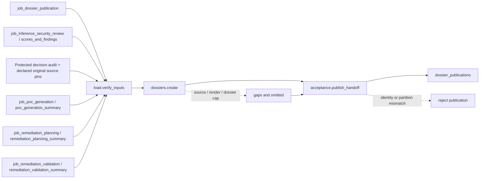

# dossier_publication

## Purpose

Produce protected developer dossiers for every accepted confirmed finding and, separately, every
accepted PoC outcome. Rendering preserves evidence, qualification, remediation and chain context;
it neither confirms supported findings nor converts compile-only artifacts into runtime proof.
The final publication gate certifies these dossiers later; dossiers do not consume that gate.

<!-- generated:begin job=job_dossier_publication -->
<!-- generated from: appsec-review.toml, containers/catalog.toml, pipeline/guidance/registry.json, tests/job-test-map.json, src/appsec_review/runtime/registry.py, src/appsec_review/runtime/contracts.py, src/appsec_review/runtime/datasets.py, src/appsec_review/guidance/workers.py, src/appsec_review/mcp/schema.py, src/appsec_review/orchestration/topology.py, src/appsec_review/orchestration/dagster/adapter.py by scripts/generate-docs.py; do not edit -->
## Declared job contract

dossier_publication

Job: `job_dossier_publication`. Enabled in the dev recipe: **true**.
Declarations describe possible work, not successful execution or consumed evidence.

### Steps and tasks

| Step | Task | Workers | Pool | Bound tool or gap | Handler |
| --- | --- | --- | --- | --- | --- |
| `acceptance` | `acceptance.publish_handoff` | 1 | `lifecycle` | Undeclared ([T-147](../TODO.md)) | [source](../../src/appsec_review/jobs/job_dossier_publication/job.py#L259) |
| `dossiers` | `dossiers.create` | 1 | `application` | Undeclared ([T-147](../TODO.md)) | [source](../../src/appsec_review/jobs/job_dossier_publication/job.py#L152) |
| `load` | `load.verify_inputs` | 1 | `application` | Undeclared ([T-147](../TODO.md)) | [source](../../src/appsec_review/jobs/job_dossier_publication/job.py#L138) |

### Accepted input declarations

| Producer | Dataset | Schema | Channel | Availability | Missing policy |
| --- | --- | --- | --- | --- | --- |
| `job_target_catalog` | `handoff` | `appsec-review/job-handoff/2` | handoff | optional | gap |
| `job_target_catalog` | `source_files` | `appsec-review/retrieval-index/2` | handoff | optional | gap |
| `job_target_catalog` | `declaration_symbols` | `appsec-review/retrieval-index/2` | handoff | optional | gap |
| `job_target_catalog` | `target_documents` | `appsec-review/retrieval-index/2` | handoff | optional | gap |
| `job_tree_sitter_ast` | `handoff` | `appsec-review/job-handoff/2` | handoff | optional | gap |
| `job_tree_sitter_ast` | `tree_sitter_ast` | `appsec-review/tree-sitter-normalizer/1` | handoff | optional | gap |
| `job_tree_sitter_ast` | `tree_sitter_coverage` | `appsec-review/tree-sitter-ast/1` | handoff | optional | gap |
| `job_cpp_compiled_analysis` | `handoff` | `appsec-review/job-handoff/2` | handoff | optional | gap |
| `job_cpp_compiled_analysis` | `clang_ast` | `appsec-review/retrieval-index/2` | handoff | optional | gap |
| `job_cpp_compiled_analysis` | `llvm_ir` | `appsec-review/retrieval-index/2` | handoff | optional | gap |
| `job_cpp_compiled_analysis` | `infer_observations` | `appsec-review/retrieval-index/2` | handoff | optional | gap |
| `job_cpp_compiled_analysis` | `binary_symbols` | `appsec-review/retrieval-index/2` | handoff | optional | gap |
| `job_cpp_compiled_analysis` | `cpp_blocked_branches` | `appsec-review/retrieval-index/2` | handoff | optional | gap |
| `job_cpp_symbol_index` | `handoff` | `appsec-review/job-handoff/2` | handoff | optional | gap |
| `job_cpp_symbol_index` | `clangd_symbols` | `appsec-review/retrieval-index/2` | handoff | optional | gap |
| `job_cpp_symbol_index` | `clangd_coverage` | `appsec-review/cpp-index-coverage/1` | handoff | optional | gap |
| `job_svf_alias_analysis` | `handoff` | `appsec-review/job-handoff/2` | handoff | optional | gap |
| `job_svf_alias_analysis` | `svf_alias_sets` | `appsec-review/retrieval-index/2` | handoff | optional | gap |
| `job_svf_alias_analysis` | `svf_alias_scope_coverage` | `appsec-review/cpp-index-coverage/1` | handoff | optional | gap |
| `job_code_graph_index` | `handoff` | `appsec-review/job-handoff/2` | handoff | optional | gap |
| `job_code_graph_index` | `code_graph_facts` | `appsec-review/graph-fact/1` | handoff | optional | gap |
| `job_codeql_analysis` | `handoff` | `appsec-review/job-handoff/2` | handoff | optional | gap |
| `job_codeql_analysis` | `codeql_observations` | `appsec-review/codeql-sarif-normalizer/3` | handoff | optional | gap |
| `job_evidence_collection` | `handoff` | `appsec-review/job-handoff/2` | handoff | optional | gap |
| `job_evidence_collection` | `static_tool_observations` | `appsec-review/retrieval-index/2` | handoff | optional | gap |
| `job_clang_static_analysis` | `handoff` | `appsec-review/job-handoff/2` | handoff | optional | gap |
| `job_clang_static_analysis` | `clang_static_observations` | `appsec-review/retrieval-index/2` | handoff | optional | gap |
| `job_clang_static_analysis` | `clang_static_scope_coverage` | `appsec-review/cpp-index-coverage/1` | handoff | optional | gap |
| `job_cpg_analysis` | `handoff` | `appsec-review/job-handoff/2` | handoff | optional | gap |
| `job_cpg_analysis` | `cpg_graph_coverage` | `appsec-review/retrieval-index/2` | handoff | optional | gap |
| `job_cpg_analysis` | `cpg_scope_coverage` | `appsec-review/cpp-index-coverage/1` | handoff | optional | gap |
| `job_ci_configuration_analysis` | `handoff` | `appsec-review/job-handoff/2` | handoff | optional | gap |
| `job_ci_configuration_analysis` | `ci_observations` | `appsec-review/retrieval-index/2` | handoff | optional | gap |
| `job_ci_configuration_analysis` | `ci_findings` | `appsec-review/retrieval-index/2` | handoff | optional | gap |
| `job_artifact_security_analysis` | `handoff` | `appsec-review/job-handoff/2` | handoff | optional | gap |
| `job_artifact_security_analysis` | `artifact_security_observations` | `appsec-review/retrieval-index/2` | handoff | optional | gap |
| `job_binary_evidence_indexing` | `handoff` | `appsec-review/job-handoff/2` | handoff | optional | gap |
| `job_binary_evidence_indexing` | `binary_functions` | `appsec-review/retrieval-index/2` | handoff | optional | gap |
| `job_dependency_intelligence` | `handoff` | `appsec-review/job-handoff/2` | handoff | optional | gap |
| `job_dependency_intelligence` | `dependency_context` | `appsec-review/retrieval-index/2` | handoff | optional | gap |
| `job_review_prioritization` | `handoff` | `appsec-review/job-handoff/2` | handoff | optional | gap |
| `job_review_prioritization` | `priority_items` | `appsec-review/retrieval-index/2` | handoff | optional | gap |
| `job_security_tagging` | `handoff` | `appsec-review/job-handoff/2` | handoff | optional | gap |
| `job_security_tagging` | `tag_assignments` | `appsec-review/tag-assignment/1` | handoff | optional | gap |
| `job_review_data_indexing` | `handoff` | `appsec-review/job-handoff/2` | handoff | optional | gap |
| `job_review_data_indexing` | `cross_domain_links` | `appsec-review/retrieval-index/2` | handoff | optional | gap |
| `job_review_data_indexing` | `precomputed_products` | `appsec-review/retrieval-index/2` | handoff | optional | gap |
| `job_inference_security_review` | `handoff` | `appsec-review/job-handoff/2` | handoff | required | reject |
| `job_inference_security_review` | `accepted_scope` | `appsec-review/inference-review-accepted-scope/1` | handoff | optional | gap |
| `job_inference_security_review` | `lead_triage` | `application/json` | handoff | optional | gap |
| `job_inference_security_review` | `review_packages` | `appsec-review/review-package/7` | handoff | optional | gap |
| `job_inference_security_review` | `review_cells` | `appsec-review/cell-attempt-receipt/1` | handoff | optional | gap |
| `job_inference_security_review` | `claim_ledger` | `appsec-review/ledger-event/1` | handoff | optional | gap |
| `job_inference_security_review` | `attack_chains` | `appsec-review/attack-chain-manifest/1` | handoff | optional | gap |
| `job_inference_security_review` | `scores_and_findings` | `appsec-review/finding-package/2` | handoff | optional | gap |
| `job_inference_security_review` | `review_audit_metadata` | `appsec-review/review-audit-publication/1` | handoff | when_output_declared | gap |
| `job_inference_security_review` | `review_decision_audit` | `appsec-review/review-audit-manifest/1` | handoff | when_output_declared | not_applicable |
| `job_inference_security_review` | `review_decisions` | `appsec-review/review-decision/1` | handoff | when_output_declared | not_applicable |
| `job_inference_security_review` | `review_verification_coverage` | `appsec-review/verification-coverage/1` | handoff | when_output_declared | not_applicable |
| `job_inference_security_review` | `review_decision_bases` | `appsec-review/decision-basis/1` | handoff | when_output_declared | not_applicable |
| `job_inference_security_review` | `review_audit_continuations` | `application/x-ndjson` | handoff | when_output_declared | not_applicable |
| `job_poc_generation` | `handoff` | `appsec-review/job-handoff/2` | handoff | optional | gap |
| `job_poc_generation` | `poc_generation_summary` | `appsec-review/poc-generation-handoff/2` | handoff | optional | gap |
| `job_poc_generation` | `poc_writer_cells` | `appsec-review/poc-writer-receipt/1` | handoff | optional | gap |
| `job_poc_generation` | `poc_reproducers` | `appsec-review/poc-provenance/2` | handoff | optional | gap |
| `job_remediation_planning` | `handoff` | `appsec-review/job-handoff/2` | handoff | optional | gap |
| `job_remediation_planning` | `remediation_planning_summary` | `appsec-review/remediation-planning/1` | handoff | optional | gap |
| `job_remediation_planning` | `remediation_proposals` | `appsec-review/remediation-plan/1` | handoff | optional | gap |
| `job_remediation_validation` | `handoff` | `appsec-review/job-handoff/2` | handoff | optional | gap |
| `job_remediation_validation` | `remediation_validation_summary` | `appsec-review/remediation-validations/1` | handoff | optional | gap |
| `job_remediation_validation` | `remediation_validation_receipts` | `appsec-review/remediation-validation/1` | handoff | optional | gap |
| `job_post_build_security_assessment` | `handoff` | `appsec-review/job-handoff/2` | handoff | optional | gap |
| `job_post_build_security_assessment` | `build_security` | `appsec-review/retrieval-index/2` | handoff | optional | gap |

### Published dataset declarations

| Dataset | Step | Schema | Stage | Indexes | MCP route |
| --- | --- | --- | --- | --- | --- |
| `dossier_publications` | `acceptance` | `appsec-review/dossier-publication/1` | protected | Not indexed | `coverage`, `query_dataset_inventory` |

Protected and artifact-only routes expose sanitized metadata, not payload access.

### Model and guidance declarations

No job-level model declaration; absence of a task binding remains [T-147](../TODO.md), not a nonexecution claim.

### Test selection

| Tier | Files or selectors |
| --- | --- |
| acceptance | None declared |
| integration | None declared |
| live | `tests/integration/test_dossier_live.py` |
| unit | `tests/test_dossier_publication.py::test_empty_scope_does_not_read_target_or_call_renderer` `tests/test_dossier_publication.py::test_supported_finding_has_only_a_poc_dossier` `tests/unit/review_decision_audit_consumers/test_dossier.py` |

### Dagster placement

Dispatch: `review_graph`. Review graph member: **true**. Enabled graph member: **true**.

Declared predecessors: `job_remediation_validation`.

### Declared dataflow

```mermaid
flowchart LR
  job["job_dossier_publication"]
  producer0["job_target_catalog"]
  input0["handoff"]
  input_schema0["appsec-review/job-handoff/2"]
  producer0 --> input0 --> job
  input0 -. schema .-> input_schema0
  producer1["job_target_catalog"]
  input1["source_files"]
  input_schema1["appsec-review/retrieval-index/2"]
  producer1 --> input1 --> job
  input1 -. schema .-> input_schema1
  producer2["job_target_catalog"]
  input2["declaration_symbols"]
  input_schema2["appsec-review/retrieval-index/2"]
  producer2 --> input2 --> job
  input2 -. schema .-> input_schema2
  producer3["job_target_catalog"]
  input3["target_documents"]
  input_schema3["appsec-review/retrieval-index/2"]
  producer3 --> input3 --> job
  input3 -. schema .-> input_schema3
  producer4["job_tree_sitter_ast"]
  input4["handoff"]
  input_schema4["appsec-review/job-handoff/2"]
  producer4 --> input4 --> job
  input4 -. schema .-> input_schema4
  producer5["job_tree_sitter_ast"]
  input5["tree_sitter_ast"]
  input_schema5["appsec-review/tree-sitter-normalizer/1"]
  producer5 --> input5 --> job
  input5 -. schema .-> input_schema5
  producer6["job_tree_sitter_ast"]
  input6["tree_sitter_coverage"]
  input_schema6["appsec-review/tree-sitter-ast/1"]
  producer6 --> input6 --> job
  input6 -. schema .-> input_schema6
  producer7["job_cpp_compiled_analysis"]
  input7["handoff"]
  input_schema7["appsec-review/job-handoff/2"]
  producer7 --> input7 --> job
  input7 -. schema .-> input_schema7
  producer8["job_cpp_compiled_analysis"]
  input8["clang_ast"]
  input_schema8["appsec-review/retrieval-index/2"]
  producer8 --> input8 --> job
  input8 -. schema .-> input_schema8
  producer9["job_cpp_compiled_analysis"]
  input9["llvm_ir"]
  input_schema9["appsec-review/retrieval-index/2"]
  producer9 --> input9 --> job
  input9 -. schema .-> input_schema9
  producer10["job_cpp_compiled_analysis"]
  input10["infer_observations"]
  input_schema10["appsec-review/retrieval-index/2"]
  producer10 --> input10 --> job
  input10 -. schema .-> input_schema10
  producer11["job_cpp_compiled_analysis"]
  input11["binary_symbols"]
  input_schema11["appsec-review/retrieval-index/2"]
  producer11 --> input11 --> job
  input11 -. schema .-> input_schema11
  producer12["job_cpp_compiled_analysis"]
  input12["cpp_blocked_branches"]
  input_schema12["appsec-review/retrieval-index/2"]
  producer12 --> input12 --> job
  input12 -. schema .-> input_schema12
  producer13["job_cpp_symbol_index"]
  input13["handoff"]
  input_schema13["appsec-review/job-handoff/2"]
  producer13 --> input13 --> job
  input13 -. schema .-> input_schema13
  producer14["job_cpp_symbol_index"]
  input14["clangd_symbols"]
  input_schema14["appsec-review/retrieval-index/2"]
  producer14 --> input14 --> job
  input14 -. schema .-> input_schema14
  producer15["job_cpp_symbol_index"]
  input15["clangd_coverage"]
  input_schema15["appsec-review/cpp-index-coverage/1"]
  producer15 --> input15 --> job
  input15 -. schema .-> input_schema15
  producer16["job_svf_alias_analysis"]
  input16["handoff"]
  input_schema16["appsec-review/job-handoff/2"]
  producer16 --> input16 --> job
  input16 -. schema .-> input_schema16
  producer17["job_svf_alias_analysis"]
  input17["svf_alias_sets"]
  input_schema17["appsec-review/retrieval-index/2"]
  producer17 --> input17 --> job
  input17 -. schema .-> input_schema17
  producer18["job_svf_alias_analysis"]
  input18["svf_alias_scope_coverage"]
  input_schema18["appsec-review/cpp-index-coverage/1"]
  producer18 --> input18 --> job
  input18 -. schema .-> input_schema18
  producer19["job_code_graph_index"]
  input19["handoff"]
  input_schema19["appsec-review/job-handoff/2"]
  producer19 --> input19 --> job
  input19 -. schema .-> input_schema19
  producer20["job_code_graph_index"]
  input20["code_graph_facts"]
  input_schema20["appsec-review/graph-fact/1"]
  producer20 --> input20 --> job
  input20 -. schema .-> input_schema20
  producer21["job_codeql_analysis"]
  input21["handoff"]
  input_schema21["appsec-review/job-handoff/2"]
  producer21 --> input21 --> job
  input21 -. schema .-> input_schema21
  producer22["job_codeql_analysis"]
  input22["codeql_observations"]
  input_schema22["appsec-review/codeql-sarif-normalizer/3"]
  producer22 --> input22 --> job
  input22 -. schema .-> input_schema22
  producer23["job_evidence_collection"]
  input23["handoff"]
  input_schema23["appsec-review/job-handoff/2"]
  producer23 --> input23 --> job
  input23 -. schema .-> input_schema23
  producer24["job_evidence_collection"]
  input24["static_tool_observations"]
  input_schema24["appsec-review/retrieval-index/2"]
  producer24 --> input24 --> job
  input24 -. schema .-> input_schema24
  producer25["job_clang_static_analysis"]
  input25["handoff"]
  input_schema25["appsec-review/job-handoff/2"]
  producer25 --> input25 --> job
  input25 -. schema .-> input_schema25
  producer26["job_clang_static_analysis"]
  input26["clang_static_observations"]
  input_schema26["appsec-review/retrieval-index/2"]
  producer26 --> input26 --> job
  input26 -. schema .-> input_schema26
  producer27["job_clang_static_analysis"]
  input27["clang_static_scope_coverage"]
  input_schema27["appsec-review/cpp-index-coverage/1"]
  producer27 --> input27 --> job
  input27 -. schema .-> input_schema27
  producer28["job_cpg_analysis"]
  input28["handoff"]
  input_schema28["appsec-review/job-handoff/2"]
  producer28 --> input28 --> job
  input28 -. schema .-> input_schema28
  producer29["job_cpg_analysis"]
  input29["cpg_graph_coverage"]
  input_schema29["appsec-review/retrieval-index/2"]
  producer29 --> input29 --> job
  input29 -. schema .-> input_schema29
  producer30["job_cpg_analysis"]
  input30["cpg_scope_coverage"]
  input_schema30["appsec-review/cpp-index-coverage/1"]
  producer30 --> input30 --> job
  input30 -. schema .-> input_schema30
  producer31["job_ci_configuration_analysis"]
  input31["handoff"]
  input_schema31["appsec-review/job-handoff/2"]
  producer31 --> input31 --> job
  input31 -. schema .-> input_schema31
  producer32["job_ci_configuration_analysis"]
  input32["ci_observations"]
  input_schema32["appsec-review/retrieval-index/2"]
  producer32 --> input32 --> job
  input32 -. schema .-> input_schema32
  producer33["job_ci_configuration_analysis"]
  input33["ci_findings"]
  input_schema33["appsec-review/retrieval-index/2"]
  producer33 --> input33 --> job
  input33 -. schema .-> input_schema33
  producer34["job_artifact_security_analysis"]
  input34["handoff"]
  input_schema34["appsec-review/job-handoff/2"]
  producer34 --> input34 --> job
  input34 -. schema .-> input_schema34
  producer35["job_artifact_security_analysis"]
  input35["artifact_security_observations"]
  input_schema35["appsec-review/retrieval-index/2"]
  producer35 --> input35 --> job
  input35 -. schema .-> input_schema35
  producer36["job_binary_evidence_indexing"]
  input36["handoff"]
  input_schema36["appsec-review/job-handoff/2"]
  producer36 --> input36 --> job
  input36 -. schema .-> input_schema36
  producer37["job_binary_evidence_indexing"]
  input37["binary_functions"]
  input_schema37["appsec-review/retrieval-index/2"]
  producer37 --> input37 --> job
  input37 -. schema .-> input_schema37
  producer38["job_dependency_intelligence"]
  input38["handoff"]
  input_schema38["appsec-review/job-handoff/2"]
  producer38 --> input38 --> job
  input38 -. schema .-> input_schema38
  producer39["job_dependency_intelligence"]
  input39["dependency_context"]
  input_schema39["appsec-review/retrieval-index/2"]
  producer39 --> input39 --> job
  input39 -. schema .-> input_schema39
  producer40["job_review_prioritization"]
  input40["handoff"]
  input_schema40["appsec-review/job-handoff/2"]
  producer40 --> input40 --> job
  input40 -. schema .-> input_schema40
  producer41["job_review_prioritization"]
  input41["priority_items"]
  input_schema41["appsec-review/retrieval-index/2"]
  producer41 --> input41 --> job
  input41 -. schema .-> input_schema41
  producer42["job_security_tagging"]
  input42["handoff"]
  input_schema42["appsec-review/job-handoff/2"]
  producer42 --> input42 --> job
  input42 -. schema .-> input_schema42
  producer43["job_security_tagging"]
  input43["tag_assignments"]
  input_schema43["appsec-review/tag-assignment/1"]
  producer43 --> input43 --> job
  input43 -. schema .-> input_schema43
  producer44["job_review_data_indexing"]
  input44["handoff"]
  input_schema44["appsec-review/job-handoff/2"]
  producer44 --> input44 --> job
  input44 -. schema .-> input_schema44
  producer45["job_review_data_indexing"]
  input45["cross_domain_links"]
  input_schema45["appsec-review/retrieval-index/2"]
  producer45 --> input45 --> job
  input45 -. schema .-> input_schema45
  producer46["job_review_data_indexing"]
  input46["precomputed_products"]
  input_schema46["appsec-review/retrieval-index/2"]
  producer46 --> input46 --> job
  input46 -. schema .-> input_schema46
  producer47["job_inference_security_review"]
  input47["handoff"]
  input_schema47["appsec-review/job-handoff/2"]
  producer47 --> input47 --> job
  input47 -. schema .-> input_schema47
  producer48["job_inference_security_review"]
  input48["accepted_scope"]
  input_schema48["appsec-review/inference-review-accepted-scope/1"]
  producer48 --> input48 --> job
  input48 -. schema .-> input_schema48
  producer49["job_inference_security_review"]
  input49["lead_triage"]
  input_schema49["application/json"]
  producer49 --> input49 --> job
  input49 -. schema .-> input_schema49
  producer50["job_inference_security_review"]
  input50["review_packages"]
  input_schema50["appsec-review/review-package/7"]
  producer50 --> input50 --> job
  input50 -. schema .-> input_schema50
  producer51["job_inference_security_review"]
  input51["review_cells"]
  input_schema51["appsec-review/cell-attempt-receipt/1"]
  producer51 --> input51 --> job
  input51 -. schema .-> input_schema51
  producer52["job_inference_security_review"]
  input52["claim_ledger"]
  input_schema52["appsec-review/ledger-event/1"]
  producer52 --> input52 --> job
  input52 -. schema .-> input_schema52
  producer53["job_inference_security_review"]
  input53["attack_chains"]
  input_schema53["appsec-review/attack-chain-manifest/1"]
  producer53 --> input53 --> job
  input53 -. schema .-> input_schema53
  producer54["job_inference_security_review"]
  input54["scores_and_findings"]
  input_schema54["appsec-review/finding-package/2"]
  producer54 --> input54 --> job
  input54 -. schema .-> input_schema54
  producer55["job_inference_security_review"]
  input55["review_audit_metadata"]
  input_schema55["appsec-review/review-audit-publication/1"]
  producer55 --> input55 --> job
  input55 -. schema .-> input_schema55
  producer56["job_inference_security_review"]
  input56["review_decision_audit"]
  input_schema56["appsec-review/review-audit-manifest/1"]
  producer56 --> input56 --> job
  input56 -. schema .-> input_schema56
  producer57["job_inference_security_review"]
  input57["review_decisions"]
  input_schema57["appsec-review/review-decision/1"]
  producer57 --> input57 --> job
  input57 -. schema .-> input_schema57
  producer58["job_inference_security_review"]
  input58["review_verification_coverage"]
  input_schema58["appsec-review/verification-coverage/1"]
  producer58 --> input58 --> job
  input58 -. schema .-> input_schema58
  producer59["job_inference_security_review"]
  input59["review_decision_bases"]
  input_schema59["appsec-review/decision-basis/1"]
  producer59 --> input59 --> job
  input59 -. schema .-> input_schema59
  producer60["job_inference_security_review"]
  input60["review_audit_continuations"]
  input_schema60["application/x-ndjson"]
  producer60 --> input60 --> job
  input60 -. schema .-> input_schema60
  producer61["job_poc_generation"]
  input61["handoff"]
  input_schema61["appsec-review/job-handoff/2"]
  producer61 --> input61 --> job
  input61 -. schema .-> input_schema61
  producer62["job_poc_generation"]
  input62["poc_generation_summary"]
  input_schema62["appsec-review/poc-generation-handoff/2"]
  producer62 --> input62 --> job
  input62 -. schema .-> input_schema62
  producer63["job_poc_generation"]
  input63["poc_writer_cells"]
  input_schema63["appsec-review/poc-writer-receipt/1"]
  producer63 --> input63 --> job
  input63 -. schema .-> input_schema63
  producer64["job_poc_generation"]
  input64["poc_reproducers"]
  input_schema64["appsec-review/poc-provenance/2"]
  producer64 --> input64 --> job
  input64 -. schema .-> input_schema64
  producer65["job_remediation_planning"]
  input65["handoff"]
  input_schema65["appsec-review/job-handoff/2"]
  producer65 --> input65 --> job
  input65 -. schema .-> input_schema65
  producer66["job_remediation_planning"]
  input66["remediation_planning_summary"]
  input_schema66["appsec-review/remediation-planning/1"]
  producer66 --> input66 --> job
  input66 -. schema .-> input_schema66
  producer67["job_remediation_planning"]
  input67["remediation_proposals"]
  input_schema67["appsec-review/remediation-plan/1"]
  producer67 --> input67 --> job
  input67 -. schema .-> input_schema67
  producer68["job_remediation_validation"]
  input68["handoff"]
  input_schema68["appsec-review/job-handoff/2"]
  producer68 --> input68 --> job
  input68 -. schema .-> input_schema68
  producer69["job_remediation_validation"]
  input69["remediation_validation_summary"]
  input_schema69["appsec-review/remediation-validations/1"]
  producer69 --> input69 --> job
  input69 -. schema .-> input_schema69
  producer70["job_remediation_validation"]
  input70["remediation_validation_receipts"]
  input_schema70["appsec-review/remediation-validation/1"]
  producer70 --> input70 --> job
  input70 -. schema .-> input_schema70
  producer71["job_post_build_security_assessment"]
  input71["handoff"]
  input_schema71["appsec-review/job-handoff/2"]
  producer71 --> input71 --> job
  input71 -. schema .-> input_schema71
  producer72["job_post_build_security_assessment"]
  input72["build_security"]
  input_schema72["appsec-review/retrieval-index/2"]
  producer72 --> input72 --> job
  input72 -. schema .-> input_schema72
  output0["dossier_publications"]
  output_schema0["appsec-review/dossier-publication/1"]
  job --> output0
  output0 -. schema .-> output_schema0
```

<!-- generated:end -->

## Process

The [handler](../../src/appsec_review/jobs/job_dossier_publication/job.py),
[input verifier](../../src/appsec_review/jobs/job_dossier_publication/inputs.py) and
[renderer](../../src/appsec_review/reporting/dossier_render.py) define this path.

### `load`

1. In `load.verify_inputs`, verify the accepted review, package partition and projection.
   Require exact claim, finding-package and content-hash identities.
2. Explicitly opt into the accepted decision-audit reader. Verify its complete protected bundle
   and original scanner/control source permissions, retaining actual read pins in the snapshot.
   `when_output_declared` admits historical declaration absence, not undeclared reads or
   present schema/authority mismatches.
3. Load optional accepted PoC, planning and validation summaries. Verify their review binding,
   item/gap counts, nested references and nonexecution assurance; validation must name the
   accepted planning handoff. Require remediation attachments to concern confirmed findings.
4. Bind the review's source manifest and attack-chain manifest. Write the attempt-owned input
   snapshot; malformed or changed accepted evidence fails the unit.

### `dossiers`

1. In `dossiers.create`, reverify the snapshot and audit reference/unavailability against the
   accepted reader. Form a sorted set of
   `(confirmed_finding, finding_package_id)` and `(poc, finding_package_id)` candidates.
   Split at the dossier bound and retain the remainder as explicit omissions.
2. Resolve cited direct or analyst-assessed relations first, followed by additional original
   relations from the verified decision basis, through bounded `read_excerpt`.
   Keep opposing, qualifying and noncounted relations distinct from supporting evidence.
   Record unavailable, truncated and capped excerpts. Read bounded PoC text
   without executing it; attach matching remediation and chain qualifications.
3. Build the bounded dossier projection, including evidence and text truncation records.
   Include the verified decision basis, original-policy attribution and verification limits
   without raw conversations or a new finding state. Render deterministic JSON and escaped LaTeX
   into a new item directory.
4. If PDF is commissioned, run the pinned LaTeX renderer and retain its execution receipt.
   Publish a PDF only for successful real output; otherwise retain `render_failed` or
   `latex_only` with a reason. A pin/integrity failure is not downgraded into rendering success.
5. Write the dossier summary with admitted, rendered/failed/LaTeX-only and omitted counts.

### `acceptance`

1. In `acceptance.publish_handoff`, reverify accepted pointers, all bound inputs and dossier
   JSON/LaTeX/PDF/receipt references.
2. Require items plus omissions to partition the exact expected kind/finding pairs, without
   duplicates. Require PDF presence to agree with `rendered` and receipt/model identities to agree.
3. Publish the immutable summary reference and aggregate gaps; a partition or reference mismatch
   rejects publication.

## Dataflow

Source excerpts use [accepted retrieval](../architecture/python-and-retrieval.md#query-boundary).
The renderer obeys [image and host pins](image-pin-verification.md#the-gate) and
[signing policy](signing.md#container-images). A scheduling edge is not an
[input grant](../architecture/job-input-contracts.md#admission-and-read-receipts).

## Gaps

These are source-emitted legacy strings, with no producer-level retryable/advisory field.
Use [canonical outcomes](../architecture/job-interchange.md#the-control-layer-beneath-the-envelope),
not a repeated count of summary strings.

| Reason family | Scope and interpretation |
| --- | --- |
| `source_excerpt_unavailable`, `source_excerpt_truncated`, `source_excerpt_cap` | Cited identity or dossier source budget; missing context remains missing. |
| `poc_assurance_limited`, `poc_source_cap`, `poc_source_unavailable` | Candidate status or generated source; compilation and readable text do not prove execution. |
| Inherited finding/PoC gaps | Exact finding or candidate; preserve their original limitations. |
| `dossier_cap` | Kind/finding pairs in `omitted`, never silently dropped. |
| `dossier_pdf_disabled_by_policy` | `latex_only`, no PDF was commissioned. |
| `dossier_render_failed`, `dossier_renderer_unavailable` | Render execution or renderer availability; JSON/LaTeX may survive but no successful PDF is asserted. |

Projection truncation/redaction records are additional limits to inspect, not invented gap codes.
Audit absence is an explicit decision-basis availability reason, not proof that no opposing
evidence exists. An available audit is fully verified before bounded presentation; malformed,
unbound or over-budget reads fail rather than rendering a partly verified success.
All candidate/producer integrity failures stop publication. A nonretryable canonical record is
not permission to accept the cost without the walk's expected-gap decision.

## Acceptance

1. **A. Inputs:** Compare admitted review and optional producer hashes with the loaded snapshot;
   verify validation-to-planning binding, source-manifest identity, exact finding triples and
   audit/source read pins.
2. **B. Independent comparison:** Count confirmed packages in the accepted review and candidate
   outcomes in the accepted PoC summary independently of the dossier summary. Their kind/finding
   union must equal items plus omissions. Compare per-kind/per-status totals; verify PDFs only
   exist for `rendered`, and compare rendered excerpts with cited accepted bytes. Check that
   audit decisions bind the same finding bytes and that counterevidence/noncounted citations
   did not become new supporting evidence.
3. **C. Gaps:** Group canonical outcomes and reconcile each with item gap lists, omissions,
   rendering receipts and truncation records. Record the cost of absent PDF/source context;
   unexpected causes stop the walk.
4. **D. Baseline:** Save an authorized `stepwise.py accept` baseline and corpus namespace,
   recording the kind/finding partition, input and rendering identities and status counts.
   Later comparisons must not equate changed rendering with changed claim state.

## Resume and invalidation

There is no dossier-specific semantic cache. The [runtime admission key](../architecture/jobs-and-runtime.md#wave-1-resumability)
binds accepted handoffs, source/configuration and implementation/validation identities.
The dossier records additionally pin settings, source manifest and renderer/template/image
identities. Changed optional producers, finding bytes or rendering settings invalidate downstream
dossiers; the inputs are reverified both before creation and before publication. Item directories
are immutable, not overwrite-in-place recovery targets; artifact-bearing units are not portable
failed-attempt checkpoints. The handler is deterministic and dispatches no model.
Audit availability, policy and certified source bindings are rechecked as inputs, not trusted
merely because an earlier dossier rendered successfully.
