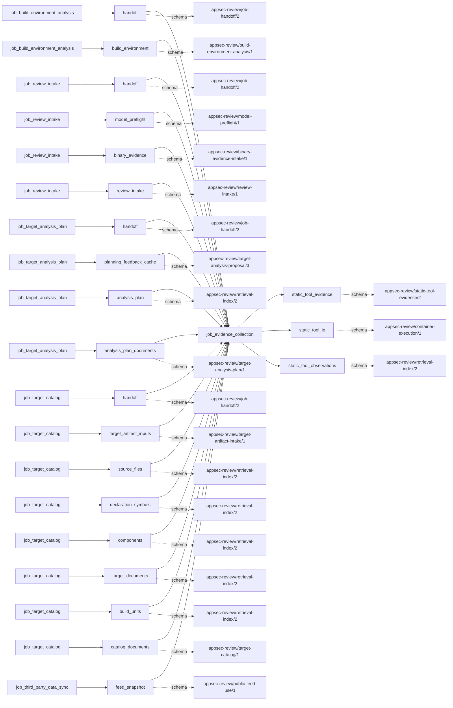

# evidence_collection

This page contains the generated contract; the authored process and acceptance description are tracked by [T-130](../TODO.md).

<!-- generated:begin job=job_evidence_collection -->
<!-- generated from: appsec-review.toml, containers/catalog.toml, pipeline/guidance/registry.json, tests/job-test-map.json, src/appsec_review/runtime/registry.py, src/appsec_review/runtime/contracts.py, src/appsec_review/runtime/datasets.py, src/appsec_review/guidance/workers.py, src/appsec_review/mcp/schema.py, src/appsec_review/orchestration/topology.py, src/appsec_review/orchestration/dagster/adapter.py by scripts/generate-docs.py; do not edit -->
## Declared job contract

evidence_collection

Job: `job_evidence_collection`. Enabled in the dev recipe: **true**.
Declarations describe possible work, not successful execution or consumed evidence.

### Steps and tasks

| Step | Task | Workers | Pool | Bound tool or gap | Handler |
| --- | --- | --- | --- | --- | --- |
| `binary_hardening` | `binary_hardening.blint_index` | 1 | `index` | Undeclared ([T-147](../TODO.md)) | [source](../../src/appsec_review/jobs/job_evidence_collection/job.py#L1334) |
| `binary_hardening` | `binary_hardening.blint_normalize` | 1 | `application` | Undeclared ([T-147](../TODO.md)) | [source](../../src/appsec_review/jobs/job_evidence_collection/job.py#L1332) |
| `binary_hardening` | `binary_hardening.blint_scan` | 1 | `scanner` | `tool-blint` | [source](../../src/appsec_review/jobs/job_evidence_collection/job.py#L1310) |
| `configuration` | `configuration.checkov_index` | 1 | `index` | Undeclared ([T-147](../TODO.md)) | [source](../../src/appsec_review/jobs/job_evidence_collection/job.py#L1334) |
| `configuration` | `configuration.checkov_normalize` | 1 | `application` | Undeclared ([T-147](../TODO.md)) | [source](../../src/appsec_review/jobs/job_evidence_collection/job.py#L1332) |
| `configuration` | `configuration.checkov_scan` | 1 | `scanner` | `tool-checkov` | [source](../../src/appsec_review/jobs/job_evidence_collection/job.py#L1310) |
| `configuration` | `configuration.hadolint_index` | 1 | `index` | Undeclared ([T-147](../TODO.md)) | [source](../../src/appsec_review/jobs/job_evidence_collection/job.py#L1334) |
| `configuration` | `configuration.hadolint_normalize` | 1 | `application` | Undeclared ([T-147](../TODO.md)) | [source](../../src/appsec_review/jobs/job_evidence_collection/job.py#L1332) |
| `configuration` | `configuration.hadolint_scan` | 1 | `scanner` | `tool-hadolint` | [source](../../src/appsec_review/jobs/job_evidence_collection/job.py#L1310) |
| `configuration` | `configuration.trivy_index` | 1 | `index` | Undeclared ([T-147](../TODO.md)) | [source](../../src/appsec_review/jobs/job_evidence_collection/job.py#L1334) |
| `configuration` | `configuration.trivy_normalize` | 1 | `application` | Undeclared ([T-147](../TODO.md)) | [source](../../src/appsec_review/jobs/job_evidence_collection/job.py#L1332) |
| `configuration` | `configuration.trivy_scan` | 1 | `scanner` | `tool-trivy` | [source](../../src/appsec_review/jobs/job_evidence_collection/job.py#L1310) |
| `configuration` | `configuration.zizmor_index` | 1 | `index` | Undeclared ([T-147](../TODO.md)) | [source](../../src/appsec_review/jobs/job_evidence_collection/job.py#L1334) |
| `configuration` | `configuration.zizmor_normalize` | 1 | `application` | Undeclared ([T-147](../TODO.md)) | [source](../../src/appsec_review/jobs/job_evidence_collection/job.py#L1332) |
| `configuration` | `configuration.zizmor_scan` | 1 | `scanner` | `tool-zizmor` | [source](../../src/appsec_review/jobs/job_evidence_collection/job.py#L1310) |
| `evidence_publication` | `evidence_publication.assemble_manifest` | 1 | `application` | Undeclared ([T-147](../TODO.md)) | [source](../../src/appsec_review/jobs/job_evidence_collection/job.py#L1340) |
| `evidence_publication` | `evidence_publication.publish_handoff` | 1 | `application` | Undeclared ([T-147](../TODO.md)) | [source](../../src/appsec_review/jobs/job_evidence_collection/job.py#L1342) |
| `secrets` | `secrets.gitleaks_index` | 1 | `index` | Undeclared ([T-147](../TODO.md)) | [source](../../src/appsec_review/jobs/job_evidence_collection/job.py#L1334) |
| `secrets` | `secrets.gitleaks_normalize` | 1 | `application` | Undeclared ([T-147](../TODO.md)) | [source](../../src/appsec_review/jobs/job_evidence_collection/job.py#L1332) |
| `secrets` | `secrets.gitleaks_scan` | 1 | `scanner` | `tool-gitleaks` | [source](../../src/appsec_review/jobs/job_evidence_collection/job.py#L1310) |
| `software_inventory` | `software_inventory.syft_index` | 1 | `index` | Undeclared ([T-147](../TODO.md)) | [source](../../src/appsec_review/jobs/job_evidence_collection/job.py#L1334) |
| `software_inventory` | `software_inventory.syft_normalize` | 1 | `application` | Undeclared ([T-147](../TODO.md)) | [source](../../src/appsec_review/jobs/job_evidence_collection/job.py#L1332) |
| `software_inventory` | `software_inventory.syft_scan` | 1 | `scanner` | `tool-syft` | [source](../../src/appsec_review/jobs/job_evidence_collection/job.py#L1310) |
| `source_sast` | `source_sast.cppcheck_index` | 1 | `index` | Undeclared ([T-147](../TODO.md)) | [source](../../src/appsec_review/jobs/job_evidence_collection/job.py#L1334) |
| `source_sast` | `source_sast.cppcheck_normalize` | 1 | `application` | Undeclared ([T-147](../TODO.md)) | [source](../../src/appsec_review/jobs/job_evidence_collection/job.py#L1332) |
| `source_sast` | `source_sast.cppcheck_scan` | 1 | `scanner` | `tool-cppcheck` | [source](../../src/appsec_review/jobs/job_evidence_collection/job.py#L1310) |
| `source_sast` | `source_sast.gosec_index` | 1 | `index` | Undeclared ([T-147](../TODO.md)) | [source](../../src/appsec_review/jobs/job_evidence_collection/job.py#L1334) |
| `source_sast` | `source_sast.gosec_normalize` | 1 | `application` | Undeclared ([T-147](../TODO.md)) | [source](../../src/appsec_review/jobs/job_evidence_collection/job.py#L1332) |
| `source_sast` | `source_sast.gosec_scan` | 1 | `scanner` | `tool-gosec` | [source](../../src/appsec_review/jobs/job_evidence_collection/job.py#L1310) |
| `source_sast` | `source_sast.mobsfscan_index` | 1 | `index` | Undeclared ([T-147](../TODO.md)) | [source](../../src/appsec_review/jobs/job_evidence_collection/job.py#L1334) |
| `source_sast` | `source_sast.mobsfscan_normalize` | 1 | `application` | Undeclared ([T-147](../TODO.md)) | [source](../../src/appsec_review/jobs/job_evidence_collection/job.py#L1332) |
| `source_sast` | `source_sast.mobsfscan_scan` | 1 | `scanner` | `tool-mobsfscan` | [source](../../src/appsec_review/jobs/job_evidence_collection/job.py#L1310) |
| `source_sast` | `source_sast.opengrep_index` | 1 | `index` | Undeclared ([T-147](../TODO.md)) | [source](../../src/appsec_review/jobs/job_evidence_collection/job.py#L1334) |
| `source_sast` | `source_sast.opengrep_normalize` | 1 | `application` | Undeclared ([T-147](../TODO.md)) | [source](../../src/appsec_review/jobs/job_evidence_collection/job.py#L1332) |
| `source_sast` | `source_sast.opengrep_scan` | 1 | `scanner` | `tool-opengrep` | [source](../../src/appsec_review/jobs/job_evidence_collection/job.py#L1310) |
| `source_sast` | `source_sast.phpcs_index` | 1 | `index` | Undeclared ([T-147](../TODO.md)) | [source](../../src/appsec_review/jobs/job_evidence_collection/job.py#L1334) |
| `source_sast` | `source_sast.phpcs_normalize` | 1 | `application` | Undeclared ([T-147](../TODO.md)) | [source](../../src/appsec_review/jobs/job_evidence_collection/job.py#L1332) |
| `source_sast` | `source_sast.phpcs_scan` | 1 | `scanner` | `tool-phpcs` | [source](../../src/appsec_review/jobs/job_evidence_collection/job.py#L1310) |
| `source_sast` | `source_sast.phpstan_index` | 1 | `index` | Undeclared ([T-147](../TODO.md)) | [source](../../src/appsec_review/jobs/job_evidence_collection/job.py#L1334) |
| `source_sast` | `source_sast.phpstan_normalize` | 1 | `application` | Undeclared ([T-147](../TODO.md)) | [source](../../src/appsec_review/jobs/job_evidence_collection/job.py#L1332) |
| `source_sast` | `source_sast.phpstan_scan` | 1 | `scanner` | `tool-phpstan` | [source](../../src/appsec_review/jobs/job_evidence_collection/job.py#L1310) |
| `source_sast` | `source_sast.pmd_index` | 1 | `index` | Undeclared ([T-147](../TODO.md)) | [source](../../src/appsec_review/jobs/job_evidence_collection/job.py#L1334) |
| `source_sast` | `source_sast.pmd_normalize` | 1 | `application` | Undeclared ([T-147](../TODO.md)) | [source](../../src/appsec_review/jobs/job_evidence_collection/job.py#L1332) |
| `source_sast` | `source_sast.pmd_scan` | 1 | `scanner` | `tool-pmd` | [source](../../src/appsec_review/jobs/job_evidence_collection/job.py#L1310) |
| `source_sast` | `source_sast.psalm_index` | 1 | `index` | Undeclared ([T-147](../TODO.md)) | [source](../../src/appsec_review/jobs/job_evidence_collection/job.py#L1334) |
| `source_sast` | `source_sast.psalm_normalize` | 1 | `application` | Undeclared ([T-147](../TODO.md)) | [source](../../src/appsec_review/jobs/job_evidence_collection/job.py#L1332) |
| `source_sast` | `source_sast.psalm_scan` | 1 | `scanner` | `tool-psalm` | [source](../../src/appsec_review/jobs/job_evidence_collection/job.py#L1310) |
| `source_sast` | `source_sast.semgrep_index` | 1 | `index` | Undeclared ([T-147](../TODO.md)) | [source](../../src/appsec_review/jobs/job_evidence_collection/job.py#L1334) |
| `source_sast` | `source_sast.semgrep_normalize` | 1 | `application` | Undeclared ([T-147](../TODO.md)) | [source](../../src/appsec_review/jobs/job_evidence_collection/job.py#L1332) |
| `source_sast` | `source_sast.semgrep_scan` | 1 | `scanner` | `tool-semgrep` | [source](../../src/appsec_review/jobs/job_evidence_collection/job.py#L1310) |
| `source_sast` | `source_sast.shellcheck_index` | 1 | `index` | Undeclared ([T-147](../TODO.md)) | [source](../../src/appsec_review/jobs/job_evidence_collection/job.py#L1334) |
| `source_sast` | `source_sast.shellcheck_normalize` | 1 | `application` | Undeclared ([T-147](../TODO.md)) | [source](../../src/appsec_review/jobs/job_evidence_collection/job.py#L1332) |
| `source_sast` | `source_sast.shellcheck_scan` | 1 | `scanner` | `tool-shellcheck` | [source](../../src/appsec_review/jobs/job_evidence_collection/job.py#L1310) |
| `source_sast` | `source_sast.spotbugs_index` | 1 | `index` | Undeclared ([T-147](../TODO.md)) | [source](../../src/appsec_review/jobs/job_evidence_collection/job.py#L1334) |
| `source_sast` | `source_sast.spotbugs_normalize` | 1 | `application` | Undeclared ([T-147](../TODO.md)) | [source](../../src/appsec_review/jobs/job_evidence_collection/job.py#L1332) |
| `source_sast` | `source_sast.spotbugs_scan` | 1 | `scanner` | `tool-spotbugs` | [source](../../src/appsec_review/jobs/job_evidence_collection/job.py#L1310) |
| `vulnerability_matching` | `vulnerability_matching.grype_index` | 1 | `index` | Undeclared ([T-147](../TODO.md)) | [source](../../src/appsec_review/jobs/job_evidence_collection/job.py#L1334) |
| `vulnerability_matching` | `vulnerability_matching.grype_normalize` | 1 | `application` | Undeclared ([T-147](../TODO.md)) | [source](../../src/appsec_review/jobs/job_evidence_collection/job.py#L1332) |
| `vulnerability_matching` | `vulnerability_matching.grype_scan` | 1 | `scanner` | `tool-grype` | [source](../../src/appsec_review/jobs/job_evidence_collection/job.py#L1310) |
| `vulnerability_matching` | `vulnerability_matching.osv_scanner_index` | 1 | `index` | Undeclared ([T-147](../TODO.md)) | [source](../../src/appsec_review/jobs/job_evidence_collection/job.py#L1334) |
| `vulnerability_matching` | `vulnerability_matching.osv_scanner_normalize` | 1 | `application` | Undeclared ([T-147](../TODO.md)) | [source](../../src/appsec_review/jobs/job_evidence_collection/job.py#L1332) |
| `vulnerability_matching` | `vulnerability_matching.osv_scanner_scan` | 1 | `scanner` | `tool-osv-scanner` | [source](../../src/appsec_review/jobs/job_evidence_collection/job.py#L1310) |

### Accepted input declarations

| Producer | Dataset | Schema | Channel | Availability | Missing policy |
| --- | --- | --- | --- | --- | --- |
| `job_build_environment_analysis` | `handoff` | `appsec-review/job-handoff/2` | handoff | optional | gap |
| `job_build_environment_analysis` | `build_environment` | `appsec-review/build-environment-analysis/1` | handoff | optional | gap |
| `job_review_intake` | `handoff` | `appsec-review/job-handoff/2` | handoff | optional | gap |
| `job_review_intake` | `model_preflight` | `appsec-review/model-preflight/1` | handoff | optional | gap |
| `job_review_intake` | `binary_evidence` | `appsec-review/binary-evidence-intake/1` | handoff | optional | gap |
| `job_review_intake` | `review_intake` | `appsec-review/review-intake/1` | handoff | optional | gap |
| `job_target_analysis_plan` | `handoff` | `appsec-review/job-handoff/2` | handoff | optional | gap |
| `job_target_analysis_plan` | `planning_feedback_cache` | `appsec-review/target-analysis-proposal/3` | handoff | optional | gap |
| `job_target_analysis_plan` | `analysis_plan` | `appsec-review/retrieval-index/2` | handoff | optional | gap |
| `job_target_analysis_plan` | `analysis_plan_documents` | `appsec-review/target-analysis-plan/1` | handoff | optional | gap |
| `job_target_catalog` | `handoff` | `appsec-review/job-handoff/2` | handoff | optional | gap |
| `job_target_catalog` | `target_artifact_inputs` | `appsec-review/target-artifact-intake/1` | handoff | optional | gap |
| `job_target_catalog` | `source_files` | `appsec-review/retrieval-index/2` | handoff | optional | gap |
| `job_target_catalog` | `declaration_symbols` | `appsec-review/retrieval-index/2` | handoff | optional | gap |
| `job_target_catalog` | `components` | `appsec-review/retrieval-index/2` | handoff | optional | gap |
| `job_target_catalog` | `target_documents` | `appsec-review/retrieval-index/2` | handoff | optional | gap |
| `job_target_catalog` | `build_units` | `appsec-review/retrieval-index/2` | handoff | optional | gap |
| `job_target_catalog` | `catalog_documents` | `appsec-review/target-catalog/1` | handoff | optional | gap |
| `job_third_party_data_sync` | `feed_snapshot` | `appsec-review/public-feed-use/1` | external | optional | gap |

### Published dataset declarations

| Dataset | Step | Schema | Stage | Indexes | MCP route |
| --- | --- | --- | --- | --- | --- |
| `static_tool_evidence` | `evidence_publication` | `appsec-review/static-tool-evidence/2` | artifact_only | Not indexed | `coverage`, `query_dataset_inventory` |
| `static_tool_io` | `source_sast` | `appsec-review/container-execution/1` | protected | Not indexed | `coverage`, `query_dataset_inventory` |
| `static_tool_observations` | `evidence_publication` | `appsec-review/retrieval-index/2` | indexed | `observations` | `find`, `query_precomputed`, `search` |

Protected and artifact-only routes expose sanitized metadata, not payload access.

### Model and guidance declarations

No job-level model declaration; absence of a task binding remains [T-147](../TODO.md), not a nonexecution claim.

### Test selection

| Tier | Files or selectors |
| --- | --- |
| acceptance | None declared |
| integration | `tests/integration/test_signal_job_acceptance.py` |
| live | None declared |
| unit | `tests/test_evidence_collection_job.py` |

### Dagster placement

Dispatch: `review_graph`. Review graph member: **true**. Enabled graph member: **true**.

Declared predecessors: `job_target_analysis_plan`.

### Declared dataflow

<!-- generated:end -->
